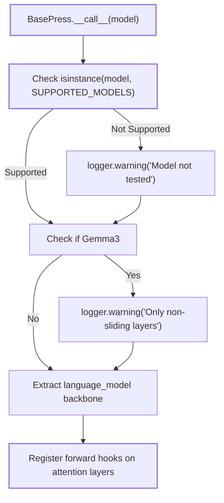
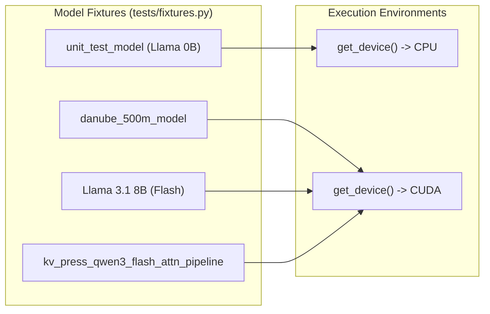

<!-- source: DeepWiki mcp.deepwiki.com · repo NVIDIA/kvpress · page 4.5 Model Compatibility · fetched 2026-10-26 -->

# Model Compatibility

<details>
<summary>Relevant source files</summary>

The following files were used as context for generating this wiki page:

- [kvpress/attention_patch.py](kvpress/attention_patch.py)
- [kvpress/presses/base_press.py](kvpress/presses/base_press.py)
- [kvpress/presses/decoding_press.py](kvpress/presses/decoding_press.py)
- [kvpress/presses/prefill_decoding_press.py](kvpress/presses/prefill_decoding_press.py)
- [notebooks/speed_and_memory.ipynb](notebooks/speed_and_memory.ipynb)
- [notebooks/wikipedia_demo.ipynb](notebooks/wikipedia_demo.ipynb)
- [tests/fixtures.py](tests/fixtures.py)
- [tests/integration/test_ruler.py](tests/integration/test_ruler.py)
- [tests/test_attention_patch.py](tests/test_attention_patch.py)

</details>


## Purpose and Scope

This document describes the model architectures and configurations supported by KVPress, including officially tested models, attention implementation requirements, and model-specific compatibility considerations. KVPress relies on patching the `transformers` library's attention functions and registering forward hooks to enable head-wise compression. For information about using presses with models, see [Using KVPress](#4).

---

## Officially Supported Model Architectures

KVPress defines a set of officially supported and tested model architectures in `SUPPORTED_MODELS`. The system performs runtime validation when presses are applied to models.

**Supported Model Classes:**

| Model Class | Architecture Family | Notes |
|------------|-------------------|-------|
| `LlamaForCausalLM` | Llama 2, Llama 3, Llama 3.1, Llama 3.2 | Fully supported [kvpress/presses/base_press.py:28]() |
| `MistralForCausalLM` | Mistral | Fully supported [kvpress/presses/base_press.py:29]() |
| `Phi3ForCausalLM` | Phi-3 | Fully supported [kvpress/presses/base_press.py:30]() |
| `Qwen2ForCausalLM` | Qwen 2 | Fully supported [kvpress/presses/base_press.py:31]() |
| `Qwen3ForCausalLM` | Qwen 3 | Fully supported [kvpress/presses/base_press.py:32]() |
| `Gemma3ForConditionalGeneration` | Gemma 3 | Partial support (skips sliding window layers) [kvpress/presses/base_press.py:33]() |

### Validation Logic

When a press is applied using the context manager pattern via `BasePress.__call__`, the system checks model compatibility and navigates the model structure to find the language model backbone.

Title: Model Compatibility Validation Flow


**Sources:** [kvpress/presses/base_press.py:27-34](), [kvpress/presses/base_press.py:182-197]()

---

## Attention Implementation Compatibility

KVPress supports multiple attention implementations through the transformers library's `attn_implementation` parameter. At import time, `patch_attention_functions()` is called to wrap all registered attention functions in `ALL_ATTENTION_FUNCTIONS`.

### The Attention Patching Mechanism

KVPress patches attention functions to support "fake" head-wise compression during the decoding phase. Since some attention kernels (like Flash Attention) do not natively support different KV lengths per head, KVPress uses a hyperplane search via `search_hyperplane` to find "fake keys" that result in zero attention scores.

Title: Attention Function Patching Architecture
```mermaid
graph TD
    Patch["patch_attention_functions()"]
    Reg["ALL_ATTENTION_FUNCTIONS"]
    Wrapper["attention_patch(func) wrapper"]
    Search["search_hyperplane(query)"]
    
    Patch -->|Iterates| Reg
    Reg -->|Wrapped by| Wrapper
    Wrapper -->|If decoding & masked_key_indices| Search
    Search -->|Returns k s.t. exp(q,k)≈0| Wrapper
    Wrapper -->|Execute| func["Original Attention Func"]
```

**Sources:** [kvpress/attention_patch.py:43-87](), [kvpress/attention_patch.py:90-110](), [kvpress/attention_patch.py:8-40]()

### Supported Attention Implementations

| Implementation | Parameter Value | Behavior in KVPress |
|----------------|-----------------|---------------------|
| **Eager** | `"eager"` | Provides `attentions` weights directly to `ScorerPress`. Best for transparency. [tests/fixtures.py:22-26]() |
| **Flash Attention 2** | `"flash_attention_2"` | Highly optimized. Requires patching to handle head-wise masking. [kvpress/attention_patch.py:81-85]() |
| **SDPA** | `"sdpa"` | PyTorch native scaled dot product. |

---

## Model-Specific Considerations

### Gemma3 Sliding Window Attention

Gemma3 models utilize sliding window attention in specific layers. KVPress compression is currently incompatible with these layers, so they are automatically excluded during the hook registration process in `BasePress.__call__`.

**Implementation Detail:**
[kvpress/presses/base_press.py:192-195]()
```python
for layer in language_model.layers:
    if isinstance(model, Gemma3ForConditionalGeneration) and layer.self_attn.is_sliding:
        # Skip layers with sliding window attention, only for Gemma3
        continue
```

### Qwen3 and Llama 3.x Testing

The testing suite explicitly targets modern architectures like Qwen3 and Llama 3.1/3.2 using Flash Attention 2 to ensure production readiness.

**Example Fixture:**
[tests/fixtures.py:104-117]()
```python
@pytest.fixture(scope="class")
def kv_press_qwen3_flash_attn_pipeline():
    ckpt = "Qwen/Qwen3-4B-Instruct-2507"
    # ... setup with flash_attention_2 and bfloat16
```

---

## Press-Specific Model Requirements

### Universal vs. Specialized Presses

| Press Category | Examples | Compatibility Requirements |
|----------------|----------|----------------------------|
| **Universal** | `RandomPress`, `KnormPress` | Works on any `SUPPORTED_MODELS`. |
| **Score-Based** | `SnapKVPress`, `ExpectedAttentionPress` | Requires attention weights or recomputation logic. |
| **Learned** | `QFilterPress` | **Restricted**: Currently does not support Qwen3; tested specifically with Llama 3.2. [tests/integration/test_ruler.py:60-62]() |
| **Phase-Specific** | `DecodingPress` | Wraps a `ScorerPress` or `AdaKVPress` to apply compression every `compression_interval` steps during decoding. [kvpress/presses/decoding_press.py:22-49]() |

**Sources:** [kvpress/presses/decoding_press.py:22-49](), [tests/integration/test_ruler.py:60-62]()

---

## Testing Infrastructure for Model Compatibility

KVPress uses a robust fixture system in `tests/fixtures.py` to validate compatibility across devices and attention backends.

Title: Test Fixture to Hardware Mapping


### Adaptive Pipelines
The `kv_press_adaptive_pipeline` fixture dynamically selects `flash_attention_2` if `torch.cuda.is_available()` is true, otherwise falling back to standard implementations.

**Sources:** [tests/fixtures.py:10-18](), [tests/fixtures.py:52-70]()

---

## Untested Model Architectures

While KVPress targets the most popular open-source LLMs, it can potentially support any decoder-only model that follows the standard `transformers` architecture.

**The system expects:**
1. A `model.layers` attribute containing transformer blocks.
2. A `self_attn` module within each block.
3. Standard `kwargs` in the forward pass including `hidden_states`, `past_key_values`, and `cache_position`. [kvpress/presses/base_press.py:139-143]()

If a model is not in `SUPPORTED_MODELS`, KVPress will issue a `logger.warning` but will still attempt to apply the press hooks.

**Sources:** [kvpress/presses/base_press.py:182-197](), [kvpress/presses/base_press.py:27-34]()

---

