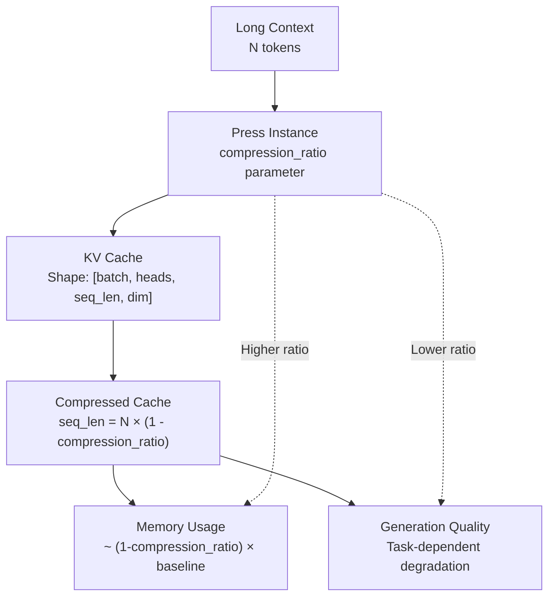
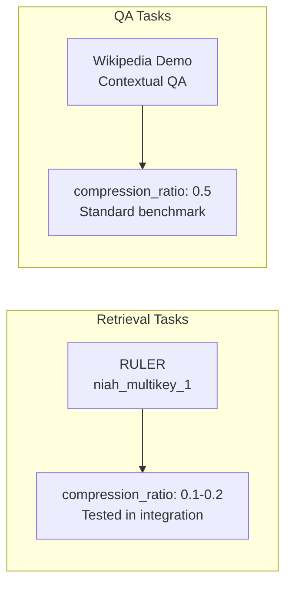
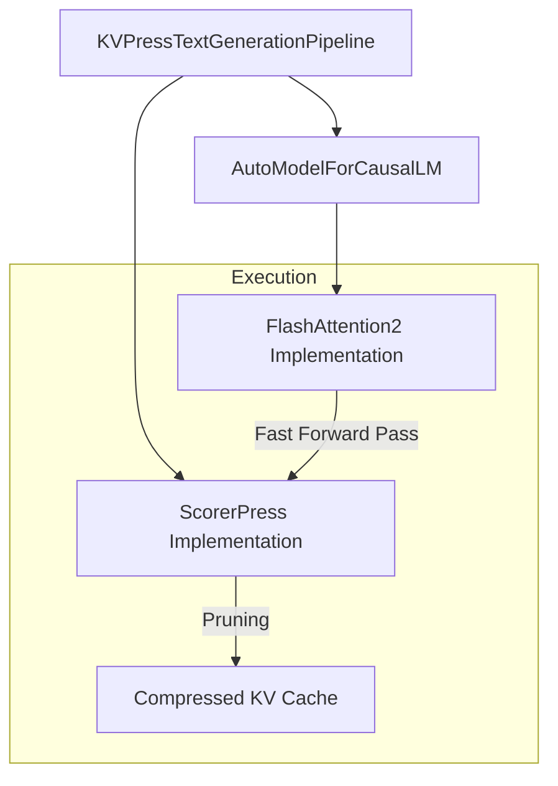
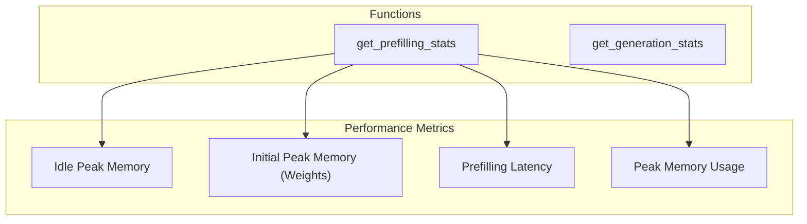

<!-- source: DeepWiki mcp.deepwiki.com · repo NVIDIA/kvpress · page 4.6 Performance Considerations · fetched 2026-10-26 -->

# Performance Considerations

<details>
<summary>Relevant source files</summary>

The following files were used as context for generating this wiki page:

- [README.md](README.md)
- [notebooks/speed_and_memory.ipynb](notebooks/speed_and_memory.ipynb)
- [notebooks/wikipedia_demo.ipynb](notebooks/wikipedia_demo.ipynb)
- [pyproject.toml](pyproject.toml)
- [tests/fixtures.py](tests/fixtures.py)
- [tests/integration/test_ruler.py](tests/integration/test_ruler.py)

</details>


This page discusses performance optimization strategies when using `kvpress`, including memory-quality tradeoffs, computational overhead, hardware acceleration options, and profiling techniques. For pipeline usage patterns, see [KVPressTextGenerationPipeline](). For cache types and lifecycle, see [Cache Management](). For evaluation metrics and benchmarking, see [Evaluation Framework]().

---

## Memory-Quality Tradeoff

The fundamental performance consideration in KV cache compression is the tradeoff between memory reduction and generation quality. Deploying long-context LLMs is primarily constrained by the linear growth of the KV cache; for instance, Llama 3.1-70B requires ~330GB for 1M tokens in float16 [[README.md:12-13]]().

The memory savings are approximately:

```
Memory Saved ≈ compression_ratio × KV_cache_size
```

### Compression Ratio Impact

| Compression Ratio | Memory Reduction | Typical Quality Impact | Use Case |
|------------------|------------------|----------------------|----------|
| 0.8-0.9 | 10-20% | Minimal degradation | Production systems requiring high accuracy |
| 0.5-0.7 | 30-50% | Moderate degradation | Balanced performance-quality scenarios |
| 0.2-0.4 | 60-80% | Significant degradation | Memory-constrained environments, retrieval tasks |
| <0.2 | 80%+ | Severe degradation | Experimental or highly selective applications |

Different press implementations exhibit different quality-compression curves. Methods like `ExpectedAttentionPress` maintain higher quality at aggressive compression ratios compared to `RandomPress` [[notebooks/wikipedia_demo.ipynb:104-108]]().



**Sources:** [[README.md:12-13]](), [[notebooks/wikipedia_demo.ipynb:104-108]](), [[tests/integration/test_ruler.py:29-30]]()

---

## Compression Ratio Selection Strategy

Selecting an appropriate compression ratio depends on the specific task, model, and phase (prefilling vs. decoding).

### Task-Specific Recommendations



### Decoding Compression Performance
While standard presses compress during the prefilling phase, `DecodingPress` introduces periodic compression during generation [[README.md:58-60]](). 
- **`compression_interval`**: Steps between compressions (default: 512) [[README.md:63]]().
- **`target_size`**: The cache is compressed to a fixed size, meaning the compression ratio is dynamic based on current sequence length [[README.md:67]]().
- **`hidden_states_buffer_size`**: Buffering hidden states (default: 256) adds a small memory overhead but is required for certain scoring methods [[README.md:65]]().

**Sources:** [[README.md:58-67]](), [[tests/integration/test_ruler.py:29-30]](), [[notebooks/wikipedia_demo.ipynb:105-106]]()

---

## Flash Attention 2 Integration

Flash Attention 2 provides significant performance improvements. `kvpress` supports Flash Attention 2 for compatible models like Llama 3.1, Llama 3.2, and Qwen3 [[tests/fixtures.py:73-118]]().

### Integration Example
To enable high-performance kernels, pass `attn_implementation="flash_attention_2"` in `model_kwargs` [[README.md:79-80]]().

```python
model_kwargs = {"attn_implementation": "flash_attention_2"}
pipe = pipeline("kv-press-text-generation", model=model, model_kwargs=model_kwargs)
```

### Flash Attention Compatibility
- **Compatible**: `KnormPress`, `LagKVPress`, `KeyDiffPress`. These are query-free or attention-weight free [[README.md:106-115]]().
- **Incompatible/Requires Eager**: `ObservedAttentionPress` often requires "eager" implementation to access full attention weights [[notebooks/wikipedia_demo.ipynb:63]]().



**Sources:** [[README.md:79-80]](), [[tests/fixtures.py:73-118]](), [[notebooks/wikipedia_demo.ipynb:63-64]]()

---

## Cache Quantization

`kvpress` supports combining token eviction with cache quantization via `transformers.QuantizedCache` [[tests/integration/test_ruler.py:9-10]]().

### Combined Performance Benefits
Memory reduction is multiplicative. Using a 4-bit `quanto` backend with a 0.5 compression ratio can reduce the KV cache size by ~8x compared to uncompressed FP16 [[notebooks/speed_and_memory.ipynb:127-128]]().

| Cache Type | Backend | Precision | Notes |
|------------|---------|-----------|-------|
| `DynamicCache` | Native | FP16/BF16 | Standard performance [[tests/integration/test_ruler.py:47]]() |
| `QuantizedCache` | `quanto` | 4-bit | Requires `optimum-quanto` [[tests/integration/test_ruler.py:48-49]]() |

### Implementation Detail: Size Calculation
Calculating the size of a `QuantizedCache` is non-trivial because accessing internal tensors can trigger unpacking. The library uses a serialization-based measurement to determine the actual storage footprint on disk [[notebooks/speed_and_memory.ipynb:73-86]]().

**Sources:** [[tests/integration/test_ruler.py:46-53]](), [[notebooks/speed_and_memory.ipynb:73-86]](), [[notebooks/speed_and_memory.ipynb:127-128]]()

---

## Computational Overhead

The computational cost of compression varies by press logic.

| Press | Mechanism | Computational Cost |
|-------|-----------|--------------------|
| `RandomPress` | Random selection | Negligible [[README.md:105]]() |
| `KnormPress` | Key norm calculation | Low (O(N)) [[README.md:106]]() |
| `SnapKVPress` | Average of last queries | Moderate [[README.md:107]]() |
| `QFilterPress` | SVD projection of keys | High (Matrix projection) [[README.md:112]]() |
| `KVzipPress` | Context reconstruction | Very High (Model-based) [[README.md:120]]() |

### Latency Monitoring
To measure overhead, the system tracks `Prefilling time` (latency to process context and compress) and `Peak memory usage` [[notebooks/speed_and_memory.ipynb:144-147]]().



**Sources:** [[README.md:105-120]](), [[notebooks/speed_and_memory.ipynb:109-151]]()

---

## Hardware and Dependencies

- **GPU Memory**: Integration tests for `KVComposePress` are often skipped in restricted environments (like GitHub Actions) due to high GPU memory requirements [[tests/integration/test_ruler.py:63-64]]().
- **Python Version**: Requires `python >= 3.10` [[pyproject.toml:11]]().
- **Optional Extras**: Use `uv sync --extra flash-attn` for high-performance kernels and `--extra eval` for benchmarking [[README.md:34-35]]().

**Sources:** [[pyproject.toml:11-38]](), [[README.md:34-35]](), [[tests/integration/test_ruler.py:63-64]]()

---

