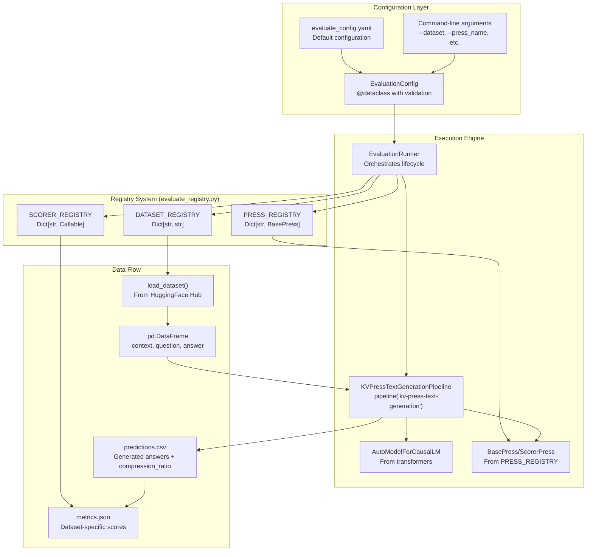
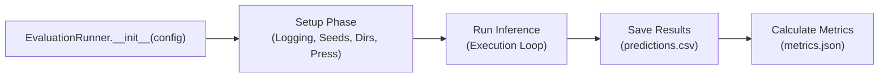
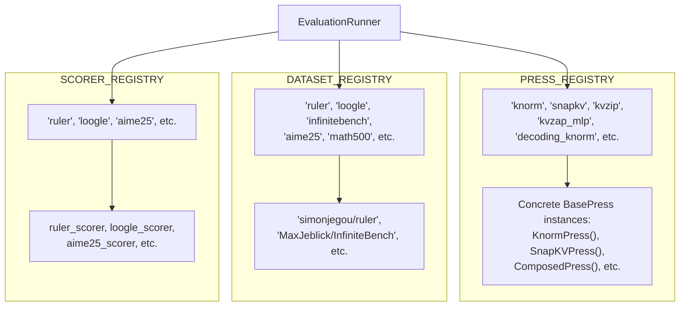

<!-- source: DeepWiki mcp.deepwiki.com · repo NVIDIA/kvpress · page 5 Evaluation Framework · fetched 2026-10-26 -->

# Evaluation Framework

Relevant source files

The following files were used as context for generating this wiki page:

- [evaluation/README.md](evaluation/README.md)
- [evaluation/evaluate.py](evaluation/evaluate.py)
- [evaluation/evaluate_config.yaml](evaluation/evaluate_config.yaml)
- [evaluation/evaluate_registry.py](evaluation/evaluate_registry.py)
- [kvzap/README.md](kvzap/README.md)

The Evaluation Framework provides a comprehensive system for benchmarking KV cache compression methods (presses) across multiple long-context datasets. It orchestrates the entire evaluation lifecycle from configuration loading through model inference to metric calculation and result storage.

For details on using the framework, see [Running Evaluations](#5.4). For information on creating custom presses to evaluate, see [Custom Press Development](#3.6). For details on the core pipeline used during evaluation, see [KVPressTextGenerationPipeline](#4.1).

## Architecture Overview

The evaluation system is built around three main components: a **configuration system** that manages evaluation parameters through `EvaluationConfig`, a **registry system** in `evaluate_registry.py` that provides centralized access to presses, datasets, and metrics, and an **execution engine** implemented by `EvaluationRunner` that orchestrates the evaluation workflow.

**Evaluation Architecture**: The entry point merges configuration from YAML and CLI, validates it through `EvaluationConfig.__post_init__()` [evaluation/evaluate.py:80-110](), then passes it to `EvaluationRunner` which coordinates registry lookups, model pipeline setup via `pipeline()`, inference execution, and metrics calculation.

Sources: [evaluation/evaluate.py:38-161](), [evaluation/evaluate.py:188-207](), [evaluation/evaluate_registry.py:52-137](), [evaluation/README.md:3-36]()

## Core Components

### EvaluationConfig

The `EvaluationConfig` dataclass [evaluation/evaluate.py:38-79]() centralizes all evaluation parameters and provides validation logic through its `__post_init__()` method. It supports configuration from multiple sources with a priority hierarchy: defaults → YAML file → CLI arguments.

| Parameter Category | Key Parameters | Description |
|-------------------|----------------|-------------|
| **Core Settings** | `dataset`, `model`, `press_name`, `compression_ratio` | Defines what to evaluate |
| **Press-Specific** | `key_channel_compression_ratio`, `threshold` | For `ThinKPress` and `DMSPress` |
| **Dataset Control** | `fraction`, `max_context_length`, `query_aware` | Controls dataset sampling and processing |
| **Generation** | `max_new_tokens`, `needle_depth` | Controls text generation behavior |
| **Decoding** | `compression_interval`, `target_size`, `hidden_states_buffer_size` | For `DecodingPress` configurations |
| **Output** | `output_dir`, `log_level` | Controls logging and result storage |
| **Reproducibility** | `seed` | Ensures deterministic results |
| **Quantization** | `fp8` | Enables FP8 quantization via `FineGrainedFP8Config` |

The configuration validates itself on initialization [evaluation/evaluate.py:80-110](), checking that the dataset and scorer exist in `DATASET_REGISTRY` and `SCORER_REGISTRY` [evaluation/evaluate.py:83-84](), and the press exists in `PRESS_REGISTRY` [evaluation/evaluate.py:87]().

Sources: [evaluation/evaluate.py:38-110](), [evaluation/evaluate_config.yaml:4-28]()

### EvaluationRunner

The `EvaluationRunner` class [evaluation/evaluate.py:188-207]() (partially shown) orchestrates the complete evaluation workflow. It manages state across the evaluation lifecycle and coordinates interactions between the pipeline, press, dataset, and scorer components.

**Evaluation Lifecycle**: The runner orchestrates initialization, setup, inference, and metrics calculation in sequence. It typically includes checks for existing results to avoid redundant computation as indicated in the documentation strings [evaluation/evaluate.py:198-199]().

Sources: [evaluation/evaluate.py:188-207]()

### Registry System

The registry system in `evaluate_registry.py` provides centralized lookup tables for presses, datasets, and scoring functions.

The `PRESS_REGISTRY` [evaluation/evaluate_registry.py:80-137]() contains over 50 pre-configured press combinations, including complex wrappers like `AdaKVPress`, `CriticalKVPress`, `CAMPress`, `DMSPress`, and `DecodingPress`.

Sources: [evaluation/evaluate_registry.py:52-137](), [evaluation/evaluate.py:18]()

## Supported Datasets

The framework supports a wide variety of standard popular benchmarks [evaluation/README.md:44-53]():

- **RULER**: Evaluates long-context needle retrieval [evaluation/evaluate_registry.py:54]().
- **Loogle**: Long-context understanding benchmark [evaluation/evaluate_registry.py:53]().
- **Zero Scrolls**: Zero-shot long-context reasoning [evaluation/evaluate_registry.py:55]().
- **InfiniteBench**: Benchmarking extremely long context [evaluation/evaluate_registry.py:56]().
- **LongBench / LongBench-v2**: Comprehensive long-context benchmarks [evaluation/evaluate_registry.py:57-59]().
- **Needle in a Haystack**: Testing retrieval capabilities [evaluation/evaluate_registry.py:60]().
- **AIME25 / Math500**: Mathematical reasoning datasets, used for evaluating decoding-phase compression [evaluation/evaluate_registry.py:62-63]().

Each dataset is associated with a specific scoring function in `SCORER_REGISTRY` [evaluation/evaluate_registry.py:66-77]().

Sources: [evaluation/evaluate_registry.py:52-77](), [evaluation/README.md:44-70]()

## Special Evaluation Modules

### KVzap Training and Evaluation
The `kvzap` directory contains tools for surrogate model training and evaluation [kvzap/README.md:1-62]().
- **Training**: Uses surrogate models (MLP/Linear) to predict `KVzip+` scores, enabling `DMSPress` (threshold-based) pruning [kvzap/README.md:5-6](). Training utilizes the `Nemotron-Pretraining-Dataset-sample` [kvzap/README.md:41]().
- **AIME25 Evaluation**: A dedicated `evaluate_aime.py` script is provided to evaluate KVzap on mathematical benchmarks using `model.generate` directly, supporting sampling-based decoding [kvzap/README.md:56-60]().

### Configuration and CLI
Evaluation is typically launched via `evaluate.py` [evaluation/README.md:10-15](). Settings can be provided via `evaluate_config.yaml` or overridden through command-line arguments [evaluation/README.md:16-26](). Multi-GPU orchestration is supported via the `evaluate.sh` shell script [evaluation/README.md:73-74]().

---

For detailed information on specific aspects of the evaluation framework, see:
- [Evaluation Overview](#5.1) — Runner architecture and lifecycle
- [Supported Datasets](#5.2) — Benchmark details and structures
- [Configuration and Registry System](#5.3) — Registry lookups and override hierarchy
- [Running Evaluations](#5.4) — Practical guide to CLI and multi-GPU usage
- [Evaluation Metrics](#5.5) — Scoring functions and result formats
- [Leaderboard Submission](#5.6) — Reproducibility and submission guide
- [KVzap Training and Evaluation](#5.7) — Surrogate model training and AIME25 evaluation

---

