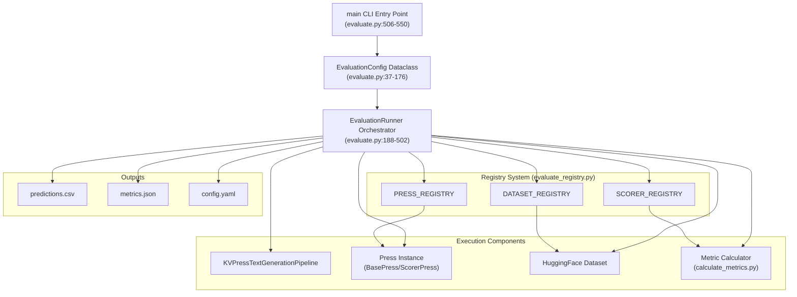
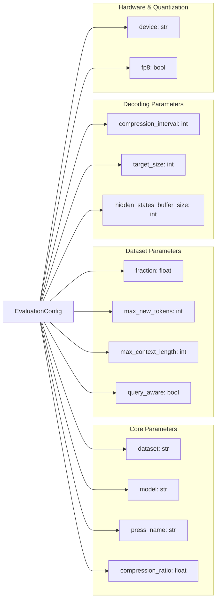
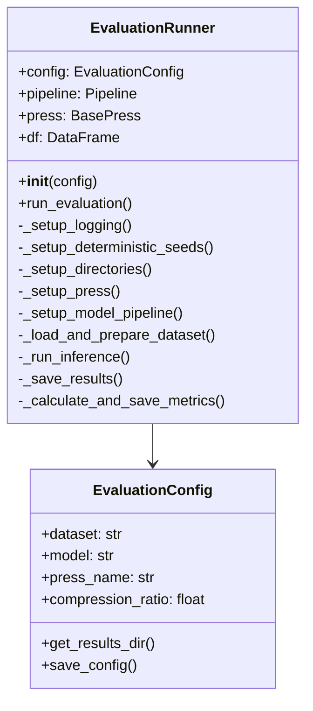
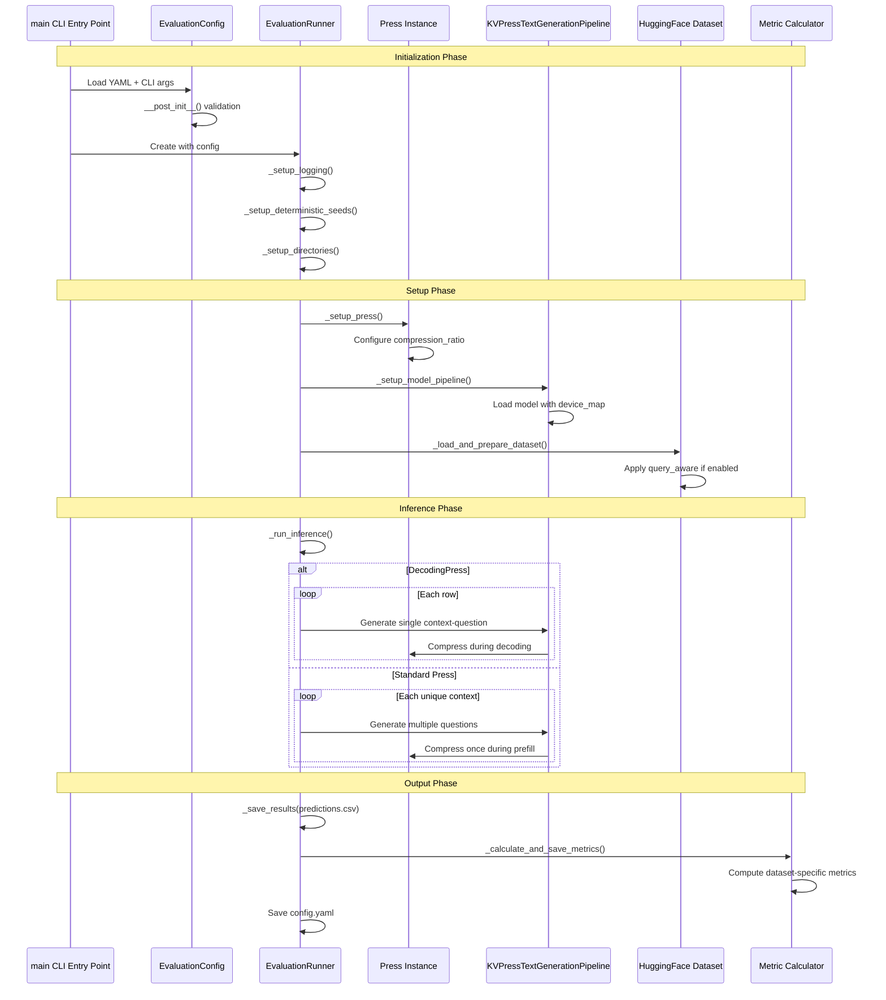
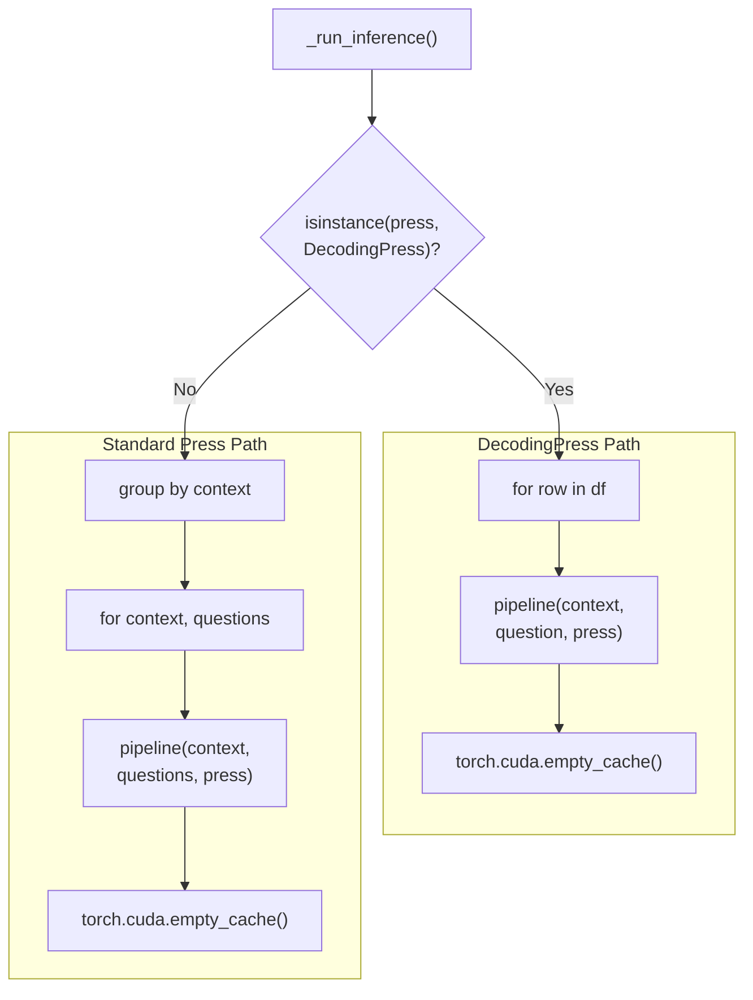
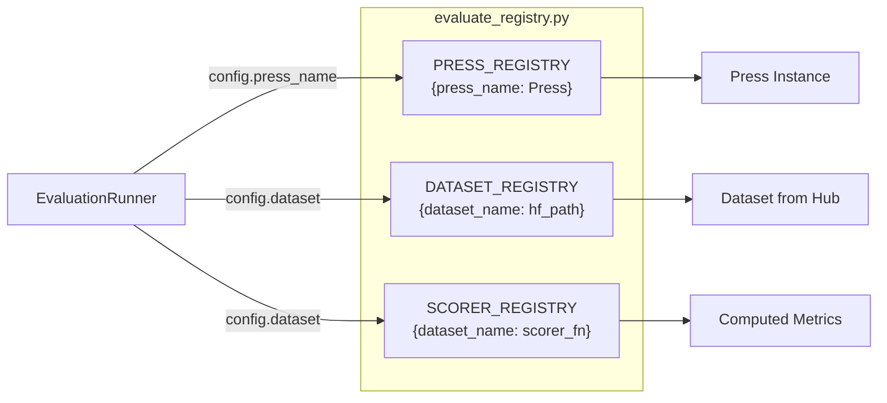
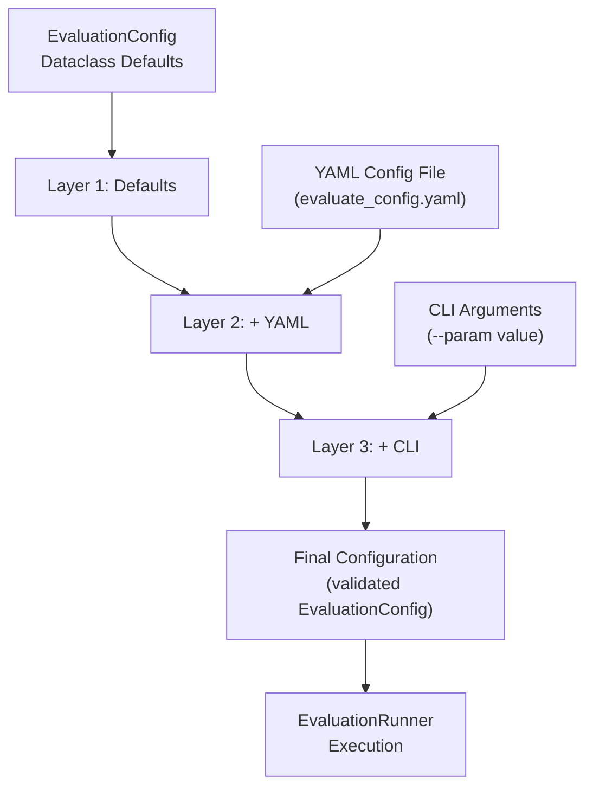

<!-- source: DeepWiki mcp.deepwiki.com · repo NVIDIA/kvpress · page 5.1 Evaluation Overview · fetched 2026-10-26 -->

# Evaluation Overview

<details>
<summary>Relevant source files</summary>

The following files were used as context for generating this wiki page:

- [evaluation/README.md](evaluation/README.md)
- [evaluation/evaluate.py](evaluation/evaluate.py)
- [evaluation/evaluate_config.yaml](evaluation/evaluate_config.yaml)
- [kvzap/README.md](kvzap/README.md)

</details>


This document explains the architecture and operation of the KVPress evaluation system. The evaluation framework provides systematic benchmarking of compression methods across multiple long-context datasets, enabling quantitative comparison of different press implementations.

For details on specific datasets, see [Supported Datasets](#5.2). For configuration file syntax and registry details, see [Configuration and Registry System](#5.3). For practical usage instructions, see [Running Evaluations](#5.4).

## Purpose and Scope

The evaluation system orchestrates the complete workflow for benchmarking KV cache compression methods:

1.  **Configuration Management** - Merge defaults, YAML files, and CLI arguments into a validated configuration.
2.  **Press Setup** - Instantiate and configure compression methods from the registry.
3.  **Model Pipeline** - Load transformer models with appropriate device and attention implementations.
4.  **Dataset Loading** - Load benchmark datasets with a standardized schema.
5.  **Inference Execution** - Run generation with compression enabled.
6.  **Metrics Calculation** - Compute dataset-specific performance metrics.
7.  **Results Storage** - Save predictions and metrics for analysis.

The system is implemented primarily in [evaluation/evaluate.py:1-550](). The entry point accepts configuration via a YAML file [evaluation/evaluate_config.yaml:1-28]() or CLI overrides.

## System Architecture

The evaluation system follows a layered architecture with three primary components: configuration, orchestration, and registry lookup.

### High-Level Components



**Sources:** [evaluation/evaluate.py:1-550](), [evaluation/README.md:1-77](), [evaluation/evaluate_registry.py:1-100]()

### Configuration Layer

The `EvaluationConfig` dataclass [evaluation/evaluate.py:37-176]() manages all evaluation parameters with validation and hierarchical override:

| Configuration Source | Priority | Purpose |
| :--- | :--- | :--- |
| Dataclass defaults | Lowest | Baseline values for all parameters [evaluation/evaluate.py:42-79]() |
| YAML file (`evaluate_config.yaml`) | Medium | Project-specific configurations [evaluation/evaluate.py:178-186]() |
| CLI arguments | Highest | Runtime overrides [evaluation/evaluate.py:527-540]() |

**Key Configuration Parameters:**



The configuration validates all parameters in `__post_init__` [evaluation/evaluate.py:80-110](), checking registry membership, compression ratio bounds, and dataset-specific requirements (e.g., `needle_depth` for `needle_in_haystack` [evaluation/evaluate.py:107-109]()).

**Sources:** [evaluation/evaluate.py:37-176](), [evaluation/evaluate_config.yaml:1-28]()

## EvaluationRunner Architecture

The `EvaluationRunner` class [evaluation/evaluate.py:188-502]() orchestrates the complete evaluation workflow. It maintains state for the pipeline, press, and dataset, and executes the evaluation phases sequentially.

### Class Structure



The runner follows a strict initialization order:

1.  **Logging Setup** [evaluation/evaluate.py:222-229]() - Configure log levels and handlers.
2.  **Seed Initialization** [evaluation/evaluate.py:209-220]() - Set deterministic seeds for reproducibility.
3.  **Directory Creation** [evaluation/evaluate.py:231-243]() - Create output directory structure via `get_results_dir`.
4.  **Press Setup** [evaluation/evaluate.py:245-299]() - Instantiate and configure the compression method.
5.  **Model Pipeline** [evaluation/evaluate.py:343-378]() - Load the model with device mapping and quantization.
6.  **Dataset Loading** [evaluation/evaluate.py:301-341]() - Load and prepare benchmark data.

**Sources:** [evaluation/evaluate.py:188-502]()

### Press Configuration Logic

The `_setup_press` method [evaluation/evaluate.py:245-299]() handles press-specific configuration with type-based branching:

| Press Type | Configuration Logic | Source Lines |
| :--- | :--- | :--- |
| `DuoAttentionPress` | Set `head_compression_ratio` | [evaluation/evaluate.py:256-258]() |
| `ComposedPress` | Configure component presses individually | [evaluation/evaluate.py:259-275]() |
| `ThinKPress` | Set `key_channel_compression_ratio` | [evaluation/evaluate.py:276-279]() |
| `DecodingPress` | Configure interval, target size, and buffer | [evaluation/evaluate.py:280-286]() |
| Generic `ScorerPress` | Set `compression_ratio` attribute | [evaluation/evaluate.py:287-294]() |

**Sources:** [evaluation/evaluate.py:245-299]()

## Evaluation Lifecycle

The evaluation proceeds through distinct phases, each implemented as a method in `EvaluationRunner`.

### Execution Flow Diagram



**Sources:** [evaluation/evaluate.py:476-502]()

### Inference Execution

The `_run_inference` method [evaluation/evaluate.py:380-436]() handles two distinct execution paths:

**Path 1: DecodingPress** [evaluation/evaluate.py:388-404]()
- Iterate over each context-question pair individually.
- Generate one answer at a time with decoding-phase compression.
- Clear CUDA cache after each generation to prevent OOM.
- Required for methods that compress during token generation (e.g., `DMSPress`).

**Path 2: Standard Press** [evaluation/evaluate.py:406-434]()
- Group questions by shared context using `df.groupby("context")`.
- Process all questions for a context in a single pipeline call.
- Compress once during the prefill phase.
- Reuse the compressed cache across multiple questions.
- More efficient for prefill-only compression methods.



**Sources:** [evaluation/evaluate.py:380-436]()

## Registry Integration

The evaluation system queries three registries for component lookup:



The registries are imported at [evaluation/evaluate.py:18]() and queried during:

-   **Press Setup** [evaluation/evaluate.py:253]() - Retrieve press instance by name.
-   **Dataset Loading** [evaluation/evaluate.py:310]() - Get HuggingFace dataset path.
-   **Metrics Calculation** [evaluation/evaluate.py:465]() - Get dataset-specific scorer function.

**Sources:** [evaluation/evaluate.py:18](), [evaluation/evaluate.py:245-299](), [evaluation/evaluate.py:301-341](), [evaluation/evaluate.py:455-474]()

## Results Output

The `EvaluationRunner` generates a unique output directory based on configuration parameters [evaluation/evaluate.py:111-161]():

**Directory Naming Pattern:**
`{dataset}__{data_dir}__{model}__{press_name}__{compression_ratio}[__{optional_params}]` [evaluation/evaluate.py:126-149]()

**Generated Files:**

| File | Content | Method |
| :--- | :--- | :--- |
| `predictions.csv` | Generated answers and compression ratios | `_save_results()` [evaluation/evaluate.py:438-453]() |
| `metrics.json` | Dataset-specific performance scores | `_calculate_and_save_metrics()` [evaluation/evaluate.py:455-474]() |
| `config.yaml` | Full evaluation configuration (for reproducibility) | `save_config()` [evaluation/evaluate.py:163-176]() |

The system automatically skips evaluation if both predictions and metrics files exist [evaluation/evaluate.py:488-492](), enabling safe resumption of interrupted benchmark runs.

**Sources:** [evaluation/evaluate.py:111-176](), [evaluation/evaluate.py:438-502]()

## CLI Entry Point

The `Fire` entry point [evaluation/evaluate.py:506-550]() provides the command-line interface with three-tier configuration merging:



**Usage Examples:**

```bash
# Use default config file
python evaluate.py

# Override specific parameters
python evaluate.py --dataset loogle --compression_ratio 0.5

# Use custom config file
python evaluate.py --config_file my_config.yaml --press_name expected_attention
```

The entry point filters `None` values from CLI overrides [evaluation/evaluate.py:534](), ensuring unspecified parameters don't override YAML or default values.

**Sources:** [evaluation/evaluate.py:506-550](), [evaluation/README.md:10-29]()

## Model and Dataset Handling

### Model Pipeline Configuration

The `_setup_model_pipeline` method [evaluation/evaluate.py:343-378]() configures the model pipeline with automatic attention implementation selection:

| Condition | Attention Implementation | Source Lines |
| :--- | :--- | :--- |
| `isinstance(press, ObservedAttentionPress)` | Force `"eager"` | [evaluation/evaluate.py:352-354]() |
| `flash_attn` available | Use `"flash_attention_2"` | [evaluation/evaluate.py:356-363]() |
| Default | Model's default implementation | [evaluation/evaluate.py:362]() |

Device mapping supports both single-device (`device="cuda:0"`) and multi-GPU (`device_map="auto"`) configurations [evaluation/evaluate.py:371-374](). FP8 quantization is supported via `FineGrainedFP8Config` [evaluation/evaluate.py:365-369]().

### Dataset Preparation

The `_load_and_prepare_dataset` method [evaluation/evaluate.py:301-341]() applies several transformations:

1.  **Sampling** [evaluation/evaluate.py:312-315]() - Reduce dataset size with `fraction` parameter.
2.  **Query-Aware Compression** [evaluation/evaluate.py:335-338]() - Concatenate question to context when `query_aware=True`.
3.  **Needle Insertion** [evaluation/evaluate.py:320-323]() - Insert needle for `needle_in_haystack` benchmark.
4.  **FinchPress Tokenizer Update** [evaluation/evaluate.py:325-333]() - Add delimiter token for `FinchPress`.

**Sources:** [evaluation/evaluate.py:301-378]()

---

