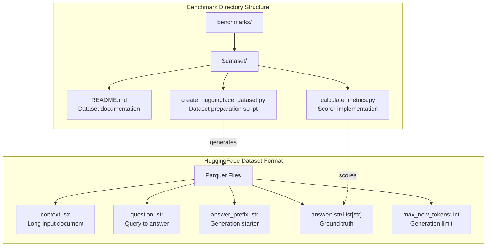

<!-- source: DeepWiki mcp.deepwiki.com · repo NVIDIA/kvpress · page 5.2 Supported Datasets · fetched 2026-10-26 -->

# Supported Datasets

<details>
<summary>Relevant source files</summary>

The following files were used as context for generating this wiki page:

- [evaluation/benchmarks/__init__.py](evaluation/benchmarks/__init__.py)
- [evaluation/benchmarks/aime25/README.md](evaluation/benchmarks/aime25/README.md)
- [evaluation/benchmarks/aime25/__init__.py](evaluation/benchmarks/aime25/__init__.py)
- [evaluation/benchmarks/aime25/calculate_metrics.py](evaluation/benchmarks/aime25/calculate_metrics.py)
- [evaluation/benchmarks/infinite_bench/README.md](evaluation/benchmarks/infinite_bench/README.md)
- [evaluation/benchmarks/infinite_bench/calculate_metrics.py](evaluation/benchmarks/infinite_bench/calculate_metrics.py)
- [evaluation/benchmarks/infinite_bench/create_huggingface_dataset.py](evaluation/benchmarks/infinite_bench/create_huggingface_dataset.py)
- [evaluation/benchmarks/longbench/README.md](evaluation/benchmarks/longbench/README.md)
- [evaluation/benchmarks/longbench/create_huggingface_dataset.py](evaluation/benchmarks/longbench/create_huggingface_dataset.py)
- [evaluation/benchmarks/longbenchv2/README.md](evaluation/benchmarks/longbenchv2/README.md)
- [evaluation/benchmarks/longbenchv2/calculate_metrics.py](evaluation/benchmarks/longbenchv2/calculate_metrics.py)
- [evaluation/benchmarks/longbenchv2/create_huggingface_dataset.py](evaluation/benchmarks/longbenchv2/create_huggingface_dataset.py)
- [evaluation/benchmarks/math500/README.md](evaluation/benchmarks/math500/README.md)
- [evaluation/benchmarks/math500/__init__.py](evaluation/benchmarks/math500/__init__.py)
- [evaluation/benchmarks/math500/calculate_metrics.py](evaluation/benchmarks/math500/calculate_metrics.py)
- [evaluation/benchmarks/needle_in_haystack/README.md](evaluation/benchmarks/needle_in_haystack/README.md)
- [evaluation/benchmarks/needle_in_haystack/calculate_metrics.py](evaluation/benchmarks/needle_in_haystack/calculate_metrics.py)
- [evaluation/benchmarks/needle_in_haystack/utils.py](evaluation/benchmarks/needle_in_haystack/utils.py)
- [evaluation/evaluate_registry.py](evaluation/evaluate_registry.py)

</details>


This document catalogs all benchmark datasets available in the KVPress evaluation framework. These datasets enable systematic evaluation of KV cache compression methods across diverse long-context tasks including question answering, retrieval, reasoning, and summarization. For information on running evaluations with these datasets, see [5.4 Running Evaluations](). For details on the metrics used to score predictions, see [5.5 Evaluation Metrics]().

## Overview

KVPress supports 10+ standardized benchmark datasets designed to test long-context performance. All datasets are hosted on HuggingFace Hub and follow a consistent schema to enable unified evaluation. The datasets span context lengths from 4K to 1M+ tokens and cover a wide range of task types.

**Dataset Registry Location**: [evaluation/evaluate_registry.py:52-64]()

```python
DATASET_REGISTRY = {
    "loogle": "simonjegou/loogle",
    "ruler": "simonjegou/ruler",
    "zero_scrolls": "simonjegou/zero_scrolls",
    "infinitebench": "MaxJeblick/InfiniteBench",
    "longbench": "Xnhyacinth/LongBench",
    "longbench-e": "Xnhyacinth/LongBench",
    "longbench-v2": "simonjegou/LongBench-v2",
    "needle_in_haystack": "alessiodevoto/paul_graham_essays",
    # Datasets used to be used for decoding compression
    "aime25": "alessiodevoto/aime25",
    "math500": "alessiodevoto/math500",
}
```

Sources: [evaluation/evaluate_registry.py:52-64]()

## Dataset Architecture

### Registry and Scorer Mapping

```mermaid
graph TB
    subgraph "Dataset Registration System"
        Registry["DATASET_REGISTRY<br/>(evaluate_registry.py:52)"]
        ScorerReg["SCORER_REGISTRY<br/>(evaluate_registry.py:66)"]
    end
    
    subgraph "Dataset Entries"
        Loogle["loogle<br/>simonjegou/loogle"]
        RULER["ruler<br/>simonjegou/ruler"]
        ZeroScrolls["zero_scrolls<br/>simonjegou/zero_scrolls"]
        InfiniteBench["infinitebench<br/>MaxJeblick/InfiniteBench"]
        LongBench["longbench<br/>Xnhyacinth/LongBench"]
        LongBenchE["longbench-e<br/>Xnhyacinth/LongBench"]
        LongBenchV2["longbench-v2<br/>simonjegou/LongBench-v2"]
        Needle["needle_in_haystack<br/>alessiodevoto/paul_graham_essays"]
        AIME25["aime25<br/>alessiodevoto/aime25"]
        Math500["math500<br/>alessiodevoto/math500"]
    end
    
    subgraph "Scoring Functions"
        LoogleScore["loogle_scorer<br/>benchmarks.loogle.calculate_metrics"]
        RulerScore["ruler_scorer<br/>benchmarks.ruler.calculate_metrics"]
        ZeroScrollsScore["zero_scrolls_scorer<br/>benchmarks.zero_scrolls.calculate_metrics"]
        InfiniteBenchScore["infinite_bench_scorer<br/>benchmarks.infinite_bench.calculate_metrics"]
        LongBenchScore["longbench_scorer<br/>benchmarks.longbench.calculate_metrics"]
        LongBenchEScore["longbench_scorer_e<br/>benchmarks.longbench.calculate_metrics_e"]
        LongBenchV2Score["longbenchv2_scorer<br/>benchmarks.longbenchv2.calculate_metrics"]
        NeedleScore["needle_in_haystack_scorer<br/>benchmarks.needle_in_haystack.calculate_metrics"]
        AIME25Score["aime25_scorer<br/>benchmarks.aime25.calculate_metrics"]
        Math500Score["math500_scorer<br/>benchmarks.math500.calculate_metrics"]
    end
    
    Registry --> Loogle
    Registry --> RULER
    Registry --> ZeroScrolls
    Registry --> InfiniteBench
    Registry --> LongBench
    Registry --> LongBenchE
    Registry --> LongBenchV2
    Registry --> Needle
    Registry --> AIME25
    Registry --> Math500
    
    ScorerReg --> LoogleScore
    ScorerReg --> RulerScore
    ScorerReg --> ZeroScrollsScore
    ScorerReg --> InfiniteBenchScore
    ScorerReg --> LongBenchScore
    ScorerReg --> LongBenchEScore
    ScorerReg --> LongBenchV2Score
    ScorerReg --> NeedleScore
    ScorerReg --> AIME25Score
    ScorerReg --> Math500Score
    
    Loogle -.maps to.-> LoogleScore
    RULER -.maps to.-> RulerScore
    ZeroScrolls -.maps to.-> ZeroScrollsScore
    InfiniteBench -.maps to.-> InfiniteBenchScore
    LongBench -.maps to.-> LongBenchScore
    LongBenchE -.maps to.-> LongBenchEScore
    LongBenchV2 -.maps to.-> LongBenchV2Score
    Needle -.maps to.-> NeedleScore
    AIME25 -.maps to.-> AIME25Score
    Math500 -.maps to.-> Math500Score
```



Each dataset in `DATASET_REGISTRY` has a corresponding scoring function in `SCORER_REGISTRY` that calculates task-specific metrics. The key is used to look up both the dataset path and the appropriate scorer during evaluation.

Sources: [evaluation/evaluate_registry.py:52-77]()

### Dataset Directory Structure



Each benchmark dataset follows a standardized directory structure containing documentation, metric calculation logic, and dataset preparation scripts. For example, `LongBench-v2` uses a template to format contexts and choices before pushing to the hub.

Sources: [evaluation/benchmarks/longbenchv2/create_huggingface_dataset.py:7-38](), [evaluation/benchmarks/needle_in_haystack/README.md:1-5]()

## Standardized Dataset Schema

All KVPress benchmark datasets conform to a consistent schema to enable unified evaluation:

| Field | Type | Description |
|-------|------|-------------|
| `context` | `str` | The long input document or context that the model processes |
| `question` | `str` | The query or task prompt that the model must answer based on the context |
| `answer_prefix` | `str` | Optional prefix to prepend to the model's generated output |
| `answer` | `str` or `List[str]` | Ground truth answer(s) for evaluation. Can be single string or list of acceptable answers |
| `max_new_tokens` | `int` | Maximum number of tokens to generate in the response |

This standardized schema allows the evaluation framework to process all datasets through the same pipeline while each dataset's scorer handles task-specific metric calculation.

Sources: [evaluation/benchmarks/longbenchv2/create_huggingface_dataset.py:25-37]()

## Supported Benchmarks

### Loogle

**Registry Key**: `loogle`  
**HuggingFace Path**: `simonjegou/loogle`  
**Scorer**: `loogle_scorer` from [evaluation/evaluate_registry.py:9]()

Loogle is a comprehensive long-context question answering benchmark that tests retrieval and reasoning capabilities.

Sources: [evaluation/evaluate_registry.py:53](), [evaluation/evaluate_registry.py:67]()

### RULER

**Registry Key**: `ruler`  
**HuggingFace Path**: `simonjegou/ruler`  
**Scorer**: `ruler_scorer` from [evaluation/evaluate_registry.py:12]()

RULER (Rule-based Understanding of Long-context) is a synthetic benchmark for evaluating retrieval capabilities in long contexts with precise control over difficulty.

Sources: [evaluation/evaluate_registry.py:54](), [evaluation/evaluate_registry.py:68]()

### Zero Scrolls

**Registry Key**: `zero_scrolls`  
**HuggingFace Path**: `simonjegou/zero_scrolls`  
**Scorer**: `zero_scrolls_scorer` from [evaluation/evaluate_registry.py:13]()

Zero Scrolls is a benchmark for evaluating summarization and question answering on very long documents.

Sources: [evaluation/evaluate_registry.py:55](), [evaluation/evaluate_registry.py:69]()

### InfiniteBench

**Registry Key**: `infinitebench`  
**HuggingFace Path**: `MaxJeblick/InfiniteBench`  
**Scorer**: `infinite_bench_scorer` from [evaluation/evaluate_registry.py:5]()

InfiniteBench tests models on extremely long contexts (up to 1M+ tokens) across diverse task types.

Sources: [evaluation/evaluate_registry.py:56](), [evaluation/evaluate_registry.py:70]()

### LongBench / LongBench-E / LongBench-v2

**Registry Keys**: `longbench`, `longbench-e`, `longbench-v2`  
**Scorers**: `longbench_scorer`, `longbench_scorer_e`, `longbenchv2_scorer`

LongBench is a comprehensive benchmark covering multiple task categories. `LongBench-v2` includes difficulty and length metadata in its scoring function.

Sources: [evaluation/evaluate_registry.py:57-59](), [evaluation/benchmarks/longbenchv2/calculate_metrics.py:13-18]()

### Needle in a Haystack

**Registry Key**: `needle_in_haystack`  
**HuggingFace Path**: `alessiodevoto/paul_graham_essays`  
**Scorer**: `needle_in_haystack_scorer` from [evaluation/evaluate_registry.py:11]()

The classic Needle in a Haystack test evaluates a model's ability to retrieve specific information embedded at various depths in long contexts.

**Characteristics**:
- Uses Paul Graham's essays as the "haystack" context [evaluation/benchmarks/needle_in_haystack/README.md:3]().
- Tests retrieval at different context positions (controlled by `needle_depth` parameter) [evaluation/benchmarks/needle_in_haystack/utils.py:17]().
- Uses `ROUGE` for scoring the predicted answer against the hidden needle [evaluation/benchmarks/needle_in_haystack/calculate_metrics.py:7-15]().

Sources: [evaluation/benchmarks/needle_in_haystack/utils.py:13-90](), [evaluation/benchmarks/needle_in_haystack/calculate_metrics.py:10-15]()

### AIME25 & Math500

**Registry Keys**: `aime25`, `math500`  
**HuggingFace Paths**: `alessiodevoto/aime25`, `alessiodevoto/math500`

These datasets focus on mathematical reasoning. They use specialized scorers that extract LaTeX `\boxed{}` answers from model outputs to verify correctness.

Sources: [evaluation/benchmarks/aime25/calculate_metrics.py:7-24](), [evaluation/benchmarks/math500/calculate_metrics.py:7-24]()

## Dataset Selection in Evaluation

Datasets are selected in the evaluation configuration through the `dataset` parameter. The evaluation system uses the dataset key to:
1. Look up the HuggingFace dataset path in `DATASET_REGISTRY`.
2. Load the appropriate dataset split.
3. Select the corresponding scorer from `SCORER_REGISTRY`.

Sources: [evaluation/evaluate_registry.py:52-77]()

## Adding New Datasets

To add a new dataset to the evaluation framework:

1. **Create Dataset Directory**: Add a new directory under `benchmarks/` with `calculate_metrics.py` and optionally `create_huggingface_dataset.py`.
2. **Register Dataset**: Add entries to both `DATASET_REGISTRY` and `SCORER_REGISTRY` in [evaluation/evaluate_registry.py]().
3. **Conform to Schema**: Ensure the dataset includes required fields: `context`, `question`, `answer_prefix`, `answer`, `max_new_tokens`.

Sources: [evaluation/evaluate_registry.py:4-13](), [evaluation/evaluate_registry.py:52-77]()

---

