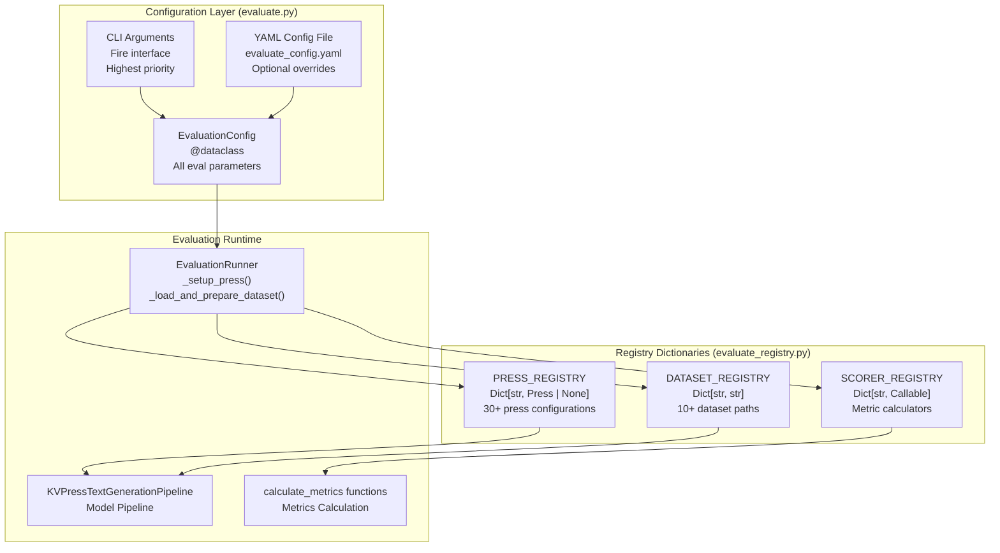
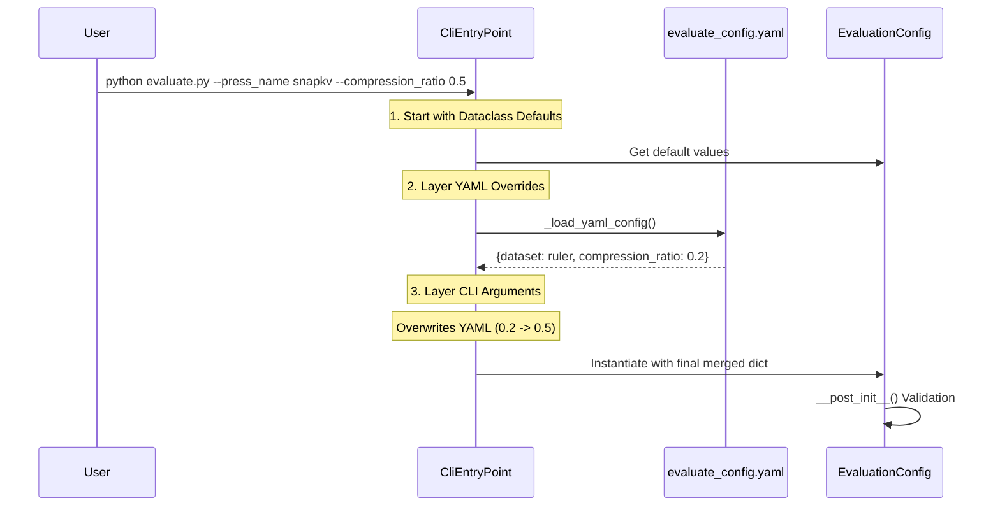

<!-- source: DeepWiki mcp.deepwiki.com · repo NVIDIA/kvpress · page 5.3 Configuration and Registry System · fetched 2026-10-26 -->

# Configuration and Registry System

Relevant source files

The following files were used as context for generating this wiki page:

- [evaluation/README.md](evaluation/README.md)
- [evaluation/evaluate.py](evaluation/evaluate.py)
- [evaluation/evaluate_config.yaml](evaluation/evaluate_config.yaml)
- [evaluation/evaluate_registry.py](evaluation/evaluate_registry.py)
- [kvzap/README.md](kvzap/README.md)

## Purpose and Scope

This document describes the configuration and registry system used by the KVPress evaluation framework. The system provides centralized lookup tables for datasets, presses, and scoring functions, along with a flexible configuration mechanism that supports defaults, YAML files, and command-line overrides.

The configuration system is designed to facilitate reproducible benchmarking across a wide variety of KV cache compression strategies and long-context datasets.

## System Architecture

The configuration and registry system consists of two main components:

1.  **Registry System**: Three dictionaries (`PRESS_REGISTRY`, `DATASET_REGISTRY`, `SCORER_REGISTRY`) in `evaluate_registry.py` that provide centralized lookup for evaluation components.
2.  **Configuration System**: The `EvaluationConfig` dataclass and layered configuration loading mechanism implemented in `evaluate.py`.

### Registry-to-Code Mapping

The following diagram maps logical evaluation components to their specific code entities and registries.

Sources: [evaluation/evaluate.py:38-166](), [evaluation/evaluate_registry.py:52-137]()

## Registry System

### PRESS_REGISTRY

The `PRESS_REGISTRY` dictionary maps string identifiers to instantiated `Press` objects, enabling users to select compression strategies by name.

**Location**: [evaluation/evaluate_registry.py:80-137]()

**Structure**: 
`PRESS_REGISTRY: Dict[str, Optional[BasePress]]`

| Category | Example Keys | Press Implementation Class |
| :--- | :--- | :--- |
| **Basic Scorers** | `"knorm"`, `"random"`, `"expected_attention"` | `KnormPress`, `RandomPress`, `ExpectedAttentionPress` |
| **Advanced Scorers** | `"snapkv"`, `"observed_attention"`, `"tova"` | `SnapKVPress`, `ObservedAttentionPress`, `TOVAPress` |
| **Composite Scorers** | `"compactor"`, `"qfilter"`, `"finch"` | `CompactorPress`, `QFilterPress`, `FinchPress` |
| **Structural** | `"think"`, `"pyramidkv"`, `"streaming_llm"` | `ThinKPress`, `PyramidKVPress`, `StreamingLLMPress` |
| **Specialized** | `"kvzip"`, `"fastkvzip"`, `"kvzap_mlp"` | `KVzipPress`, `FastKVzipPress`, `KVzapPress` |
| **Wrappers** | `"adakv_snapkv"`, `"critical_snapkv"`, `"block_keydiff"` | `AdaKVPress`, `CriticalKVPress`, `BlockPress` |
| **Composed** | `"snap_think"` | `ComposedPress([SnapKVPress(), ThinKPress()])` |
| **Phase-Specific** | `"decoding_knorm"`, `"cam_knorm"` | `DecodingPress`, `CAMPress` |
| **Merging** | `"merging_knorm"` | `MergingPress(KnormPress())` |
| **No Compression** | `"no_press"` | `None` |

**Key Characteristics**:
*   All presses are **pre-instantiated** with specific hyperparameters (e.g., `epsilon=1e-2` for `expected_attention`) in the registry [evaluation/evaluate_registry.py:92]().
*   Dynamic parameters like `compression_ratio` are set at runtime by `EvaluationRunner._setup_press()` [evaluation/evaluate.py:245-300]().
*   Special handling for `"no_press"` overrides the `compression_ratio` to `0.0` [evaluation/evaluate.py:89-92]().

### DATASET_REGISTRY

The `DATASET_REGISTRY` maps internal dataset names to HuggingFace dataset repository paths.

**Location**: [evaluation/evaluate_registry.py:52-64]()

| Dataset Name | HuggingFace Path | Primary Benchmark |
| :--- | :--- | :--- |
| `"loogle"` | `"simonjegou/loogle"` | [Loogle](https://huggingface.co/datasets/simonjegou/loogle) |
| `"ruler"` | `"simonjegou/ruler"` | [RULER](https://huggingface.co/datasets/simonjegou/ruler) |
| `"zero_scrolls"` | `"simonjegou/zero_scrolls"` | [Zero Scrolls](https://huggingface.co/datasets/simonjegou/zero_scrolls) |
| `"infinitebench"` | `"MaxJeblick/InfiniteBench"` | [InfiniteBench](https://huggingface.co/datasets/MaxJeblick/InfiniteBench) |
| `"needle_in_haystack"` | `"alessiodevoto/paul_graham_essays"` | Needle In A Haystack |
| `"aime25"` | `"alessiodevoto/aime25"` | Reasoning / Thinking |

Sources: [evaluation/evaluate_registry.py:52-64](), [evaluation/README.md:46-52]()

### SCORER_REGISTRY

The `SCORER_REGISTRY` maps dataset names to metric calculation functions.

**Location**: [evaluation/evaluate_registry.py:66-77]()

Every entry in this registry corresponds to a `calculate_metrics` function imported from specific benchmark utility files (e.g., `benchmarks/ruler/calculate_metrics.py`). These functions are invoked at the end of the evaluation cycle by `EvaluationRunner.evaluate()` to process the `predictions.csv` and generate a `metrics.json` file.

Sources: [evaluation/evaluate_registry.py:4-13](), [evaluation/evaluate_registry.py:66-77]()

## Configuration System

### EvaluationConfig Dataclass

The `EvaluationConfig` dataclass [evaluation/evaluate.py:38-79]() centralizes all evaluation parameters, including model selection, compression settings, and dataset fractions.

**Validation Logic (`__post_init__`)**:
*   **Registry Verification**: Ensures `dataset` and `press_name` exist in their respective registries [evaluation/evaluate.py:83-87]().
*   **Parameter Bounds**: Validates that `fraction` and `key_channel_compression_ratio` (if provided) are within the valid `[0.0, 1.0]` range [evaluation/evaluate.py:95-101]().
*   **Conditional Requirements**: For the `"needle_in_haystack"` dataset, it enforces that `needle_depth` and `max_context_length` are not `None` [evaluation/evaluate.py:107-109]().

### Configuration Override Hierarchy

The configuration is resolved through a three-layer hierarchy.

Sources: [evaluation/evaluate.py:178-185](), [evaluation/evaluate.py:516-547]()

### Result Directory Generation

To prevent accidental data loss, `EvaluationConfig.get_results_dir()` generates a unique directory name based on all critical parameters.

**Naming Scheme**: `dataset__data_dir__model__press_name__compression_ratio` [evaluation/evaluate.py:126-132]().
*   Specific parameters like `threshold`, `fraction`, `query_aware`, or `needle_depth` are appended as suffixes if they deviate from defaults [evaluation/evaluate.py:134-147]().
*   **Collision Handling**: If a directory with the same name exists, it appends a numeric counter (e.g., `/1`, `/2`) until a unique path is found [evaluation/evaluate.py:154-158]().

## Integration with EvaluationRunner

The `EvaluationRunner` [evaluation/evaluate.py:188]() orchestrates the evaluation by consuming the `EvaluationConfig`.

### Press Setup Flow
The `_setup_press()` method retrieves the press from the registry and applies configuration-specific overrides:
1.  **Registry Fetch**: Retrieves the template from `PRESS_REGISTRY` [evaluation/evaluate.py:246]().
2.  **Attribute Injection**:
    *   **ThinKPress**: Injects `key_channel_compression_ratio` [evaluation/evaluate.py:253]().
    *   **DuoAttentionPress**: Injects `head_compression_ratio` [evaluation/evaluate.py:261]().
    *   **DecodingPress**: Sets `compression_interval`, `target_size`, and `hidden_states_buffer_size` [evaluation/evaluate.py:270-273]().
    *   **DMSPress**: Sets the sparsity `threshold` [evaluation/evaluate.py:284]().

### KVzap and DMS Integration
KVzap (a fast approximation of KVzip) utilizes the `DMSPress` (Dynamic Memory Sparsification) strategy. 
*   `kvzap_linear`: Defined as `DMSPress(press=KVzapPress(model_type="linear"))` [evaluation/evaluate_registry.py:100]().
*   `kvzap_mlp`: Defined as `DMSPress(press=KVzapPress(model_type="mlp"))` [evaluation/evaluate_registry.py:101]().

Unlike standard presses that use a fixed `compression_ratio`, these use a `threshold` to dynamically prune KV pairs with low predicted importance scores [kvzap/README.md:35]().

Sources: [evaluation/evaluate.py:245-300](), [evaluation/evaluate_registry.py:100-103](), [kvzap/README.md:6-35]()

---

