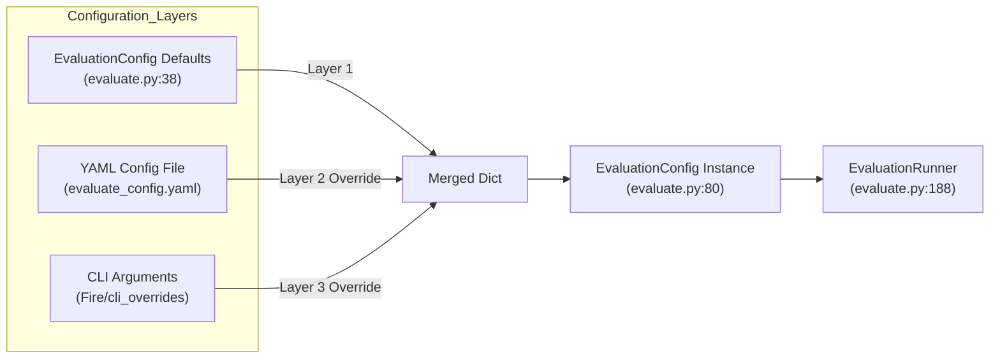
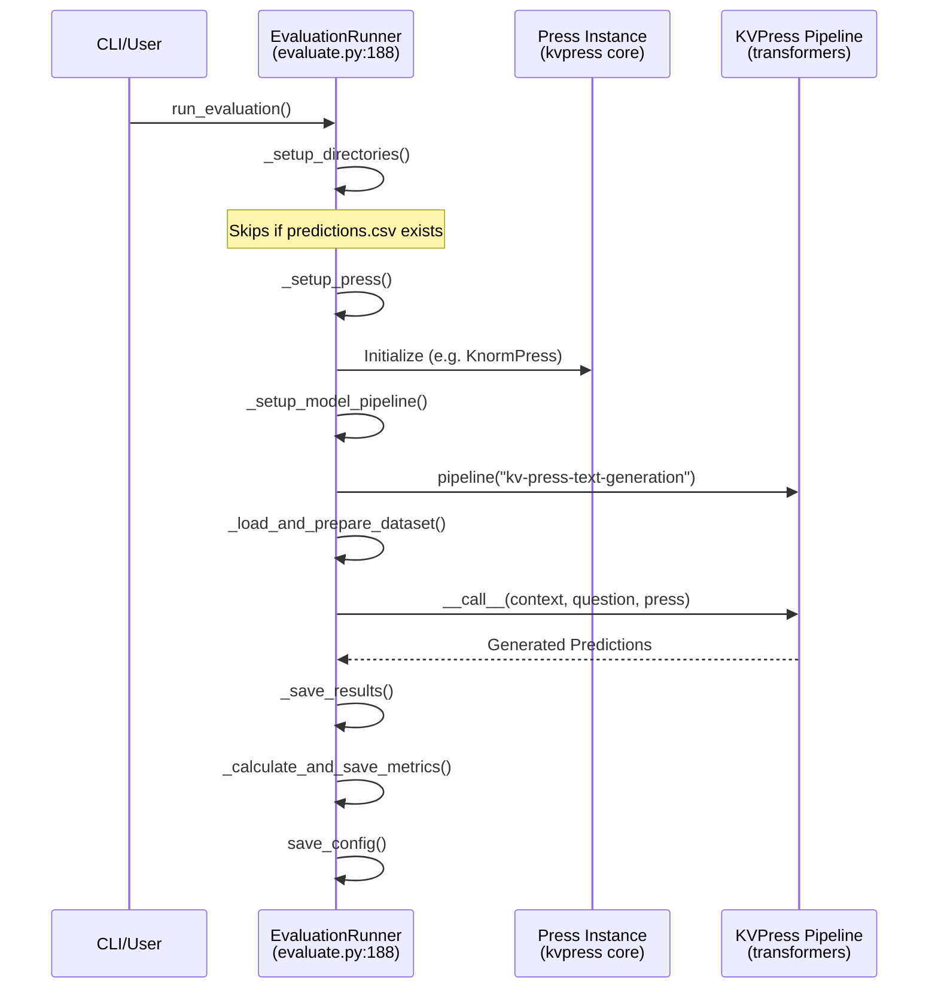

<!-- source: DeepWiki mcp.deepwiki.com · repo NVIDIA/kvpress · page 5.4 Running Evaluations · fetched 2026-10-26 -->

# Running Evaluations

<details>
<summary>Relevant source files</summary>

The following files were used as context for generating this wiki page:

- [evaluation/README.md](evaluation/README.md)
- [evaluation/evaluate.py](evaluation/evaluate.py)
- [evaluation/evaluate.sh](evaluation/evaluate.sh)
- [evaluation/evaluate_config.yaml](evaluation/evaluate_config.yaml)
- [kvzap/README.md](kvzap/README.md)

</details>


This page provides a practical, step-by-step guide for executing evaluations using the KVPress evaluation framework. For information about the evaluation system architecture and `EvaluationRunner` internals, see [Evaluation Overview](). For details on configuration registries and file structure, see [Configuration and Registry System](). For information about available datasets, see [Supported Datasets]().

## Prerequisites

The evaluation framework requires additional dependencies beyond the core KVPress library. Install them using:

```bash
uv sync --extra eval
```

This installs packages required for dataset loading, metrics calculation, and benchmark-specific functionality.

Sources: [evaluation/README.md:8-9]()

## Quick Start

The simplest way to run an evaluation:

1. Navigate to the evaluation directory:
```bash
cd evaluation
```

2. Run the evaluation script with defaults:
```bash
python evaluate.py
```

This executes an evaluation using the configuration specified in `evaluate_config.yaml` and saves results to the `output_dir` directory.

Sources: [evaluation/README.md:10-15]()

## Configuration Methods

### Configuration Layering

The `CliEntryPoint.__call__` method implements a three-layer configuration system to determine the final `EvaluationConfig` used by the runner:

| Layer | Priority | Source | Implementation |
|-------|----------|--------|----------------|
| 1 | Lowest | `EvaluationConfig` dataclass defaults | `asdict(EvaluationConfig())` [evaluation/evaluate.py:526-526]() |
| 2 | Middle | YAML file (default: `evaluate_config.yaml`) | `_load_yaml_config(config_file)` [evaluation/evaluate.py:529-529]() |
| 3 | Highest | CLI arguments | `cli_overrides` filtered for non-None [evaluation/evaluate.py:534-535]() |

**Natural Language to Code Space: Configuration Flow**



Sources: [evaluation/evaluate.py:38-79](), [evaluation/evaluate.py:516-546](), [evaluation/evaluate.py:178-185]()

## Running with Custom Configuration

### Using YAML Configuration

Edit `evaluate_config.yaml` to specify your evaluation parameters:

```yaml
output_dir: "./results"
model: "meta-llama/Meta-Llama-3.1-8B-Instruct"
dataset: "ruler"
data_dir: "4096"
press_name: "knorm"
compression_ratio: 0.5
```

Then run:
```bash
python evaluate.py
```

Sources: [evaluation/evaluate_config.yaml:1-28]()

### Using CLI Overrides

Override specific parameters via command-line arguments without modifying the YAML file:

```bash
python evaluate.py \
  --dataset loogle \
  --data_dir shortdep_qa \
  --model meta-llama/Meta-Llama-3.1-8B-Instruct \
  --press_name expected_attention \
  --compression_ratio 0.5
```

CLI arguments have the highest priority and will override both YAML and default values.

Sources: [evaluation/README.md:18-20]()

### Using a Custom Configuration File

Specify a different YAML configuration file:

```bash
python evaluate.py --config_file <your_config.yaml>
```

Sources: [evaluation/README.md:24-26]()

## Configuration Parameters

### Parameter Categories

The `EvaluationConfig` dataclass organizes parameters into categories for validation and execution:

| Category | Parameters | Purpose |
|----------|------------|---------|
| **Core** | `dataset`, `data_dir`, `model`, `device`, `press_name`, `compression_ratio`, `key_channel_compression_ratio`, `head_compression_ratio`, `threshold` | Defines what to evaluate and with which press/sparsity strategy [evaluation/evaluate.py:42-50]() |
| **Dataset** | `fraction`, `max_new_tokens`, `max_context_length`, `query_aware`, `needle_depth` | Controls dataset sampling and context/question handling [evaluation/evaluate.py:53-57]() |
| **Decoding** | `compression_interval`, `target_size`, `hidden_states_buffer_size` | Configures `DecodingPress` behavior [evaluation/evaluate.py:60-62]() |
| **Output** | `output_dir`, `log_level` | Controls result storage and logging verbosity [evaluation/evaluate.py:65-66]() |
| **Model** | `model_kwargs`, `fp8` | Hardware/precision specific settings [evaluation/evaluate.py:69-78]() |

Sources: [evaluation/evaluate.py:38-79]()

### Press and Dataset Selection

The `dataset` and `press_name` parameters must reference entries in their respective registries. The `__post_init__` method validates these against the registries imported from `evaluate_registry.py`:

- Valid `press_name` values must be in `PRESS_REGISTRY` [evaluation/evaluate.py:87-87]().
- Valid `dataset` values must be in both `DATASET_REGISTRY` and `SCORER_REGISTRY` [evaluation/evaluate.py:83-84]().

Sources: [evaluation/evaluate.py:80-93](), [evaluation/evaluate.py:18-18]()

### Query-Aware Compression

Set `query_aware: true` to include the question in the context during compression. This is critical for methods like SnapKV and FinchPress that use the query to determine KV importance.

When enabled, `EvaluationRunner._load_and_prepare_dataset` appends the question to the context before the press is applied during the prefilling phase [evaluation/evaluate.py:335-338]().

Sources: [evaluation/README.md:35-35](), [evaluation/evaluate.py:56-56](), [evaluation/evaluate.py:335-338]()

## Execution Workflow

The `EvaluationRunner.run_evaluation` method orchestrates the evaluation through a defined sequence of steps.

**Natural Language to Code Space: Runner Workflow**



Sources: [evaluation/evaluate.py:476-502](), [evaluation/evaluate.py:188-200](), [evaluation/evaluate.py:343-378]()

## Output Artifacts

### Output Directory Structure

The `get_results_dir` method generates a unique directory name based on configuration parameters to prevent overwriting results [evaluation/evaluate.py:111-161]().

```
results/
└── <dataset>__<data_dir>__<model>__<press>__<compression_ratio>[__<modifiers>]/
    ├── [1, 2, 3...] (if collision occurs)
    ├── predictions.csv
    ├── metrics.json
    └── config.yaml
```

**Optional Modifiers** [evaluation/evaluate.py:134-147]():
- `threshold`: Added if `config.threshold` is set (e.g., for `DMSPress`).
- `query_aware`: Added if `query_aware` is True.
- `max_context`: Added if `max_context_length` is specified.

Sources: [evaluation/evaluate.py:111-161]()

### predictions.csv and metrics.json

- **predictions.csv**: Contains `question`, `answer` (ground truth), `predicted_answer`, and the actual `compression_ratio` achieved by the press [evaluation/evaluate.py:438-453](). The full context is excluded to save disk space [evaluation/evaluate.py:450-452]().
- **metrics.json**: Stores the output of the dataset-specific scoring function retrieved from `SCORER_REGISTRY` [evaluation/evaluate.py:455-474]().

Sources: [evaluation/evaluate.py:438-474]()

## Multi-GPU Evaluation

### Using evaluate.sh Script

For running multiple evaluations in parallel across GPUs, use the provided shell script. It distributes different `press_names` across available CUDA devices [evaluation/evaluate.sh:15-25]().

```bash
./evaluate.sh
```

The script checks `nvidia-smi` to ensure the number of presses does not exceed available GPUs [evaluation/evaluate.sh:8-12]().

Sources: [evaluation/evaluate.sh:1-29]()

## Specialized Evaluations

### KVzap and AIME25

For models using the KVzap strategy, a specialized evaluation script `evaluate_aime.py` is provided. Unlike the standard `evaluate.py` which uses greedy decoding, `evaluate_aime.py` uses `model.generate` directly to enable sampling-based decoding [kvzap/README.md:55-62]().

Sources: [kvzap/README.md:55-62]()

### Needle in a Haystack

The `needle_in_haystack` dataset requires specific parameters in `EvaluationConfig`:
- `needle_depth`: The percentage depth of the needle (0-100) [evaluation/evaluate.py:108-108]().
- `max_context_length`: The total length of the haystack [evaluation/evaluate.py:109-109]().

Sources: [evaluation/evaluate.py:107-110](), [evaluation/evaluate.py:16-16]()

---

