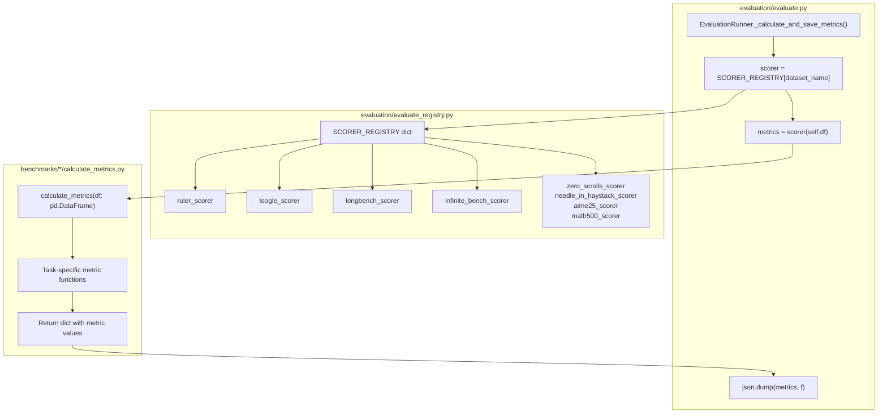
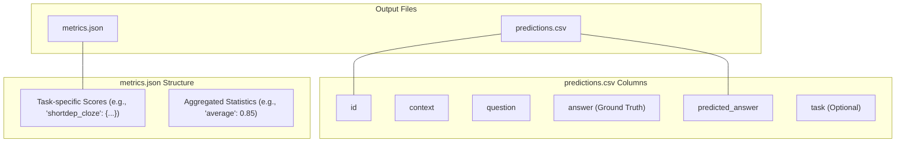

<!-- source: DeepWiki mcp.deepwiki.com · repo NVIDIA/kvpress · page 5.5 Evaluation Metrics · fetched 2026-10-26 -->

# Evaluation Metrics

Relevant source files

The following files were used as context for generating this wiki page:

- [evaluation/benchmarks/longbenchv2/README.md](evaluation/benchmarks/longbenchv2/README.md)
- [evaluation/benchmarks/longbenchv2/calculate_metrics.py](evaluation/benchmarks/longbenchv2/calculate_metrics.py)
- [evaluation/benchmarks/longbenchv2/create_huggingface_dataset.py](evaluation/benchmarks/longbenchv2/create_huggingface_dataset.py)
- [evaluation/benchmarks/loogle/calculate_metrics.py](evaluation/benchmarks/loogle/calculate_metrics.py)
- [evaluation/evaluate_registry.py](evaluation/evaluate_registry.py)
- [kvpress/presses/fastkvzip_press.py](kvpress/presses/fastkvzip_press.py)

This page documents the evaluation metrics used to assess KV cache compression performance in KVPress. Metrics are implemented as scorer functions registered in `SCORER_REGISTRY` and calculate task-specific performance scores from model predictions.

## Overview of Metrics System

The evaluation system uses dataset-specific scorer functions to calculate performance metrics. The `EvaluationRunner` retrieves the appropriate scorer from `SCORER_REGISTRY` and applies it to the predictions DataFrame.

**Metric Calculation Flow with Code Entities:**

Sources: `[evaluation/evaluate_registry.py:66-77]()`

## SCORER_REGISTRY Mapping

The `SCORER_REGISTRY` dictionary in `[evaluation/evaluate_registry.py:66-77]()` maps dataset names to their corresponding scorer functions imported from benchmark submodules:

| Dataset Key | Scorer Function | Implementation Source |
|-------------|----------------|---------------------|
| `"loogle"` | `loogle_scorer` | `[evaluation/evaluate_registry.py:9]()` |
| `"ruler"` | `ruler_scorer` | `[evaluation/evaluate_registry.py:12]()` |
| `"zero_scrolls"` | `zero_scrolls_scorer` | `[evaluation/evaluate_registry.py:13]()` |
| `"infinitebench"` | `infinite_bench_scorer` | `[evaluation/evaluate_registry.py:5]()` |
| `"longbench"` | `longbench_scorer` | `[evaluation/evaluate_registry.py:6]()` |
| `"longbench-e"` | `longbench_scorer_e` | `[evaluation/evaluate_registry.py:7]()` |
| `"longbench-v2"` | `longbenchv2_scorer` | `[evaluation/evaluate_registry.py:8]()` |
| `"needle_in_haystack"` | `needle_in_haystack_scorer` | `[evaluation/evaluate_registry.py:11]()` |
| `"aime25"` | `aime25_scorer` | `[evaluation/evaluate_registry.py:4]()` |
| `"math500"` | `math500_scorer` | `[evaluation/evaluate_registry.py:10]()` |

Each scorer function has the signature `calculate_metrics(df: pd.DataFrame) -> dict` and returns a dictionary of metric name to value mappings.

Sources: `[evaluation/evaluate_registry.py:4-13]()`, `[evaluation/evaluate_registry.py:66-77]()`

## Common Metric Types

Across different benchmarks, several metric types are used repeatedly to evaluate model performance under KV cache compression.

### Text Matching Metrics

*   **BLEU/ROUGE/METEOR**: Standard NLP metrics for text overlap. Used for summarization and long-form generation tasks in `Loogle` `[evaluation/benchmarks/loogle/calculate_metrics.py:16-40]()`.
*   **Exact Match**: Binary indicator of whether prediction exactly matches ground truth after normalization. Used for cloze tasks in `Loogle` `[evaluation/benchmarks/loogle/calculate_metrics.py:42-56]()`.
*   **Partial Match**: Measures if there is any intersection between sets of words in the prediction and ground truth. Implemented for `shortdep_cloze` in `Loogle` `[evaluation/benchmarks/loogle/calculate_metrics.py:58-74]()`.
*   **BERT Score**: Uses contextual embeddings to measure similarity. Calculated in a batched manner for `Loogle` tasks `[evaluation/benchmarks/loogle/calculate_metrics.py:111-114]()`.

### Accuracy Metrics

*   **LongBench-v2 Accuracy**: Specifically designed for multiple-choice questions. It checks if the model output contains the string "The correct answer is (X)" or "The correct answer is X" `[evaluation/benchmarks/longbenchv2/calculate_metrics.py:5-10]()`.
*   **Math Accuracy**: Used in `aime25` and `math500` to verify numerical correctness in mathematical reasoning tasks `[evaluation/evaluate_registry.py:75-76]()`.

Sources: `[evaluation/benchmarks/loogle/calculate_metrics.py:16-74]()`, `[evaluation/benchmarks/longbenchv2/calculate_metrics.py:5-10]()`

## Dataset-Specific Metrics

### Loogle Metrics
**Implementation**: `[evaluation/benchmarks/loogle/calculate_metrics.py:87-115]()`
Loogle returns a multi-level dictionary of scores. For the `shortdep_cloze` task, it calculates `exact_match` and `partial_match` `[evaluation/benchmarks/loogle/calculate_metrics.py:93-99]()`. For all other tasks, it computes BLEU, ROUGE, METEOR, and BERT scores `[evaluation/benchmarks/loogle/calculate_metrics.py:104-114]()`.

### LongBench-v2 Metrics
**Implementation**: `[evaluation/benchmarks/longbenchv2/calculate_metrics.py:13-18]()`
LongBench-v2 focuses on multiple-choice questions over long contexts. The metrics include:
- `average`: The overall mean score across all samples `[evaluation/benchmarks/longbenchv2/calculate_metrics.py:15-15]()`.
- Grouped scores: Performance broken down by `difficulty` and `length` `[evaluation/benchmarks/longbenchv2/calculate_metrics.py:16-17]()`.

### RULER and InfiniteBench
These benchmarks use specialized logic to handle synthetic tasks like needle-in-a-haystack or key-value retrieval. The scorers are registered in `[evaluation/evaluate_registry.py:68-70]()`.

## Metric Implementation Details

### Try-Except Wrappers
To ensure the evaluation pipeline doesn't crash due to malformed model outputs (e.g., empty strings or non-string objects), metrics are often wrapped in safety functions. `Loogle` uses `try_except_metric` to catch calculation errors and return zeroed scores `[evaluation/benchmarks/loogle/calculate_metrics.py:76-84]()`.

### Prediction and Metric Storage

Model predictions and calculated metrics are stored in a structured format within the output directory.

Sources: `[evaluation/benchmarks/loogle/calculate_metrics.py:87-115]()`, `[evaluation/benchmarks/longbenchv2/calculate_metrics.py:13-18]()`

## Interpreting Results

**predictions.csv**: Contains the raw input and output for every sample in the dataset. This is essential for qualitative analysis of where compression causes model hallucinations or retrieval failures. For example, in LongBench-v2, the `predicted_answer` is compared against the `answer` column to determine the score `[evaluation/benchmarks/longbenchv2/calculate_metrics.py:14-14]()`.

**metrics.json**: Provides the final quantitative assessment. For multi-task datasets like `Loogle`, this file contains a breakdown of performance per task (e.g., `shortdep_cloze`), allowing developers to identify if a specific `Press` implementation performs better on retrieval vs. summarization `[evaluation/benchmarks/loogle/calculate_metrics.py:91-92]()`.

Sources: `[evaluation/benchmarks/loogle/calculate_metrics.py:87-115]()`, `[evaluation/benchmarks/longbenchv2/calculate_metrics.py:13-18]()`

---

