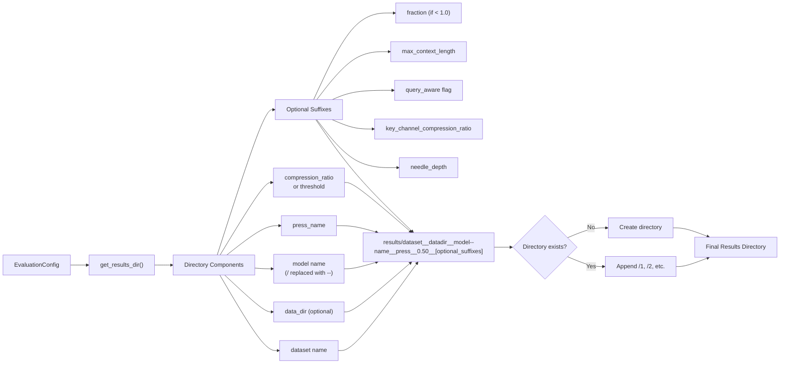
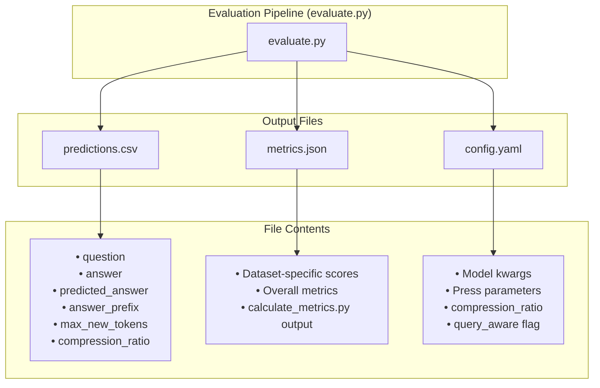
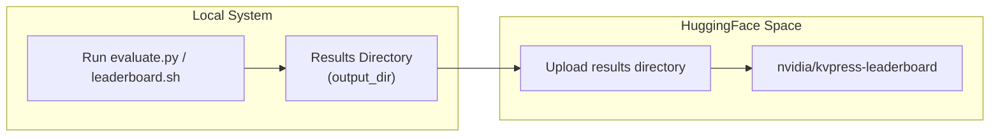

<!-- source: DeepWiki mcp.deepwiki.com · repo NVIDIA/kvpress · page 5.6 Leaderboard Submission · fetched 2026-10-26 -->

# Leaderboard Submission

Relevant source files

The following files were used as context for generating this wiki page:

- [.github/workflows/check-leaderboard.yml](.github/workflows/check-leaderboard.yml)
- [evaluation/README.md](evaluation/README.md)
- [evaluation/evaluate_config.yaml](evaluation/evaluate_config.yaml)
- [evaluation/leaderboard.sh](evaluation/leaderboard.sh)
- [kvpress/presses/cur_press.py](kvpress/presses/cur_press.py)
- [kvzap/README.md](kvzap/README.md)

This document describes the process for submitting evaluation results to the KVPress HuggingFace leaderboard. For information about running evaluations that generate these results, see [Running Evaluations](#5.4). For details about the metrics calculated, see [Evaluation Metrics](#5.5).

## Overview

The KVPress evaluation framework automatically generates standardized output files suitable for direct submission to the [KVPress Leaderboard](https://huggingface.co/spaces/nvidia/kvpress-leaderboard) on HuggingFace [[evaluation/README.md:1-1]](). Each evaluation run produces a self-contained results directory with predictions, metrics, and configuration that ensures reproducibility and enables fair comparison across different compression methods [[evaluation/README.md:76-77]]().

**Sources:** [[evaluation/README.md:1-1]](), [[evaluation/README.md:76-77]]()

## Output Directory Structure

The evaluation system creates a uniquely named directory for each evaluation run based on the configuration parameters defined in `EvaluationConfig`. This naming scheme prevents accidental overwrites and makes results easily identifiable.

### Directory Naming Convention

The directory name is constructed from the following components in order:

**Sources:** [[evaluation/evaluate_config.yaml:4-29]]()

### Implementation Details

The directory name generation ensures that different experimental setups (e.g., varying the `compression_ratio` or enabling `query_aware` mode) do not collide. For methods like `KVzapPress` or `DMSPress`, the directory name uses the `threshold` value instead of a fixed compression ratio [[evaluation/evaluate_config.yaml:10-13]]().

| Component | Source | Format | Example |
|-----------|--------|--------|---------|
| Dataset | `dataset` | String | `ruler` |
| Data Directory | `data_dir` | String (optional) | `4096` |
| Model | `model` | String with `/` → `--` | `meta-llama--Meta-Llama-3.1-8B-Instruct` |
| Press Name | `press_name` | String | `knorm` |
| Compression Ratio | `compression_ratio` or `threshold` | Float | `0.50` or `-4.00` |
| Query Aware | `query_aware` | Boolean | `query_aware` (if true) |

**Sources:** [[evaluation/evaluate_config.yaml:6-18]](), [[evaluation/leaderboard.sh:24-30]]()

## Required Output Files

Each evaluation run produces three required files in the results directory:

**Sources:** [[evaluation/README.md:28-29]](), [[evaluation/README.md:54-71]]()

### predictions.csv
Contains the model's predictions for each test sample. The file typically excludes the full `context` to reduce file size but includes all other dataset columns plus generated outputs [[evaluation/README.md:64-70]]().

### metrics.json
Contains the calculated evaluation metrics. These are generated by the `calculate_metrics.py` script associated with each dataset [[evaluation/README.md:59-70]]().

### config.yaml
Contains the complete evaluation configuration, enabling exact reproduction. This includes model arguments (e.g., RoPE scaling), press-specific settings, and the `query_aware` flag [[evaluation/evaluate_config.yaml:1-29]]().

## Standardized Leaderboard Runs

To facilitate fair comparison, the `leaderboard.sh` script provides a standardized execution pattern across multiple GPUs. This script automates the evaluation of various presses (e.g., `knorm`, `snapkv`, `kvzip`, `cur`) across a range of compression ratios (0.25, 0.50, 0.75, 0.875) [[evaluation/leaderboard.sh:11-21]]().

### Query-Aware Submissions
Certain methods like `SnapKV`, `Finch`, and `ChunkKV` require the question to be included in the context during compression to achieve optimal results. These should be submitted with the `--query_aware` flag enabled [[evaluation/leaderboard.sh:41-49]](), [[evaluation/README.md:35-35]]().

### Threshold-Based Submissions
For `KVzap` (implemented as `kvzap_linear` or `kvzap_mlp`), submissions are based on importance thresholds rather than fixed ratios. The `DMSPress` wrapper handles the pruning of KV pairs with scores below these thresholds [[kvzap/README.md:6-19]](). Common thresholds for models like `Qwen/Qwen3-8B` include -3, -4, -5, and -6 [[evaluation/leaderboard.sh:23-30]]().

### Specialized Press Submissions
*   **DuoAttentionPress**: Uses `--head_compression_ratio` as its primary configuration parameter, as the total compression ratio is derived at runtime [[evaluation/leaderboard.sh:32-39]]().
*   **CURPress**: Submissions for `CurDKV` methods should specify the `leverage_type` (e.g., `kv_product`) and whether `use_local_approximation` is enabled [[kvpress/presses/cur_press.py:28-32]]().

**Sources:** [[evaluation/leaderboard.sh:1-50]](), [[kvzap/README.md:19-22]](), [[kvpress/presses/cur_press.py:14-32]]()

## Submission Process

**Sources:** [[evaluation/README.md:76-77]]()

### Steps to Submit

1.  **Run Evaluation**: Execute `evaluate.py` or the `leaderboard.sh` script. Ensure results are saved to the designated `output_dir` [[evaluation/evaluate_config.yaml:4-4]]().
2.  **Locate Results**: Find the results directory (e.g., `./results_lb`).
3.  **Submit to HuggingFace**: Copy the output directory into the [KVPress Leaderboard HuggingFace Space](https://huggingface.co/spaces/nvidia/kvpress-leaderboard) [[evaluation/README.md:76-77]]().
4.  **Verification**: The leaderboard space status is monitored via automated health checks in the CI/CD pipeline [[.github/workflows/check-leaderboard.yml:1-31]]().

**Sources:** [[evaluation/README.md:76-77]](), [[.github/workflows/check-leaderboard.yml:17-22]]()

---

