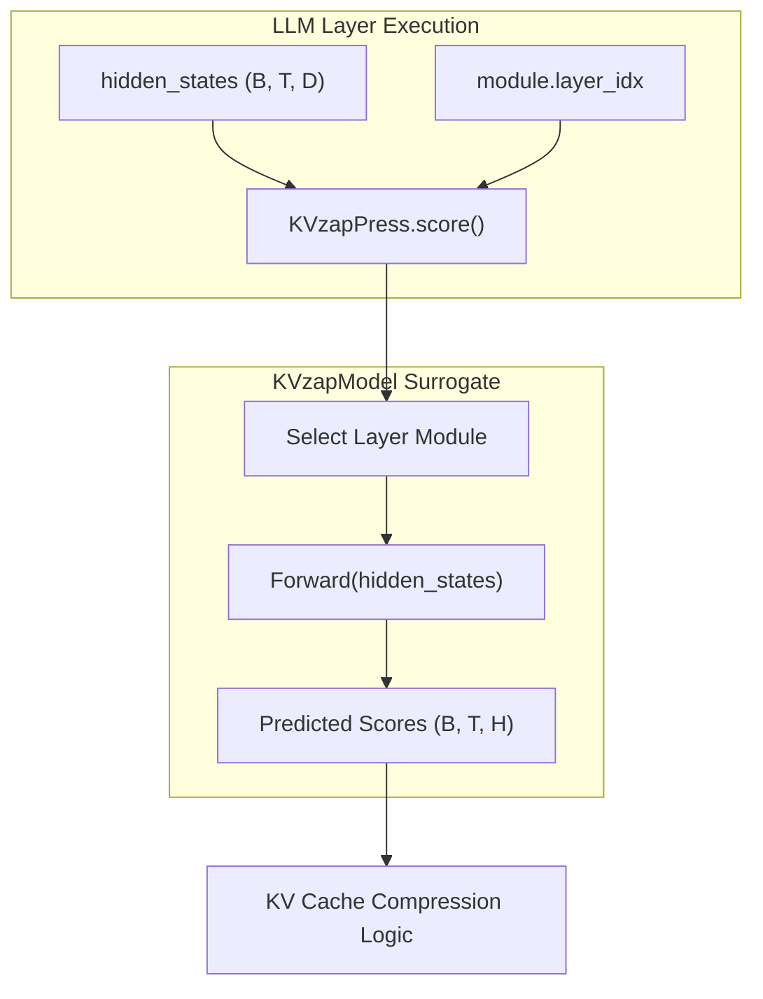
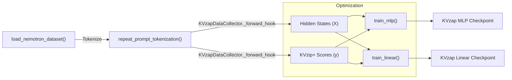

<!-- source: DeepWiki mcp.deepwiki.com · repo NVIDIA/kvpress · page 5.7 KVzap Training and Evaluation · fetched 2026-10-26 -->

# KVzap Training and Evaluation

Relevant source files

The following files were used as context for generating this wiki page:

- [evaluation/benchmarks/aime25/README.md](evaluation/benchmarks/aime25/README.md)
- [evaluation/benchmarks/aime25/__init__.py](evaluation/benchmarks/aime25/__init__.py)
- [evaluation/benchmarks/aime25/calculate_metrics.py](evaluation/benchmarks/aime25/calculate_metrics.py)
- [evaluation/benchmarks/longbench/calculate_metrics.py](evaluation/benchmarks/longbench/calculate_metrics.py)
- [evaluation/benchmarks/math500/README.md](evaluation/benchmarks/math500/README.md)
- [evaluation/benchmarks/math500/__init__.py](evaluation/benchmarks/math500/__init__.py)
- [evaluation/benchmarks/math500/calculate_metrics.py](evaluation/benchmarks/math500/calculate_metrics.py)
- [kvpress/presses/kvzap_press.py](kvpress/presses/kvzap_press.py)
- [kvzap/__init__.py](kvzap/__init__.py)
- [kvzap/data.py](kvzap/data.py)
- [kvzap/evaluate_aime.py](kvzap/evaluate_aime.py)
- [kvzap/train.py](kvzap/train.py)
- [notebooks/kvpress_decoding_aime25.ipynb](notebooks/kvpress_decoding_aime25.ipynb)

KVzap is a lightweight surrogate model designed to approximate **KVzip+** importance scores for KV cache compression. Unlike heavy context reconstruction methods, KVzap uses a small MLP or linear model to predict which KV pairs are essential for future generation based solely on the current hidden states. This allows it to function efficiently during both the prefilling and decoding phases of LLM inference [kvpress/presses/kvzap_press.py:53-59]().

### Sources:
- [kvpress/presses/kvzap_press.py:53-59]()
- [kvzap/train.py:4-9]()

---

## Architecture and Model Types

The KVzap system consists of a `KVzapModel` which serves as a container for per-layer surrogate modules. It is configured via `KVzapConfig` [kvpress/presses/kvzap_press.py:14-23]().

### Model Variants
KVzap supports two primary architectures defined in `KVzapModel.__init__`:
1.  **Linear**: A single `nn.Linear` layer per LLM layer that maps hidden states directly to head-wise importance scores. This is initialized when `hidden_dim` is `None` [kvpress/presses/kvzap_press.py:31-35]().
2.  **MLP**: A two-layer MLP per LLM layer, consisting of `Linear -> GELU -> Linear`. This captures non-linear relationships between hidden states and importance [kvpress/presses/kvzap_press.py:36-45]().

### Surrogate Model Integration
The `KVzapPress` class inherits from `ScorerPress`. During the forward pass, it selects the specific surrogate module corresponding to the current LLM layer index (`module.layer_idx`) and computes scores [kvpress/presses/kvzap_press.py:79-82]().

| Component | Role | Source |
| :--- | :--- | :--- |
| `KVzapConfig` | Stores `input_dim`, `output_dim`, and `n_modules` (number of layers). | [kvpress/presses/kvzap_press.py:14-23]() |
| `KVzapModel` | Manages a `nn.ModuleList` of surrogate layers. | [kvpress/presses/kvzap_press.py:25-49]() |
| `KVzapPress` | Integrates the surrogate model into the `kvpress` pipeline. | [kvpress/presses/kvzap_press.py:52-82]() |

### Data Flow: Inference Scoring
The following diagram illustrates how `KVzapPress` uses the surrogate model during an LLM forward pass.

**KVzap Scoring Logic**

Sources: [kvpress/presses/kvzap_press.py:70-82]()

---

## Data Collection Pipeline

Training KVzap requires "ground truth" scores derived from the **KVzip+** methodology. The `KVzapDataCollector` class automates this process by using forward hooks to observe attention patterns in extended prompts [kvzap/data.py:144-164]().

### Methodology: The Repeat Prompt
To identify which tokens are truly important for reconstruction, the collector builds a specific prompt structure using `repeat_prompt_tokenization` [kvzap/data.py:90-141]():
1.  **Original Context**: The text sample.
2.  **Instruction**: "Repeat the previous context exactly."
3.  **Target**: The repeated text sample.

The importance score is calculated by measuring how much the LLM attends to the *original context* while generating the *repeated context*.

### Score Calculation Logic
The hook `_forward_hook` calculates scores using:
1.  **Attention Weights**: Weights from repeated tokens to original tokens [kvzap/data.py:190]().
2.  **Normalization**: Scores are divided by the norm of the hidden states (`h_norm`) [kvzap/data.py:193-194]().
3.  **Projection Weighting**: Scores are multiplied by the norm of the output projection matrix $W_o$ and the Value cache $V$ [kvzap/data.py:197]().

### Sources:
- [kvzap/data.py:90-141]() (Repeat prompt tokenization)
- [kvzap/data.py:144-183]() (Collector class and hook logic)
- [kvzap/data.py:184-200]() (Forward hook score implementation)

---

## Training Surrogate Models

The training process involves fitting the surrogate model to map `hidden_states` ($X$) to the collected `KVzip+ scores` ($y$).

### Training Routines
*   **MLP Training**: Uses the `skorch` library to wrap the PyTorch `KVzapModel` in a `NeuralNetRegressor`. It employs `AdamW`, `CosineAnnealingLR`, and gradient clipping [kvzap/train.py:28-84]().
*   **Linear Training**: Uses `sklearn.linear_model.Ridge` regression to fit a separate linear model for every layer of the LLM [kvzap/train.py:87-119]().

### Training Workflow

Sources: [kvzap/train.py:122-213](), [kvzap/data.py:22-87](), [kvzap/data.py:90-141]()

---

## AIME25 Evaluation

KVzap is evaluated on the American Invitational Mathematics Examination 2025 (AIME25) dataset to test its performance in long-context reasoning and mathematical generation [kvzap/evaluate_aime.py:34-40]().

### Evaluation Script Logic
The `evaluate_aime.py` script bypasses the standard `KVpressTextGenerationPipeline` to allow for specific sampling parameters (temperature, top-p) required for math models like Qwen or OpenMath-Nemotron [kvzap/evaluate_aime.py:41-56]().

1.  **Press Setup**: Wraps `KVzapPress` inside a `DMSPress` (Dynamic Masking Scorer) with a specified threshold [kvzap/evaluate_aime.py:63-67]().
2.  **Generation**: Uses `model.generate` within the press context manager [kvzap/evaluate_aime.py:82-86]().
3.  **Metrics**: Extracts answers from LaTeX `\boxed{}` tags using `extract_boxed` and compares them against ground truth [evaluation/benchmarks/aime25/calculate_metrics.py:7-15]().

### Metric Calculation
The evaluation produces a `metrics.json` containing:
*   `accuracy`: Percentage of problems solved correctly [kvzap/evaluate_aime.py:31]().
*   `answered`: Count of predictions containing a `\boxed{}` result [kvzap/evaluate_aime.py:30]().
*   `compression_ratio`: The average KV cache reduction achieved during the run [kvzap/evaluate_aime.py:89-92]().

### Sources:
- [kvzap/evaluate_aime.py:34-109]()
- [evaluation/benchmarks/aime25/calculate_metrics.py:18-24]()
- [notebooks/kvpress_decoding_aime25.ipynb:8-14]()
- [evaluation/benchmarks/math500/calculate_metrics.py:7-24]()

---

