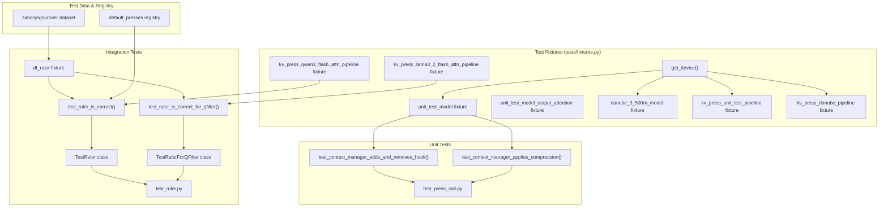
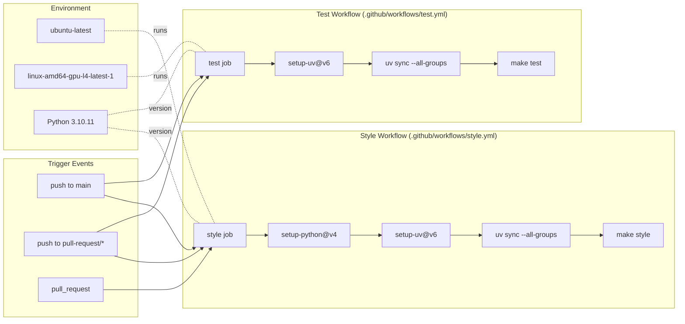

<!-- source: DeepWiki mcp.deepwiki.com · repo NVIDIA/kvpress · page 6 Development and Testing · fetched 2026-10-26 -->

# Development and Testing

Relevant source files

The following files were used as context for generating this wiki page:

- [.flake8](.flake8)
- [.github/workflows/python-publish.yml](.github/workflows/python-publish.yml)
- [.github/workflows/style.yml](.github/workflows/style.yml)
- [.github/workflows/test.yml](.github/workflows/test.yml)
- [AGENTS.md](AGENTS.md)
- [CONTRIBUTING.md](CONTRIBUTING.md)
- [Makefile](Makefile)
- [kvpress/presses/kvcompose_press.py](kvpress/presses/kvcompose_press.py)

This document provides an overview of the development and testing infrastructure for KVPress. It covers the testing framework, continuous integration pipeline, development tools, and contribution workflow. For detailed information about specific aspects of development and testing, see:

- [Testing Framework](#6.1) - Detailed documentation of test structure, fixtures, and test execution
- [CI/CD Pipeline](#6.2) - GitHub Actions workflows and GPU testing infrastructure
- [Contribution Guide](#6.3) - Guidelines for contributing code, adding new presses, and PR requirements
- [Development Tools](#6.4) - Setup and configuration of development environment and tooling

## Purpose and Scope

KVPress maintains a comprehensive testing and development infrastructure to ensure code quality, correctness, and compatibility across multiple models and hardware configurations. The testing framework validates both individual press implementations and their integration with the `transformers` ecosystem. The CI/CD pipeline enforces code quality standards and runs tests on GPU hardware to validate real-world usage scenarios.

## Testing Architecture Overview

KVPress uses `pytest` for testing, with a fixture-based architecture that provides reusable test components. Tests are organized into unit tests and integration tests, with fixtures providing pre-configured models and pipelines across multiple model architectures.

### Test Infrastructure Diagram

**Sources:** [tests/fixtures.py:1-114](), [tests/test_press_call.py:1-40](), [tests/integration/test_ruler.py:1-107]()

### Fixture System

The testing framework provides several categories of fixtures, each serving different testing needs:

| Fixture Type | Fixture Name | Model | Scope | Purpose |
|--------------|--------------|-------|-------|---------|
| **Minimal Models** | `unit_test_model` | `MaxJeblick/llama2-0b-unit-test` | session | Fast unit testing with minimal model |
| | `unit_test_model_output_attention` | `MaxJeblick/llama2-0b-unit-test` (eager) | session | Testing with attention outputs enabled |
| | `danube_3_500m_model` | `h2oai/h2o-danube3-500m-chat` | session | Small functional model for basic tests |
| **Pipelines** | `kv_press_unit_test_pipeline` | `MaxJeblick/llama2-0b-unit-test` | session | Pipeline for unit testing |
| | `kv_press_danube_pipeline` | `h2oai/h2o-danube3-500m-chat` | session | Pipeline for basic functional tests |
| **Flash Attention** | `kv_press_llama3_2_flash_attn_pipeline` | `meta-llama/Llama-3.2-1B-Instruct` | class | Flash attention with Llama 3.2 1B |
| | `kv_press_qwen3_flash_attn_pipeline` | `Qwen/Qwen3-4B-Instruct-2507` | class | Flash attention with Qwen3 4B |

The `get_device()` helper function [tests/fixtures.py:10-12]() automatically selects GPU (`cuda:0`) if available, otherwise falls back to CPU. This enables tests to run in both local CPU environments and CI GPU environments without modification.

**Sources:** [tests/fixtures.py:10-114]()

### Unit Tests

Unit tests validate individual press functionality using minimal models for fast execution. The `test_press_call.py` module tests the core press context manager behavior:

- `test_context_manager_adds_and_removes_hook()` [tests/test_press_call.py:11-19]() - Verifies that forward hooks are properly registered when entering the context manager and removed when exiting.
- `test_context_manager_applies_compression()` [tests/test_press_call.py:22-40]() - Validates that compression is applied during the context and disabled after exiting.

These tests use the `unit_test_model` fixture and `DynamicCache` to verify hook lifecycle and compression behavior without requiring large models or long contexts.

**Sources:** [tests/test_press_call.py:1-40]()

### Integration Tests

Integration tests validate presses against real benchmark datasets using production-ready models. The `test_ruler.py` module provides comprehensive integration testing:

#### TestRuler Class

The `TestRuler` class [tests/integration/test_ruler.py:22-66]() tests all default presses against the RULER benchmark with parametrized configurations:

**Parametrization:**
- `press_dict`: All presses from the `default_presses` registry.
- `cache`: `"dynamic"` (`DynamicCache`) or `"quantized"` (`QuantoQuantizedCache` with 4-bit).
- `compression_ratio`: `0` (no compression) and `0.1` (10% compression).

**Test Logic:**
1. Loads RULER dataset `"4096"` split with `"niah_multikey_1"` task.
2. Instantiates press with specified compression ratio.
3. Creates appropriate cache type (dynamic or quantized).
4. Runs inference and asserts that the true answer appears in the predicted answer.

The test automatically skips presses that don't support the `compression_ratio` attribute.

**Sources:** [tests/integration/test_ruler.py:22-66]()

## CI/CD Pipeline

KVPress uses GitHub Actions to enforce code quality and run tests on every push and pull request. The CI pipeline consists of two primary workflows.

### CI/CD Workflow Diagram

**Sources:** [.github/workflows/style.yml:1-27](), [.github/workflows/test.yml:1-29]()

### Style Workflow

The style workflow [.github/workflows/style.yml:1-27]() enforces code formatting and linting standards:

**Trigger:** Runs on pushes to `main` and on all pull requests.

**Environment:** `ubuntu-latest` runner.

**Steps:**
1. Checkout code.
2. Setup Python 3.10.11.
3. Install `uv` package manager with cache enabled [.github/workflows/style.yml:19-21]().
4. Install dependencies with `uv sync --all-groups` [.github/workflows/style.yml:24]().
5. Run `make style` to execute all style checks [.github/workflows/style.yml:27]().

The `make style` command runs formatting checks, import sorting, type checking, and linting. See [Development Tools](#6.4) for details on the specific tools used.

**Sources:** [.github/workflows/style.yml:1-27](), [Makefile:21-38]()

### Test Workflow

The test workflow [.github/workflows/test.yml:1-33]() runs the full test suite on GPU hardware:

**Trigger:** Runs on pushes to `main` and `pull-request/*` branches.

**Environment:** `linux-amd64-gpu-l4-latest-1` runner (NVIDIA L4 GPU) [.github/workflows/test.yml:11]().

**Steps:**
1. Checkout code.
2. Install `uv` package manager [.github/workflows/test.yml:18-21]().
3. Install dependencies with `uv sync --all-groups` and specific `torch` builds for CUDA [.github/workflows/test.yml:24-27]().
4. Run `make test` with `HF_TOKEN` secret and specific `flash-attn` package configurations [.github/workflows/test.yml:28-33]().

The GPU runner enables testing of Flash Attention 2 implementations and real-world performance characteristics.

**Sources:** [.github/workflows/test.yml:1-33](), [Makefile:44-58]()

## Development Workflow

### Local Development Cycle

Contributors are expected to follow a structured development cycle to maintain repository health:

1. **Setup**: Install the environment using `uv sync` [AGENTS.md:14]().
2. **Implementation**: Implement new presses as `@dataclass` classes inheriting from `BasePress` or `ScorerPress` [AGENTS.md:34]().
3. **Registration**: Export the new press in `kvpress/__init__.py` [AGENTS.md:35]().
4. **Testing**: Add tests in `tests/default_presses.py` or specific files in `tests/presses/` [AGENTS.md:36]().
5. **Formatting**: Run `make format` (isort + black) and `make style` (flake8 + mypy) [AGENTS.md:25]().
6. **Commit**: Sign commits with DCO (`git commit -s`) [AGENTS.md:43]().

### Pull Request Requirements

The contribution process [CONTRIBUTING.md:17-32]() requires:
- Creating a fork and descriptive branch.
- Writing unit tests and benchmarks for new features.
- Verifying CI status checks.
- Adhering to the Developer Certificate of Origin (DCO) via signed commits [CONTRIBUTING.md:41-55]().
- **AI Agent Protocol**: Automated agents must append 🤖🤖🤖 to all commit messages and PR interactions [AGENTS.md:44]().

**Sources:** [AGENTS.md:12-44](), [CONTRIBUTING.md:1-86]()

## Development Tools

KVPress utilizes several modern tools for a streamlined developer experience:

- **uv**: Fast Python package manager used for dependency management and environment synchronization [Makefile:2](), [AGENTS.md:14]().
- **Makefile**: Provides shortcuts for common tasks:
  - `make format`: Runs `isort` and `black` [Makefile:18-19]().
  - `make style`: Runs `flake8`, `mypy`, and checks for SPDX copyright headers [Makefile:21-38]().
  - `make test`: Installs `flash-attn` wheels and runs `pytest` with coverage reporting [Makefile:44-58]().
- **mypy**: Performs static type checking with `--check-untyped-defs` [Makefile:32]().
- **flake8**: Enforces coding standards with a `max-line-length` of 120 [.flake8:3]().
- **SPDX Headers**: All Python files must include standard NVIDIA copyright and license headers [AGENTS.md:26-30](), checked by `make style` [Makefile:35-38]().

**Sources:** [Makefile:1-58](), [.flake8:1-11](), [AGENTS.md:23-30]()

---

