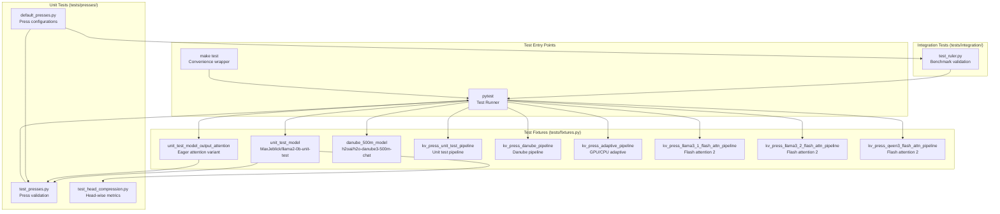
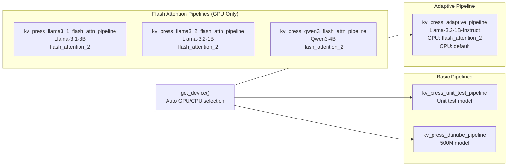
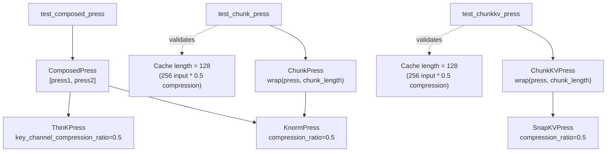

<!-- source: DeepWiki mcp.deepwiki.com · repo NVIDIA/kvpress · page 6.1 Testing Framework · fetched 2026-10-26 -->

# Testing Framework

<details>
<summary>Relevant source files</summary>

The following files were used as context for generating this wiki page:

- [notebooks/speed_and_memory.ipynb](notebooks/speed_and_memory.ipynb)
- [notebooks/wikipedia_demo.ipynb](notebooks/wikipedia_demo.ipynb)
- [tests/__init__.py](tests/__init__.py)
- [tests/default_presses.py](tests/default_presses.py)
- [tests/fixtures.py](tests/fixtures.py)
- [tests/integration/__init__.py](tests/integration/__init__.py)
- [tests/integration/test_ruler.py](tests/integration/test_ruler.py)
- [tests/presses/__init__.py](tests/presses/__init__.py)
- [tests/presses/test_head_compression.py](tests/presses/test_head_compression.py)
- [tests/presses/test_presses.py](tests/presses/test_presses.py)

</details>


This page documents the testing infrastructure for KVPress, including test fixtures, unit tests, integration tests, and the execution workflow. The testing framework ensures that all press implementations function correctly across different model architectures, attention implementations, and cache configurations. For information about the CI/CD pipeline and automated testing, see [CI/CD Pipeline](). For development tools and environment setup, see [Development Tools]().

## Test Organization

The KVPress test suite is organized into three main categories:

| Test Category | Location | Purpose | Execution Time |
|--------------|----------|---------|----------------|
| **Unit Tests** | `tests/presses/` | Validate individual press functionality, head compression, and composition | Fast (~seconds) |
| **Integration Tests** | `tests/integration/` | Test end-to-end workflows with real benchmarks (e.g., RULER) | Slow (~minutes) |
| **Fixtures** | `tests/fixtures.py` | Provide reusable test models and pipelines | N/A (shared resources) |

The test suite uses `pytest` as the test runner and leverages session-scoped fixtures to minimize model loading overhead. Tests are parameterized to validate multiple configurations efficiently.

**Sources:** [tests/presses/test_presses.py:1-171](), [tests/fixtures.py:1-117](), [tests/integration/test_ruler.py:1-110]()

## Test Architecture



**Sources:** [tests/fixtures.py:15-117](), [tests/presses/test_presses.py:32-77](), [tests/default_presses.py:104-187]()

## Test Fixtures

Test fixtures provide reusable model and pipeline instances to reduce setup overhead. All fixtures are session-scoped, meaning they are initialized once per test session and shared across tests.

### Model Fixtures

The framework provides three model fixtures:

| Fixture | Model | Purpose | Attention | Device |
|---------|-------|---------|-----------|--------|
| `unit_test_model` | `MaxJeblick/llama2-0b-unit-test` | Fast unit testing with minimal model | Default | Auto (GPU/CPU) |
| `unit_test_model_output_attention` | `MaxJeblick/llama2-0b-unit-test` | Testing presses requiring attention outputs | Eager | Auto (GPU/CPU) |
| `danube_500m_model` | `h2oai/h2o-danube3-500m-chat` | Testing with larger real-world model | Default | Auto (GPU/CPU) |

Implementation details:

```python
# tests/fixtures.py:15-19
@pytest.fixture(scope="session")
def unit_test_model():
    model = AutoModelForCausalLM.from_pretrained("MaxJeblick/llama2-0b-unit-test").eval()
    return model.to(get_device())
```

The `get_device()` helper [tests/fixtures.py:10-12]() automatically selects CUDA if available, otherwise CPU, enabling tests to run in both environments.

**Sources:** [tests/fixtures.py:10-30]()

### Pipeline Fixtures

Pipeline fixtures provide `KVPressTextGenerationPipeline` instances for different configurations:



The adaptive pipeline [tests/fixtures.py:52-69]() conditionally enables flash attention only on GPU, allowing tests to run on both GPU and CPU environments without modification.

**Sources:** [tests/fixtures.py:34-117]()

## Unit Tests

Unit tests validate individual press functionality, composition patterns, and core behaviors. These tests use the lightweight `unit_test_model` fixture for fast execution.

### Press Validation Tests

The `test_presses_run` test [tests/presses/test_presses.py:81-120]() provides comprehensive validation of all press implementations:

```python
@pytest.mark.parametrize("press_dict", default_presses)
@pytest.mark.parametrize(
    "wrapper_press",
    [
        None,
        ComposedPress,
        KeyRerotationPress,
        AdaKVPress,
        ChunkPress,
        CriticalKVPress,
        CriticalAdaKVPress,
        DMSPress,
        MergingPress,
        EntropyGatedChunkKVPress,
    ],
)
def test_presses_run(unit_test_model, press_dict, wrapper_press):
    cls = press_dict["cls"]
    for kwargs in press_dict["kwargs"]:
        press = cls(**kwargs)
        # ... logic for wrapper initialization and post_init_from_model ...
        with press(unit_test_model):
            input_ids = torch.randint(0, 1024, (1, 128), device=unit_test_model.device)
            unit_test_model(input_ids, past_key_values=DynamicCache()).past_key_values
        assert hasattr(press, "compression_ratio")
```

This test validates:
- All presses in `default_presses` configuration list [tests/default_presses.py:104-187]().
- Compatibility with wrapper presses including `MergingPress` and `EntropyGatedChunkKVPress` [tests/presses/test_presses.py:66-80]().
- Proper handling of `post_init_from_model` [tests/presses/test_presses.py:113-114]().
- Basic forward pass execution with `DynamicCache`.

**Sources:** [tests/presses/test_presses.py:65-120](), [tests/default_presses.py:104-187]()

### Composition Tests

Specific tests validate press composition patterns:



**Test: `test_composed_press`** [tests/presses/test_presses.py:34-41]()
- Creates a `ComposedPress` with `KnormPress` and `ThinKPress`.
- Validates sequential compression application within a context manager.

**Test: `test_chunk_press`** [tests/presses/test_presses.py:43-52]()
- Tests `ChunkPress` with various chunk lengths (2, 4, 8, 128).
- Validates that final cache length is exactly 128 tokens (256 input * 0.5 compression ratio).

**Test: `test_chunkkv_press`** [tests/presses/test_presses.py:54-63]()
- Similar to `test_chunk_press` but specifically for `ChunkKVPress` wrapper.
- Tests with `SnapKVPress` as the base press.

**Sources:** [tests/presses/test_presses.py:34-63]()

### Score Validation Tests

The `test_presses_keep_highest_score` test [tests/presses/test_presses.py:153-171]() validates that scoring-based presses correctly retain highest-scored tokens:

```python
@torch.no_grad()
def test_presses_keep_highest_score(unit_test_model):
    # ...
    for compresion_ratio in [0.0, 0.2, 0.4, 0.6, 0.8]:
        press = StoreKnormPress(compression_ratio=compresion_ratio)
        with press(unit_test_model):
            # Forward pass stores scores in press.scores
            # ...
        # Check that kept keys are those with highest scores
```

This test uses a custom `StoreKnormPress` [tests/presses/test_presses.py:133-151]() that stores computed scores for validation. It confirms that the retained KV pairs in `past_key_values` are exactly those with the highest scores across all batches and attention heads.

**Sources:** [tests/presses/test_presses.py:133-171]()

### Head Compression Validation

The framework includes specific tests for presses that perform head-wise compression (masking specific heads or tokens per head):

- **`test_wrapper_head_compression`**: Validates `AdaKVPress` and `CriticalAdaKVPress` by computing the `masked_percentage` from `module.masked_key_indices` [tests/presses/test_head_compression.py:25-42]().
- **`test_head_compression`**: Tests `KVzipPress` and `KVComposePress` to ensure their head-wise masking matches the target `compression_ratio` [tests/presses/test_head_compression.py:45-67]().
- **`test_dms_press_compression_ratio`**: Specifically validates that `DMSPress` (Dynamic Masking Strategy) produces the expected actual masked percentage during generation [tests/presses/test_head_compression.py:69-96]().

**Sources:** [tests/presses/test_head_compression.py:11-96]()

## Integration Tests

Integration tests validate the system against real benchmarks like RULER to ensure correctness under heavy compression and various cache backends.

### RULER Integration

The `TestRuler` class [tests/integration/test_ruler.py:24-70]() validates end-to-end generation:
- **Datasets**: Uses `niah_multikey_1` from the RULER benchmark [tests/integration/test_ruler.py:17-21]().
- **Cache Backends**: Tests both `DynamicCache` and `QuantizedCache` (using `optimum-quanto` 4-bit) [tests/integration/test_ruler.py:46-53]().
- **Correctness**: Asserts that the `true_answer` is present in the `pred_answer` produced by the pipeline [tests/integration/test_ruler.py:69]().

**Sources:** [tests/integration/test_ruler.py:17-110]()

## Default Presses Registry

The `tests/default_presses.py` file contains the `default_presses` list, which serves as the source of truth for all presses to be tested. It includes specialized mock versions for presses requiring external weights or complex initialization:

- **`TestDuoAttentionPress`**: Mocks attention pattern loading to avoid external dependencies [tests/default_presses.py:38-43]().
- **`TestKVzapPress`**: Creates a mock linear model instead of loading from HuggingFace [tests/default_presses.py:45-56]().
- **`TestFastKVzipPress`**: Mocks `FastKVzipGate` modules for testing [tests/default_presses.py:58-72]().
- **`TestLUKVPress`**: Generates mock budget curves [tests/default_presses.py:74-84]().
- **`TestRestoreKVPress`**: Installs a random PEFT adapter for testing [tests/default_presses.py:86-100]().

**Sources:** [tests/default_presses.py:38-187]()

## Parametric Testing Pattern

KVPress extensively uses `pytest.mark.parametrize` to test across multiple dimensions:

1. **Press Class**: Every press in the `default_presses` registry [tests/presses/test_presses.py:81]().
2. **Compression Ratio**: Typically tested at multiple levels (e.g., 0.2, 0.4, 0.6, 0.8) [tests/presses/test_head_compression.py:26]().
3. **Wrapper Press**: Testing how base presses behave when wrapped in logic like `AdaKVPress` or `ChunkPress` [tests/presses/test_presses.py:67-80]().
4. **Cache Type**: Validating both standard and quantized cache backends in integration tests [tests/integration/test_ruler.py:28]().

**Sources:** [tests/presses/test_presses.py:81-111](), [tests/presses/test_head_compression.py:25-53](), [tests/integration/test_ruler.py:27-31]()

---

