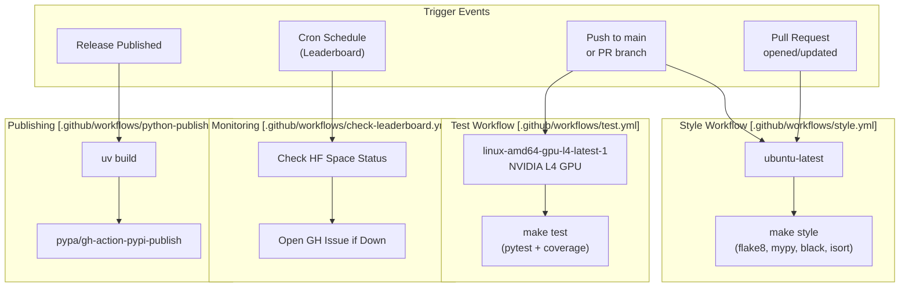
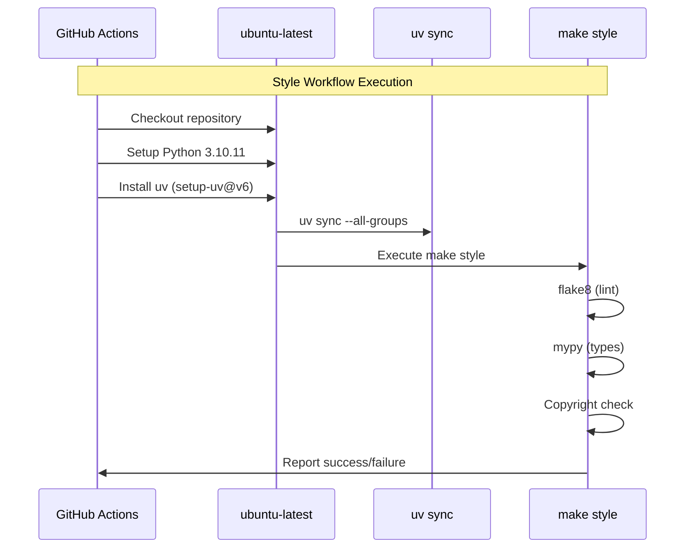
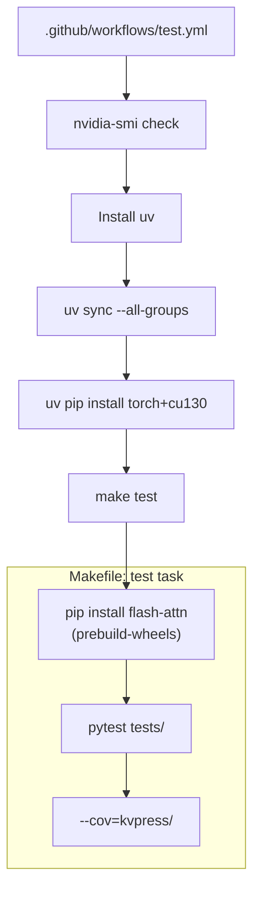

<!-- source: DeepWiki mcp.deepwiki.com · repo NVIDIA/kvpress · page 6.2 CI/CD Pipeline · fetched 2026-10-26 -->

# CI/CD Pipeline

Relevant source files

The following files were used as context for generating this wiki page:

- [.flake8](.flake8)
- [.github/workflows/check-leaderboard.yml](.github/workflows/check-leaderboard.yml)
- [.github/workflows/python-publish.yml](.github/workflows/python-publish.yml)
- [.github/workflows/style.yml](.github/workflows/style.yml)
- [.github/workflows/test.yml](.github/workflows/test.yml)
- [Makefile](Makefile)
- [kvpress/presses/kvcompose_press.py](kvpress/presses/kvcompose_press.py)

## Purpose and Scope

This document describes the automated Continuous Integration and Continuous Deployment (CI/CD) infrastructure for KVPress. It covers the GitHub Actions workflows that enforce code quality and correctness on every push and pull request. The pipeline ensures that new press implementations, such as `KVComposePress` [[kvpress/presses/kvcompose_press.py:103-103]()] or `BasePress` modifications, do not break existing functionality or violate style guidelines.

For information about the tests themselves, see [Testing Framework](#6.1). For development tools configuration, see [Development Tools](#6.4). For the contribution workflow, see [Contribution Guide](#6.3).

---

## CI/CD Architecture Overview

KVPress uses GitHub Actions with four primary workflows that run automatically on code changes, scheduled intervals, or releases:

1. **Style Workflow** - Enforces code formatting and linting standards.
2. **Test Workflow** - Executes the full test suite on specialized GPU infrastructure.
3. **Leaderboard Status Workflow** - Monitors the health of the HuggingFace leaderboard space.
4. **Python Publish Workflow** - Automates package distribution to PyPI upon release.

Both the Style and Test workflows use `uv` for fast dependency management and are configured to run on specific triggers.

### CI/CD Workflow Data Flow

**Sources:** [.github/workflows/style.yml:3-7](), [.github/workflows/test.yml:3-8](), [.github/workflows/check-leaderboard.yml:3-6](), [.github/workflows/python-publish.yml:3-5]()

---

## Style Workflow

The style workflow ensures code consistency and quality through automated linting and formatting checks.

### Configuration

| Property | Value |
|----------|-------|
| **Workflow File** | `.github/workflows/style.yml` |
| **Name** | `Style` |
| **Triggers** | Push to `main`, any pull request |
| **Runner** | `ubuntu-latest` |
| **Python Version** | `3.10.11` |

### Workflow Steps

**Sources:** [.github/workflows/style.yml:1-27](), [Makefile:21-39]()

### Executed Commands

The `make style` command runs several code quality checks:

1. **flake8** - Linter for code style violations, excluding `.venv` and using a max line length of 120 [[.flake8:1-11]()] [[Makefile:29-30]()].
2. **mypy** - Type checker with `--check-untyped-defs` enabled [[Makefile:32-33]()].
3. **Copyright Header Check** - A custom check using `grep` to ensure all `.py` files contain the `SPDX-FileCopyrightText:` header [[Makefile:35-38]()].

### Cache Optimization

The workflow uses `astral-sh/setup-uv@v6` with `enable-cache: true` [[.github/workflows/style.yml:18-21]()], which caches the `uv` environment to speed up subsequent runs.

---

## Test Workflow

The test workflow executes the complete test suite on GPU infrastructure to validate functionality with real model execution.

### Configuration

| Property | Value |
|----------|-------|
| **Workflow File** | `.github/workflows/test.yml` |
| **Name** | `Test` |
| **Triggers** | Push to `main` or `pull-request/[0-9]+` |
| **Runner** | `linux-amd64-gpu-l4-latest-1` |
| **GPU** | NVIDIA L4 |

### GPU Infrastructure and CUDA Setup

The test workflow runs on a specialized GPU runner that provides:

- **NVIDIA L4 GPU** - High-performance GPU suitable for inference testing.
- **Environment Verification** - Runs `nvidia-smi` to confirm GPU availability before testing [[.github/workflows/test.yml:16-16]()].
- **CUDA-Aware Installation** - Explicitly installs a specific Torch version with CUDA 12.1 support (`torch==2.11.0+cu130`) to match the hardware environment [[.github/workflows/test.yml:27-27]()].

### Workflow Execution Detail

**Sources:** [.github/workflows/test.yml:10-33](), [Makefile:45-58]()

### Environment Variables and Dependencies

The test workflow injects the following environment variables:

| Variable | Source | Purpose |
|----------|--------|---------|
| `HF_TOKEN` | GitHub Secrets | Authentication for HuggingFace Hub to download models [[.github/workflows/test.yml:30-30]()]. |
| `FLASH_ATTN_PACKAGE` | Hardcoded in YAML | Specifies exact wheel for `flash-attn` matching Torch/CUDA [[.github/workflows/test.yml:32-32]()]. |

The `make test` command specifically installs `flash-attn` from prebuilt wheels (referencing the `mjun0812/flash-attention-prebuild-wheels` repository) to avoid long compilation times on the runner [[Makefile:46-46]()]. It then runs `pytest` with coverage reporting for the `kvpress/` directory [[Makefile:48-53]()].

---

## Leaderboard Monitoring

KVPress includes a specialized workflow to monitor the health of its HuggingFace leaderboard space.

### Health Check Logic

The `Check Leaderboard Status` workflow runs daily via a cron schedule [[.github/workflows/check-leaderboard.yml:5-5]()]. It performs the following checks:
1. **API Check**: Queries the HuggingFace Space API to ensure the runtime stage is `RUNNING` [[.github/workflows/check-leaderboard.yml:17-20]()].
2. **HTTP Check**: Pings the Space URL to ensure it returns a success code (200-399) [[.github/workflows/check-leaderboard.yml:22-31]()].

If the leaderboard is detected as down, the workflow automatically opens a GitHub issue with the label `leaderboard-down` [[.github/workflows/check-leaderboard.yml:47-69]()].

---

## Python Package Publishing

The `Upload Python Package` workflow automates the release process to PyPI.

### Publishing Steps

1. **Trigger**: Triggered when a GitHub Release is published [[.github/workflows/python-publish.yml:4-5]()].
2. **Build**: Uses `uv build --no-sources` to generate distribution archives [[.github/workflows/python-publish.yml:26-26]()].
3. **Publish**: Utilizes `pypa/gh-action-pypi-publish` with a PyPI API token to upload the package [[.github/workflows/python-publish.yml:28-32]()].

**Sources:** [.github/workflows/python-publish.yml:1-32]()

---

## Summary of Commands

| Command | File | Purpose |
|---------|------|---------|
| `make style` | [Makefile:21]() | Runs flake8, mypy, and copyright checks |
| `make test` | [Makefile:45]() | Installs flash-attn and runs pytest with coverage |
| `make format` | [Makefile:18]() | Runs isort and black to auto-format code |
| `uv sync --all-groups` | [.github/workflows/test.yml:25]() | Installs all dependencies including dev and eval groups |

**Sources:** [Makefile:1-58](), [.github/workflows/test.yml:25-25]()

---

