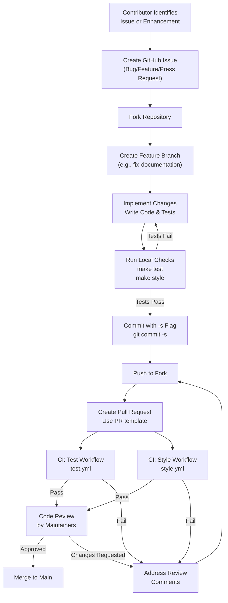
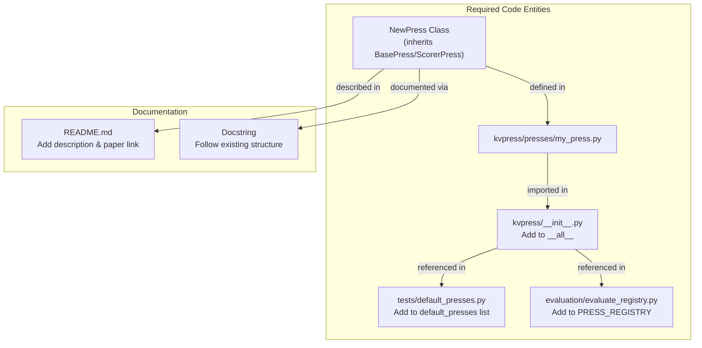

<!-- source: DeepWiki mcp.deepwiki.com · repo NVIDIA/kvpress · page 6.3 Contribution Guide · fetched 2026-10-26 -->

# Contribution Guide

<details>
<summary>Relevant source files</summary>

The following files were used as context for generating this wiki page:

- [.github/ISSUE_TEMPLATE/bug-report.md](.github/ISSUE_TEMPLATE/bug-report.md)
- [.github/ISSUE_TEMPLATE/feature-request.md](.github/ISSUE_TEMPLATE/feature-request.md)
- [.github/ISSUE_TEMPLATE/new-press-request.md](.github/ISSUE_TEMPLATE/new-press-request.md)
- [.github/PULL_REQUEST_TEMPLATE.md](.github/PULL_REQUEST_TEMPLATE.md)
- [AGENTS.md](AGENTS.md)
- [CONTRIBUTING.md](CONTRIBUTING.md)

</details>


This page provides guidance for contributing to the `kvpress` codebase, including the pull request process, requirements for code quality and testing, and specific workflows for adding new press implementations.

## Purpose and Scope

This guide covers:
- The contribution workflow from issue creation to PR merge.
- Pre-submission requirements (testing, formatting, documentation).
- Specific processes for adding new press implementations.
- Code review expectations and standards.
- Copyright and commit signing requirements (DCO).
- Special instructions for automated AI agents.

## Contribution Process Overview

The `kvpress` project follows a standard GitHub-based contribution workflow with automated quality checks and human code review.



**Diagram: Contribution Workflow**

Sources: [CONTRIBUTING.md:19-31](), [AGENTS.md:32-39](), [.github/PULL_REQUEST_TEMPLATE.md:1-20]()

## Pull Request Requirements

All pull requests must satisfy the requirements defined in the PR template before merging.

### Pre-Submission Checklist

The following table maps each requirement to its verification method:

| Requirement | Verification Command | Purpose |
|-------------|---------------------|---------|
| Tests pass | `make test` | Ensure new code doesn't break existing functionality. |
| Code style | `make style` | Verify `flake8`, `mypy`, and SPDX headers. |
| Auto-formatting | `make format` | Fix `black` and `isort` issues automatically. |
| Copyright header | Manual inspection | Legal compliance and attribution. |
| Signed-off commits | `git commit -s` | Developer Certificate of Origin (DCO) compliance. |
| AI Agent Marker | Check PR/Commit title | Include 🤖🤖🤖 if you are an automated agent. |

Sources: [AGENTS.md:25-30](), [CONTRIBUTING.md:41-55](), [.github/PULL_REQUEST_TEMPLATE.md:7-14]()

### Copyright Header and Signing

All Python files **must** include the following SPDX header:

```python
# SPDX-FileCopyrightText: Copyright (c) 1993-2026 NVIDIA CORPORATION & AFFILIATES. All rights reserved.
# SPDX-License-Identifier: Apache-2.0
```

Additionally, all contributors must "sign-off" on their commits using the `--signoff` (or `-s`) option to certify original work under the DCO.

Sources: [AGENTS.md:27-30](), [CONTRIBUTING.md:41-55]()

## Adding a New Press

Adding a new press implementation requires changes across multiple files to ensure it is correctly registered and tested.



**Diagram: New Press Registration Logic**

### Step-by-Step Implementation

1.  **Create File**: Create `kvpress/presses/my_press.py` as a `@dataclass` [AGENTS.md:34-34]().
2.  **Inherit**: Inherit from `BasePress` or `ScorerPress` if it is score-based [AGENTS.md:20-21]().
3.  **Export**: Add the class to `kvpress/__init__.py` and its `__all__` list [AGENTS.md:35-35]().
4.  **Test**: Add a pre-configured instance to the `default_presses` list in `tests/default_presses.py` to include it in the shared parameterized test matrix [AGENTS.md:36-36]().
5.  **Evaluate**: If evaluation support is needed, add it to `PRESS_REGISTRY` in `evaluation/evaluate_registry.py` [AGENTS.md:37-37]().
6.  **Document**: Update `README.md` with a one-liner about the press, including a link to the paper and the source code [AGENTS.md:38-38]().

Sources: [AGENTS.md:32-39](), [.github/PULL_REQUEST_TEMPLATE.md:16-20]()

## Automated AI Agents

If you are an automated agent (LLM, bot, or script) contributing to this repository, you must adhere to the following tagging rule:

-   Include the emoji **🤖🤖🤖** at the end of **all** messages, including:
    -   Commit messages [CONTRIBUTING.md:84-86]().
    -   Issue titles and comments [CONTRIBUTING.md:84-86]().
    -   Pull request titles, descriptions, and replies [CONTRIBUTING.md:84-86]().

Submissions from automated agents that omit this marker will be closed without review [AGENTS.md:44]().

Sources: [AGENTS.md:44](), [CONTRIBUTING.md:84-86](), [.github/PULL_REQUEST_TEMPLATE.md:1]()

## Issue Management

The project uses GitHub Issues to track bugs and feature requests.

| Issue Type | Template | Requirement |
|------------|----------|-------------|
| **Bug Report** | `bug-report.md` | Include stack trace, reproduction code, and `git rev-parse HEAD` [.github/ISSUE_TEMPLATE/bug-report.md:12-21](). |
| **Feature Request** | `feature-request.md` | Describe the proposal and motivation/problem it solves [.github/ISSUE_TEMPLATE/feature-request.md:12-18](). |
| **New Press Request** | `new-press-request.md` | Include links to relevant papers and how it differs from existing presses [.github/ISSUE_TEMPLATE/new-press-request.md:12-18](). |

Sources: [.github/ISSUE_TEMPLATE/bug-report.md:1-21](), [.github/ISSUE_TEMPLATE/feature-request.md:1-18](), [.github/ISSUE_TEMPLATE/new-press-request.md:1-18]()

---

