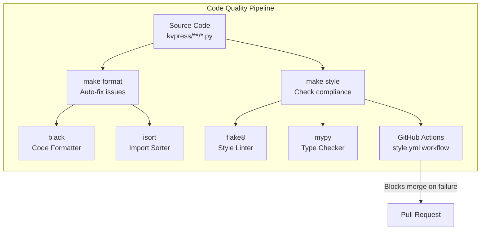
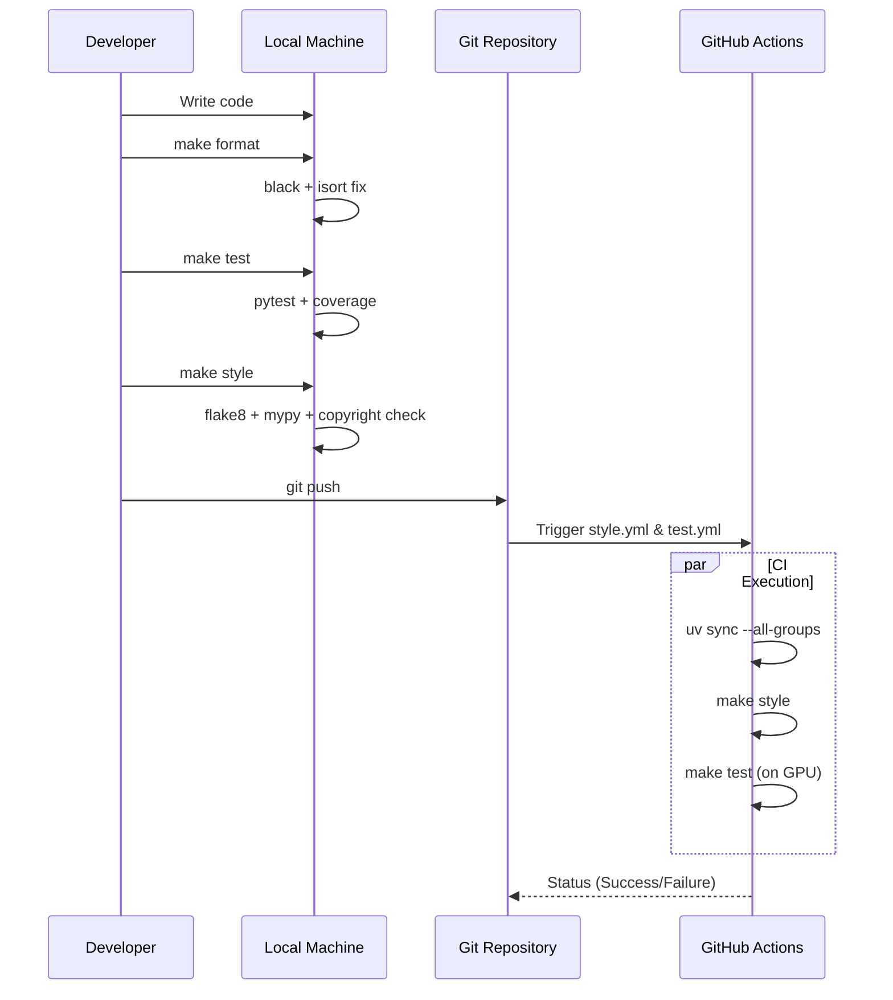

<!-- source: DeepWiki mcp.deepwiki.com · repo NVIDIA/kvpress · page 6.4 Development Tools · fetched 2026-10-26 -->

# Development Tools

<details>
<summary>Relevant source files</summary>

The following files were used as context for generating this wiki page:

- [.flake8](.flake8)
- [.github/workflows/python-publish.yml](.github/workflows/python-publish.yml)
- [.github/workflows/style.yml](.github/workflows/style.yml)
- [.github/workflows/test.yml](.github/workflows/test.yml)
- [Makefile](Makefile)
- [kvpress/presses/kvcompose_press.py](kvpress/presses/kvcompose_press.py)
- [pyproject.toml](pyproject.toml)

</details>


This document describes the development tooling infrastructure used in kvpress, including package management, dependency management, code quality tools, type checking, and automation commands. These tools ensure consistent code style, type safety, and facilitate efficient development workflows.

For information about the testing framework and test organization, see **6.1 Testing Framework**. For CI/CD automation and GitHub Actions workflows, see **6.2 CI/CD Pipeline**. For contribution guidelines and PR requirements, see **6.3 Contribution Guide**.

---

## Package Management with uv

kvpress uses **uv** as its primary package manager, replacing traditional pip-based workflows. The uv package manager provides fast dependency resolution, reproducible environments, and efficient caching.

### Installation and Setup

The uv package manager is installed automatically in CI/CD pipelines [ .github/workflows/test.yml:18-21]() and [ .github/workflows/style.yml:18-21]():

```bash
# Install uv (standard installation)
curl -LsSf https://astral.sh/uv/install.sh | sh

# Install all dependencies including development dependencies
uv sync --all-groups
```

### Dependency Groups

Dependencies are organized into three categories in [ pyproject.toml:13-57]():

| Dependency Group | Purpose | Installation |
|-----------------|---------|--------------|
| **Core dependencies** | Runtime requirements for kvpress (torch, transformers, accelerate) | Installed by default |
| **Optional: eval** | Evaluation framework dependencies (rouge, nltk, bert-score, fuzzywuzzy) | `uv sync --extra eval` |
| **Optional: flash-attn** | Flash Attention 2 support | `uv sync --extra flash-attn` |
| **Development groups** | Testing, linting, formatting tools (pytest, flake8, mypy, black) | `uv sync --all-groups` |

### uv Configuration

Special configuration is required for the `flash-attn` package to ensure it can be built correctly in different environments without pre-built isolation issues [ pyproject.toml:64-65]():

```toml
[tool.uv]
no-build-isolation-package = ["flash-attn"]
```

**Sources:** [ pyproject.toml:13-65](), [ .github/workflows/test.yml:18-25](), [ .github/workflows/style.yml:18-24]()

---

## Build System

kvpress uses **hatchling** as its PEP 517-compliant build backend [ pyproject.toml:60-62]():

```toml
[build-system]
requires = ["hatchling"]
build-backend = "hatchling.build"
```

### Project Metadata

Core project configuration is defined in the `[project]` table [ pyproject.toml:1-24]():

| Field | Value | Description |
|-------|-------|-------------|
| `name` | "kvpress" | Package name |
| `version` | "0.5.4" | Current version [ pyproject.toml:3]() |
| `requires-python` | ">=3.10" | Minimum Python version |
| `readme` | "README.md" | Documentation file |

**Sources:** [ pyproject.toml:1-62]()

---

## Code Quality Tools

kvpress enforces code quality through automated tools: `black`, `isort`, `flake8`, and `mypy`. These tools are configured in `pyproject.toml` and executed via `make` commands.

### Tool Chain Overview



**Diagram: Code Quality Tool Pipeline**

**Sources:** [ .github/workflows/style.yml:1-28](), [ pyproject.toml:41-57](), [ Makefile:11-39]()

### Black - Code Formatter

Black provides opinionated code formatting with specific settings to maintain consistency [ pyproject.toml:67-70]():

| Configuration | Value | Purpose |
|--------------|-------|---------|
| `line-length` | 120 | Maximum characters per line |
| `target_version` | ["py310"] | Python 3.10 syntax |
| `exclude` | `(.eggs|.git|venv|.venv|...)` | Skip virtual environments and build artifacts |

### isort - Import Organizer

isort sorts and organizes Python imports according to PEP 8 conventions [ pyproject.toml:72-79]():

| Configuration | Value | Purpose |
|--------------|-------|---------|
| `multi_line_output` | 3 | Vertical hanging indent style |
| `include_trailing_comma` | true | Add trailing commas to multi-line imports |
| `line_length` | 120 | Match black's line length |
| `use_parentheses` | true | Use parentheses for line continuation |

### mypy - Type Checker

mypy performs static type checking to catch type errors before runtime [ pyproject.toml:81-86]():

| Configuration | Value | Purpose |
|--------------|-------|---------|
| `ignore_missing_imports` | true | Don't error on untyped third-party libraries |
| `allow_redefinition` | true | Allow variable redefinition |
| `exclude` | `(tests|dist|.venv|...)` | Skip test and temporary files |
| `disable_error_code` | `["union-attr", "operator", ...]` | Suppress specific error categories |

#### Module-Specific Overrides

Special type checking rules for complex modules [ pyproject.toml:88-95]():

- **kvpress.presses.base_press**: Disables `attr-defined` errors [ pyproject.toml:90]() due to dynamic hook registration.
- **kvpress.pipeline**: Disables `attr-defined`, `assignment`, and `override` errors [ pyproject.toml:94]() due to HuggingFace Pipeline inheritance patterns.

**Sources:** [ pyproject.toml:67-95](), [ Makefile:32-34]()

---

## Make Commands

The `Makefile` provides standardized entry points for common development tasks. These commands are utilized in local development and CI/CD pipelines.

### Command Reference

| Command | Definition | Purpose |
|---------|------------|---------|
| `make isort` | `$(UV) run isort .` | Sort imports [ Makefile:11-12]() |
| `make black` | `$(UV) run black .` | Format code [ Makefile:15-16]() |
| `make format` | `isort black` | Run all auto-formatters [ Makefile:18-19]() |
| `make style` | `flake8 + mypy + copyright check` | Verify code quality and headers [ Makefile:21-39]() |
| `make test` | `uv pip install flash-attn + pytest` | Run the full test suite with coverage [ Makefile:44-59]() |

### Copyright Header Enforcement

The `make style` command includes a specific check for SPDX copyright headers in all Python files [ Makefile:35-38]():

```bash
Checking for SPDX-FileCopyrightText headers in Python files...
find . -name "*.py" -not -path "*/\.*" | xargs grep -L "SPDX-FileCopyrightText:"
```

**Sources:** [ Makefile:1-59]()

---

## Development Workflow Integration

The development tools integrate into the standard contribution workflow via GitHub Actions.



**Diagram: Development Workflow with Tool Integration**

### Automated Quality Checks

- **Style Workflow**: Triggered on push to `main` and pull requests. It runs `make style` on `ubuntu-latest` [ .github/workflows/style.yml:1-28]().
- **Test Workflow**: Triggered on push to `main` and specific PR branches. It runs `make test` on a specialized Linux GPU runner (`linux-amd64-gpu-l4-latest-1`) [ .github/workflows/test.yml:1-34]().
- **Package Release**: Triggered on published releases to build and upload the package to PyPI using `uv build` [ .github/workflows/python-publish.yml:1-32]().

**Sources:** [ .github/workflows/style.yml:1-28](), [ .github/workflows/test.yml:1-34](), [ .github/workflows/python-publish.yml:1-32](), [ Makefile:1-59]()

---

