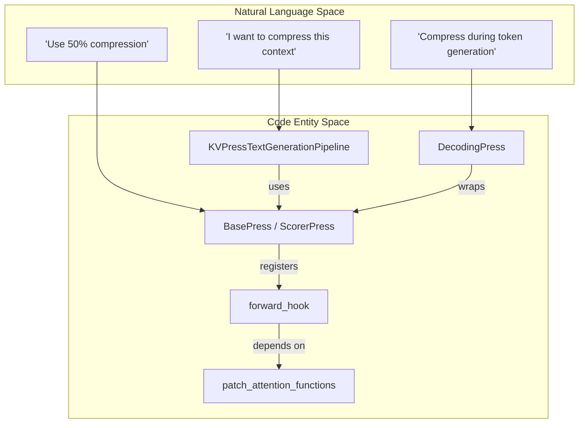
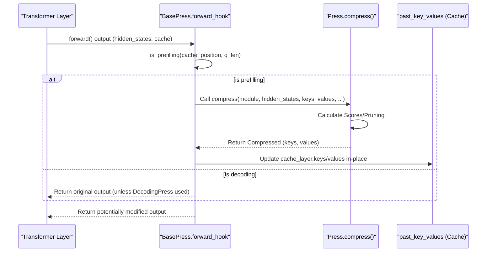

<!-- source: DeepWiki mcp.deepwiki.com · repo NVIDIA/kvpress · page 7 Glossary · fetched 2026-10-26 -->

# Glossary

Relevant source files

The following files were used as context for generating this wiki page:

- [README.md](README.md)
- [evaluation/benchmarks/longbench/calculate_metrics.py](evaluation/benchmarks/longbench/calculate_metrics.py)
- [evaluation/evaluate_registry.py](evaluation/evaluate_registry.py)
- [kvpress/__init__.py](kvpress/__init__.py)
- [kvpress/presses/base_press.py](kvpress/presses/base_press.py)
- [kvpress/presses/decoding_press.py](kvpress/presses/decoding_press.py)
- [kvpress/presses/expected_attention_press.py](kvpress/presses/expected_attention_press.py)
- [kvpress/presses/kvzap_press.py](kvpress/presses/kvzap_press.py)
- [kvpress/presses/prefill_decoding_press.py](kvpress/presses/prefill_decoding_press.py)
- [kvpress/presses/snapkv_press.py](kvpress/presses/snapkv_press.py)
- [kvpress/presses/think_press.py](kvpress/presses/think_press.py)
- [kvzap/data.py](kvzap/data.py)
- [kvzap/evaluate_aime.py](kvzap/evaluate_aime.py)
- [kvzap/train.py](kvzap/train.py)

This glossary defines technical terms, architectural components, and domain-specific concepts used throughout the `kvpress` library. It serves as a reference for onboarding engineers to understand how LLM KV cache compression is implemented and integrated with the Hugging Face ecosystem.

## Core Concepts

### KV Cache
The Key-Value (KV) cache stores the intermediate keys and values of the self-attention layers in transformer models. Storing these tensors prevents redundant computations during the autoregressive decoding phase. However, the cache grows linearly with sequence length, leading to memory bottlenecks for long-context applications [README.md:13-13]().

### Press
A "Press" is the primary abstraction in `kvpress` for a compression algorithm. All compression methods inherit from `BasePress` and implement logic to reduce the size of the KV cache [kvpress/presses/base_press.py:44-53]().

### Prefilling vs. Decoding Phase
*   **Prefilling:** The initial phase where the entire context (prompt) is processed. `kvpress` typically applies compression at the end of this phase [README.md:39-39](), [kvpress/presses/base_press.py:105-112]().
*   **Decoding:** The autoregressive phase where the model generates one token at a time. Some specialized presses, like `DecodingPress`, perform periodic compression during this phase [README.md:57-67](), [kvpress/presses/decoding_press.py:23-43]().

### Sink Tokens
A small number of initial tokens (often the first 1-4 tokens) that are protected from pruning. These tokens often receive high attention weights regardless of their semantic content, a phenomenon known as "attention sink" [kvpress/presses/expected_attention_press.py:39-42]().

## System Architecture

The following diagram illustrates the relationship between the Natural Language Space (User Intent) and the Code Entity Space (Implementation).

**System Mapping: User Pipeline to Code Entities**

Sources: [kvpress/pipeline.py:6-6](), [kvpress/presses/base_press.py:44-53](), [kvpress/presses/base_press.py:101-137](), [kvpress/__init__.py:52-53](), [kvpress/presses/decoding_press.py:23-43]()

## Key Code Entities

### BasePress
The abstract base class for all compression methods. It defines the `compress` method and the `forward_hook` used to intercept attention layer outputs [kvpress/presses/base_press.py:44-53]().
*   **Key Function:** `forward_hook` [kvpress/presses/base_press.py:101-162]().
*   **Context Manager:** Allows using a press via `with press(model):` [kvpress/presses/base_press.py:164-181]().

### ScorerPress
A specialized subclass of `BasePress` that follows a "Score-and-Prune" pattern. It calculates an importance score for every token in the cache and removes those with the lowest scores [kvpress/presses/scorer_press.py:17-30]().
*   **Key Function:** `score(...)` [kvpress/presses/scorer_press.py:35-74]().
*   **Key Function:** `compress(...)` (Standardized implementation for all scorers) [kvpress/presses/scorer_press.py:76-102]().

### DecodingPress
A wrapper press that operates during the decoding phase. It maintains a `hidden_states_buffer` and applies compression every `compression_interval` steps to reach a `target_size` [kvpress/presses/decoding_press.py:23-49]().

### KVzap
A fast approximation of `KVzip` that uses a surrogate model (Linear or MLP) to predict importance scores directly from hidden states [kvpress/presses/kvzap_press.py:52-61](). It is typically used via `DMSPress` [evaluation/evaluate_registry.py:100-101]().

**Data Flow: Attention Hook and Compression**

Sources: [kvpress/presses/base_press.py:101-162](), [kvpress/presses/scorer_press.py:76-102](), [kvpress/presses/decoding_press.py:113-162]()

## Terminology & Jargon

| Term | Definition | Code Reference |
| :--- | :--- | :--- |
| **Compression Ratio** | The fraction of KV pairs to remove (e.g., 0.5 means 50% removed). | [kvpress/presses/scorer_press.py:30-30]() |
| **KV Groups** | Used in Grouped-Query Attention (GQA). Scores are often averaged across these groups. | [kvpress/presses/snapkv_press.py:82-82]() |
| **RoPE** | Rotary Positional Embeddings. Presses like `ExpectedAttentionPress` must account for RoPE when predicting future scores. | [kvpress/presses/expected_attention_press.py:88-124]() |
| **Window Size** | The number of recent tokens used to calculate importance for historical tokens. | [kvpress/presses/snapkv_press.py:38-39]() |
| **QuantizedCache** | A Hugging Face cache type. `kvpress` handles re-quantization after compression. | [kvpress/presses/base_press.py:152-157]() |
| **Target Size** | Used in `DecodingPress` to specify the exact number of tokens to keep after pruning. | [kvpress/presses/decoding_press.py:47-47]() |

## Evaluation Framework Registry

The evaluation system uses registries to map string identifiers to implementation objects, facilitating CLI-based benchmarking.

*   **DATASET_REGISTRY:** Maps names like `loogle` or `ruler` to Hugging Face dataset paths [evaluation/evaluate_registry.py:52-64]().
*   **PRESS_REGISTRY:** Maps configuration names to instantiated `Press` objects, including complex wrappers like `AdaKVPress(SnapKVPress())` [evaluation/evaluate_registry.py:80-137]().
*   **SCORER_REGISTRY:** Maps datasets to their specific metric calculation functions [evaluation/evaluate_registry.py:66-77]().

Sources: [evaluation/evaluate_registry.py:1-137]()