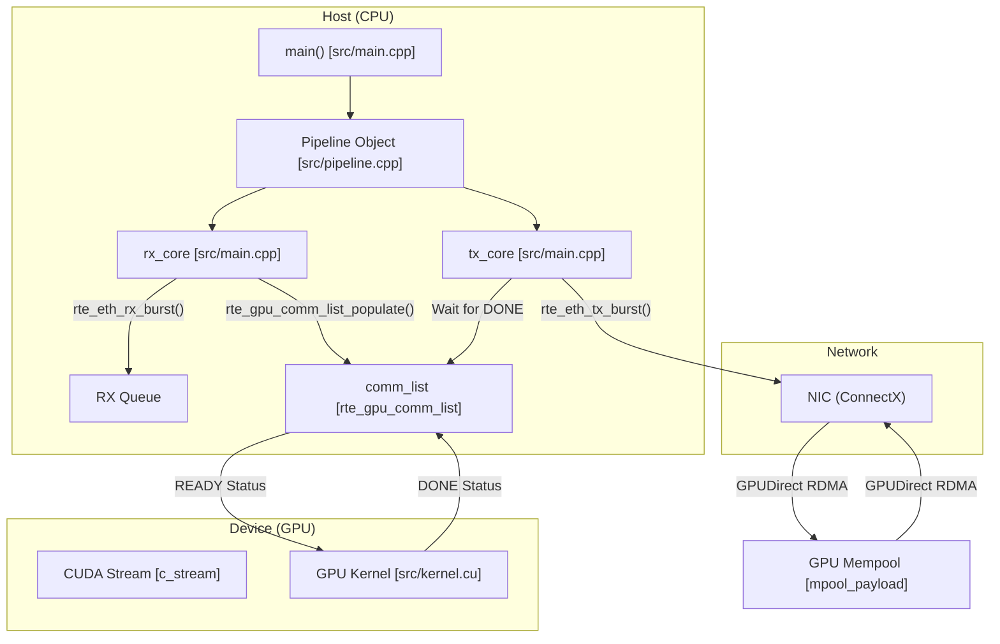
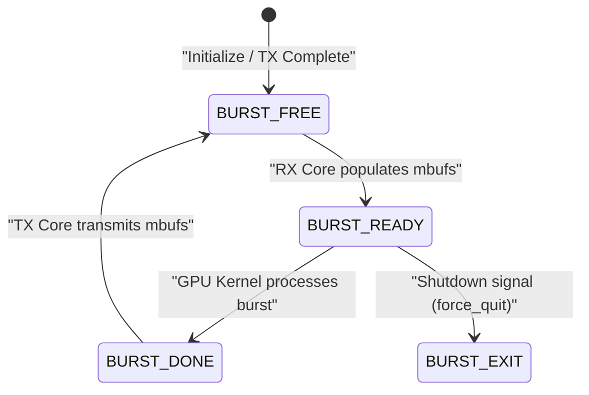

<!-- source: DeepWiki mcp.deepwiki.com · repo NVIDIA/l2fwd-nv · page 1.1 Project Purpose and Architecture · fetched 2026-10-26 -->

# Project Purpose and Architecture

Relevant source files

The following files were used as context for generating this wiki page:

- [README.md](README.md)
- [include/common.h](include/common.h)
- [src/main.cpp](src/main.cpp)

The `l2fwd-nv` application is a high-performance packet processing showcase designed to demonstrate the integration of the Data Plane Development Kit (DPDK) with NVIDIA GPUs using the `gpudev` library. It extends the classic DPDK `l2fwd` example by enabling packet payloads to be stored in GPU memory and processed via CUDA kernels, leveraging GPUDirect RDMA for low-latency data transfer [README.md:1-6]().

## Application Goals

The primary goal of `l2fwd-nv` is to provide a reference implementation for:
*   **GPUDirect RDMA:** Direct data transfer between Network Interface Cards (NICs) and GPU memory [README.md:31-33]().
*   **GPU-Centric Networking:** Utilizing the `gpudev` library (introduced in DPDK 21.11) to manage GPU memory and communication [README.md:45-46]().
*   **Workload Pipelining:** Demonstrating efficient CPU-GPU synchronization models to maintain high throughput and low latency [README.md:8-17]().

## Pipeline Architecture

The application is structured around the `Pipeline` abstraction. Each pipeline operates independently on a dedicated set of CPU cores and a DPDK queue pair [README.md:8-11]().

### The Pipeline Model
A single pipeline consists of three logical stages:
1.  **RX Stage (CPU):** A dedicated `rx_core` receives packets from a DPDK RX queue and accumulates them into bursts [README.md:9-13]().
2.  **Workload Stage (CPU/GPU):** The accumulated burst is processed. Depending on the configuration, this may be a simple CPU-based MAC swap or a complex CUDA kernel execution [README.md:10-14]().
3.  **TX Stage (CPU):** A dedicated `tx_core` waits for the workload completion and transmits the modified packets through a DPDK TX queue [README.md:11-16]().

### Data Flow Diagram: NIC to GPU to NIC
The following diagram illustrates the data flow and the interaction between code entities across the pipeline stages.

**Pipeline Data Flow and Entity Mapping**

Sources: [src/main.cpp:250-280](), [src/pipeline.cpp:45-80](), [README.md:8-17](), [include/common.h:85-93]()

## Supported Workload Modes

The application supports several execution modes, defined by the `workload_flags` enum in `include/common.h` [include/common.h:74-80]().

| Mode | Flag | Description | Implementation |
| :--- | :--- | :--- | :--- |
| **No Workload** | `NO_WORKLOAD` | Basic I/O forwarding without packet modification. | [src/main.cpp:170-174]() |
| **CPU Workload** | `CPU_WORKLOAD` | The CPU performs MAC address swapping on the host. | [README.md:24]() |
| **Standard GPU** | `GPU_WORKLOAD` | A discrete CUDA kernel is launched for every burst. | [src/kernel.cu:35-50]() |
| **Persistent GPU** | `GPU_PK_WORKLOAD` | A single long-running kernel polls for new data in a loop. | [src/kernel.cu:150-180]() |
| **CUDA Graphs** | `GPU_GRAPHS_WORKLOAD` | Uses CUDA Graphs to chain multiple burst executions with low overhead. | [src/pipeline.cpp:120-150]() |

Sources: [include/common.h:74-80](), [README.md:19-28]()

## System Synchronization and Communication

The CPU and GPU communicate via a structured list of descriptors managed by the `gpudev` library. The primary structure used for this is the `rte_gpu_comm_list` [src/pipeline.cpp:65-70]().

### The `burst_item` Lifecycle
Each packet burst is tracked using a `burst_item` structure, which resides in memory accessible by both CPU and GPU [include/common.h:85-93]().

**Workload Lifecycle States**

Sources: [include/common.h:39-42](), [src/main.cpp:91](), [src/kernel.cu:200-220]()

### Memory Management
The application supports two primary memory configurations for the packet mempool, controlled by `conf_mem_type` [src/main.cpp:23]():
1.  **`MEM_HOST_PINNED` (0):** Packets are stored in CPU memory that is pinned and mapped for GPU access [include/common.h:61]().
2.  **`MEM_DEVMEM` (1):** Packets are stored directly in GPU memory. The NIC uses GPUDirect RDMA to write/read directly to/from the GPU VRAM [include/common.h:60]().

When using GPU memory, `l2fwd-nv` can also enable **Buffer Split** (`-s` flag). This feature splits an incoming packet: the header (first 60 bytes) is stored in CPU memory for easy protocol processing, while the payload is stored in GPU memory for parallel computation [src/main.cpp:36](), [include/common.h:57-58]().

Sources: [src/main.cpp:22-37](), [include/common.h:60-61](), [README.md:21-28]()

---

