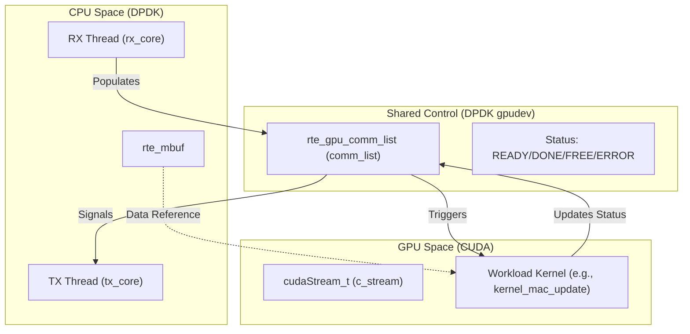
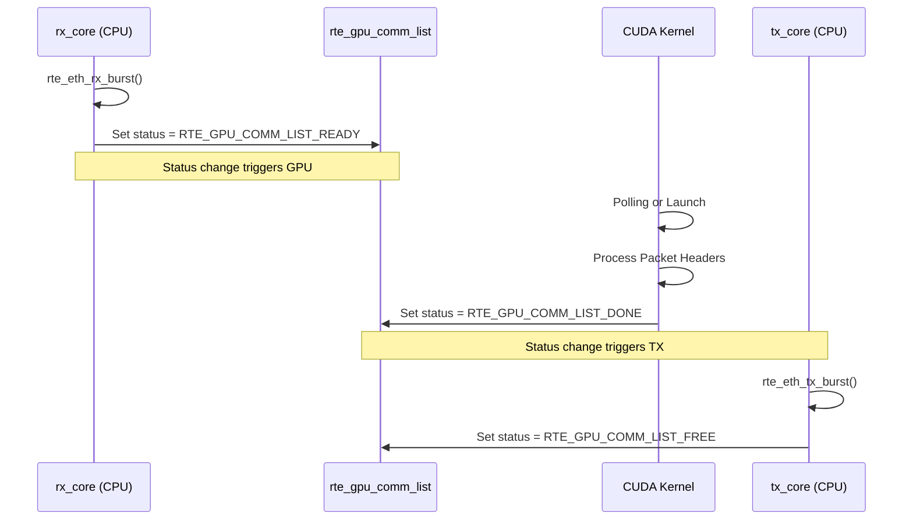

<!-- source: DeepWiki mcp.deepwiki.com · repo NVIDIA/l2fwd-nv · page 2 Core Architecture · fetched 2026-10-26 -->

# Core Architecture

Relevant source files

The following files were used as context for generating this wiki page:

- [include/common.h](include/common.h)
- [src/main.cpp](src/main.cpp)
- [src/pipeline.cpp](src/pipeline.cpp)

The `l2fwd-nv` application is built around a high-performance pipeline designed to bridge DPDK's packet processing capabilities with NVIDIA GPU parallel computing. The architecture minimizes CPU involvement in the data path by using asynchronous communication and direct memory access (GPUDirect RDMA).

### System Overview

The application organizes work into multiple independent pipelines. Each pipeline maps to a specific set of CPU cores (RX and TX) and a GPU stream. Data flows from the NIC directly to GPU-visible memory, where it is processed by CUDA kernels before being transmitted back through the NIC.

#### Data Flow and Code Entity Mapping
The following diagram illustrates how high-level architectural components map to specific code entities and data structures.

**Diagram: Architectural Component Mapping**

**Sources:** [src/main.cpp:53-53](), [include/pipeline.h:38-60](), [include/common.h:85-93]()

---

### Pipeline Abstraction
The `Pipeline` class in `include/pipeline.h` is the central orchestrator for each data stream. It encapsulates the CUDA stream, the communication ring buffer, and telemetry data.

- **Initialization**: The constructor initializes the `rte_gpu_comm_list` using `rte_gpu_comm_create_list` [src/pipeline.cpp:33-35]().
- **Workload Branching**: Depending on the `workload_type` (e.g., `GPU_WORKLOAD`, `GPU_PK_WORKLOAD`), the pipeline either launches kernels per-burst or sets up persistent/graph-based workloads [src/pipeline.cpp:49-77]().
- **Shutdown**: The `terminateWorkload()` function uses the `RTE_GPU_COMM_LIST_ERROR` status to gracefully signal GPU kernels to exit their loops [src/pipeline.cpp:98-110]().

For details, see [Pipeline Abstraction](#2.1).

**Sources:** [src/pipeline.cpp:19-78](), [include/pipeline.h:38-66]()

---

### RX/TX Threading Model
The application uses a split-core model to maximize throughput. For every pipeline, two EAL remote threads are launched: one for receiving packets (`rx_core`) and one for transmitting them (`tx_core`).

- **Synchronization**: The threads synchronize with the GPU using a circular buffer of `struct burst_item` managed by the `rte_gpu_comm_list` [include/common.h:85-93]().
- **Burst Management**: The `rx_core` accumulates packets into bursts (up to `MAX_MBUFS_BURST`) before handing them to the GPU [include/common.h:34-34]().
- **Flow Control**: The `GAP_PKTS` mechanism ensures there is a safety buffer between the producer (RX) and consumer (TX) indices in the ring buffer [include/common.h:62-62]().

For details, see [RX/TX Threading Model](#2.2).

**Sources:** [src/main.cpp:1146-1152](), [include/common.h:34-42]()

---

### Memory Management and GPU Communication
Efficient CPU-GPU communication is achieved through the `gpudev` library and specialized mempool configurations.

- **Mempool Strategies**: Supports `MEM_HOST_PINNED` (CPU memory registered with the GPU) and `MEM_DEVMEM` (GPU-native memory registered with DPDK) [include/common.h:60-61]().
- **Communication Protocol**: The `rte_gpu_comm_list` provides a standardized way for the CPU to signal "READY" to the GPU and for the GPU to signal "DONE" back to the CPU [include/common.h:39-42]().
- **Buffer Split**: To optimize processing, the system can split packets into headers (for GPU processing) and payloads [src/main.cpp:36-36]().

For details, see [Memory Management and GPU Communication](#2.3).

**Sources:** [src/main.cpp:23-23](), [src/main.cpp:59-60](), [include/common.h:65-68]()

---

### Core Interaction Sequence
The following diagram shows the lifecycle of a single packet burst as it moves through the core architecture entities.

**Diagram: Burst Lifecycle Sequence**

**Sources:** [src/main.cpp:750-850](), [src/main.cpp:950-1050](), [include/common.h:39-42]()

---

