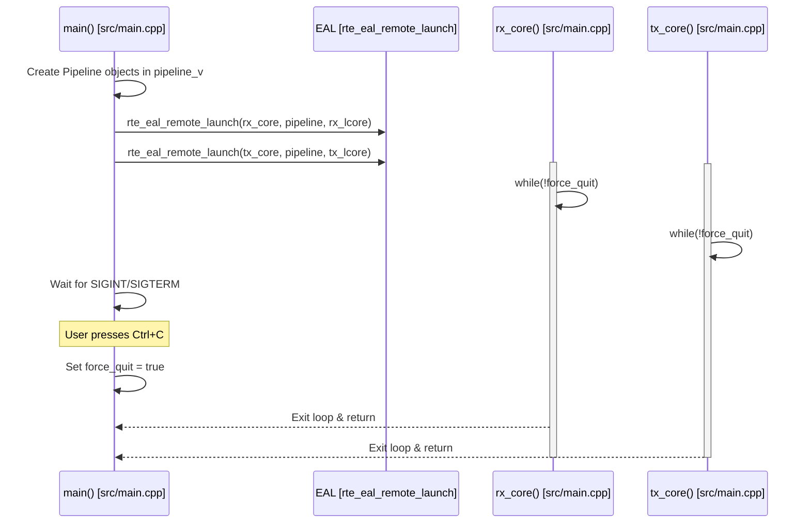
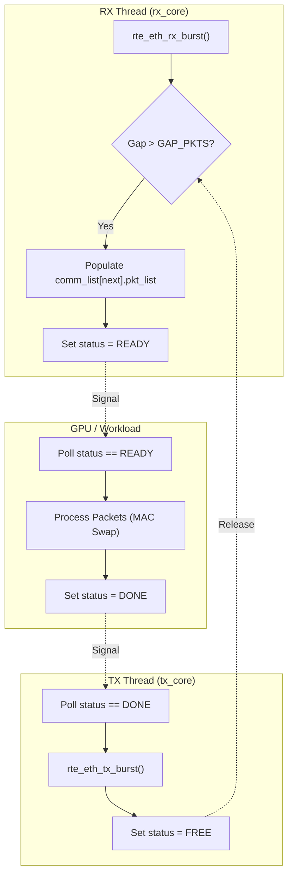

<!-- source: DeepWiki mcp.deepwiki.com · repo NVIDIA/l2fwd-nv · page 2.2 RX/TX Threading Model · fetched 2026-10-26 -->

# RX/TX Threading Model

Relevant source files

The following files were used as context for generating this wiki page:

- [include/common.h](include/common.h)
- [include/headers.h](include/headers.h)
- [src/main.cpp](src/main.cpp)

The `l2fwd-nv` application employs a decoupled threading model where RX and TX operations for each pipeline are executed on dedicated CPU cores. This separation, combined with a ring-buffer-based communication protocol, allows the application to overlap network I/O with GPU execution, maximizing throughput and minimizing latency.

## Thread Launch and Lifecycle

The application utilizes the DPDK EAL (Environment Abstraction Layer) to manage CPU affinity and thread execution. For every configured pipeline, two distinct functions are launched on remote lcores using `rte_eal_remote_launch` [src/main.cpp:575-578]().

*   **RX Thread (`rx_core`)**: Responsible for polling the NIC, accumulating packets into bursts, and signaling the GPU (or CPU workload) that data is ready.
*   **TX Thread (`tx_core`)**: Responsible for polling the completion status of bursts and transmitting processed packets back through the NIC.

The `force_quit` flag is a global volatile boolean used to signal all threads to exit their processing loops gracefully [src/main.cpp:91-91]().

### Thread Initialization Flow
The following diagram illustrates how the main thread orchestrates the launch of the pipeline threads.

**Pipeline Thread Orchestration**

Sources: [src/main.cpp:575-578](), [src/main.cpp:91-91](), [src/main.cpp:315-315](), [src/main.cpp:450-450]()

---

## Communication via `rte_gpu_comm_list`

Synchronization between the CPU threads and the GPU workload is managed through the `rte_gpu_comm_list` provided by the DPDK `gpudev` library. This structure acts as a circular ring buffer of communication items, where each item represents a single burst of packets [src/pipeline.cpp:88-100]().

### Burst Lifecycle States
The communication protocol relies on the `status` field of the `rte_gpu_comm_list` items:
1.  **`RTE_GPU_COMM_LIST_FREE`**: The item is available for the RX core to populate.
2.  **`RTE_GPU_COMM_LIST_READY`**: The RX core has filled the item with packet pointers and lengths; the GPU can now process it.
3.  **`RTE_GPU_COMM_LIST_DONE`**: The GPU (or CPU workload) has finished processing; the TX core can now transmit.
4.  **`RTE_GPU_COMM_LIST_ERROR`**: Indicates a failure or a signal to terminate (used by persistent kernels) [include/common.h:39-42]().

### Burst Accumulation and GAP_PKTS
The `rx_core` does not necessarily signal the GPU for every small packet arrival. It attempts to accumulate packets up to `conf_pkt_burst_size` [src/main.cpp:337-340](). 

A critical optimization is the `GAP_PKTS` mechanism. To prevent the RX core from being blocked by a slow consumer, the `rx_core` ensures there is always a minimum gap of `GAP_PKTS` free items in the `comm_list` ring before fetching more packets from the NIC [src/main.cpp:333-335](). If the gap is insufficient, the RX core stalls to avoid overwriting items currently being processed by the GPU or TX core.

Sources: [src/pipeline.cpp:88-100](), [include/common.h:39-42](), [include/common.h:62-62](), [src/main.cpp:333-340]()

---

## Data Flow: RX to TX

The interaction between the two threads and the GPU is mediated by the `comm_list` and the `Pipeline` object.

**RX/TX Data Flow and State Machine**

Sources: [src/main.cpp:315-448](), [src/main.cpp:450-530](), [include/common.h:62-62]()

---

## Statistics and PPS Reporting

Each `Pipeline` object maintains internal telemetry to track performance without requiring global locks.

### Per-Pipeline Statistics
The following fields in the `Pipeline` class are updated during the main loops:
*   `rx_pkts`: Total packets received by the `rx_core` [src/main.cpp:417-417]().
*   `tx_pkts`: Total packets transmitted by the `tx_core` [src/main.cpp:513-513]().
*   `start_rx_core` / `stop_rx_core`: Timestamps for the duration of the RX loop [src/main.cpp:322-322](), [src/main.cpp:447-447]().
*   `start_tx_core` / `stop_tx_core`: Timestamps for the duration of the TX loop [src/main.cpp:457-457](), [src/main.cpp:529-529]().

### Warmup and Performance Phases
The application distinguishes between "warmup" and "performance" packets to ensure measurements are taken when the system is in a steady state:
*   `conf_warmup_packets`: Packets processed before statistics start [src/main.cpp:30-30]().
*   `conf_performance_packets`: Total packets to process before the application triggers `force_quit` [src/main.cpp:31-31]().

### Reporting Logic
The `print_stats()` function calculates the Packets Per Second (PPS) for each queue by dividing the `rx_pkts` (or `tx_pkts`) by the total elapsed time recorded by the core timestamps [src/main.cpp:129-134](). It also compares `l2fwd-nv` internal counters against the hardware counters retrieved via `rte_eth_stats_get()` [src/main.cpp:105-105]().

| Statistic | Source Entity | Description |
| :--- | :--- | :--- |
| **RX PPS** | `Pipeline::rx_pkts` | (rx_pkts) / (stop_rx_core - start_rx_core) |
| **TX PPS** | `Pipeline::tx_pkts` | (tx_pkts) / (stop_tx_core - start_tx_core) |
| **Dropped (HW)** | `rte_eth_stats::imissed` | Packets dropped by NIC due to full RX queues |
| **Errors** | `rte_eth_stats::ierrors` | Erroneous packets received by NIC |

Sources: [src/main.cpp:96-168](), [include/pipeline.h:55-64](), [src/main.cpp:30-31]()

---

