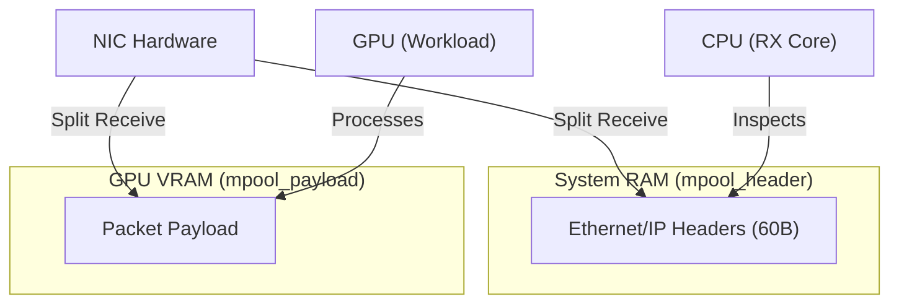
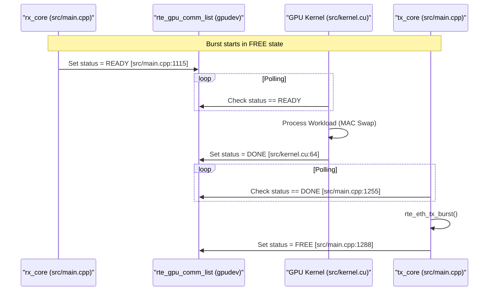
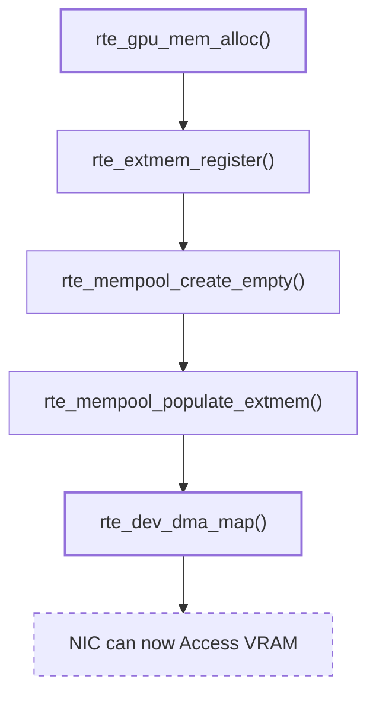

<!-- source: DeepWiki mcp.deepwiki.com · repo NVIDIA/l2fwd-nv · page 2.3 Memory Management and GPU Communication · fetched 2026-10-26 -->

# Memory Management and GPU Communication

Relevant source files

The following files were used as context for generating this wiki page:

- [include/common.h](include/common.h)
- [include/headers.h](include/headers.h)
- [src/main.cpp](src/main.cpp)

This page details the memory allocation strategies and the synchronization protocol used by `l2fwd-nv` to facilitate high-performance data movement between the Network Interface Card (NIC), System RAM, and GPU VRAM. The application leverages DPDK's `gpudev` library and NVIDIA GPUDirect RDMA to minimize CPU involvement in the data path.

## Mempool Strategies

`l2fwd-nv` supports two primary memory management strategies for packet buffers, determined by the `conf_mem_type` variable (controlled via the `-m` CLI flag) [src/main.cpp:23-23](). Both strategies aim to make packet data accessible to the GPU for processing.

### 1. Host Pinned Memory (MEM_HOST_PINNED)
In this mode, packets are received into standard CPU system memory (hugepages). The memory is "pinned" and registered with the GPU so the GPU can access it over PCIe via DMA.
- **Implementation**: The application calls `rte_gpu_mem_register` to map the CPU-resident mempool into the GPU address space [src/main.cpp:665-673]().
- **Use Case**: Suitable for systems without GPUDirect RDMA support or when the workload requires frequent CPU access to packet headers.

### 2. Device Memory (MEM_DEVMEM)
This mode utilizes GPUDirect RDMA to receive packets directly into GPU VRAM.
- **Allocation**: Memory is allocated on the GPU using `rte_gpu_mem_alloc` [src/main.cpp:607-607]().
- **Registration**: The allocated GPU memory is registered as DPDK external memory using `rte_extmem_register` [src/main.cpp:615-615]().
- **DMA Mapping**: The memory is then DMA-mapped to the NIC using `rte_dev_dma_map` to allow the hardware to write directly to VRAM [src/main.cpp:624-624]().

### Memory Alignment and Page Size
GPU memory allocations must be aligned to the GPU page size. `l2fwd-nv` defines `GPU_PAGE_SIZE` as 64KB ($2^{16}$) [include/common.h:65-66]().
- **Alignment Calculation**: `ext_mem.buf_len = RTE_ALIGN_CEIL(total_mem_size, GPU_PAGE_SIZE)` [src/main.cpp:612-612]().

**Sources**: [src/main.cpp:600-680](), [include/common.h:60-70]()

---

## Buffer Split Feature

To optimize processing, `l2fwd-nv` can split incoming packets into two segments: a **Header** (stored in CPU memory) and a **Payload** (stored in GPU memory). This is enabled via the `-s` flag [src/main.cpp:46-46]().

- **mpool_header**: A mempool created in CPU memory for protocol headers [src/main.cpp:59]().
- **mpool_payload**: A mempool created in GPU memory for the data [src/main.cpp:59]().
- **Configuration**: The `rte_eth_rxconf` structure is configured with `RTE_ETH_RX_OFFLOAD_BUFFER_SPLIT` [src/main.cpp:66-66]().
- **Headroom**: The application sets `RTE_PKTMBUF_HEADROOM=0` implicitly by not relying on standard offsets, ensuring the payload starts exactly at the beginning of the GPU buffer for simplified kernel indexing.

### Buffer Split Data Flow
Title: Buffer Split Memory Layout

**Sources**: [src/main.cpp:55-78](), [src/main.cpp:712-750](), [include/common.h:57-58]()

---

## CPU-GPU Communication Protocol

The synchronization between the CPU (managing RX/TX) and the GPU (executing kernels) is handled via `rte_gpu_comm_list`. This structure acts as a circular buffer of communication items that track the lifecycle of a packet burst.

### The `rte_gpu_comm_list` Lifecycle
Each entry in the list has a `status` field that transitions through specific states:

| State | Entity Responsible | Description |
| :--- | :--- | :--- |
| `RTE_GPU_COMM_LIST_FREE` | CPU (TX Core) | The slot is empty and ready for a new RX burst. |
| `RTE_GPU_COMM_LIST_READY` | CPU (RX Core) | CPU has populated the slot with packet pointers; GPU can start. |
| `RTE_GPU_COMM_LIST_DONE` | GPU (Kernel) | GPU has finished processing; CPU can transmit the packets. |
| `RTE_GPU_COMM_LIST_ERROR` | CPU/GPU | An error occurred or the application is shutting down. |

### Synchronization Diagram
Title: CPU-GPU Burst Lifecycle (Code Entities)

**Sources**: [src/main.cpp:1100-1120](), [src/main.cpp:1250-1290](), [src/kernel.cu:50-70](), [include/common.h:39-42]()

---

## DMA Mapping and Registration

For the NIC to interact with GPU memory, the memory must be visible to the I/O Memory Management Unit (IOMMU).

### Implementation Flow
1. **rte_gpu_mem_alloc**: Reserves a contiguous block of VRAM [src/main.cpp:607]().
2. **rte_extmem_register**: Informs DPDK about this external memory block so it can be used to back an `rte_mempool` [src/main.cpp:615]().
3. **rte_dev_dma_map**: Maps the memory for the specific NIC device. This ensures the PCIe `bus:device.function` has permission to perform DMA reads/writes to those addresses [src/main.cpp:624]().

Title: Memory Registration and DMA Mapping Logic

### Page Alignment and Multi-segment Considerations
When using `MEM_DEVMEM`, `l2fwd-nv` calculates the required memory based on the number of mbufs and the data room size, then aligns it to the 64KB GPU page boundary to satisfy `gpudev` requirements [src/main.cpp:603-612]().

**Sources**: [src/main.cpp:600-640](), [include/common.h:65-68]()

---

