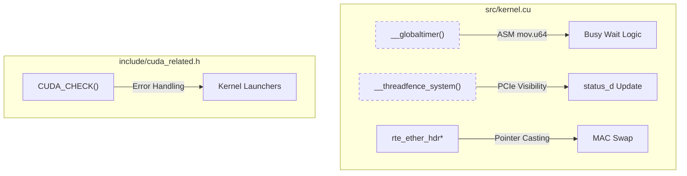

<!-- source: DeepWiki mcp.deepwiki.com · repo NVIDIA/l2fwd-nv · page 3 GPU Workload Engine · fetched 2026-10-26 -->

# GPU Workload Engine

Relevant source files

The following files were used as context for generating this wiki page:

- [include/cuda_related.h](include/cuda_related.h)
- [src/kernel.cu](src/kernel.cu)

The GPU Workload Engine is the core packet processing component of `l2fwd-nv`, implemented in `src/kernel.cu`. It provides the CUDA kernels responsible for manipulating packet data received via GPUDirect RDMA. The engine is designed to integrate seamlessly with the `Pipeline` class, which manages the orchestration of RX/TX cores and GPU execution streams.

The engine supports three distinct execution strategies to balance latency, throughput, and CPU overhead. Each strategy implements a MAC address swap (L2 Forwarding) and can simulate computational load using a busy-wait timer.

### GPU Workload Integration

The engine interfaces with the DPDK `rte_gpu_comm_list` structure to receive packet metadata and signal completion. Each workload strategy is launched via a specific wrapper function that configures the CUDA grid and stream.

#### System Overview: Workload to Code Mapping
The following diagram illustrates how the different workload strategies map to specific CUDA kernels and launcher functions within the codebase.

| Workload Type | Launcher Function | CUDA Kernel | Mode Flag |
| :--- | :--- | :--- | :--- |
| **Standard** | `workload_launch_gpu_processing` | `kernel_mac_update` | `-w 2` |
| **Persistent** | `workload_launch_persistent_gpu_processing` | `kernel_persistent_mac_update` | `-w 3` |
| **Graphs** | `workload_launch_graphs_gpu_processing` | `kernel_graphs_mac_update` | `-w 4` |

**Sources:**
- [src/kernel.cu:94-106]() (Standard Launcher)
- [src/kernel.cu:195-208]() (Persistent Launcher)
- [src/kernel.cu:243-255]() (Graphs Launcher)

### Workload Strategies

The engine provides three strategies to handle the packet processing lifecycle.

#### 1. Standard GPU Kernel (Per-Burst Launch)
This is the default GPU processing mode. For every burst of packets received by the RX core, a new CUDA kernel is launched into the pipeline's stream. It provides the simplest implementation but incurs the overhead of frequent kernel launches.
*   **Key Logic:** Casts packet addresses to `rte_ether_hdr` and swaps source/destination MAC addresses.
*   **Synchronization:** Uses `__threadfence_system()` and sets `RTE_GPU_COMM_LIST_DONE` on the status flag to notify the CPU.
*   For details, see [Standard GPU Kernel (Per-Burst Launch)](#3.1).

#### 2. Persistent Kernel Strategy
Designed for ultra-low latency, this strategy launches a single long-running kernel at application startup. The kernel stays resident on the GPU, polling the `status_d` flag in a `while(1)` loop.
*   **Key Logic:** Thread 0 polls for `RTE_GPU_COMM_LIST_READY` and signals the rest of the block via shared memory (`wait_status_shared`).
*   **Efficiency:** Eliminates the CPU-side overhead of repeated `cudaLaunchKernel` calls.
*   For details, see [Persistent Kernel Strategy](#3.2).

#### 3. CUDA Graphs Strategy
This strategy uses CUDA Graphs to pre-record the processing workflow. It combines the low launch overhead of persistent kernels with the scheduling flexibility of the standard model.
*   **Key Logic:** The pipeline records a sequence of `kernel_graphs_mac_update` executions into a graph, which is then instantiated and replayed.
*   **Synchronization:** The kernel internally polls for the `READY` status before processing, allowing the graph to be launched ahead of actual data arrival.
*   For details, see [CUDA Graphs Strategy](#3.3).

### Common Kernel Utilities

All kernels share a set of utility functions and synchronization primitives to ensure data consistency and timing accuracy.

*   **`__globaltimer()`**: Accesses the GPU hardware timer via inline PTX assembly to provide nanosecond-resolution timing for the `wtime_n` busy-wait simulation [src/kernel.cu:25-30]().
*   **Memory Fencing**: Uses `__threadfence()` to ensure packet data writes are complete, followed by `__threadfence_system()` when updating `status_d` to ensure the status change is visible to the CPU over the PCIe bus [src/kernel.cu:84-90]().
*   **Error Handling**: All launchers utilize the `CUDA_CHECK` macro defined in `include/cuda_related.h` to validate kernel execution and API calls [include/cuda_related.h:71-80]().

**Sources:**
- [src/kernel.cu:25-30]() (Global Timer)
- [src/kernel.cu:84-90]() (Fencing)
- [include/cuda_related.h:71-80]() (CUDA_CHECK)

### Strategy Comparison

| Feature | Standard (`-w 2`) | Persistent (`-w 3`) | Graphs (`-w 4`) |
| :--- | :--- | :--- | :--- |
| **Launch Frequency** | Per Burst | Once at Startup | Per Graph (N Bursts) |
| **Host Overhead** | High | Minimal | Low |
| **GPU Occupancy** | Dynamic | Static (Always On) | Dynamic |
| **Polling Location** | CPU (Stream) | GPU (Kernel Loop) | GPU (Kernel Internal) |

**Sources:**
- [src/kernel.cu:35-92]() (Standard Kernel)
- [src/kernel.cu:111-193]() (Persistent Kernel)
- [src/kernel.cu:214-241]() (Graphs Kernel)

---

