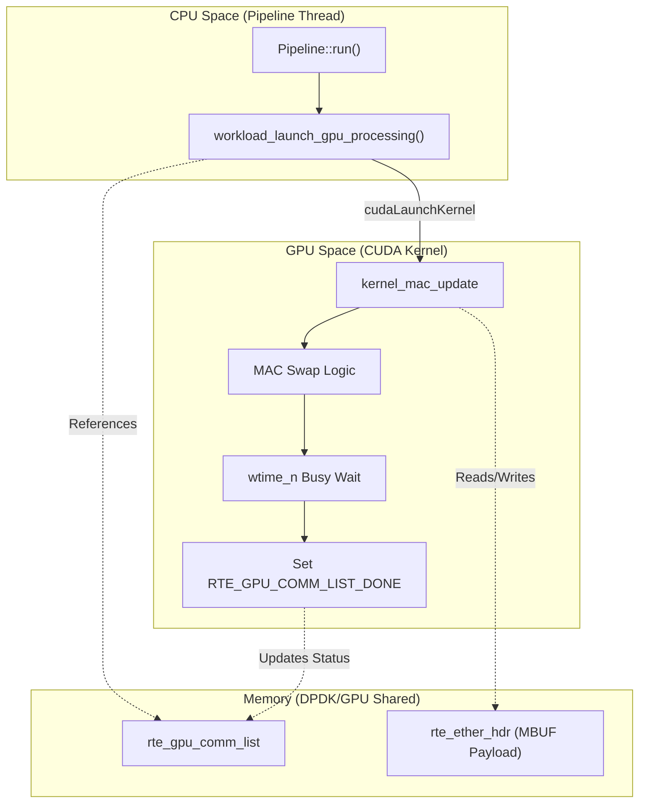
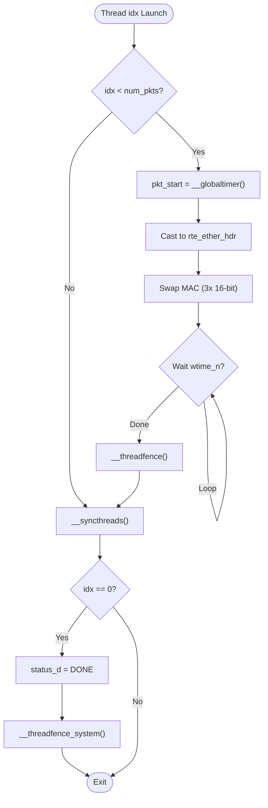

<!-- source: DeepWiki mcp.deepwiki.com · repo NVIDIA/l2fwd-nv · page 3.1 Standard GPU Kernel (Per-Burst Launch) · fetched 2026-10-26 -->

# Standard GPU Kernel (Per-Burst Launch)

Relevant source files

The following files were used as context for generating this wiki page:

- [include/cuda_related.h](include/cuda_related.h)
- [src/kernel.cu](src/kernel.cu)

The **Standard GPU Kernel** mode represents the traditional CUDA offloading model where a discrete kernel launch is triggered for every burst of packets received by the RX core. This mode is activated using the `-w 2` (GPU_WORKLOAD) command-line flag.

## Overview

In this model, the CPU-side `rx_core` thread manages the synchronization with the GPU. When a burst of packets is ready, the CPU populates a `rte_gpu_comm_list` item and invokes the launcher function `workload_launch_gpu_processing`. This function launches `kernel_mac_update` on a specific CUDA stream. The kernel processes the burst, performs a MAC address swap, simulates computational work if requested, and signals completion back to the CPU/TX core.

### Data Flow and Code Entity Mapping

The following diagram illustrates the transition from the CPU-side DPDK control plane to the GPU-side CUDA execution space.

**Diagram: Per-Burst Launch Control Flow**

**Sources:** [src/kernel.cu:94-106](), [src/kernel.cu:35-92]()

---

## Kernel Implementation: `kernel_mac_update`

The `kernel_mac_update` function is a `__global__` CUDA kernel designed to process a single burst of packets. Each CUDA thread is mapped to a single packet within the burst using its global thread index.

### MAC Address Swap Logic
The kernel performs an L2 forward swap (Source MAC $\leftrightarrow$ Destination MAC). Instead of byte-by-byte copying, it optimizes the swap by casting the Ethernet header to 16-bit integers.

1.  **Header Casting**: The packet address from `comm_list->pkt_list[idx].addr` is cast to a `struct rte_ether_hdr *` [src/kernel.cu:45]().
2.  **16-bit Pointer Access**: The source and destination addresses are treated as arrays of `uint16_t` [src/kernel.cu:46-47]().
3.  **Swap Execution**: Three 16-bit assignments swap the 48-bit MAC addresses [src/kernel.cu:60-68]().

### Busy-Wait Simulation (`wtime_n`)
To simulate real-world computational workloads (like encryption or deep packet inspection), the kernel includes a busy-wait mechanism:
*   It captures the starting timestamp using the internal `__globaltimer()` function, which reads the GPU's `globaltimer` register [src/kernel.cu:25-30](), [src/kernel.cu:43]().
*   It enters a `while` loop until the difference between the current `__globaltimer()` and the start time exceeds the user-provided `wtime_n` nanoseconds [src/kernel.cu:70-71]().

### Synchronization and Completion
After processing, the kernel ensures memory visibility and signals the CPU:
*   **Memory Barriers**: `__threadfence()` and `__syncthreads()` are used to ensure all packet modifications are complete within the GPU [src/kernel.cu:84-85]().
*   **Status Update**: Thread 0 in the block updates the status of the burst to `RTE_GPU_COMM_LIST_DONE` using the `RTE_GPU_VOLATILE` macro [src/kernel.cu:87-88]().
*   **PCIe Visibility**: `__threadfence_system()` is called to ensure the status write is propagated across the PCIe bus and visible to the CPU cores [src/kernel.cu:89]().

**Sources:** [src/kernel.cu:25-92]()

---

## Launcher: `workload_launch_gpu_processing`

The launcher acts as the bridge between the C++ Pipeline logic and the CUDA C++ kernel.

| Parameter | Description |
| :--- | :--- |
| `comm_list` | Pointer to the DPDK GPU communication list item for the current burst. |
| `wtime_n` | Simulation time in nanoseconds for the busy-wait loop. |
| `cuda_blocks` | Number of CUDA blocks (asserted to be 1 for this implementation). |
| `cuda_threads` | Number of threads per block (typically matching the burst size). |
| `stream` | The `cudaStream_t` associated with the specific Pipeline instance. |

The launcher performs basic validation, ensuring `cuda_blocks` is 1 [src/kernel.cu:97]() and that the `comm_list` is valid [src/kernel.cu:100](). It uses `CUDA_CHECK` from `cuda_related.h` to verify that the kernel launch was successful and that no previous asynchronous errors were pending [src/kernel.cu:103-105]().

**Sources:** [src/kernel.cu:94-106](), [include/cuda_related.h:71-80]()

---

## Technical Details Summary

### Logic Flow Diagram
This diagram details the internal branching and memory synchronization within the `kernel_mac_update`.

**Diagram: Kernel Internal Logic**

**Sources:** [src/kernel.cu:35-92]()

### Key Code Entities

| Entity | File | Description |
| :--- | :--- | :--- |
| `__globaltimer()` | [src/kernel.cu:25]() | Inline assembly wrapper for reading the GPU's 64-bit nanosecond timer. |
| `kernel_mac_update` | [src/kernel.cu:35]() | The primary GPU entry point for per-burst processing. |
| `workload_launch_gpu_processing` | [src/kernel.cu:94]() | Host-side function that triggers the CUDA kernel launch. |
| `RTE_GPU_COMM_LIST_DONE` | [external/dpdk/...]() | DPDK constant indicating the GPU has finished processing the communication item. |
| `__threadfence_system()` | [CUDA Ref]() | Ensures memory writes are visible to the CPU and other devices on the system bus. |

**Sources:** [src/kernel.cu:25-106]()

---

