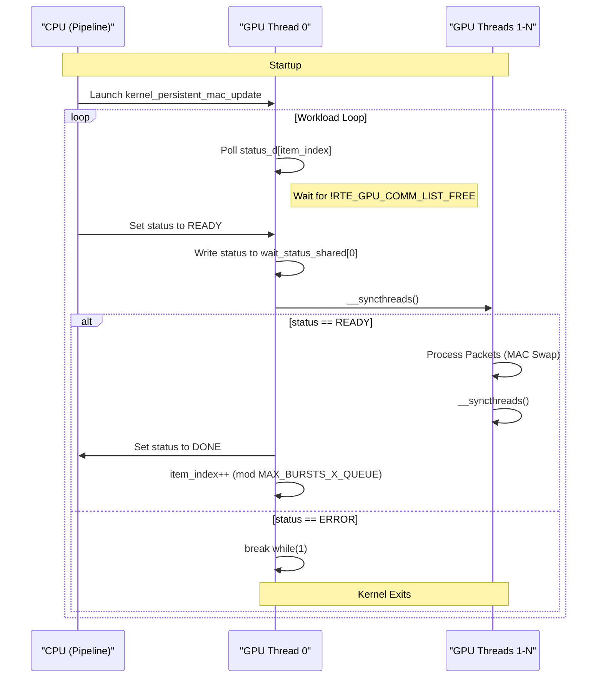
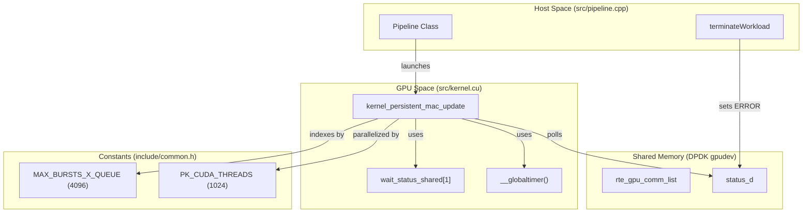

<!-- source: DeepWiki mcp.deepwiki.com · repo NVIDIA/l2fwd-nv · page 3.2 Persistent Kernel Strategy · fetched 2026-10-26 -->

# Persistent Kernel Strategy

Relevant source files

The following files were used as context for generating this wiki page:

- [include/common.h](include/common.h)
- [src/kernel.cu](src/kernel.cu)
- [src/pipeline.cpp](src/pipeline.cpp)

The Persistent Kernel Strategy (selected via the `-w 3` or `GPU_PK_WORKLOAD` flag) is designed to minimize the overhead associated with frequent CUDA kernel launches. Instead of launching a new GPU kernel for every packet burst, a single "persistent" kernel is launched at application startup and remains active on the GPU, polling for new work via a shared memory signaling mechanism with the CPU.

## Architecture and Design

The persistent strategy relies on a long-lived `__global__` function, `kernel_persistent_mac_update`, which executes a continuous loop. This kernel synchronizes with the CPU using the `rte_gpu_comm_list` structure provided by the DPDK `gpudev` library.

### Key Implementation Details
*   **Single Launch**: The kernel is launched once during the `Pipeline` constructor [src/pipeline.cpp:55-61]().
*   **Polling Loop**: The kernel runs a `while(1)` loop [src/kernel.cu:123]().
*   **Circular Buffer**: Work items are processed using a circular index that wraps around at `MAX_BURSTS_X_QUEUE` [src/kernel.cu:191]().
*   **Signaling**: Thread 0 of the CUDA block is responsible for polling the status of the current burst item in the `comm_list` [src/kernel.cu:124-136]().

### Data Flow and Synchronization

The following diagram illustrates the interaction between the CPU (Host) and the Persistent Kernel (GPU).

**Persistent Kernel Control Flow**

Sources: [src/kernel.cu:123-193](), [src/pipeline.cpp:100-109]()

## Kernel Implementation: `kernel_persistent_mac_update`

The kernel implementation in `src/kernel.cu` utilizes shared memory to broadcast the status of the current burst from the lead thread to the rest of the block.

### Status Polling and Shared Memory
Only the first thread (`idx == 0`) performs the volatile read on `comm_list[item_index].status_d[0]` [src/kernel.cu:128](). Once the status changes from `RTE_GPU_COMM_LIST_FREE`, it is stored in `wait_status_shared[0]` [src/kernel.cu:131](). A `__syncthreads()` call ensures that all threads in the block see the updated status before proceeding to process the burst [src/kernel.cu:138]().

### Packet Processing Logic
If the status is `RTE_GPU_COMM_LIST_READY`, the kernel performs the following:
1.  **Pointer Resolution**: Each thread calculates the address of its assigned packet using the `pkt_list[idx].addr` [src/kernel.cu:143-147]().
2.  **MAC Update**: Threads swap the Source and Destination MAC addresses in the `rte_ether_hdr` using 16-bit temporary registers [src/kernel.cu:159-167]().
3.  **Busy Wait (Optional)**: If `wtime_n` is non-zero, the kernel simulates computational load by polling `__globaltimer()` until the specified nanoseconds have elapsed [src/kernel.cu:179-180]().
4.  **Completion Signaling**: After a `__threadfence()` to ensure memory visibility, thread 0 sets the status to `RTE_GPU_COMM_LIST_DONE` [src/kernel.cu:187]().

### Workload Termination
To safely shut down the persistent kernel, the `Pipeline::terminateWorkload()` function iterates through the entire `comm_list` and sets every item's status to `RTE_GPU_COMM_LIST_ERROR` [src/pipeline.cpp:102-106](). When the kernel polls an item and detects this status, it breaks the `while(1)` loop and exits [src/kernel.cu:140-141]().

Sources: [src/kernel.cu:111-193](), [src/pipeline.cpp:98-110]()

## Code Entity Mapping

The following diagram maps the logical components of the persistent strategy to specific code entities and constants.

**System Entity Mapping**

Sources: [src/kernel.cu:111-193](), [include/common.h:31-35](), [src/pipeline.cpp:33-78]()

## Summary Table of Persistent Strategy Constants

| Constant | Value | Description |
| :--- | :--- | :--- |
| `PK_CUDA_BLOCKS` | 1 | Number of blocks for the persistent kernel [include/common.h:31](). |
| `PK_CUDA_THREADS` | 1024 | Threads per block, defining the max packets per burst [include/common.h:32](). |
| `MAX_BURSTS_X_QUEUE` | 4096 | Size of the circular communication list [include/common.h:35](). |
| `RTE_GPU_COMM_LIST_READY` | (DPDK) | Signal from CPU that data is ready for GPU [src/kernel.cu:140](). |
| `RTE_GPU_COMM_LIST_DONE` | (DPDK) | Signal from GPU that processing is complete [src/kernel.cu:187](). |
| `RTE_GPU_COMM_LIST_ERROR` | (DPDK) | Signal used to trigger kernel exit [src/pipeline.cpp:103](). |

Sources: [include/common.h:31-35](), [src/kernel.cu:111-193](), [src/pipeline.cpp:98-110]()

---

