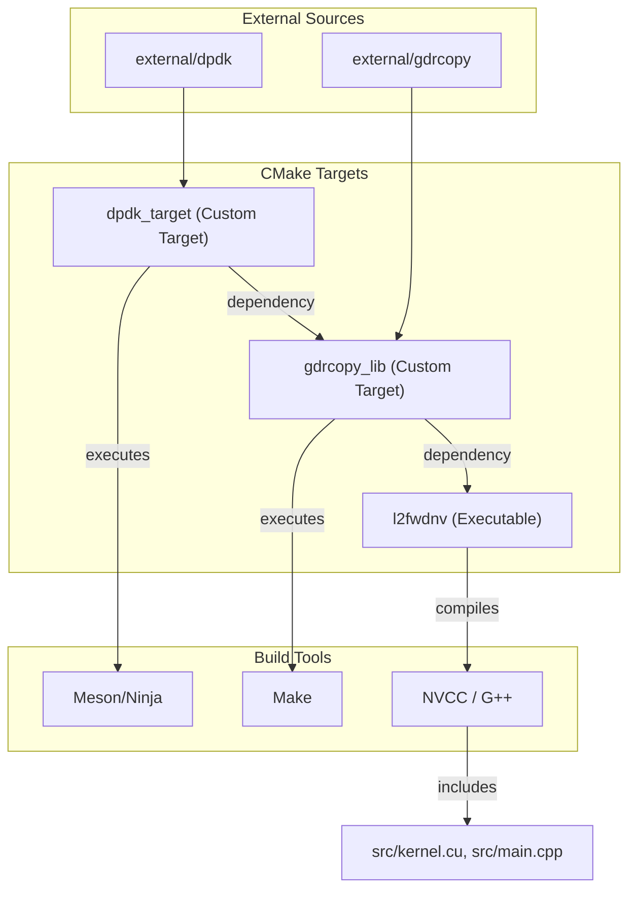
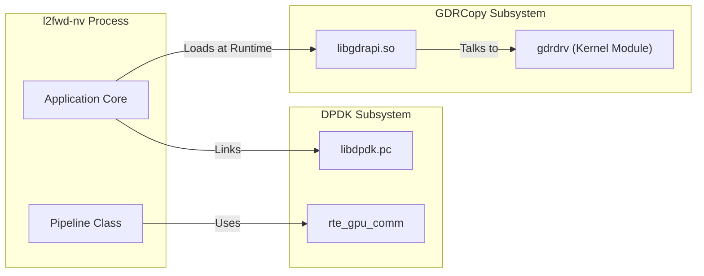

<!-- source: DeepWiki mcp.deepwiki.com · repo NVIDIA/l2fwd-nv · page 5 Build System and External Dependencies · fetched 2026-10-26 -->

# Build System and External Dependencies

Relevant source files

The following files were used as context for generating this wiki page:

- [.gitmodules](.gitmodules)
- [CMakeLists.txt](CMakeLists.txt)

This page provides a high-level overview of how the `l2fwd-nv` project is structured, its reliance on external submodules, and the CMake-based orchestration used to build the complete system. The project integrates DPDK for high-speed networking and CUDA for GPU-accelerated packet processing, requiring a coordinated build of both CPU and GPU components.

## Build System Overview

The project uses **CMake** as its primary build system, which orchestrates several underlying build tools including **Meson**, **Ninja**, and **Make**. The build process is designed to handle the complexities of linking C++ application code with C-based DPDK libraries and CUDA `.cu` kernels.

### Dependency Chain and Build Flow
The build system enforces a strict dependency chain to ensure that all external libraries are compiled and available before the main application is linked.

1.  **`dpdk_target`**: The first stage builds DPDK from source using Meson and Ninja [CMakeLists.txt:115-119]().
2.  **`gdrcopy_lib`**: Once DPDK is ready, the GDRCopy library is built using its internal Makefile [CMakeLists.txt:137-142]().
3.  **`l2fwdnv`**: Finally, the main executable is compiled, linking against the results of the previous two stages [CMakeLists.txt:158-160]().

### Build System Component Mapping
The following diagram illustrates how the CMake targets map to specific code entities and external processes.

**Build Target Orchestration**

**Sources:** [CMakeLists.txt:115-160]()

For a detailed walkthrough of the CMake configuration, compiler flags, and optional build toggles, see **[CMake Build System](#5.1)**.

---

## External Dependencies and Submodules

The `l2fwd-nv` project relies on two critical external projects maintained as Git submodules within the `external/` directory [.gitmodules:1-7](). These submodules are pinned to specific versions to ensure compatibility with the GPU-centric features of the application.

### DPDK (Data Plane Development Kit)
The project uses **DPDK 22.03** [external/dpdk] to handle fast-path packet I/O. A custom build configuration is applied to:
*   Disable unnecessary drivers to speed up compilation [CMakeLists.txt:62-97]().
*   Optimize for GPU performance by setting `RTE_PKTMBUF_HEADROOM` to `0` [CMakeLists.txt:110-113]().
*   Enable experimental APIs required for `rte_gpu` communication features [CMakeLists.txt:23]().

### GDRCopy
**GDRCopy** [external/gdrcopy] is a low-latency GPU Direct RDMA copy library. It provides a kernel-mode driver (`gdrdrv`) and a userspace library (`libgdrapi.so`) that allow the CPU to directly access GPU memory. In this project, it is primarily used for low-latency signaling between the CPU and GPU.

### Dependency Relationship Diagram
The following diagram shows how these external entities are integrated into the `l2fwd-nv` runtime environment.

**External Library Integration**

**Sources:** [CMakeLists.txt:121-133](), [.gitmodules:1-7]()

For more information on submodule roles, runtime loading of `libgdrapi.so`, and kernel module requirements, see **[External Submodules: DPDK and GDRCopy](#5.2)**.

---

## Summary Table of Build Options

| Option | Default | Description |
| :--- | :--- | :--- |
| `CUDA_ENABLED` | `ON` | Enables CUDA support (required for L2 forwarding on GPU) [CMakeLists.txt:29]() |
| `ENABLE_NVTX` | `OFF` | Enables NVIDIA Tools Extension for profiling [CMakeLists.txt:32]() |
| `IPV4_UDP_MODE`| `OFF` | Encapsulates eCPRI packets in IPv4/UDP headers [CMakeLists.txt:30]() |
| `PROFILE_LOGS` | `OFF` | Periodically dumps performance statistics to the console [CMakeLists.txt:31]() |

**Sources:** [CMakeLists.txt:27-32]()

---

