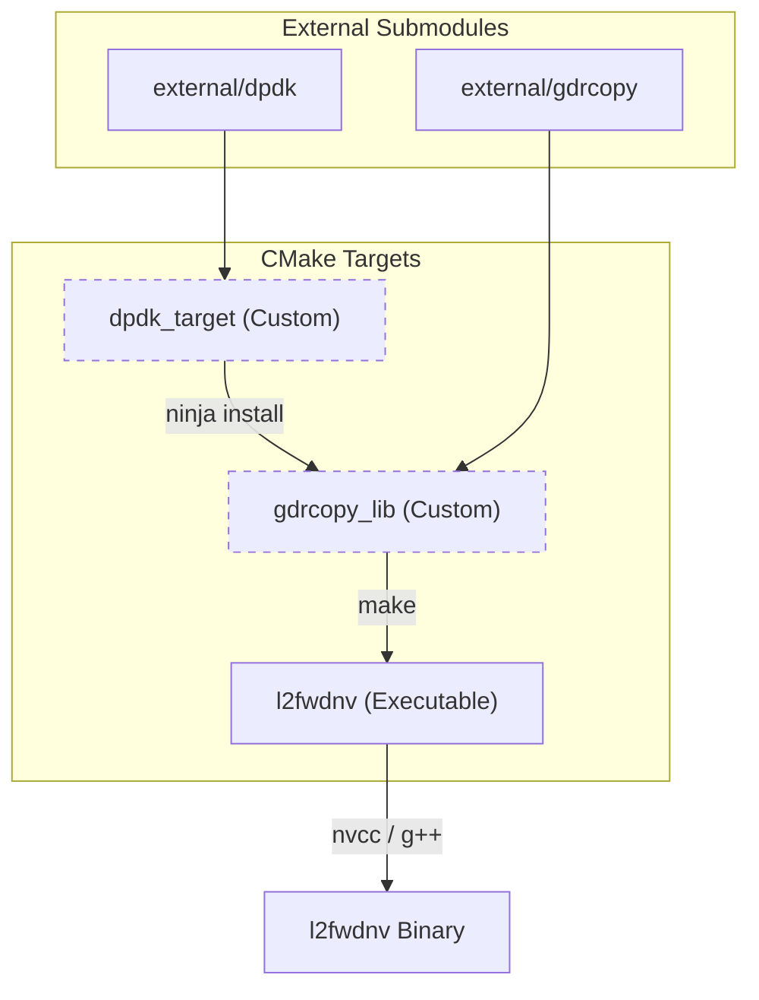
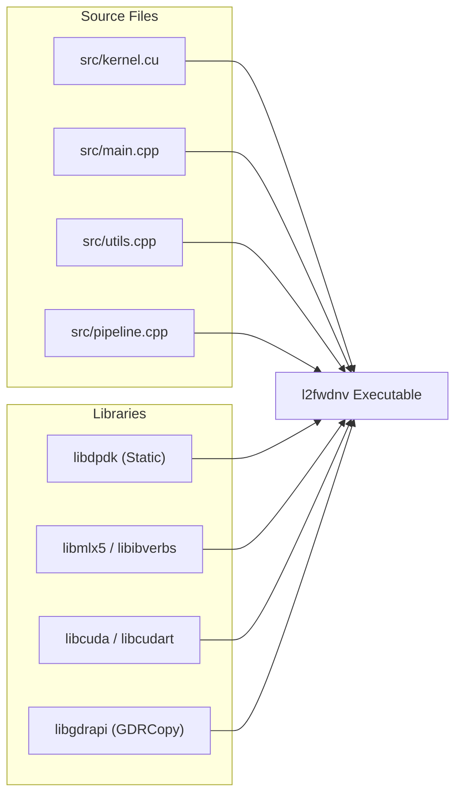

<!-- source: DeepWiki mcp.deepwiki.com · repo NVIDIA/l2fwd-nv · page 5.1 CMake Build System · fetched 2026-10-26 -->

# CMake Build System

Relevant source files

The following files were used as context for generating this wiki page:

- [CMakeLists.txt](CMakeLists.txt)

The `l2fwd-nv` project utilizes a CMake-based build system designed to orchestrate the compilation of high-performance networking code, GPU kernels, and external dependencies. The build system manages a complex dependency chain involving DPDK (Data Plane Development Kit), GDRCopy, and CUDA, ensuring that experimental APIs and specific hardware optimizations (like DPDK's `RTE_PKTMBUF_HEADROOM`) are correctly configured.

### Dependency Chain and Build Flow

The build system follows a strict linear dependency chain to ensure that libraries are built and configured before the main application is compiled.

| Target | Description | Dependency |
| :--- | :--- | :--- |
| `dpdk_target` | Custom target that invokes Meson/Ninja to build DPDK from submodules. | None (Base) |
| `gdrcopy_lib` | Custom target that invokes `make` for the GDRCopy library. | `dpdk_target` |
| `l2fwdnv` | The main executable target comprising C++ and CUDA sources. | `gdrcopy_lib` |

#### Build Sequence Diagram
The following diagram illustrates the relationship between the CMake targets and the external build tools they invoke.

**Build Target Hierarchy**

Sources: [CMakeLists.txt:115-119](), [CMakeLists.txt:137-145](), [CMakeLists.txt:149-160]()

---

### DPDK Custom Build (`dpdk_target`)

The build system does not rely on a system-wide DPDK installation. Instead, it builds DPDK from the `external/dpdk` submodule to apply specific optimizations and configurations [CMakeLists.txt:57-61]().

*   **Meson Configuration**: The project invokes `meson` to configure DPDK with a specific architecture (defaulting to `x86_64-native-linuxapp-gcc`) [CMakeLists.txt:54-101]().
*   **Disabled Drivers**: To reduce build time and binary size, a large number of NIC drivers are explicitly disabled via `DPDK_DISABLED_DRIVERS`, focusing the build on `mlx5` and `ibverbs` [CMakeLists.txt:62-97]().
*   **Performance Optimization**: A critical optimization is performed using `sed` to set `RTE_PKTMBUF_HEADROOM` to `0` in `config/rte_config.h` [CMakeLists.txt:110-113](). This is essential for GPU memory performance, as it removes unnecessary padding at the start of packet buffers.
*   **Flags Extraction**: After building, the system uses `pkg-config` to extract `DPDK_BUILD_FLAGS` and `DPDK_LINK_FLAGS` from the generated `libdpdk.pc` [CMakeLists.txt:123-131]().

Sources: [CMakeLists.txt:51-134]()

---

### CUDA and NVCC Configuration

The project integrates CUDA via the `find_package(CUDA)` mechanism and requires version 11 or higher [CMakeLists.txt:36]().

#### Flag Wrapping with -Xcompiler
Because the main application includes DPDK headers that use GCC-specific flags, these flags must be passed to `nvcc` when compiling `.cu` files. To prevent `nvcc` from rejecting unknown GCC flags, the build system uses regex replacements to wrap them in `-Xcompiler` [CMakeLists.txt:175-201]().

*   **`-std=`** becomes **`-Xcompiler -std=`** [CMakeLists.txt:176-182]()
*   **`-march=`** becomes **`-Xcompiler -march=`** [CMakeLists.txt:184-190]()
*   **`-moutline-atomics`** becomes **`-Xcompiler -moutline-atomics`** [CMakeLists.txt:192-198]()

#### Experimental APIs
The project explicitly defines `ALLOW_EXPERIMENTAL_API` [CMakeLists.txt:23](). This is required because `l2fwd-nv` utilizes the `rte_gpu` (gpudev) library and other DPDK features that are marked as experimental in the DPDK 22.03 release.

Sources: [CMakeLists.txt:15-24](), [CMakeLists.txt:174-206]()

---

### Optional Build Flags

The `CMakeLists.txt` provides several `OPTION` toggles that influence the application's behavior and performance monitoring capabilities.

| Flag | Macro Defined | Purpose |
| :--- | :--- | :--- |
| `IPV4_UDP_MODE` | N/A (Option) | If enabled, supports encapsulating eCPRI packets in IPv4/UDP [CMakeLists.txt:30](). |
| `ENABLE_NVTX` | `USE_NVTX=1` | Links with `nvToolsExt` to enable NVTX profiling ranges for NVIDIA Nsight Systems [CMakeLists.txt:32](), [CMakeLists.txt:163-166](). |
| `PROFILE_LOGS` | N/A (Option) | Enables periodic dumping of profiling and monitoring statistics [CMakeLists.txt:31](). |

Sources: [CMakeLists.txt:25-33](), [CMakeLists.txt:163-166]()

---

### Executable Target: `l2fwdnv`

The final executable target is defined with four primary source files:

1.  `src/kernel.cu`: Contains CUDA kernels for packet processing [CMakeLists.txt:152]().
2.  `src/main.cpp`: Application entry point and EAL initialization [CMakeLists.txt:153]().
3.  `src/utils.cpp`: Utility functions for CLI parsing and timing [CMakeLists.txt:154]().
4.  `src/pipeline.cpp`: Core logic for the Pipeline class and CPU-GPU synchronization [CMakeLists.txt:155]().

The target links against a combination of DPDK libraries (including `mlx5` and `ibverbs`), CUDA libraries, and the CUDA driver library [CMakeLists.txt:133](), [CMakeLists.txt:170]().

**Entity Mapping: Source to Target**

Sources: [CMakeLists.txt:133](), [CMakeLists.txt:151-158](), [CMakeLists.txt:170]()

---

