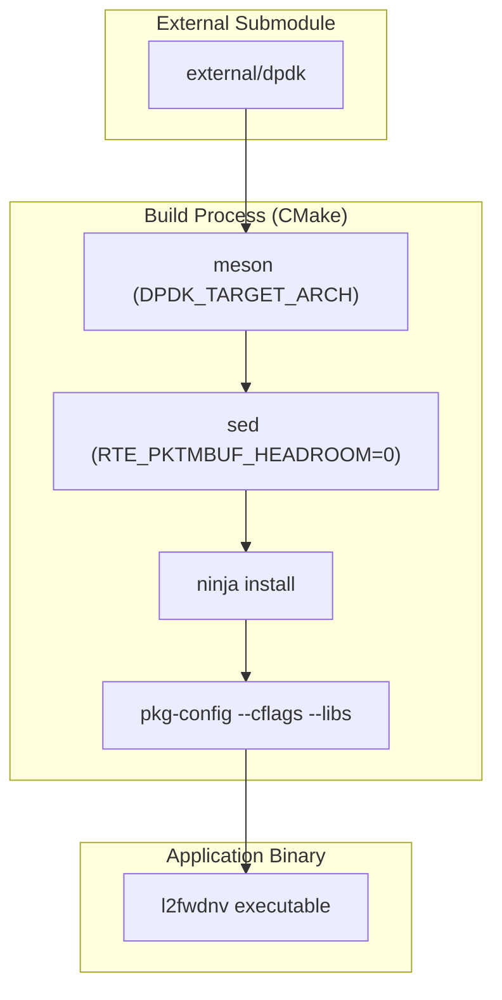
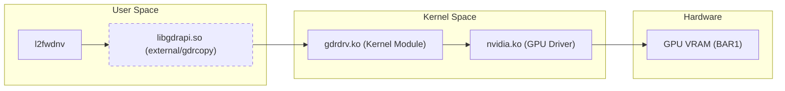

<!-- source: DeepWiki mcp.deepwiki.com · repo NVIDIA/l2fwd-nv · page 5.2 External Submodules: DPDK and GDRCopy · fetched 2026-10-26 -->

# External Submodules: DPDK and GDRCopy

Relevant source files

The following files were used as context for generating this wiki page:

- [.gitmodules](.gitmodules)
- [CMakeLists.txt](CMakeLists.txt)

The `l2fwd-nv` application relies on two critical external projects maintained as git submodules within the `external/` directory: **DPDK** and **GDRCopy**. These submodules provide the foundation for high-speed packet processing and low-latency CPU-GPU memory synchronization. This page details their roles, how the build system consumes them, and their runtime requirements.

### Submodule Overview

The project includes specific versions of these libraries to ensure compatibility with the `gpudev` and `gdrcopy` features required for GPUDirect RDMA.

| Submodule | Path | Purpose |
| :--- | :--- | :--- |
| **DPDK** | `external/dpdk` | Provides the Data Plane Development Kit for fast packet I/O and the `gpudev` library. |
| **GDRCopy** | `external/gdrcopy` | Provides a low-latency GPU memory copy library and kernel module for CPU access to GPU memory. |

**Sources:** [ .gitmodules:1-6 ]()

---

### DPDK Integration

The application uses **DPDK 22.03** (or compatible versions) to handle network traffic. The build system automates the compilation of DPDK using `meson` and `ninja` to ensure it is optimized for the local architecture and includes the necessary drivers.

#### Build and Configuration
The `CMakeLists.txt` file manages the DPDK build process through a custom target named `dpdk_target`. Key configuration steps include:
1.  **Driver Filtering**: To speed up compilation, a long list of unnecessary drivers (e.g., `net/e1000`, `net/ixgbe`) is disabled, focusing primarily on `mlx5` and `ibverbs` for Mellanox NICs [ CMakeLists.txt:62-97 ]().
2.  **Performance Tuning**: The `RTE_PKTMBUF_HEADROOM` is programmatically set to `0` in `config/rte_config.h` using `sed`. This optimization is specific to GPU memory workloads where traditional CPU-side headroom is unnecessary and can complicate alignment [ CMakeLists.txt:110-113 ]().
3.  **Consumption via pkg-config**: After building, the system uses `pkg-config --cflags libdpdk.pc` and `pkg-config --static --libs libdpdk.pc` to extract the necessary include paths and linker flags for the main `l2fwdnv` executable [ CMakeLists.txt:123-131 ]().

#### Code-to-System Mapping: DPDK Consumption
The following diagram illustrates how the CMake build system bridges the DPDK submodule to the final application binary.

**DPDK Build Data Flow**

**Sources:** [ CMakeLists.txt:51-134 ]()

---

### GDRCopy Integration

**GDRCopy** is a low-latency GPU memory copy library based on NVIDIA GPUDirect RDMA technology. In `l2fwd-nv`, it is used to allow the CPU to directly access GPU memory (the `rte_gpu_comm_list`) for control-plane signaling with minimal overhead.

#### Library and Kernel Module
GDRCopy consists of two primary components:
1.  **`libgdrapi.so`**: The user-space library built from the `external/gdrcopy` submodule. The build system triggers a `make` command in the submodule directory to produce this library [ CMakeLists.txt:138-142 ]().
2.  **`gdrdrv` Kernel Module**: This module must be loaded into the Linux kernel to enable the mapping of GPU memory into CPU address space.

#### Runtime Loading
Unlike DPDK, which is linked into the binary, `libgdrapi.so` is often loaded at runtime. The application expects the path to this library to be exported via the environment variable `GDRCOPY_PATH_L`.

#### Implementation Logic
The `gdrdrv` module provides the mechanism for the CPU to map a bar1 memory region of the GPU. This is essential for the `rte_gpu_comm_list` synchronization protocol, where the CPU reads and writes status flags (e.g., `RTE_GPU_COMM_LIST_READY`, `RTE_GPU_COMM_LIST_DONE`) that the GPU kernel is also polling or updating.

**GDRCopy Code Entity Mapping**

**Sources:** [ CMakeLists.txt:135-146 ](), [ .gitmodules:1-3 ]()

---

### Build Dependencies and Sequencing

The `CMakeLists.txt` defines a strict dependency chain to ensure that submodules are prepared before the main application is compiled. 

1.  **`dpdk_target`**: The first target built. It includes the `gpudev` library which is a prerequisite for GPU-aware networking [ CMakeLists.txt:115-119 ]().
2.  **`gdrcopy_lib`**: Depends on `dpdk_target`. This target runs the GDRCopy Makefile [ CMakeLists.txt:138-145 ]().
3.  **`l2fwdnv`**: The final executable. It depends on both `dpdk_target` and `gdrcopy_lib`. It links against `DPDK_LIBS` and requires the headers from both submodules [ CMakeLists.txt:158-170 ]().

**Sources:** [ CMakeLists.txt:145-160 ]()

---

