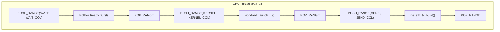
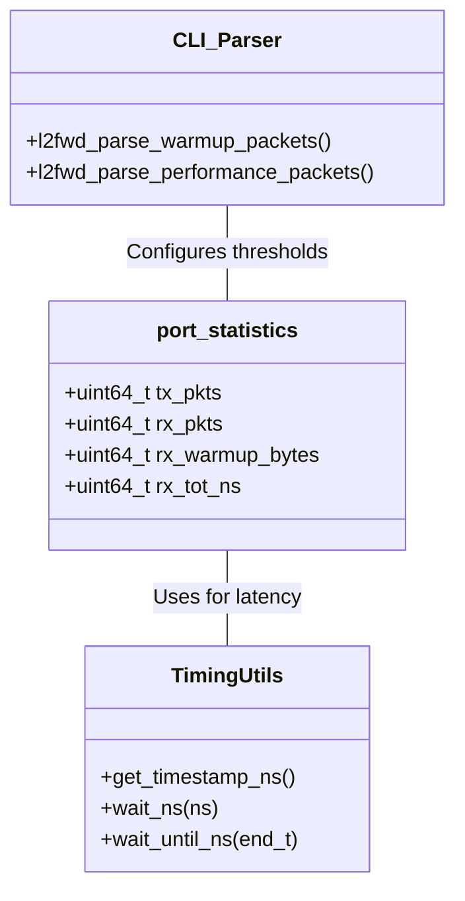

<!-- source: DeepWiki mcp.deepwiki.com · repo NVIDIA/l2fwd-nv · page 6.2 Profiling with NVTX and Statistics Collection · fetched 2026-10-26 -->

# Profiling with NVTX and Statistics Collection

Relevant source files

The following files were used as context for generating this wiki page:

- [include/cuda_related.h](include/cuda_related.h)
- [include/headers.h](include/headers.h)
- [src/utils.cpp](src/utils.cpp)

This page details the instrumentation and metrics collection framework used in `l2fwd-nv` to measure high-performance packet processing throughput and latency. The application utilizes NVIDIA Tools Extension (NVTX) for visual profiling and a dedicated statistics structure for real-time performance tracking.

## NVTX Instrumentation

`l2fwd-nv` incorporates NVTX to provide high-fidelity visual timelines when using tools like NVIDIA Nsight Systems or `nvvp`. This instrumentation allows developers to correlate CPU execution phases (RX, TX, Wait) with GPU kernel execution.

### Implementation and Macros
The NVTX integration is defined in `include/cuda_related.h`. It uses a set of macros to push and pop ranges on the profiler timeline:

*   **`PUSH_RANGE(name, cid)`**: Starts a named range with a specific color index [include/cuda_related.h:41-56]().
*   **`POP_RANGE`**: Ends the most recent range [include/cuda_related.h:65]().
*   **Color-Coded Phases**: Specific constants are defined to ensure consistency across the timeline [include/cuda_related.h:28-40]():
    *   `COMM_COL`: Communication tasks.
    *   `WAIT_COL`: Polling or synchronization waits.
    *   `KERNEL_COL`: GPU kernel launches and execution.
    *   `SEND_COL`: Transmission phases.

### Enabling NVTX
NVTX profiling is not enabled by default to avoid overhead in production runs. It must be activated at two levels:
1.  **Compile-time**: The code must be compiled with `-DENABLE_NVTX=ON`. This defines the `USE_NVTX` macro, which expands the `PUSH_RANGE` and `POP_RANGE` definitions [include/cuda_related.h:25-69]().
2.  **Runtime**: The `-n` CLI flag must be passed to the application to initialize the CUDA profiler and NVTX markers [src/utils.cpp:112]().

### Data Flow: Profiling Lifecycle
The following diagram illustrates how NVTX ranges are used within the pipeline processing loop.

**Title: NVTX Range Lifecycle in Pipeline Loop**

Sources: [include/cuda_related.h:25-69](), [src/utils.cpp:105-120]()

## Statistics Collection

The application tracks performance using the `port_statistics` structure. This structure is cache-aligned to prevent false sharing between lcores [include/headers.h:82-95]().

### port_statistics Structure
The structure maintains counters for every RX and TX queue assigned to an lcore.

| Field | Description |
| :--- | :--- |
| `rx_pkts` | Total packets received [include/headers.h:88](). |
| `rx_bytes` | Total bytes received [include/headers.h:90](). |
| `rx_tot_ns` | Cumulative time spent in RX operations [include/headers.h:92](). |
| `rx_warmup_bytes` | Bytes received during the warmup phase [include/headers.h:91](). |
| `tx_pkts` | Total packets successfully transmitted [include/headers.h:83](). |
| `dropped` | Packets dropped due to full TX rings [include/headers.h:94](). |

### Warmup and Performance Phases
To ensure benchmark accuracy, `l2fwd-nv` implements a two-phase execution model:
1.  **Warmup Phase**: Controlled by the `-z` flag [src/utils.cpp:118](). During this phase, packets are processed but throughput metrics are not finalized. The `rx_warmup_bytes` field tracks this data to exclude it from the final PPS/Gbps calculation [include/headers.h:91]().
2.  **Performance Phase**: Controlled by the `-v` flag [src/utils.cpp:116](). Once the warmup threshold is met, the application begins full performance measurement until the specified number of packets is reached.

### Code Entity Map: Statistics and Timing
The following diagram maps the logical performance concepts to the specific code entities in `headers.h` and `utils.cpp`.

**Title: Statistics and Timing Entity Mapping**

Sources: [include/headers.h:82-95](), [src/utils.cpp:19-53](), [src/utils.cpp:176-204]()

## Periodic Logging (PROFILE_LOGS)

When the `PROFILE_LOGS` option is enabled during the build process, the application performs periodic dumps of the `port_statistics` data.

*   **Mechanism**: The main thread or a dedicated monitoring thread iterates through the `port_statistics` array for all active ports.
*   **Throughput Calculation**: 
    *   $PPS = \frac{\Delta pkts}{\Delta time}$
    *   $Gbps = \frac{\Delta bytes \times 8}{\Delta time \times 10^9}$
*   **Warmup Exclusion**: The logic subtracts `rx_warmup_bytes` from the total bytes if the transition from warmup to performance occurred within the last logging interval [include/headers.h:91]().

## Time Measurement Utilities
High-resolution timing is provided by `src/utils.cpp` using `clock_gettime(CLOCK_REALTIME, ...)` [src/utils.cpp:19-30]().

*   **`get_timestamp_ns()`**: Returns the current system time in nanoseconds [src/utils.cpp:19]().
*   **`wait_ns(uint64_t ns)`**: A busy-wait function that stalls the CPU for a precise duration, used to simulate workload intensity via the `-t` flag [src/utils.cpp:32-42]().
*   **`wait_until_ns(uint64_t end_t)`**: Stalls execution until a specific absolute timestamp is reached [src/utils.cpp:44-53]().

Sources: [include/headers.h:82-95](), [include/cuda_related.h:1-93](), [src/utils.cpp:1-256]()

---

