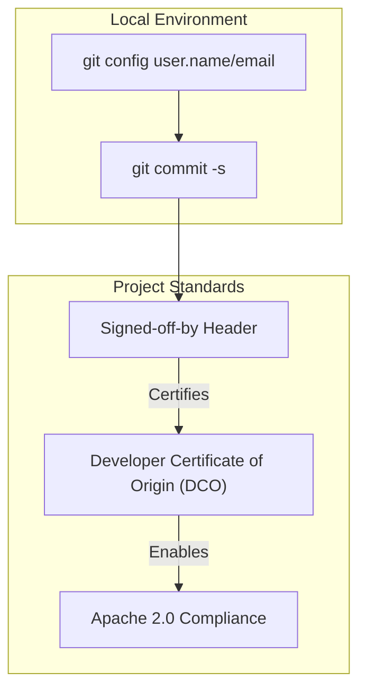
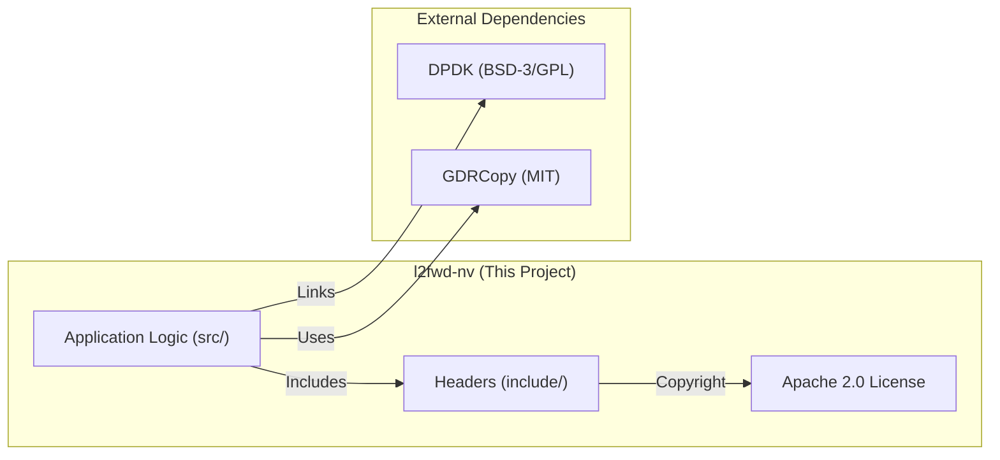

<!-- source: DeepWiki mcp.deepwiki.com · repo NVIDIA/l2fwd-nv · page 7 Contributing and Licensing · fetched 2026-10-26 -->

# Contributing and Licensing

Relevant source files

The following files were used as context for generating this wiki page:

- [CONTRIBUTING.md](CONTRIBUTING.md)
- [LICENSE](LICENSE)

The `l2fwd-nv` project is an open-source showcase for high-performance DPDK and GPU integration. To maintain the integrity of the codebase and ensure legal compliance, all contributors must follow a specific sign-off process. The project is distributed under the Apache License 2.0 and relies on upstream projects like DPDK and GDRCopy.

## Contribution Workflow

Contributions to `l2fwd-nv` require a formal "sign-off" to certify that the contributor has the right to submit the code under the project's open-source license. This process is governed by the **Developer Certificate of Origin (DCO)** version 1.1.

### Developer Certificate of Origin (DCO)
By signing off on a contribution, you certify that you created the work, it is based on compatible open-source work, or it was provided to you by someone else who certified the same. This certification is maintained as a public record of the contribution.

### Submission Requirement
Every git commit must include a `Signed-off-by` line with the contributor's real name and email address. 
*   **Manual:** `Signed-off-by: Joe Smith <joe.smith@email.com>`
*   **Automatic:** Using `git commit -s` after configuring `user.name` and `user.email` in git.

For details on the DCO text and git configuration, see [Contribution Guidelines](#7.1).

### Mapping the Contribution Process

The following diagram illustrates how a developer's local environment maps to the required project standards for submission.

**Contribution Identity Mapping**

Sources: [CONTRIBUTING.md:6-60]()

## Licensing

The `l2fwd-nv` project is licensed under the **Apache License, Version 2.0**. This is a permissive license that allows for use, reproduction, and distribution of the software, including derivative works.

### Key License Provisions
*   **Grant of Copyright License:** Contributors grant a perpetual, worldwide, royalty-free license to use and distribute the work.
*   **Grant of Patent License:** Contributors grant a patent license for claims infringed by their contribution.
*   **Redistribution:** You may redistribute the code provided you include a copy of the license and provide notice of any modified files.
*   **Copyright Headers:** All source files in the project contain NVIDIA copyright headers indicating ownership and licensing terms.

For the full text of the license and implications for redistribution, see [License](#7.2).

### Licensing and Dependency Architecture

The application links against several external components, each with its own licensing and upstream maintenance.

**Dependency and License Relationship**

Sources: [LICENSE:1-128](), [CONTRIBUTING.md:27-31]()

## Upstream Projects

The `l2fwd-nv` project serves as a reference implementation utilizing several key technologies. Contributors and users should be aware of the following upstream projects:

| Project | Role in l2fwd-nv | Source Location |
| :--- | :--- | :--- |
| **DPDK** | Provides the Data Plane Development Kit environment, including `rte_gpu` for GPU memory management and communication. | `external/dpdk` |
| **GDRCopy** | Enables low-latency CPU access to GPU memory via the `gdrdrv` kernel module. | `external/gdrcopy` |

Sources: [CONTRIBUTING.md:1-5](), [LICENSE:1-40]()

---

