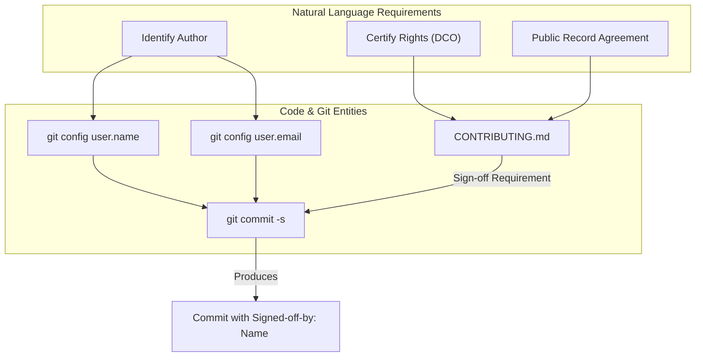

<!-- source: DeepWiki mcp.deepwiki.com · repo NVIDIA/l2fwd-nv · page 7.1 Contribution Guidelines · fetched 2026-10-26 -->

# Contribution Guidelines

<details>
<summary>Relevant source files</summary>

The following files were used as context for generating this wiki page:

- [CONTRIBUTING.md](CONTRIBUTING.md)

</details>


This page outlines the requirements and procedures for contributing to the `l2fwd-nv` project. To maintain a clear record of origin for all code, the project follows a formal sign-off process using the Developer Certificate of Origin (DCO).

## Developer Certificate of Origin (DCO)

All contributors must certify that they have the right to submit their code under the project's open-source license. By adding a "Sign-off" to a commit, the contributor agrees to the following text from [developercertificate.org](http://developercertificate.org/):

```text
Developer Certificate of Origin
Version 1.1

Copyright (C) 2004, 2006 The Linux Foundation and its contributors.
1 Letterman Drive
Suite D4700
San Francisco, CA, 94129

Everyone is permitted to copy and distribute verbatim copies of this
license document, but changing it is not allowed.


Developer's Certificate of Origin 1.1

By making a contribution to this project, I certify that:

(a) The contribution was created in whole or in part by me and I
    have the right to submit it under the open source license
    indicated in the file; or

(b) The contribution is based upon previous work that, to the best
    of my knowledge, is covered under an appropriate open source
    license and I have the right under that license to submit that
    work with modifications, whether created in whole or in part
    by me, under the same open source license (unless I am
    permitted to submit under a different license), as indicated
    in the file; or

(c) The contribution was provided directly to me by some other
    person who certified (a), (b) or (c) and I have not modified
    it.

(d) I understand and agree that this project and the contribution
    are public and that a record of the contribution (including all
    personal information I submit with it, including my sign-off) is
    maintained indefinitely and may be redistributed consistent with
    this project or the open source license(s) involved.
```
**Sources:** [CONTRIBUTING.md:14-50]()

## Signing Your Work

The "sign-off" is a single line appended to the end of each git commit message. It must contain your real name (pseudonyms or anonymous contributions are not permitted).

### Formatting the Sign-off
The required format is:
`Signed-off-by: Your Name <your.email@example.com>`

**Sources:** [CONTRIBUTING.md:8-11](), [CONTRIBUTING.md:52-56]()

### Git Configuration
To streamline the process, you should configure your local git environment with your identity. This allows you to use the `-s` flag during commits to automatically append the sign-off line.

1. **Set Identity:**
   ```bash
   git config --global user.name "Joe Smith"
   git config --global user.email "joe.smith@email.com"
   ```
2. **Commit with Sign-off:**
   ```bash
   git commit -s -m "Brief description of the changes"
   ```

**Sources:** [CONTRIBUTING.md:58-59]()

## Submission Process

The following diagram illustrates the workflow from local development to a compliant patch submission.

### Patch Submission Workflow
| Step | Action | Description |
| :--- | :--- | :--- |
| 1 | **Code Development** | Implement features or fixes in a local branch. |
| 2 | **DCO Verification** | Ensure the work meets criteria (a), (b), or (c) of the DCO. |
| 3 | **Signed Commit** | Execute `git commit -s` to include the mandatory `Signed-off-by` line. |
| 4 | **Submission** | Submit the patch/Pull Request for maintainer review. |

**Sources:** [CONTRIBUTING.md:4-11](), [CONTRIBUTING.md:52-59]()

### Logic Flow: Contribution Validation
The following diagram maps the natural language requirements for a valid contribution to the specific entities and commands used in the `l2fwd-nv` repository.

**Contribution Validation Logic**

**Sources:** [CONTRIBUTING.md:6-11](), [CONTRIBUTING.md:52-59]()

### Data Flow: Sign-off Integration
This diagram illustrates how the contributor's identity flows from local configuration into the final repository record.

**Identity Data Flow**
```mermaid
graph LR
    subgraph "Contributor Environment"
        "User Identity" -- "git config" --> "Local Git Config"
        "Local Git Config" -- "Reads Name/Email" --> "git commit -s"
    end

    subgraph "Commit Metadata"
        "git commit -s" -- "Appends" --> "Signed-off-by Line"
        "Signed-off-by Line" -- "Stored in" --> "Git History"
    end

    subgraph "Repository Standards"
        "Git History" -- "Validated Against" --> "CONTRIBUTING.md"
    end
```
**Sources:** [CONTRIBUTING.md:1-59]()

---

