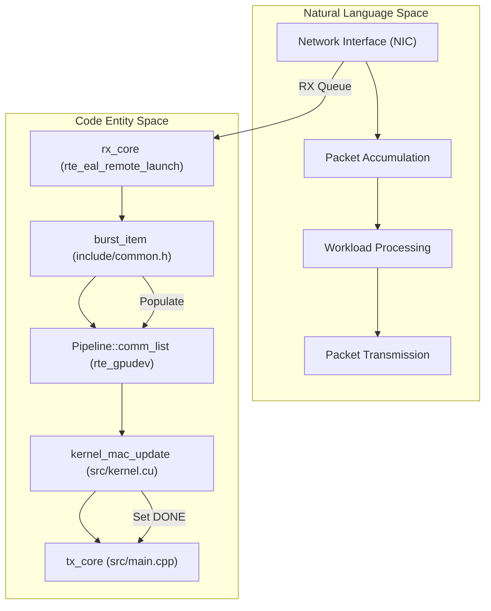
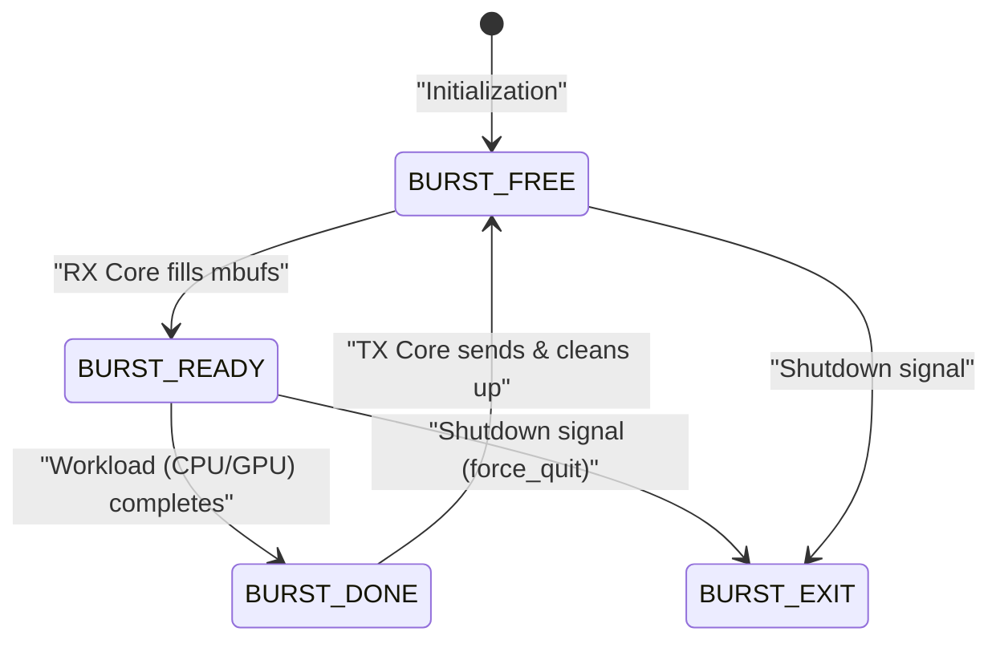

<!-- source: DeepWiki mcp.deepwiki.com · repo NVIDIA/l2fwd-nv · page 8 Glossary · fetched 2026-10-26 -->

# Glossary

Relevant source files

The following files were used as context for generating this wiki page:

- [.gitmodules](.gitmodules)
- [CMakeLists.txt](CMakeLists.txt)
- [README.md](README.md)
- [include/common.h](include/common.h)
- [include/cuda_related.h](include/cuda_related.h)
- [include/headers.h](include/headers.h)
- [src/kernel.cu](src/kernel.cu)
- [src/main.cpp](src/main.cpp)
- [src/pipeline.cpp](src/pipeline.cpp)
- [src/utils.cpp](src/utils.cpp)

This glossary defines the technical terms, domain concepts, and codebase-specific abstractions used in `l2fwd-nv`. It serves as a reference for onboarding engineers to understand the mapping between high-level networking/GPU concepts and their specific implementations in this project.

## Core Concepts & Terms

### Buffer Split
A DPDK feature where a single incoming packet is split into two separate memory segments (mbufs). In `l2fwd-nv`, this is used to store the packet header (64B) in CPU memory and the payload in GPU memory [README.md:28-29](). It is enabled via the `-s` flag and requires `RTE_ETH_RX_OFFLOAD_BUFFER_SPLIT` [src/main.cpp:46-66]().
*   **Code Pointer:** `conf_buffer_split` in [src/main.cpp:36]().

### Burst
A collection of packets processed as a single unit to amortize overhead. The application uses `MAX_MBUFS_BURST` (default 1024) to define the maximum number of packets per workload trigger [include/common.h:34]().
*   **Code Pointer:** `struct burst_item` in [include/common.h:85-93]().

### Comm List (`rte_gpu_comm_list`)
The primary synchronization structure provided by the DPDK `gpudev` library for CPU-GPU communication. It consists of a status flag and a list of packet addresses. The CPU sets the status to `READY`, and the GPU sets it to `DONE` upon completion [src/kernel.cu:87-90]().
*   **Code Pointer:** `comm_list` in [include/pipeline.h:48]().

### CUDA Graphs
A feature used in `GPU_GRAPHS_WORKLOAD` mode where a sequence of GPU operations is captured into a graph and replayed. This reduces the CPU overhead of launching kernels for every burst [src/pipeline.cpp:66-76]().
*   **Code Pointer:** `wgraph` and `winstance` arrays in [include/pipeline.h:51-52]().

### GDRCopy
A low-latency GPU-to-CPU copy library. In this codebase, it is used via the DPDK `gpudev` library to map GPU memory into the CPU address space, allowing the CPU to directly read/write packet metadata or headers [README.md:151-158]().
*   **Code Pointer:** `GDRCOPY_PATH_L` environment variable requirement in [README.md:161]().

### Mempool Type
Defines where the packet data buffers are allocated.
1.  **MEM_HOST_PINNED (0):** CPU memory pinned for DMA access [include/common.h:61]().
2.  **MEM_DEVMEM (1):** GPU device memory [include/common.h:60]().

### Pipeline
The top-level abstraction representing a single processing unit. Each pipeline consists of one RX core, one TX core, and a dedicated workload (CPU or GPU) [README.md:8-11]().
*   **Code Pointer:** `class Pipeline` in [include/pipeline.h:38]().

---

## Data Flow & Lifecycle Diagrams

### Pipeline Data Flow: Natural Language to Code
This diagram maps the logical flow of a packet through the system to the specific code entities responsible for each stage.

**Sources:** [README.md:8-17](), [src/pipeline.cpp:33-47](), [src/kernel.cu:35-92]().

### Workload State Machine
The lifecycle of a `burst_item` as it moves through the pipeline, coordinated by the `status` flags.

**Sources:** [include/common.h:39-42](), [src/pipeline.cpp:98-110]().

---

## Technical Definitions Table

| Term | Implementation / Code Reference | Description |
| :--- | :--- | :--- |
| `MAX_BURSTS_X_QUEUE` | [include/common.h:35]() | Size of the circular buffer (4096) for communication between RX and TX threads. |
| `GPU_PAGE_SIZE` | [include/common.h:66]() | Fixed at 64KB (1 << 16) for alignment with GPUDirect RDMA requirements. |
| `GAP_PKTS` | [include/common.h:62]() | Threshold (4) used to trigger GPU workload launches to prevent pipeline stalls. |
| `port_statistics` | [include/headers.h:82-95]() | Cache-aligned structure tracking per-queue RX/TX packets, bytes, and nanoseconds. |
| `wtime_n` | [src/kernel.cu:35]() | A simulated workload parameter passed to kernels to induce a busy-wait delay. |
| `force_quit` | [src/main.cpp:91]() | Global volatile boolean used to trigger a graceful exit of all EAL threads. |
| `comm_list->status_d` | [src/kernel.cu:88]() | Device-side pointer to the status of a burst item, polled by persistent kernels. |

---

## Workload Strategy Comparison

The system supports four distinct workload strategies, defined in `enum workload_flags` [include/common.h:74-80]():

| Mode | Flag | Logic Entity | Implementation Detail |
| :--- | :--- | :--- | :--- |
| **No Workload** | `NO_WORKLOAD` | N/A | Basic I/O forwarding without modification. |
| **CPU Workload** | `CPU_WORKLOAD` | `workload_macswap_cpu` | CPU loops through mbufs and swaps MACs [src/utils.cpp:56](). |
| **Standard GPU** | `GPU_WORKLOAD` | `kernel_mac_update` | One kernel launch per burst of packets [src/kernel.cu:35](). |
| **Persistent GPU**| `GPU_PK_WORKLOAD` | `kernel_persistent_mac_update` | Single long-running kernel polling `status_d` [src/kernel.cu:111](). |
| **CUDA Graphs** | `GPU_GRAPHS_WORKLOAD`| `winstance` | Replays captured graph of `GRAPH_BURST` (8) bursts [src/pipeline.cpp:66](). |

**Sources:** [include/common.h:74-80](), [src/kernel.cu:1-213](), [src/utils.cpp:56-101]().