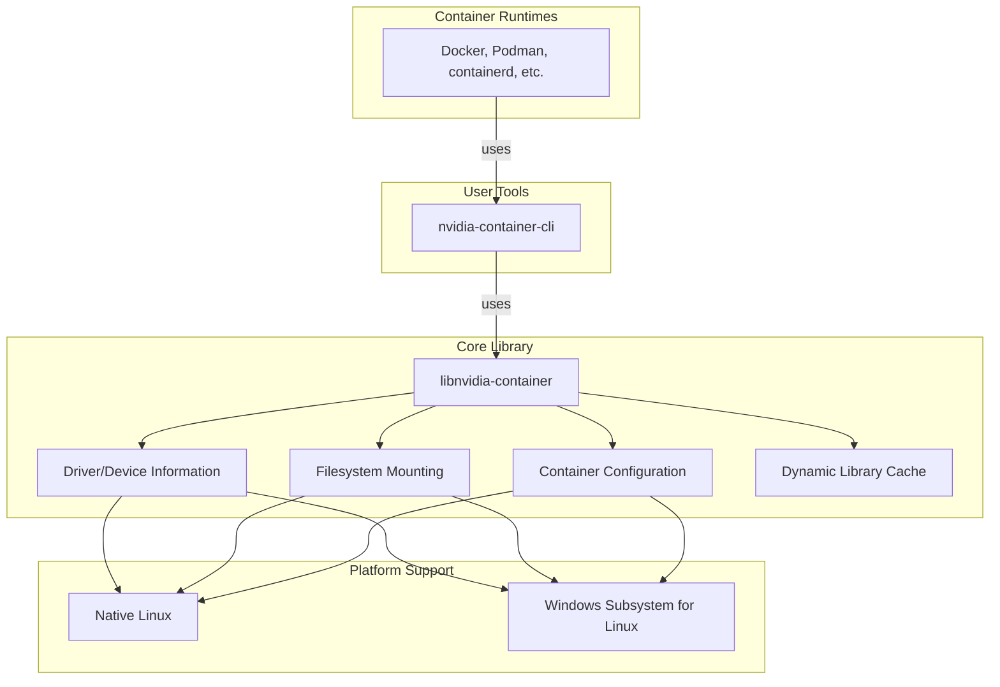
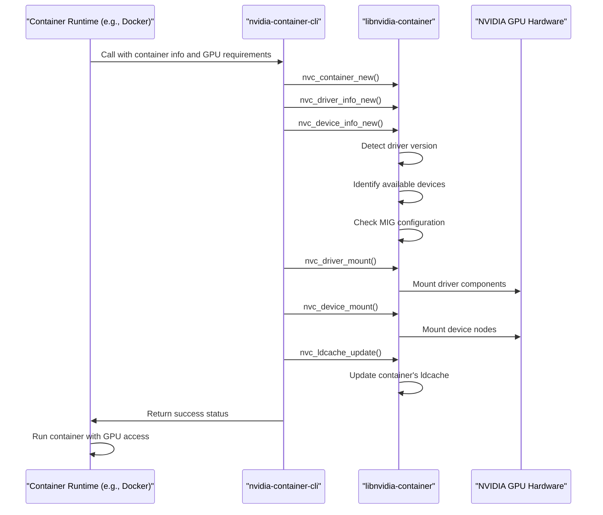
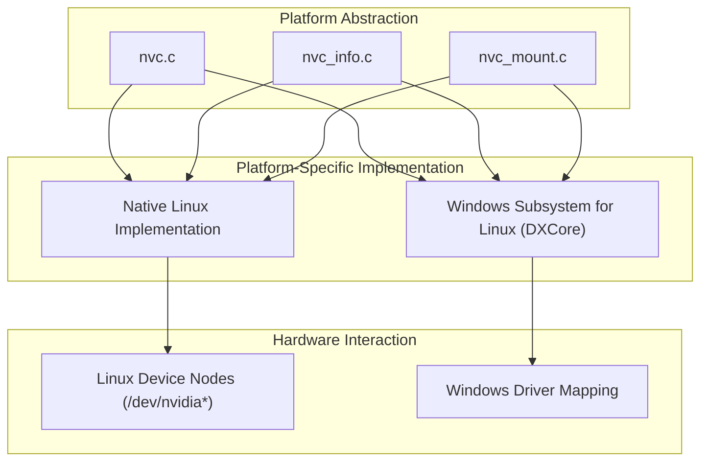

<!-- source: DeepWiki mcp.deepwiki.com · repo NVIDIA/libnvidia-container · page 1 Overview · fetched 2026-10-26 -->

# Overview

<details>
<summary>Relevant source files</summary>

The following files were used as context for generating this wiki page:

- [.github/workflows/build.yaml](.github/workflows/build.yaml)
- [CHANGELOG.md](CHANGELOG.md)
- [README.md](README.md)
- [src/cgroup_legacy.c](src/cgroup_legacy.c)
- [src/dxcore.c](src/dxcore.c)
- [src/dxcore.h](src/dxcore.h)

</details>


The libnvidia-container project provides a low-level library and a CLI utility for configuring GNU/Linux containers with NVIDIA GPU support. This system is designed to be container runtime agnostic, relying on kernel primitives to properly isolate and expose NVIDIA GPU devices to containerized applications. This overview explains the purpose, components, and architecture of libnvidia-container, providing a foundation for understanding how it enables GPU acceleration in container environments.

For detailed information about the system architecture, see [Architecture](#2).

Sources: [README.md:10-11]()

## Purpose and Core Functionality

The libnvidia-container library enables container runtimes to:

1. Detect NVIDIA hardware and drivers on the host system
2. Mount necessary driver components inside containers
3. Configure device nodes and permissions for GPU access
4. Manage cgroup-based isolation and access control
5. Support specialized configurations (e.g., Multi-Instance GPU)
6. Work across different platforms (Native Linux and Windows Subsystem for Linux)

The project is designed as a building block for more complex container technologies, providing the fundamental capabilities needed for containerized GPU workloads.

Sources: [README.md:10-11](), [README.md:43-45]()

## Key Components

### Component Architecture



Sources: [src/dxcore.c:1-430](), [README.md:10-11]()

### Library and CLI Relationship

The project consists of two main components:

1. **libnvidia-container library**: Core implementation providing programmatic access to GPU configuration capabilities
2. **nvidia-container-cli**: Command-line utility that exposes the library's functionality

Container runtimes typically integrate with the CLI tool, which in turn leverages the library's functionality to configure containers with NVIDIA GPU support.

Sources: [README.md:10-11](), [README.md:47-77]()

## System Integration

### Integration with Container Environments



Sources: [README.md:47-77]()

### Container Runtime Example

The library is used by projects like [nvidia-container-runtime](#2.3) to enable GPU support in container platforms. This usage follows a pattern where:

1. The container runtime invokes `nvidia-container-cli`
2. The CLI configures the container's namespaces with required GPU access
3. The container gains access to specified GPU devices

A practical command-line example demonstrating this integration is shown in the README:

```
nvidia-container-cli --load-kmods configure --ldconfig=@/sbin/ldconfig.real --no-cgroups --utility --device 0 $(pwd)
```

This command configures the current directory as a container root with access to GPU device 0, along with required utilities.

Sources: [README.md:44-77]()

## Platform Support

The library supports both native Linux environments and Windows Subsystem for Linux (WSL):

### Native Linux Support

On native Linux, the library:
- Interacts directly with the NVIDIA driver via device nodes
- Uses cgroups for access control
- Manages filesystem mounts within container namespaces

### Windows Subsystem for Linux Support

For WSL environments, the system:
- Uses the DXCore interface to interact with Windows display drivers
- Detects NVIDIA hardware through Windows APIs
- Maps driver components from Windows driver store to Linux containers



The DXCore implementation enables GPUs on Windows hosts to be properly exposed to containers running in WSL environments, bridging the gap between Windows drivers and Linux containers.

Sources: [src/dxcore.c:1-430](), [src/dxcore.h:1-40]()

## Container Integration Mechanisms

### Device Access Control

The library uses cgroups to control access to GPU devices within containers:

- For cgroup v1: Modifies `devices.allow` entries to permit access to specific device nodes
- For cgroup v2: Uses the appropriate mechanisms for the newer cgroup version

This ensures containers can only access the specific GPU devices that have been explicitly assigned to them.

Sources: [src/cgroup_legacy.c:1-206]()

### Filesystem Mounting

To provide GPU access, the library mounts several components into containers:

1. **Driver libraries**: CUDA libraries, display drivers, etc.
2. **Device nodes**: `/dev/nvidia*` devices for direct hardware access
3. **Utility binaries**: Tools like `nvidia-smi` for monitoring and management

The mounting process ensures that only required components are exposed, maintaining container isolation principles.

## Summary

The libnvidia-container project provides the foundation for GPU acceleration in container environments by:

1. Offering a container-runtime-agnostic solution for NVIDIA GPU integration
2. Providing both a programmable library and command-line utilities
3. Supporting multiple platforms including native Linux and WSL
4. Ensuring proper isolation and access control for containerized GPU workloads
5. Enabling container technologies to leverage NVIDIA hardware capabilities

This overview provides the context for understanding the more detailed aspects of the system covered in other documentation sections.

---

