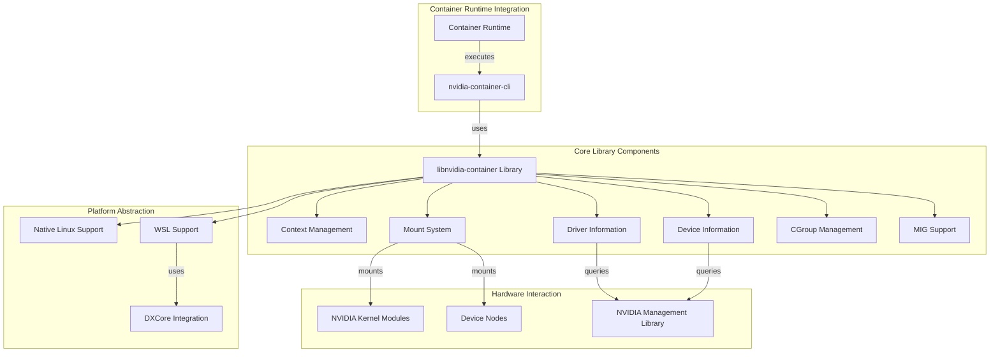
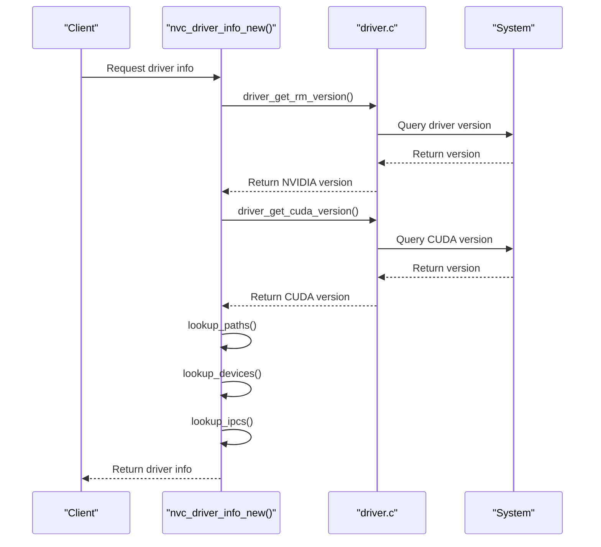
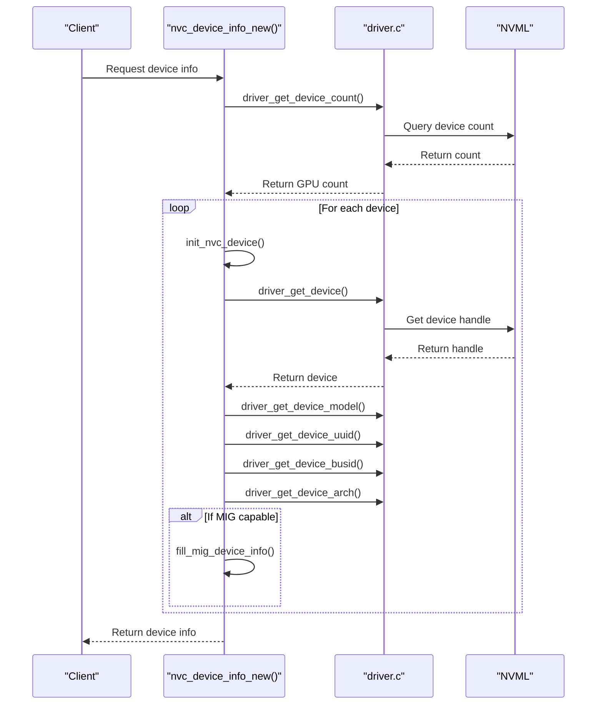
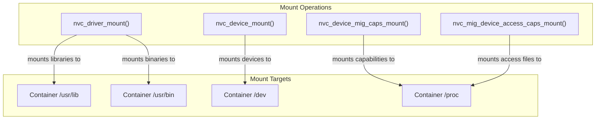
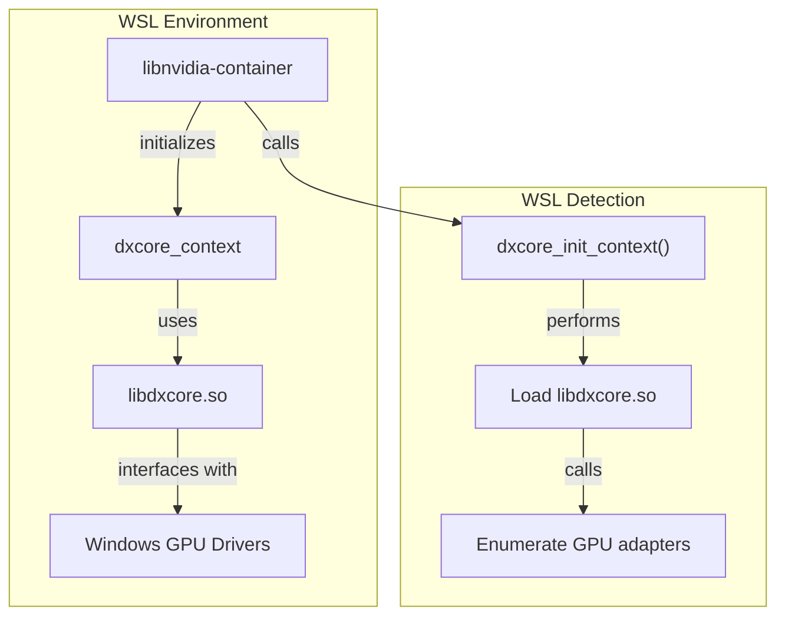
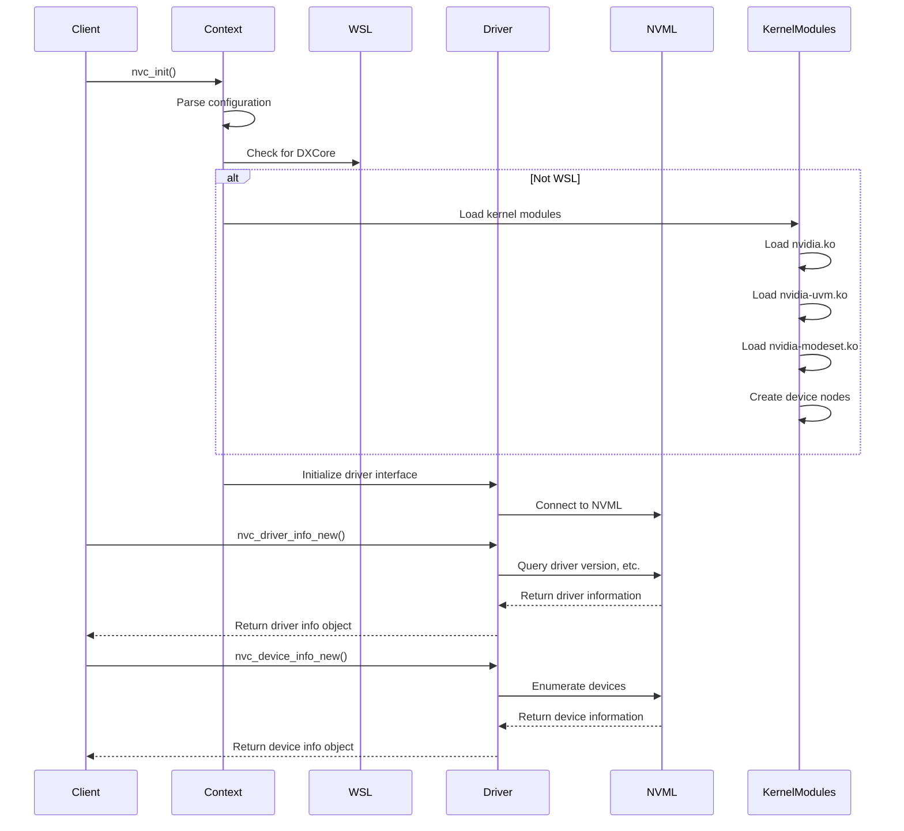
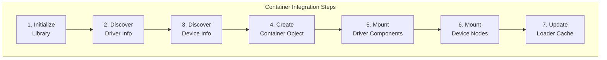
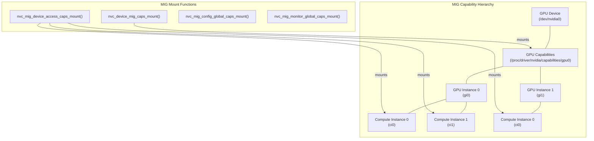

<!-- source: DeepWiki mcp.deepwiki.com · repo NVIDIA/libnvidia-container · page 2 Architecture · fetched 2026-10-26 -->

# Architecture

<details>
<summary>Relevant source files</summary>

The following files were used as context for generating this wiki page:

- [pkg/deb/libnvidia-container@MAJOR@.symbols](pkg/deb/libnvidia-container@MAJOR@.symbols)
- [src/libnvidia-container.lds](src/libnvidia-container.lds)
- [src/nvc.c](src/nvc.c)
- [src/nvc.h.template](src/nvc.h.template)
- [src/nvc_info.c](src/nvc_info.c)
- [src/nvc_internal.h](src/nvc_internal.h)

</details>


This document describes the architecture of libnvidia-container, a key component of the NVIDIA Container Toolkit that enables GPU support in containerized applications. It explains the core subsystems, their interactions, and how they work together to expose NVIDIA GPUs to containers in a secure and isolated manner.

For information about specific commands and usage patterns, see [Command-Line Interface](#3). For details about building the project, see [Building and Packaging](#4).

## System Overview

libnvidia-container operates as a foundational component that manages the complex task of properly configuring Linux containers with NVIDIA GPU support. It's designed to be container runtime agnostic, allowing integration with Docker, containerd, CRI-O, and other container runtimes.



Sources: [src/nvc_internal.h:1-181](), [src/nvc.c:1-496](), [src/nvc_info.c:1-940]()

## Core Components

### Context and Configuration Management

The library uses a context-based design where operations are performed against an initialized context. The context maintains configuration details, error state, and platform-specific information.

```mermaid
classDiagram
    class nvc_context {
        bool initialized
        struct error err
        struct nvc_config cfg
        int mnt_ns
        bool no_pivot
        struct dxcore_context dxcore
    }

    class nvc_config {
        char* root
        char* ldcache
        uid_t uid
        gid_t gid
        struct nvc_imex_info imex
    }

    class nvc_container {
        int32_t flags
        struct nvc_container_config cfg
        uid_t uid
        gid_t gid
        char* mnt_ns
        int dev_cg_version
        char* dev_cg
        char** libs
        size_t nlibs
    }

    nvc_context --> nvc_config : "contains"
    nvc_container --> "nvc_container_config" : "contains"
```

The library's lifecycle begins with context initialization through `nvc_init()` and ends with `nvc_shutdown()`. The initialization process:

1. Parses configuration options
2. Loads necessary kernel modules (if requested)
3. Initializes platform-specific components (native Linux or WSL)
4. Sets up driver communication

Sources: [src/nvc.c:94-131](), [src/nvc.c:376-447](), [src/nvc_internal.h:68-87]()

### Driver and Device Information

A key responsibility of the library is discovering and providing information about available drivers and devices. This is handled by two main components:

#### Driver Information System

The driver information system collects details about installed NVIDIA drivers, including:
- NVIDIA driver version
- CUDA version
- Required libraries and binaries
- Device nodes



The driver information system scans the system for required NVIDIA components such as libraries (both 32-bit and 64-bit), binaries, device nodes, and IPC mechanisms. It uses the dynamic linker cache to locate libraries and resolves binary paths using the system PATH.

Sources: [src/nvc_info.c:794-826](), [src/nvc_info.c:365-420]()

#### Device Information System

The device information system discovers and provides details about NVIDIA GPUs in the system:
- Device model
- UUID
- PCI bus ID
- Architecture
- MIG configuration (if applicable)



MIG (Multi-Instance GPU) support is a key feature that allows for partitioning GPUs into multiple isolated instances. The device information system detects MIG-capable GPUs and collects information about configured MIG devices.

Sources: [src/nvc_info.c:844-885](), [src/nvc_info.c:703-761](), [src/nvc_info.c:603-701]()

### Mount System

The mount system is responsible for exposing driver components and device nodes inside containers. It handles:

1. Mounting NVIDIA driver libraries
2. Mounting NVIDIA device nodes
3. Mounting MIG capability files
4. Updating the container's loader cache



The mount system uses Linux mount operations to expose the required files and devices to containers. It handles both standard device access and more complex MIG configurations.

Sources: [src/nvc.h.template:162-175](), [src/libnvidia-container.lds:34-42]()

### CGroup Management

Container isolation is enforced through Linux cgroups, particularly for device access control. The library:

1. Identifies the container's cgroup
2. Determines the cgroup version (v1 or v2)
3. Configures device access permissions for NVIDIA devices

This ensures that containers only have access to the specific GPUs assigned to them, enforcing hardware-level isolation.

Sources: [src/nvc_internal.h:123-128]()

## Platform Support

libnvidia-container supports both native Linux environments and Windows Subsystem for Linux (WSL):

### Native Linux Support

On native Linux, the library:
- Loads required kernel modules (nvidia, nvidia-uvm, nvidia-modeset)
- Creates device nodes if they don't exist
- Uses procfs and sysfs for hardware detection and configuration

### WSL Support

WSL support is implemented through Microsoft's DXCore API:



In WSL environments, the library detects the presence of DXCore and uses it instead of the traditional Linux interfaces. This allows containers running in WSL to access GPUs through the Windows host.

Sources: [src/nvc.c:408-436](), [src/nvc_info.c:183-205](), [src/nvc_info.c:722-736]()

## Initialization and Discovery Flow

The following diagram illustrates the initialization sequence and discovery flow of the library:



This initialization process prepares the library for operations and discovers the available GPUs and driver components that can be exposed to containers.

Sources: [src/nvc.c:376-447](), [src/nvc_info.c:794-826](), [src/nvc_info.c:844-885]()

## Container Integration

The library integrates with containers through the following steps:

1. Create a container configuration with `nvc_container_config_new()`
2. Create a container object with `nvc_container_new()`
3. Mount driver components with `nvc_driver_mount()`
4. Mount device nodes with `nvc_device_mount()`
5. Update the dynamic linker cache with `nvc_ldcache_update()`



This process ensures that NVIDIA GPU devices and required software components are properly exposed to containers while maintaining isolation.

Sources: [src/nvc.h.template:146-176]()

## MIG Support Architecture

Multi-Instance GPU (MIG) support allows partitioning NVIDIA GPUs into multiple isolated instances. The library detects MIG-capable GPUs and provides mechanisms to mount the necessary capability files:



The MIG support architecture involves:
- Detecting MIG-capable GPUs
- Identifying configured GPU instances and compute instances
- Mounting the appropriate capability files in the container
- Managing access permissions

Sources: [src/nvc_info.c:603-701](), [src/nvc.h.template:166-170](), [src/nvc.c:147-229]()

## External Interface

The library exposes a C API defined in `nvc.h` with the following key functions:

| Function Group | Purpose | Key Functions |
|----------------|---------|---------------|
| Context Management | Initialize and manage the library context | `nvc_context_new`, `nvc_init`, `nvc_shutdown` |
| Configuration | Configure library behavior | `nvc_config_new` |
| Information | Discover driver and device information | `nvc_driver_info_new`, `nvc_device_info_new` |
| Container Management | Create and manage container objects | `nvc_container_new` |
| Mounting | Mount driver and device components | `nvc_driver_mount`, `nvc_device_mount` |
| MIG Support | Mount MIG capability files | `nvc_device_mig_caps_mount` |
| Error Handling | Get error information | `nvc_error` |

The functions are exported through a versioned API with the symbol version `NVC_1.0`.

Sources: [src/nvc.h.template:135-179](), [src/libnvidia-container.lds:14-48](), [pkg/deb/libnvidia-container@MAJOR@.symbols:1-29]()

## Summary

The libnvidia-container architecture is designed with modularity and platform abstraction in mind. It provides a clean interface for container runtimes to integrate NVIDIA GPU support while handling the complex details of driver discovery, device management, and isolation. The library supports both native Linux and WSL environments, with special handling for MIG configurations.

This architecture enables the NVIDIA Container Toolkit to provide consistent GPU support across different container runtimes and platforms, making GPU acceleration accessible to containerized applications with proper isolation and security.

---

