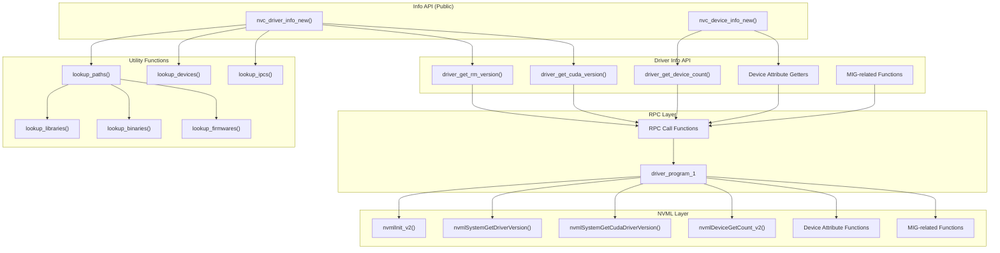
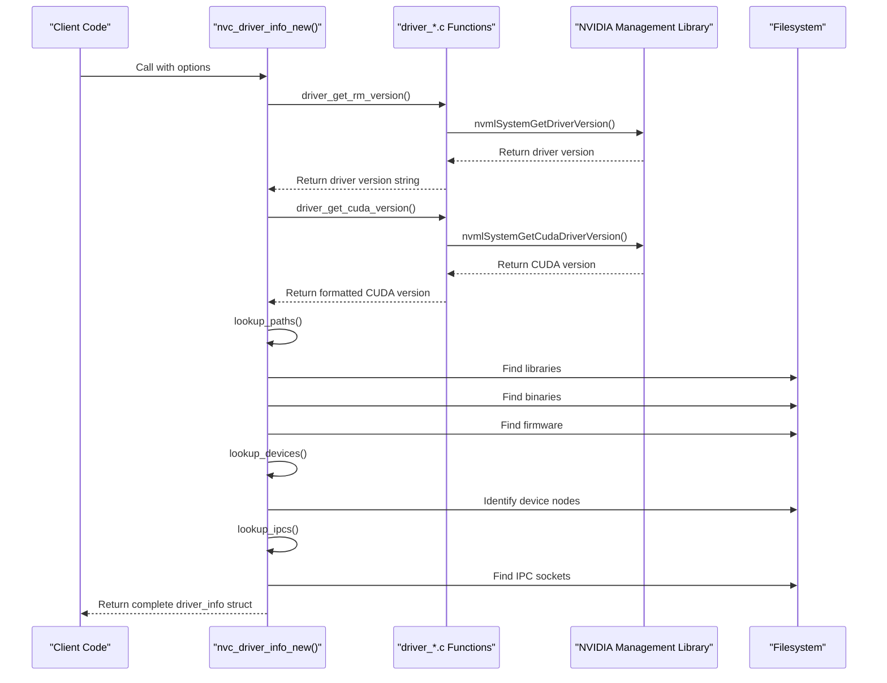
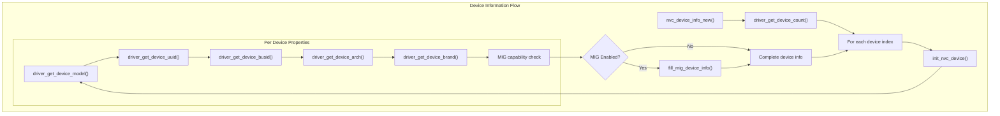
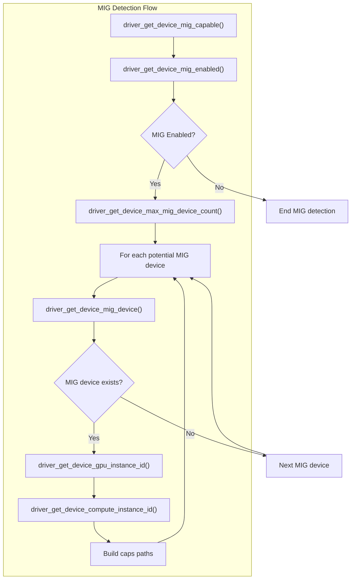
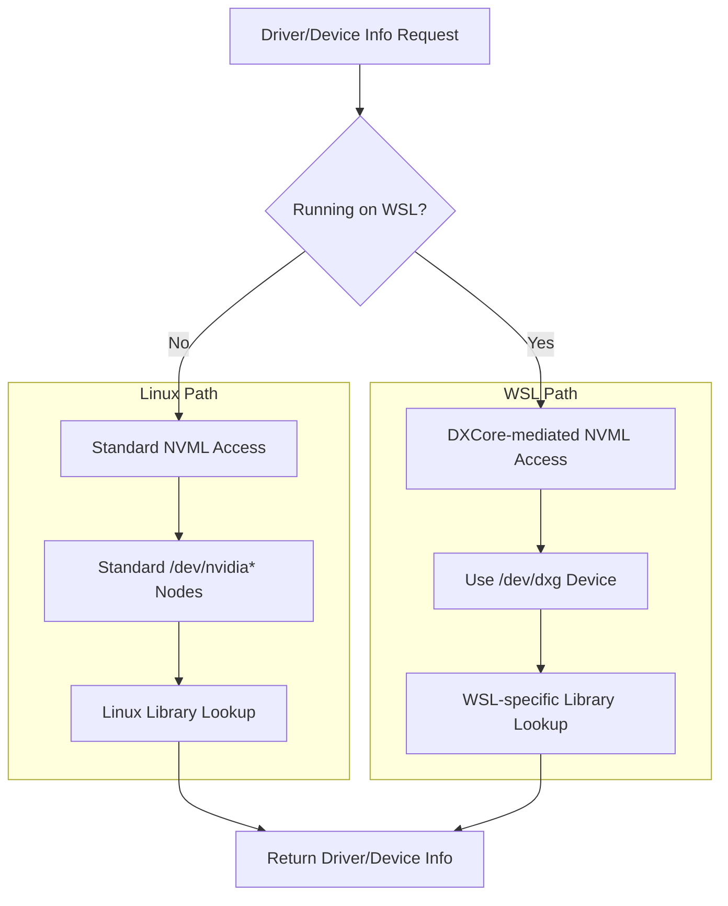
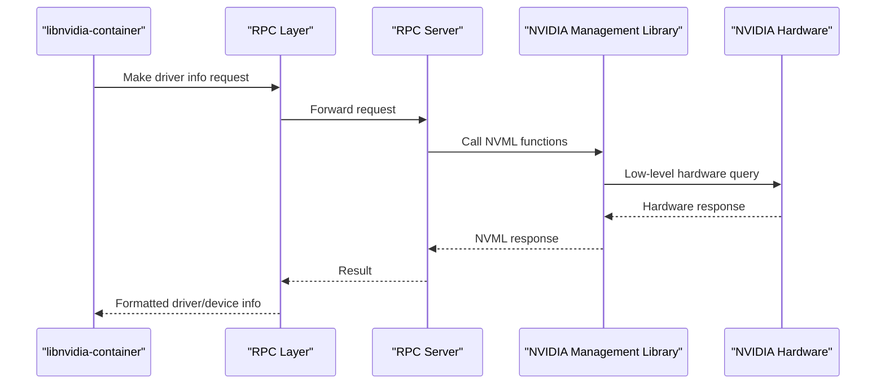

<!-- source: DeepWiki mcp.deepwiki.com · repo NVIDIA/libnvidia-container · page 2.1 Driver and Device Information · fetched 2026-10-26 -->

# Driver and Device Information

<details>
<summary>Relevant source files</summary>

The following files were used as context for generating this wiki page:

- [src/driver.c](src/driver.c)
- [src/driver.h](src/driver.h)
- [src/nvc_info.c](src/nvc_info.c)
- [src/nvc_internal.h](src/nvc_internal.h)

</details>


This document describes the driver and device information subsystem within the NVIDIA Container Toolkit. This subsystem is responsible for discovering NVIDIA drivers and GPU devices, gathering their capabilities, and providing this information to other components for container configuration.

For details about how this information is used to set up container filesystems, see [Container Filesystem Management](#2.2).

## Overview

The driver and device information subsystem is a core part of the NVIDIA Container Toolkit architecture that:

1. Detects installed NVIDIA drivers and their versions
2. Discovers available NVIDIA GPU devices and their capabilities
3. Identifies required libraries, binaries, and driver components
4. Provides Multi-Instance GPU (MIG) device detection
5. Supports both standard Linux environments and Windows Subsystem for Linux (WSL)

This information forms the foundation for proper GPU access inside containers.

Sources: [src/nvc_info.c:794-825](). [src/nvc_info.c:844-885]()

## Architecture



Sources: [src/driver.c:214-985](). [src/nvc_info.c:794-885]()

## Driver Information Collection

The driver information subsystem provides details about installed NVIDIA drivers including version information, required libraries, binaries, devices, and IPCs. This is implemented through the `nvc_driver_info_new()` function.

### Driver Collection Process



Sources: [src/nvc_info.c:794-825](). [src/driver.c:214-287]()

### Driver Information Structure

The `nvc_driver_info` structure contains:

1. **Version Information**:
   - NVIDIA driver version
   - CUDA driver version

2. **Libraries**: NVIDIA GPU-related libraries with both 64-bit and 32-bit support
   - Utility libraries (e.g., `libnvidia-ml.so`)
   - Compute libraries (e.g., `libcuda.so`)
   - Graphics libraries (OpenGL, EGL, etc.)
   - Video acceleration libraries

3. **Binaries**: NVIDIA utilities and tools
   - System management tools (e.g., `nvidia-smi`)
   - Compute-related tools (e.g., `nvidia-cuda-mps-control`)

4. **Devices**: Device nodes that need to be exposed to containers
   - Control device (`/dev/nvidiactl`)
   - GPU devices (`/dev/nvidia*`)
   - UVM devices if enabled (`/dev/nvidia-uvm*`)

5. **IPCs**: Inter-process communication sockets
   - NVIDIA Persistence daemon socket
   - NVIDIA Fabric Manager socket
   - CUDA MPS socket

Sources: [src/nvc_info.c:366-420](). [src/nvc_info.c:513-572](). [src/nvc_info.c:574-601]()

### Library and Binary Discovery

The system uses sophisticated methods to discover required libraries and binaries:

1. For libraries:
   - Uses the system's library cache (`ldcache`) to locate libraries
   - Validates libraries by checking their ABI compatibility
   - Handles both standard and GLVND (GL Vendor-Neutral Dispatch) configurations
   - Special handling for WSL environments

2. For binaries:
   - Searches through the system's PATH
   - Special handling for WSL environments to find binaries in the driver store

Sources: [src/nvc_info.c:141-310](). [src/nvc_info.c:387-420](). [src/nvc_info.c:422-441]()

## Device Information Collection

The device information subsystem discovers and provides details about NVIDIA GPU devices in the system. This is implemented through the `nvc_device_info_new()` function.

### Device Collection Process



Sources: [src/nvc_info.c:844-885](). [src/nvc_info.c:703-761]()

### Device Information Structure

The `nvc_device_info` structure contains:

| Field | Description |
|-------|-------------|
| `ngpus` | Number of GPU devices found |
| `gpus` | Array of device information structures |

Each GPU device structure contains:

| Field | Description |
|-------|-------------|
| `model` | Device model name (e.g., "Tesla V100") |
| `uuid` | Unique device identifier |
| `busid` | PCI bus identifier |
| `arch` | GPU architecture version (e.g., "7.0") |
| `brand` | Brand name (e.g., "Tesla", "Quadro") |
| `node` | Device node information |
| `mig_capable` | Whether MIG is supported by this device |
| `mig_enabled` | Whether MIG is currently enabled |
| `mig_devices` | Information about MIG device instances |

Sources: [src/nvc_info.c:703-761](). [src/driver.c:476-607]()

### Device Node Information

Device nodes are managed through the `nvc_device_node` structure:

| Field | Description |
|-------|-------------|
| `path` | Path to the device node (e.g., `/dev/nvidia0`) |
| `id` | Device ID (major/minor numbers) |

Sources: [src/nvc_info.c:513-572](). [src/nvc_info.c:313-329]()

## Multi-Instance GPU (MIG) Support

The system includes comprehensive support for Multi-Instance GPU (MIG) technology, which allows a single physical GPU to be partitioned into multiple independent GPU instances.

### MIG Detection Process



Sources: [src/nvc_info.c:603-701](). [src/driver.c:649-982]()

### MIG Device Information

The `nvc_mig_device_info` structure contains:

| Field | Description |
|-------|-------------|
| `ndevices` | Number of MIG devices found |
| `devices` | Array of MIG device structures |

Each MIG device contains:

| Field | Description |
|-------|-------------|
| `gi` | GPU Instance ID |
| `ci` | Compute Instance ID |
| `uuid` | Unique identifier for the MIG device |
| `parent` | Reference to the parent physical GPU |
| `gi_caps_path` | Path to the GPU Instance capability in procfs |
| `ci_caps_path` | Path to the Compute Instance capability in procfs |

Sources: [src/nvc_info.c:603-701](). [src/driver.c:877-982]()

## Cross-Platform Considerations

The system supports both standard Linux environments and Windows Subsystem for Linux (WSL).

### Linux vs WSL Implementation



Key differences in the WSL implementation:

1. **Device Access**:
   - Linux: Uses native `/dev/nvidia*` device nodes
   - WSL: Uses the Windows DXG device (`/dev/dxg`)

2. **Library Selection**:
   - Linux: Uses standard library selection based on NVIDIA driver version
   - WSL: Prioritizes libraries in the Windows driver store path

3. **MIG Support**:
   - Linux: Full MIG support
   - WSL: No MIG support

Sources: [src/nvc_info.c:183-205](). [src/nvc_info.c:724-736](). [src/nvc_info.c:513-572]()

## Key Data Structures

### Driver Information Structure

The `nvc_driver_info` structure is the primary container for driver-related information:

```
struct nvc_driver_info {
    char *nvrm_version;          // NVIDIA driver version
    char *cuda_version;          // CUDA version 
    char **bins;                 // Array of binary paths
    size_t nbins;                // Number of binaries
    char **libs;                 // Array of 64-bit library paths
    size_t nlibs;                // Number of 64-bit libraries
    char **libs32;               // Array of 32-bit library paths 
    size_t nlibs32;              // Number of 32-bit libraries
    struct nvc_device_node *devs;// Array of device nodes
    size_t ndevs;                // Number of device nodes
    char **ipcs;                 // Array of IPC sockets
    size_t nipcs;                // Number of IPC sockets
    char **firmwares;            // Array of firmware files
    size_t nfirmwares;           // Number of firmware files
}
```

Sources: [src/nvc_info.c:794-842]()

### Device Information Structure

The `nvc_device_info` structure holds information about all detected GPU devices:

```
struct nvc_device_info {
    size_t ngpus;                // Number of GPUs
    struct nvc_device *gpus;     // Array of GPU information
}

struct nvc_device {
    char *model;                 // Device model name
    char *uuid;                  // Device UUID
    char *busid;                 // Device bus ID
    char *arch;                  // Device architecture
    char *brand;                 // Device brand
    struct nvc_device_node node; // Device node information
    bool mig_capable;            // MIG capability flag
    char *mig_caps_path;         // Path to MIG capabilities
    struct nvc_mig_device_info mig_devices; // MIG device information
}
```

Sources: [src/nvc_info.c:844-904]()

## Integration with NVML

The driver and device information system relies on the NVIDIA Management Library (NVML) for low-level interaction with NVIDIA hardware. This is implemented through a secure RPC mechanism.



Key security aspects:

1. **Privilege Separation**: The RPC server drops privileges and capabilities to minimize security risks
2. **Chroot**: In container environments, the server changes root to properly interact with the container's view
3. **Capability Management**: The system carefully manages Linux capabilities to provide only required access

Sources: [src/driver.c:69-173](). [src/driver.c:117-166]()

## Conclusion

The Driver and Device Information subsystem provides a secure, comprehensive, and platform-independent way to discover and interact with NVIDIA drivers and GPU devices. It forms the foundation for proper GPU access inside containers by identifying all required components and hardware capabilities.

---

