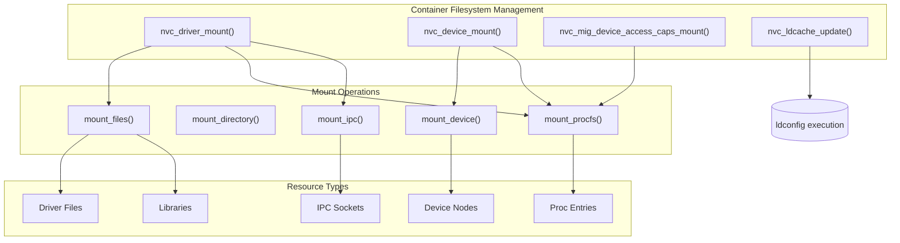
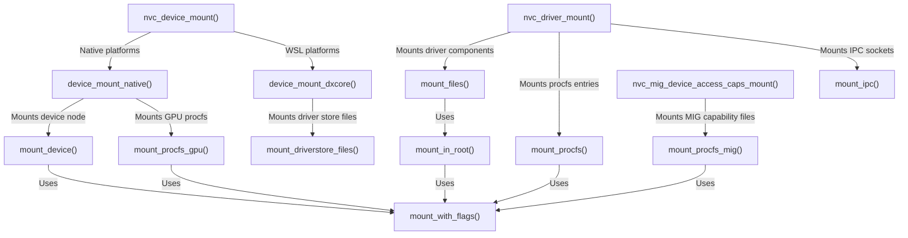
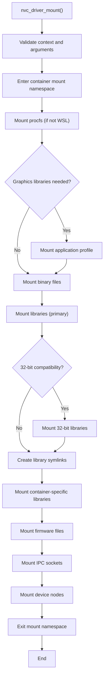
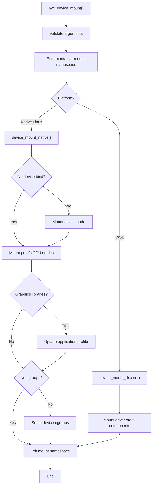
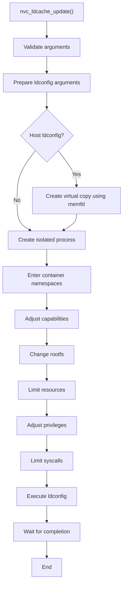

<!-- source: DeepWiki mcp.deepwiki.com · repo NVIDIA/libnvidia-container · page 2.2 Container Filesystem Management · fetched 2026-10-26 -->

# Container Filesystem Management

<details>
<summary>Relevant source files</summary>

The following files were used as context for generating this wiki page:

- [src/common.h](src/common.h)
- [src/nvc_ldcache.c](src/nvc_ldcache.c)
- [src/nvc_mount.c](src/nvc_mount.c)

</details>


## Purpose and Scope

This document details how the NVIDIA Container Toolkit manages filesystems within containers to provide access to NVIDIA GPU resources. It covers the mounting of driver files, device nodes, libraries, and other necessary components to enable GPU acceleration in containerized environments. This document focuses specifically on filesystem operations and does not cover driver and device discovery (see [Driver and Device Information](#2.1)) or container configuration through cgroups (see [Container Configuration](#2.3)).

## Overview

The Container Filesystem Management system enables GPU-accelerated containers by exposing the necessary NVIDIA drivers, libraries, device nodes, and other resources into the container filesystem. It handles mounting these components from the host system into the container while respecting container isolation and security constraints.



Sources: [src/nvc_mount.c:716-841](), [src/nvc_mount.c:844-865](), [src/nvc_mount.c:868-936](), [src/nvc_ldcache.c:460-536]()

## Core Mount Operations

The filesystem management system provides several mounting mechanisms to handle different types of resources that need to be exposed to containers.

### Mount Function Hierarchy



Sources: [src/nvc_mount.c:27-47](), [src/nvc_mount.c:716-841](), [src/nvc_mount.c:844-865](), [src/nvc_mount.c:868-936]()

### Basic Mount Functions

The system uses several low-level mounting functions that form the foundation of the filesystem management:

- `mount_with_flags()`: Performs the actual bind mounting with specified flags
- `mount_in_root()`: Ensures the destination is within container rootfs before mounting
- `mount_directory()`: Mounts a directory into the container
- `unmount()`: Safely unmounts any previously mounted filesystem

These basic functions are used by higher-level functions that focus on specific resource types.

Sources: [src/nvc_mount.c:49-102](), [src/nvc_mount.c:510-517]()

## Driver Mounting

The `nvc_driver_mount` function is the primary entry point for mounting NVIDIA driver components inside a container. It handles:

1. Mounting procfs entries for driver information
2. Setting up application profiles (for graphics libraries)
3. Mounting binary files (commands) and libraries
4. Mounting firmware files
5. Mounting IPC sockets
6. Mounting device nodes



Sources: [src/nvc_mount.c:716-841]()

### Library Management

Libraries are mounted into the container to provide GPU acceleration capabilities. The system handles:

1. 64-bit libraries in the primary library directory
2. 32-bit libraries for compatibility (when requested)
3. Container-specific libraries
4. Creation of necessary symbolic links for proper library discovery

The file paths for mounting libraries are determined based on the container configuration:

| Library Type | Default Container Path |
|--------------|------------------------|
| 64-bit libraries | `/usr/lib64` |
| 32-bit libraries | `/usr/lib32` or `/usr/lib` |
| Container-specific libraries | Configured by container |

Sources: [src/nvc_mount.c:104-155](), [src/nvc_mount.c:519-563](), [src/common.h:27-59]()

### Library Filtering

The toolkit filters libraries based on version compatibility to prevent unsupported configurations:

```c
/* Filter out any library that matches the major version of RM to prevent running
   into unsupported configurations (e.g. CUDA compat on Geforce or non-LTS drivers) */
```

The `filter_libraries` function examines the library names and versions to ensure only compatible libraries are mounted into the container.

Sources: [src/nvc_mount.c:565-584]()

## Device Mounting

Device nodes are mounted to provide direct access to GPU hardware. The `nvc_device_mount` function handles the platform-specific mounting of device nodes:

1. For native Linux, it uses `device_mount_native` which:
   - Mounts the device node (e.g., `/dev/nvidia0`)
   - Mounts GPU-specific procfs entries
   - Updates application profiles for graphics
   - Sets up device cgroups

2. For Windows Subsystem for Linux (WSL), it uses `device_mount_dxcore` which:
   - Mounts DriverStore components instead of device nodes
   - Relies on `/dev/dxg` for hardware access



Sources: [src/nvc_mount.c:210-246](), [src/nvc_mount.c:586-651](), [src/nvc_mount.c:844-865]()

## MIG Capability Mounting

For Multi-Instance GPU (MIG) support, additional mounting operations are required to expose MIG capabilities to containers. The system provides several functions:

- `nvc_mig_device_access_caps_mount`: Mounts MIG device access capability files
- `nvc_mig_config_global_caps_mount`: Mounts MIG configuration capability files
- `nvc_mig_monitor_global_caps_mount`: Mounts MIG monitoring capability files
- `nvc_device_mig_caps_mount`: Mounts device-specific MIG capabilities

These functions manage both procfs-based capabilities and device-based capabilities depending on the driver configuration.

Sources: [src/nvc_mount.c:460-508](), [src/nvc_mount.c:868-1098]()

## IPC Socket Mounting

IPC sockets are mounted to enable communication between components within the container and potentially with the host. The system mounts sockets selectively based on the container's requirements:

- Persistenced socket: Mounted only for utility libraries
- Fabricmanager socket: Mounted only for utility libraries
- Other IPC sockets: Mounted for compute libraries

```c
/* Only utility libraries require persistenced or fabricmanager IPC, everything else is compute only */
if (str_has_suffix(NV_PERSISTENCED_SOCKET, info->ipcs[i]) || str_has_suffix(NV_FABRICMANAGER_SOCKET, info->ipcs[i])) {
    if (!(cnt->flags & OPT_UTILITY_LIBS))
        continue;
} else if (!(cnt->flags & OPT_COMPUTE_LIBS))
    continue;
```

Sources: [src/nvc_mount.c:248-277](), [src/nvc_mount.c:796-806]()

## ProcFS Management

The toolkit mounts several procfs entries to provide container access to driver and device information:

1. **Driver procfs entries**: `/proc/driver/nvidia/*` including:
   - `params`: Driver parameters (modified to prevent device node modification)
   - `version`: Driver version information
   - `registry`: Driver registry information

2. **GPU-specific procfs entries**: `/proc/driver/nvidia/gpus/<busid>/*`

3. **MIG-specific procfs entries**: Access files for MIG instances

All procfs mounts are created as read-only to maintain container security.

Sources: [src/nvc_mount.c:349-414](), [src/nvc_mount.c:416-458](), [src/nvc_mount.c:460-508]()

## Library Cache Management

To ensure containerized applications can find the NVIDIA libraries, the system updates the container's LD cache after mounting libraries. This is done through the `nvc_ldcache_update` function, which:

1. Executes the `ldconfig` command within the container context
2. Uses namespace isolation for secure execution
3. Restricts resources and capabilities for the `ldconfig` process
4. Handles both container-provided and host-provided `ldconfig` executables



Sources: [src/nvc_ldcache.c:460-536]()

## Security Considerations

The filesystem management system implements several security measures:

1. All mounts are created with restrictive flags:
   - Read-only where possible
   - No execution for most mounts
   - No SUID for all mounts

2. Resource limiting during ldconfig execution:
   - CPU time limits
   - Memory limits
   - File descriptor limits
   - File size limits

3. Capability restrictions:
   - Dropping capabilities when not needed
   - Limited capabilities for ldconfig execution

4. Syscall filtering with seccomp (when enabled)

Sources: [src/nvc_mount.c:79-102](), [src/nvc_ldcache.c:239-261](), [src/nvc_ldcache.c:263-365]()

## Integration with Container Runtimes

The Container Filesystem Management system is designed to be invoked by container runtimes through the NVIDIA Container CLI. The workflow typically follows:

1. Container runtime calls `nvidia-container-cli configure`
2. The CLI uses the core library functions:
   - `nvc_driver_mount`: Mounts driver components
   - `nvc_device_mount`: Mounts specific device nodes
   - `nvc_mig_device_access_caps_mount`: Handles MIG capabilities if needed
   - `nvc_ldcache_update`: Updates the LD cache

This design allows container runtimes like Docker, containerd, CRI-O, and others to integrate GPU support with minimal changes to their codebase.

## Windows Subsystem for Linux Support

The system includes special handling for WSL environments:

1. Uses `device_mount_dxcore` instead of `device_mount_native`
2. Mounts driver store components rather than device nodes
3. Skips procfs mounts that aren't applicable to WSL
4. Works with DXCore to access Windows display drivers

In WSL, instead of mounting device nodes directly, the system mounts the required libraries from the Windows driver store and relies on the `/dev/dxg` device for hardware access.

Sources: [src/nvc_mount.c:586-614](), [src/nvc_mount.c:736-747]()

---

