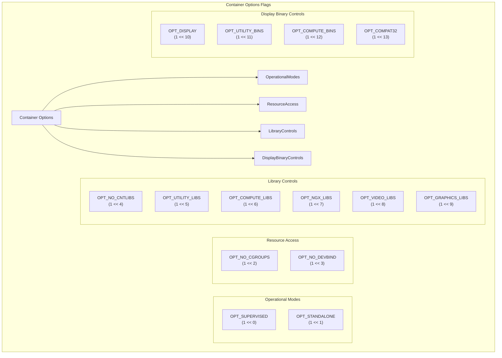
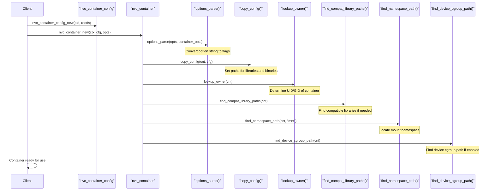
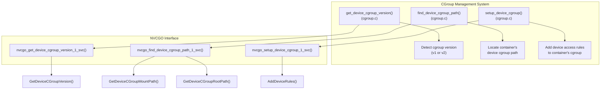
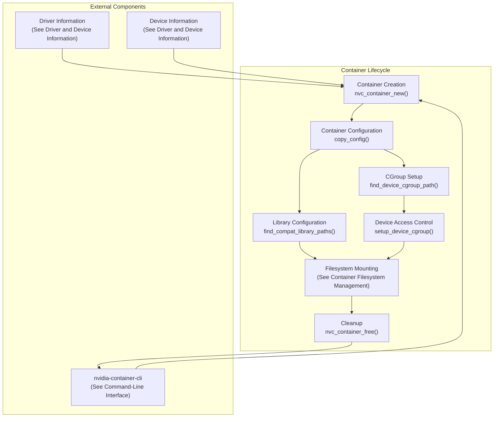

<!-- source: DeepWiki mcp.deepwiki.com · repo NVIDIA/libnvidia-container · page 2.3 Container Configuration · fetched 2026-10-26 -->

# Container Configuration

<details>
<summary>Relevant source files</summary>

The following files were used as context for generating this wiki page:

- [src/cgroup.c](src/cgroup.c)
- [src/cgroup.h](src/cgroup.h)
- [src/debug.h](src/debug.h)
- [src/ldcache.h](src/ldcache.h)
- [src/nvc_container.c](src/nvc_container.c)
- [src/options.h](src/options.h)

</details>


## Purpose and Scope

The Container Configuration system in the NVIDIA Container Toolkit provides mechanisms for defining, managing, and controlling how NVIDIA devices and related software components are exposed to containerized applications. This system handles container configuration parameters, cgroup device access control, and compatible library path determination.

This document describes how containers are configured within the libnvidia-container library, including:
- Container configuration structures and options
- Device access controls through cgroups
- Path handling for libraries and binaries

For information about mounting files into containers, see [Container Filesystem Management](#2.2). For driver and device discovery, see [Driver and Device Information](#2.1).

Sources: [src/nvc_container.c](), [src/options.h](), [src/cgroup.h]()

## Container Configuration Architecture

The container configuration system provides the foundation for specifying how NVIDIA components should be exposed to containers. It includes:

1. **Configuration structures** - Core data structures that define container parameters
2. **Option flags** - Control behavior of the container configuration
3. **Cgroup management** - Controls device access permissions
4. **Library path handling** - Determines which libraries to expose to containers

```mermaid
graph TD
    subgraph "Container Configuration System"
        ConfigStructs["Configuration Structures"] --> ContainerConfig["nvc_container_config"]
        ConfigStructs --> NVCContainer["nvc_container"]
        
        OptionFlags["Option Flags"] --> Operational["Operational Modes<br/>OPT_STANDALONE/OPT_SUPERVISED"]
        OptionFlags --> CgroupOpts["Cgroup Options<br/>OPT_NO_CGROUPS"]
        OptionFlags --> LibraryOpts["Library Options<br/>OPT_COMPUTE_LIBS/OPT_UTILITY_LIBS/etc"]
        OptionFlags --> BindingOpts["Binding Options<br/>OPT_NO_DEVBIND"]
        
        CgroupMgmt["Cgroup Management"] --> CgroupVersion["get_device_cgroup_version()"]
        CgroupMgmt --> CgroupPath["find_device_cgroup_path()"]
        CgroupMgmt --> DeviceSetup["setup_device_cgroup()"]
        
        LibPathHandling["Library Path Handling"] --> CompatLibs["find_compat_library_paths()"]
    end
    
    subgraph "External Systems"
        NVCGO["NVCGO Library<br/>(Cgroup Operations)"]
        ContainerRuntime["Container Runtime"]
    end
    
    CgroupMgmt --> NVCGO
    ContainerRuntime --> ConfigStructs
```



Sources: [src/nvc_container.c](), [src/options.h](), [src/cgroup.c]()

## Container Configuration Structures

The container configuration system is built around two primary structures:

1. **`nvc_container_config`** - A lightweight structure containing essential container properties:
   - Process ID (`pid`)
   - Root filesystem path (`rootfs`)

2. **`nvc_container`** - A comprehensive structure that extends the config with additional information:
   - Configuration flags (`flags`)
   - Extended path configuration (bins, libs, libs32, cudart, ldconfig)
   - User and group IDs (`uid`, `gid`)
   - Mount namespace path (`mnt_ns`)
   - Device cgroup information (`dev_cg_version`, `dev_cg`)
   - Compatible libraries (`libs`, `nlibs`)

### Configuration Management Functions

| Function | Purpose |
|----------|---------|
| `nvc_container_config_new()` | Creates a new container configuration |
| `nvc_container_config_free()` | Releases container configuration resources |
| `nvc_container_new()` | Creates a fully configured container structure |
| `nvc_container_free()` | Releases container resources |
| `find_namespace_path()` | Locates container namespace paths |
| `copy_config()` | Transfers configuration from source to container |
| `lookup_owner()` | Determines container's user/group ownership |

Sources: [src/nvc_container.c:28-47](), [src/nvc_container.c:220-297]()

## Container Options

Container behavior is controlled through option flags defined in `options.h`. These options dictate how the container interacts with NVIDIA components.

### Option Categories

1. **Operational Modes**
   - `OPT_SUPERVISED` - Container is monitored by a supervisor process
   - `OPT_STANDALONE` - Container operates independently

2. **Resource Access**
   - `OPT_NO_CGROUPS` - Disables cgroup-based device access control
   - `OPT_NO_DEVBIND` - Prevents device binding in container

3. **Library Controls**
   - `OPT_NO_CNTLIBS` - Prevents container library injection
   - `OPT_UTILITY_LIBS` - Enables utility libraries
   - `OPT_COMPUTE_LIBS` - Enables compute libraries
   - `OPT_NGX_LIBS` - Enables NGX libraries
   - `OPT_VIDEO_LIBS` - Enables video encoding/decoding libraries
   - `OPT_GRAPHICS_LIBS` - Enables graphics libraries

4. **Display and Binary Controls**
   - `OPT_DISPLAY` - Enables display capability
   - `OPT_UTILITY_BINS` - Enables utility binaries
   - `OPT_COMPUTE_BINS` - Enables compute binaries
   - `OPT_COMPAT32` - Enables 32-bit compatibility (except on PowerPC)

The default container options are: `standalone no-cgroups no-devbind utility`



Sources: [src/options.h:59-77](), [src/options.h:80-95]()

## Container Creation and Configuration Process

The container creation process involves several steps to properly configure a container for NVIDIA GPU access:

1. **Create container configuration** - Initialize basic container parameters (PID, rootfs)
2. **Parse container options** - Process options string into flags
3. **Copy and resolve paths** - Determine actual filesystem paths in the container
4. **Lookup container owner** - Identify the UID/GID for the container
5. **Find library paths** - Locate compatible libraries if needed
6. **Determine namespace path** - Find the mount namespace for the container
7. **Setup cgroup access** - Configure device cgroup if enabled



Sources: [src/nvc_container.c:220-280](), [src/nvc_container.c:119-218](), [src/nvc_container.c:60-100]()

## Cgroup Management

The cgroup management system is responsible for controlling device access within containers. It uses the NVCGO library through RPC calls to interact with the Linux cgroup filesystem.

### Cgroup Version Detection

The toolkit automatically detects the cgroup version (v1 or v2) used by the host system:

1. `get_device_cgroup_version()` - Determines cgroup version through RPC to NVCGO
2. This determines which cgroup APIs will be used for subsequent operations

### Cgroup Path Determination

For proper device access control, the system must find the correct cgroup path:

1. `find_device_cgroup_path()` - Locates the device cgroup path for the container
2. For standalone containers, uses the container's PID
3. For supervised containers, uses the parent process's PID

### Device Access Control

When a device needs to be exposed to a container:

1. `setup_device_cgroup()` - Adds device access rules to the container's cgroup
2. Creates appropriate device rules based on device major/minor numbers
3. Applies rules to allow read/write access to specific devices



Sources: [src/cgroup.c:28-44](), [src/cgroup.c:85-103](), [src/cgroup.c:165-179]()

## Library Path Management

The container configuration system includes mechanisms for finding and managing library paths within containers.

### Compatible Library Path Detection

For CUDA runtime compatibility, the system locates appropriate libraries:

1. `find_compat_library_paths()` - Finds compatible libraries in the container
2. Only runs if `OPT_COMPUTE_LIBS` flag is set
3. Searches for compatibility libraries in the container's CUDA runtime directory
4. Stores found libraries in the container structure for later mounting

### Path Resolution

The system resolves paths in the container context:

1. **Standalone mode** - Paths are resolved relative to the container's rootfs
2. **Supervised mode** - Paths are resolved through process root references

### Library Directory Detection

To accommodate different Linux distributions, the system automatically detects:

1. **Multiarch support** - Checks for Debian-style multiarch directories
2. **Standard directories** - Falls back to common library paths
3. **32-bit compatibility** - Detects 32-bit library locations based on distribution

Sources: [src/nvc_container.c:60-100](), [src/nvc_container.c:119-218]()

## Integration with Container Lifecycle

The container configuration integrates with the broader container toolkit lifecycle:

1. **Container Creation** - Configure container parameters through `nvc_container_new()`
2. **Device Setup** - Configure device access through cgroups
3. **Filesystem Mounting** - Use container configuration for mounting driver components
4. **Library Resolution** - Use configured paths to locate and mount libraries
5. **Cleanup** - Release resources with `nvc_container_free()`



Sources: [src/nvc_container.c:220-280](), [src/nvc_container.c:282-297]()

## Default Configuration Behavior

The default container configuration behavior is defined by `default_container_opts` in [src/options.h:95]():

```
standalone no-cgroups no-devbind utility
```

This means:
- Container operates in standalone mode
- No cgroup-based device access control is used
- No device binding is performed
- Utility libraries and binaries are included

To override this default, applications can provide custom options when calling `nvc_container_new()`.

Sources: [src/options.h:95](), [src/nvc_container.c:232-234]()

---

