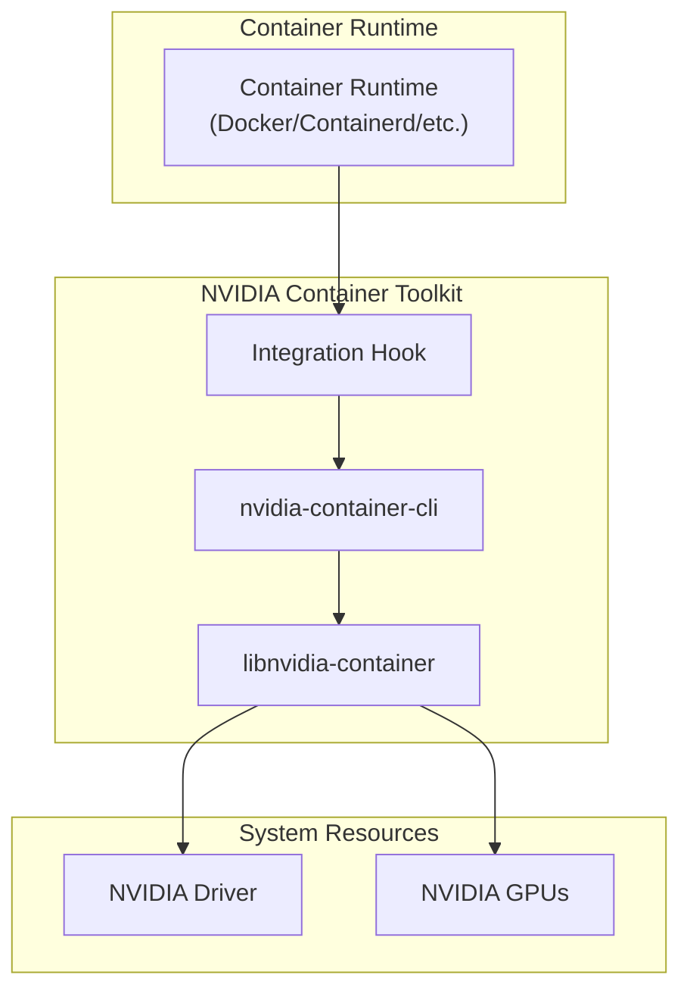
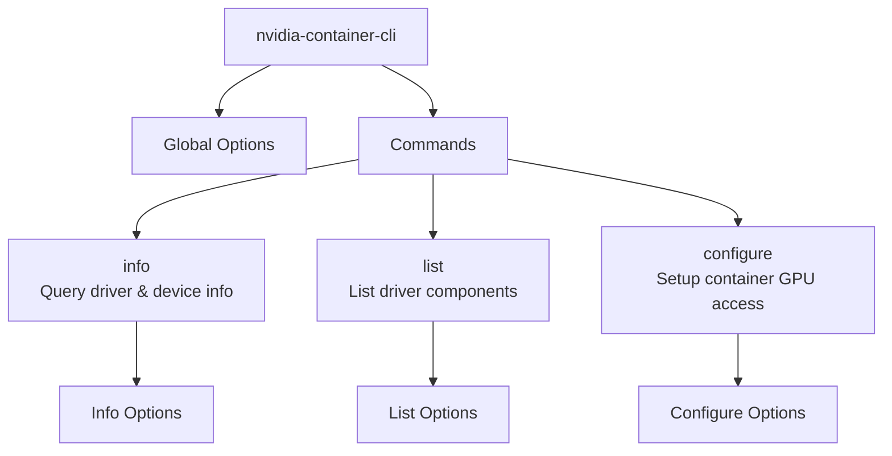
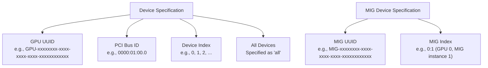
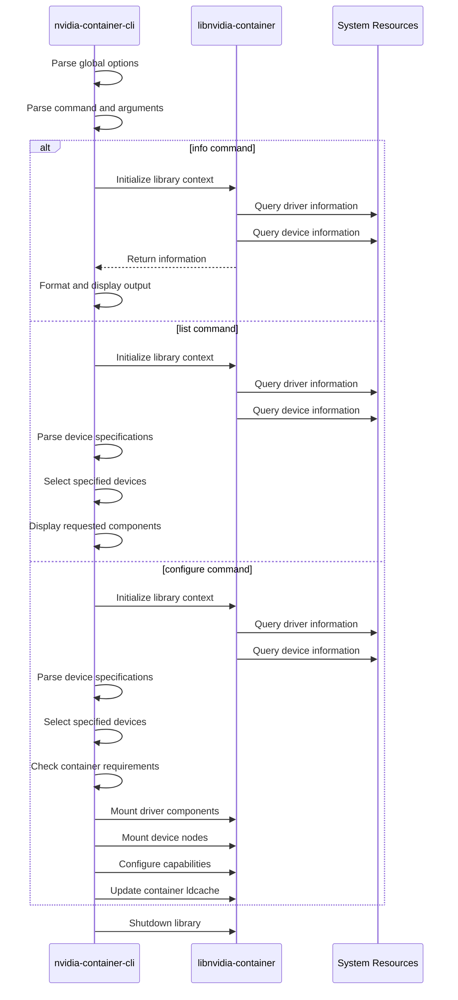

<!-- source: DeepWiki mcp.deepwiki.com · repo NVIDIA/libnvidia-container · page 3 Command-Line Interface · fetched 2026-10-26 -->

# Command-Line Interface

<details>
<summary>Relevant source files</summary>

The following files were used as context for generating this wiki page:

- [src/cli/cli.h](src/cli/cli.h)
- [src/cli/common.c](src/cli/common.c)
- [src/cli/configure.c](src/cli/configure.c)
- [src/cli/info.c](src/cli/info.c)
- [src/cli/list.c](src/cli/list.c)
- [src/cli/main.c](src/cli/main.c)

</details>


The NVIDIA Container Toolkit provides a command-line interface (CLI) tool called `nvidia-container-cli` that enables users to configure Linux containers with NVIDIA GPU support. This page documents the CLI command structure, options, and usage patterns. For information about the underlying library implementation, see [Core Library Internals](#5).

## Overview

The `nvidia-container-cli` tool is the primary user interface for the NVIDIA Container Toolkit. It provides commands to:
1. Query driver and device information
2. List required driver components
3. Configure containers with GPU access

The CLI is designed to be container-runtime agnostic and is typically invoked by container runtimes (like Docker or containerd) via the integration hook.



Sources: [src/cli/main.c:138-159]()

## Command Structure

The CLI provides a hierarchical command structure with global options and command-specific options:



Sources: [src/cli/main.c:26-48](), [src/cli/main.c:50-54]()

### Global Options

The following options apply to all commands:

| Option | Short | Argument | Description |
|--------|-------|----------|-------------|
| `--debug` | `-d` | FILE | Log debug information to FILE |
| `--load-kmods` | `-k` | | Load kernel modules |
| `--no-pivot` | `-n` | | Do not use pivot_root |
| `--user` | `-u` | UID[:GID] | User and group for privilege separation |
| `--root` | `-r` | PATH | Path to the driver root directory |
| `--ldcache` | `-l` | FILE | Path to the system's DSO cache |
| `--no-create-imex-channels` | | | Don't create IMEX channel device nodes |

Sources: [src/cli/main.c:26-36]()

## Commands

### info

The `info` command queries the driver and reports information about the driver and detected devices.

#### Usage

```
nvidia-container-cli info [OPTIONS]
```

#### Options

| Option | Description |
|--------|-------------|
| `--csv` | Output in CSV format |

#### Output

The command displays:
- NVIDIA driver version
- CUDA version
- List of detected GPU devices with:
  - Device index
  - Device minor number
  - Model
  - Brand
  - GPU UUID
  - Bus location
  - Architecture

Sources: [src/cli/info.c:15-27](), [src/cli/info.c:96-109]()

### list

The `list` command queries the driver and lists the components required to configure a container with GPU support.

#### Usage

```
nvidia-container-cli list [OPTIONS]
```

#### Options

| Option | Short | Argument | Description |
|--------|-------|----------|-------------|
| `--device` | `-d` | ID | Device UUID(s) or index(es) to list |
| `--libraries` | `-l` | | List driver libraries |
| `--binaries` | `-b` | | List driver binaries |
| `--ipcs` | `-i` | | List driver IPCs |
| `--firmwares` | `-f` | | List driver firmwares |
| `--compat32` | | | Enable 32-bit compatibility |
| `--mig-config` | | ID | MIG devices to list config capabilities files for |
| `--mig-monitor` | | ID | MIG devices to list monitor capabilities files for |
| `--imex-channel` | | CHANNEL | IMEX channel ID(s) to inject |
| `--no-persistenced` | | | Don't include the NVIDIA persistenced socket |
| `--no-fabricmanager` | | | Don't include the NVIDIA fabricmanager socket |
| `--no-gsp-firmware` | | | Don't include GSP Firmware |
| `--no-cntlibs` | | | Don't overwrite host mounts with CUDA compat libs |

When run without arguments, it defaults to listing all components for all devices.

Sources: [src/cli/list.c:13-37](), [src/cli/list.c:117-290]()

### configure

The `configure` command sets up a container with NVIDIA GPU support by exposing device drivers to it.

#### Usage

```
nvidia-container-cli configure [OPTIONS] ROOTFS
```

#### Options

| Option | Short | Argument | Description |
|--------|-------|----------|-------------|
| `--pid` | `-p` | PID | Container PID |
| `--device` | `-d` | ID | Device UUID(s) or index(es) to isolate |
| `--require` | `-r` | EXPR | Check container requirements |
| `--ldconfig` | `-l` | PATH | Path to the ldconfig binary |
| `--compute` | `-c` | | Enable compute capability |
| `--utility` | `-u` | | Enable utility capability |
| `--video` | `-v` | | Enable video capability |
| `--graphics` | `-g` | | Enable graphics capability |
| `--display` | `-D` | | Enable display capability |
| `--ngx` | `-n` | | Enable NGX capability |
| `--compat32` | | | Enable 32-bit compatibility |
| `--mig-config` | | ID | Enable configuration of MIG devices |
| `--mig-monitor` | | ID | Enable monitoring of MIG devices |
| `--imex-channel` | | CHANNEL | IMEX channel ID(s) to inject |
| `--no-cgroups` | | | Don't use cgroup enforcement |
| `--no-devbind` | | | Don't bind mount devices |
| `--no-persistenced` | | | Don't include the NVIDIA persistenced socket |
| `--no-fabricmanager` | | | Don't include the NVIDIA fabricmanager socket |
| `--no-gsp-firmware` | | | Don't include GSP Firmware |
| `--no-cntlibs` | | | Don't overwrite host mounts with CUDA compat libs |

Sources: [src/cli/configure.c:17-51](), [src/cli/configure.c:250-473]()

## Device Selection

The CLI supports specifying GPU devices in multiple formats:



Sources: [src/cli/common.c:158-324]()

### GPU Device Selection

The toolkit identifies GPU devices using one of the following methods:

1. **GPU UUID**: Formatted as `GPU-xxxxxxxx-xxxx-xxxx-xxxx-xxxxxxxxxxxx`
2. **PCI Bus ID**: Formatted as `domain:bus:device.0` (e.g., `0000:01:00.0`)
3. **Device Index**: A numeric index (e.g., `0`, `1`, `2`, etc.)
4. **All devices**: Specified using the keyword `all`

Multiple devices can be specified as a comma-separated list.

Sources: [src/cli/common.c:158-214]()

### MIG Device Selection

For systems with Multi-Instance GPU (MIG) capability, MIG devices can be specified:

1. **MIG UUID**: Formatted as `MIG-xxxxxxxx-xxxx-xxxx-xxxx-xxxxxxxxxxxx`
2. **MIG Index**: Using the format `<GPU_idx>:<MIG_idx>` (e.g., `0:1` for the second MIG instance on the first GPU)

Sources: [src/cli/common.c:216-274]()

## Usage Examples

### Querying Driver and Device Information

```bash
# Display driver and device information
nvidia-container-cli info

# Output in CSV format
nvidia-container-cli info --csv
```

### Listing Required Components

```bash
# List all components for all devices
nvidia-container-cli list

# List libraries for a specific GPU
nvidia-container-cli list -d GPU-xxxxxxxx-xxxx-xxxx-xxxx-xxxxxxxxxxxx -l

# List all libraries and binaries
nvidia-container-cli list -l -b
```

### Configuring a Container

```bash
# Configure a container with all available GPUs and compute capability
nvidia-container-cli configure -c /path/to/rootfs

# Configure with specific GPU by index, enabling compute and utility capabilities
nvidia-container-cli configure -d 0 -c -u /path/to/rootfs

# Configure with specific GPU by UUID, enabling graphics capability
nvidia-container-cli configure -d GPU-xxxxxxxx-xxxx-xxxx-xxxx-xxxxxxxxxxxx -g /path/to/rootfs

# Configure with specific MIG instance
nvidia-container-cli configure -d MIG-xxxxxxxx-xxxx-xxxx-xxxx-xxxxxxxxxxxx -c /path/to/rootfs
```

## Internal Command Flow

The CLI follows this execution flow when processing commands:



Sources: [src/cli/main.c:138-159](), [src/cli/info.c:45-124](), [src/cli/list.c:117-307](), [src/cli/configure.c:250-473]()

## Error Handling

The CLI follows standard Unix conventions for error reporting:
- Successful operations return exit code 0
- Error conditions return non-zero exit codes
- Error messages are printed to stderr
- When parsing fails, usage information is displayed

Sources: [src/cli/main.c:134-137](), [src/cli/configure.c:201-203](), [src/cli/list.c:112-114]()

---

