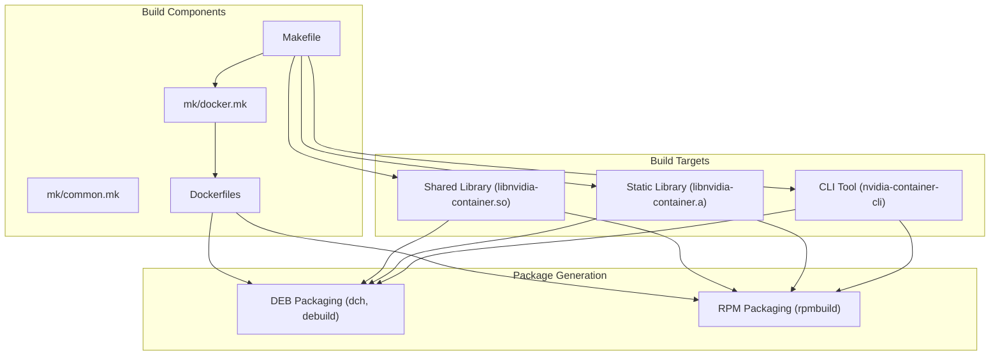
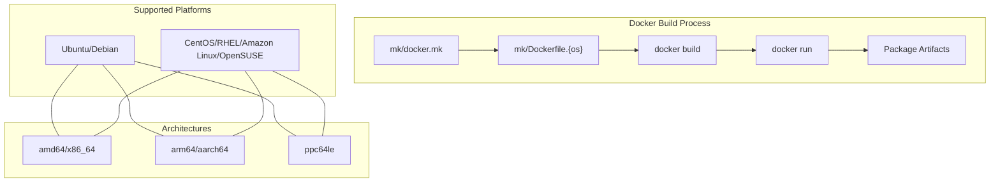
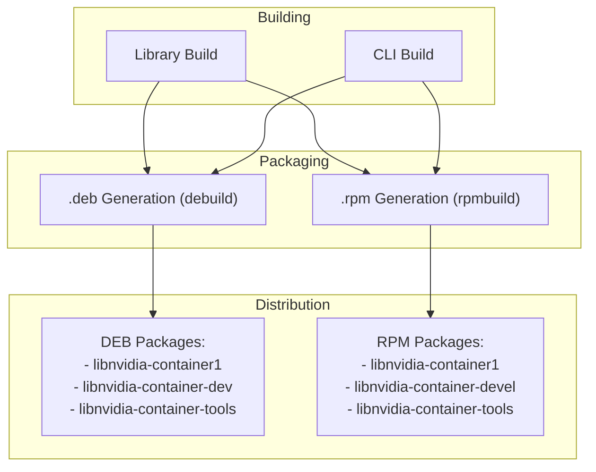

<!-- source: DeepWiki mcp.deepwiki.com · repo NVIDIA/libnvidia-container · page 4 Building and Packaging · fetched 2026-10-26 -->

# Building and Packaging

<details>
<summary>Relevant source files</summary>

The following files were used as context for generating this wiki page:

- [Makefile](Makefile)
- [mk/Dockerfile.centos](mk/Dockerfile.centos)
- [mk/docker.mk](mk/docker.mk)

</details>


This document provides a comprehensive overview of the build system and package generation process for libnvidia-container. It covers building from source, Docker-based builds, and packaging for various Linux distributions. For information about installing and using the packages, see [Command-Line Interface](#3).

## 1. Build System Overview

The libnvidia-container build system is designed to compile the core library and CLI tool across multiple Linux distributions and architectures. It uses GNU Make as the primary build tool and supports Docker-based builds for cross-platform compatibility.



Sources: [Makefile:15-16](), [Makefile:102-130](), [mk/docker.mk:16-21]()

### 1.1 Key Build Components

The build system consists of several key components:

| Component | Path | Purpose |
|-----------|------|---------|
| Main Makefile | `Makefile` | Defines core build targets and rules |
| Docker Makefile | `mk/docker.mk` | Defines Docker-based build system for cross-platform support |
| Dockerfiles | `mk/Dockerfile.*` | Container definitions for each supported OS |
| Package Definitions | `pkg/deb`, `pkg/rpm` | Packaging specifications for DEB and RPM |

Sources: [Makefile:39-40](), [mk/docker.mk:105]()

## 2. Building from Source

### 2.1 Build Prerequisites

The following dependencies are required for building:

- C compiler (gcc or compatible)
- GNU Make
- pkg-config
- libcap-dev
- libseccomp-dev (optional)
- NVIDIA driver utilities (nvidia-modprobe)

Additional dependencies may be needed depending on build options:
- elftoolchain or libelf
- libtirpc
- golang (when building with NVCGO support)

Sources: [mk/Dockerfile.centos:23-38]()

### 2.2 Build Options

libnvidia-container supports several build options that can be enabled or disabled:

| Option | Default | Description |
|--------|---------|-------------|
| WITH_NVCGO | yes | Enable NVCGO support for modern cgroup handling |
| WITH_LIBELF | no | Use system libelf instead of building elftoolchain |
| WITH_TIRPC | no | Enable TI-RPC support (required for some distros) |
| WITH_SECCOMP | yes | Enable seccomp support for improved security |

Sources: [Makefile:20-23](), [mk/docker.mk:21-24]()

### 2.3 Basic Build Commands

To build the entire project:

```bash
make
```

To build specific components:

```bash
make shared  # Build shared library only
make static  # Build static library only
make tools   # Build CLI tool only
```

To install to the system:

```bash
make install
```

Sources: [Makefile:242-243](), [Makefile:250-254](), [Makefile:269-290]()

## 3. Docker-based Builds

The project includes a Docker-based build system that creates packages for multiple Linux distributions and architectures without requiring native build environments.



Sources: [mk/docker.mk:37-95](), [mk/docker.mk:149-179]()

### 3.1 Supported Platforms

The Docker build system supports the following platforms:

#### 3.1.1 x86_64/amd64
- Ubuntu: 16.04, 18.04, 20.04
- Debian: 9, 10
- CentOS: 7, 8
- RHEL: 7, 8
- Amazon Linux: 2
- OpenSUSE Leap: 15.1

#### 3.1.2 ppc64le
- Ubuntu: 16.04, 18.04
- CentOS: 7, 8
- RHEL: 7, 8

#### 3.1.3 arm64/aarch64
- Ubuntu: 18.04
- CentOS: 7, 8
- RHEL: 7, 8
- Amazon Linux: 2

Sources: [mk/docker.mk:37-41]()

### 3.2 Running Docker Builds

To build for a specific platform:

```bash
make ubuntu18.04                 # Build for Ubuntu 18.04 on native architecture
make ubuntu18.04-amd64           # Build for Ubuntu 18.04 on amd64
make centos7-ppc64le             # Build for CentOS 7 on ppc64le
```

To build for all supported platforms:

```bash
make docker-all
```

Sources: [mk/docker.mk:47-58](), [mk/docker.mk:93-95]()

## 4. Packaging System

The packaging system generates distribution-specific packages (DEB and RPM) that can be installed on target systems.



Sources: [Makefile:337-351](), [Makefile:353-368]()

### 4.1 DEB Packaging (Ubuntu/Debian)

The DEB packaging process uses `debuild` to create packages for Debian-based distributions:

1. The source is built using the main Makefile
2. Package metadata is created using the `dch` tool
3. Packages are built using `debuild`

To build DEB packages:

```bash
make deb
```

Sources: [Makefile:337-351]()

### 4.2 RPM Packaging (CentOS/RHEL/Amazon Linux/OpenSUSE)

The RPM packaging process uses `rpmbuild` to create packages for RPM-based distributions:

1. The source is built using the main Makefile
2. Spec files are prepared with appropriate version information
3. Packages are built using `rpmbuild`

To build RPM packages:

```bash
make rpm
```

Sources: [Makefile:353-368]()

## 5. Build Artifacts

The build process generates the following key artifacts:

| Artifact | Description |
|----------|-------------|
| libnvidia-container.so.{version} | Main shared library |
| libnvidia-container.a | Static library |
| libnvidia-container-go.so.{version} | Go bindings library (if enabled) |
| nvidia-container-cli | Command-line utility |
| libnvidia-container.pc | pkg-config file |

For DEB packages:
- libnvidia-container1 - Runtime library
- libnvidia-container-dev - Development files
- libnvidia-container-tools - CLI tools

For RPM packages:
- libnvidia-container1 - Runtime library
- libnvidia-container-devel - Development files
- libnvidia-container-tools - CLI tools

Sources: [Makefile:123-134](), [Makefile:272-290]()

## 6. Continuous Integration and Testing

The build system includes verification targets that can run basic functionality tests to ensure the built components work correctly:

```bash
make ubuntu18.04-verify
```

This runs a minimal sanity check that verifies the built packages can successfully interact with NVIDIA GPUs on the host system.

Sources: [mk/docker.mk:110-121](), [mk/docker.mk:180-187]()

---

