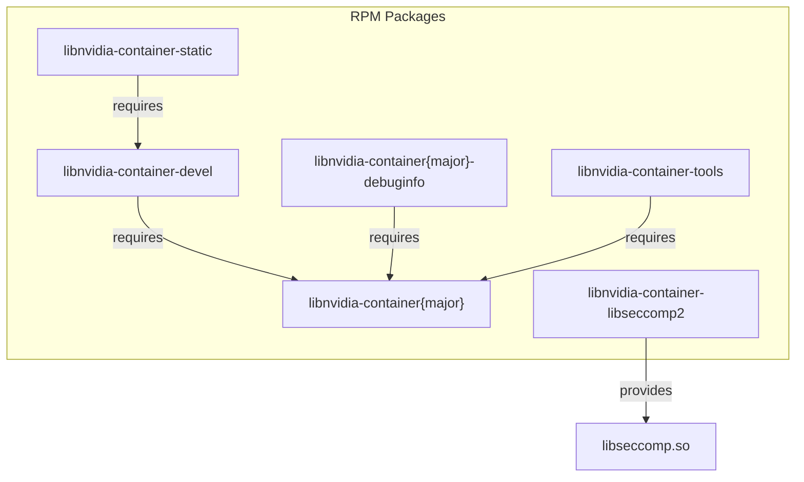
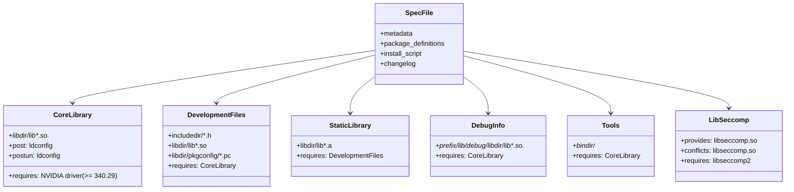
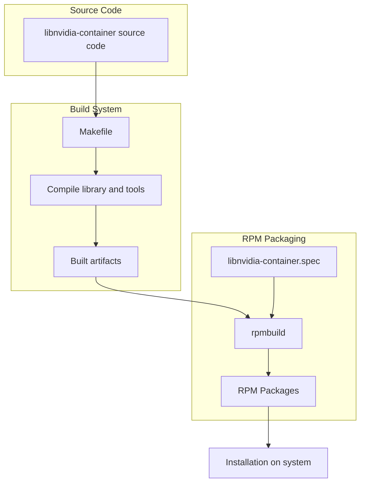

<!-- source: DeepWiki mcp.deepwiki.com · repo NVIDIA/libnvidia-container · page 4.1 RPM Packaging · fetched 2026-10-26 -->

# RPM Packaging

<details>
<summary>Relevant source files</summary>

The following files were used as context for generating this wiki page:

- [pkg/rpm/SPECS/libnvidia-container.spec](pkg/rpm/SPECS/libnvidia-container.spec)

</details>


This document details the RPM packaging process and specifications for the NVIDIA Container Toolkit's libnvidia-container library. It covers the structure of the RPM packages, the spec file configuration, and how the library is packaged for RPM-based Linux distributions like CentOS, RHEL, and Fedora. For information about Debian packaging, see [Debian Packaging](#4.2).

## Package Structure Overview

The libnvidia-container RPM packaging system produces multiple packages to separate runtime dependencies from development tools and debugging information, allowing users to install only what they need.



Sources: [pkg/rpm/SPECS/libnvidia-container.spec:30-108]()

## Spec File Structure

The RPM spec file defines how the packages are built, their dependencies, contents, and installation processes.

### Basic Package Information

The spec file begins with metadata about the package, including:

- Package name: libnvidia-container
- License information: Multiple licenses (BSD-3-Clause, Apache-2.0, GPL-3.0-or-later, LGPL-3.0-or-later, MIT, GPL-2.0-only)
- Vendor and maintainer information
- Build requirements
- Version and release information

Sources: [pkg/rpm/SPECS/libnvidia-container.spec:1-25]()

### Package Definitions

The spec file defines six distinct packages:

1. **libnvidia-container{major}** - Core runtime library
2. **libnvidia-container-devel** - Development files (headers, pkg-config)
3. **libnvidia-container-static** - Static library for statically linked applications
4. **libnvidia-container{major}-debuginfo** - Debugging symbols
5. **libnvidia-container-tools** - Command-line utilities
6. **libnvidia-container-libseccomp2** - Virtual package for libseccomp dependency

Each package definition includes:
- Summary description
- Package dependencies
- File listings
- Pre/post installation scripts if needed

Sources: [pkg/rpm/SPECS/libnvidia-container.spec:30-108]()



Sources: [pkg/rpm/SPECS/libnvidia-container.spec:30-108]()

## Installation Process

The installation process is defined in the `%install` section, which specifies how the files should be installed into the RPM build root directory. The libnvidia-container installation uses the project's Makefile to handle the installation with the appropriate directory structures.

```
DESTDIR=%{buildroot} %{__make} install prefix=%{_prefix} exec_prefix=%{_exec_prefix} bindir=%{_bindir} libdir=%{_libdir} includedir=%{_includedir} docdir=%{_licensedir}
```

This command installs the compiled files to the correct locations within the build root, which will then be packaged into the respective RPM packages.

Sources: [pkg/rpm/SPECS/libnvidia-container.spec:27-28]()

## Package Contents and Dependencies

### Core Library Package

The core library package (`libnvidia-container%{_major}`) contains the shared library files:

| Content | Description |
|---------|-------------|
| `%{_libdir}/lib*.so.*` | Shared library files |
| `%{_licensedir}/*` | License files |

It requires NVIDIA drivers (>= 340.29) to be installed separately.

Post-installation and post-uninstallation scripts run `ldconfig` to update the shared library cache.

Sources: [pkg/rpm/SPECS/libnvidia-container.spec:30-42]()

### Development Package

The development package (`libnvidia-container-devel`) contains files needed for developing applications that use the library:

| Content | Description |
|---------|-------------|
| `%{_includedir}/*.h` | Header files |
| `%{_libdir}/lib*.so` | Symbolic links to the shared libraries |
| `%{_libdir}/pkgconfig/*.pc` | pkg-config files |

This package depends on the core library package.

Sources: [pkg/rpm/SPECS/libnvidia-container.spec:44-57]()

### Static Library Package

The static library package (`libnvidia-container-static`) contains the static version of the library:

| Content | Description |
|---------|-------------|
| `%{_libdir}/lib*.a` | Static library files |

This package depends on the development package.

Sources: [pkg/rpm/SPECS/libnvidia-container.spec:59-70]()

### Debug Information Package

The debug information package (`libnvidia-container%{_major}-debuginfo`) contains debugging symbols:

| Content | Description |
|---------|-------------|
| `%{_prefix}/lib/debug%{_libdir}/lib*.so.*` | Debugging symbols |

This package depends on the core library package.

Sources: [pkg/rpm/SPECS/libnvidia-container.spec:72-84]()

### Tools Package

The tools package (`libnvidia-container-tools`) contains command-line utilities:

| Content | Description |
|---------|-------------|
| `%{_bindir}/*` | Executable binaries, including nvidia-container-cli |

This package depends on the core library package.

Sources: [pkg/rpm/SPECS/libnvidia-container.spec:86-97]()

### LibSeccomp Virtual Package

The libseccomp virtual package (`libnvidia-container-libseccomp2`) provides a compatibility layer:

- Requires: libseccomp2
- Provides: libseccomp.so
- Conflicts: libseccomp.so

This is used to satisfy the libseccomp.so dependency through libseccomp2.

Sources: [pkg/rpm/SPECS/libnvidia-container.spec:99-108]()

## Build Process Integration

The RPM packaging process integrates with the overall build system of the project. Below is a diagram showing how the RPM packaging fits into the build workflow:



Sources: [pkg/rpm/SPECS/libnvidia-container.spec:27-28]()

## Changelog Management

The spec file includes a `%changelog` section that documents the changes in each release. For versions 1.14.0-1 and later, the changelog information is automatically generated and references the GitLab repository's CHANGELOG.md file.

Sources: [pkg/rpm/SPECS/libnvidia-container.spec:110-113]()

## RPM Variables

The spec file uses several RPM variables that are defined externally during the build process:

| Variable | Description |
|----------|-------------|
| `%{version}` | Package version number |
| `%{release}` | Package release number |
| `%{_major}` | Major version number used in package names |
| `%{release_date}` | Automatically generated release date |
| `%{git_commit}` | Git commit hash for changelog reference |
| `%{_prefix}` | Installation prefix (typically /usr) |
| `%{_exec_prefix}` | Executable files prefix |
| `%{_bindir}` | Binary directory (typically /usr/bin) |
| `%{_libdir}` | Library directory (typically /usr/lib64 on 64-bit systems) |
| `%{_includedir}` | Header files directory (typically /usr/include) |
| `%{_licensedir}` | License files directory |

These variables allow the spec file to be flexible and work across different RPM-based distributions.

Sources: [pkg/rpm/SPECS/libnvidia-container.spec:19-20](), [pkg/rpm/SPECS/libnvidia-container.spec:27-28](), [pkg/rpm/SPECS/libnvidia-container.spec:112]()

---

