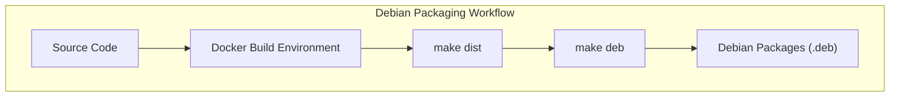
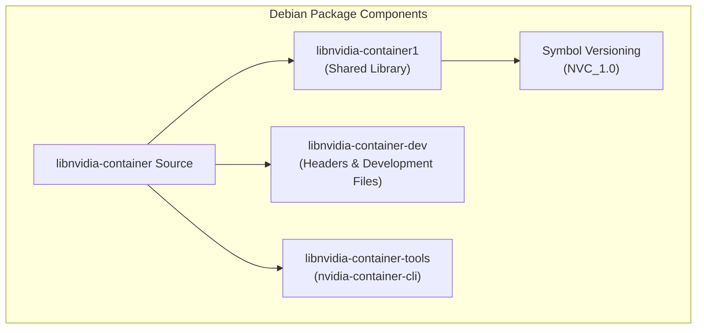
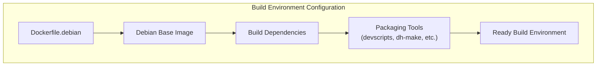
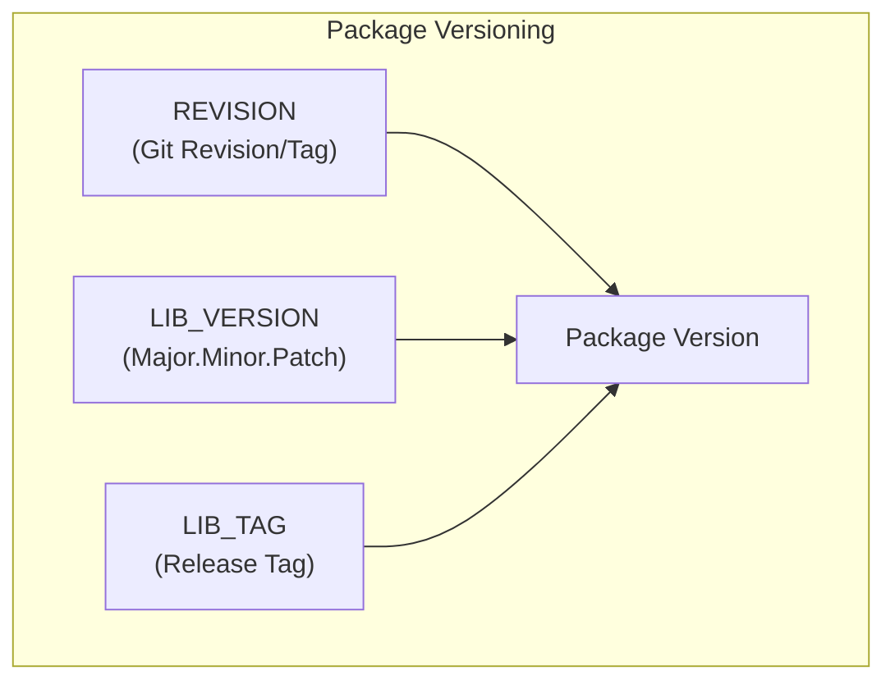
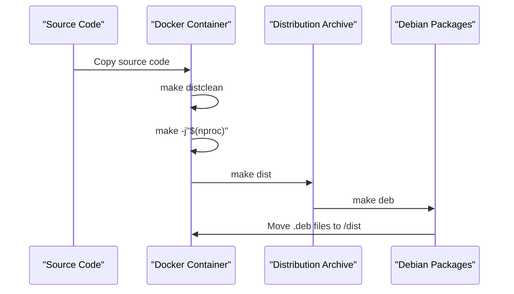

<!-- source: DeepWiki mcp.deepwiki.com · repo NVIDIA/libnvidia-container · page 4.2 Debian Packaging · fetched 2026-10-26 -->

# Debian Packaging

<details>
<summary>Relevant source files</summary>

The following files were used as context for generating this wiki page:

- [mk/Dockerfile.debian](mk/Dockerfile.debian)
- [mk/Dockerfile.ubuntu](mk/Dockerfile.ubuntu)
- [pkg/deb/libnvidia-container@MAJOR@.symbols](pkg/deb/libnvidia-container@MAJOR@.symbols)
- [src/libnvidia-container.lds](src/libnvidia-container.lds)
- [src/nvc.h.template](src/nvc.h.template)

</details>


## Purpose and Scope

This document details the Debian packaging process for libnvidia-container, explaining how the library and CLI components are packaged as Debian (.deb) packages. It covers the build environment configuration, package structure, symbol management, and the steps required to create Debian packages for distribution. For information about RPM packaging, see [RPM Packaging](#4.1).

## Overview of Debian Packaging

The libnvidia-container project uses a Docker-based build system to create Debian packages that can be installed on Debian and Ubuntu-based Linux distributions. This approach ensures consistent packaging across different environments and versions.



Sources: [mk/Dockerfile.debian:69-74]()

## Package Structure

The Debian packaging process creates several packages from the libnvidia-container codebase:

1. **libnvidia-container1** - The runtime shared library package
2. **libnvidia-container-dev** - Development files including headers and static libraries
3. **libnvidia-container-tools** - Command-line tools such as nvidia-container-cli



Sources: [pkg/deb/libnvidia-container@MAJOR@.symbols:1-28](), [src/libnvidia-container.lds:14-48]()

## Build Environment Setup

The build environment for Debian packages is defined in Docker files, which install all necessary build dependencies and tools required for the Debian packaging process.



Sources: [mk/Dockerfile.debian:6-27]()

### Build Dependencies

The following dependencies are installed in the build environment:

| Dependency | Purpose |
|------------|---------|
| bmake | BSD make utility |
| build-essential | Basic compilation tools (gcc, g++, make) |
| libcap-dev | Development files for capability support |
| libelf-dev | Development files for ELF file handling |
| libseccomp-dev | Development files for seccomp filtering |
| devscripts | Scripts for Debian package maintenance |
| dh-make | Tool for creating Debian packages |
| fakeroot | Tool for simulating root privileges |
| lintian | Debian package checker |

Sources: [mk/Dockerfile.debian:7-26](), [mk/Dockerfile.ubuntu:7-26]()

## Symbol Management

The Debian packaging system uses a symbols file to define the exported symbols of the shared library. This ensures binary compatibility across package updates.

### Symbol Versioning

The symbols file `libnvidia-container@MAJOR@.symbols` defines the public API of the library:

```
libnvidia-container.so.1 libnvidia-container1 #MINVER#
 NVC_1.0@NVC_1.0 @VERSION_TAG@
 nvc_config_free@NVC_1.0 @VERSION_TAG@
 nvc_config_new@NVC_1.0 @VERSION_TAG@
 ...
```

This corresponds to the linker version script in `src/libnvidia-container.lds`:

```
VERSION {
    NVC_1.0 {
        global:
            nvc_version;
            nvc_context_new;
            ...
        local:
            *;
    };
}
```

The symbol versioning ensures that:
1. Applications compiled against one version of the library continue to work with newer versions
2. The package system can detect ABI compatibility issues

Sources: [pkg/deb/libnvidia-container@MAJOR@.symbols:1-28](), [src/libnvidia-container.lds:14-48]()

## Package Versioning

The Debian package version is derived from the REVISION environment variable set during the build process. This is combined with the library version and tag to create the complete package version.



Sources: [mk/Dockerfile.debian:51-58](), [mk/Dockerfile.ubuntu:51-58]()

## Building Debian Packages

The process of building Debian packages consists of the following steps:

1. **Prepare source distribution** (`make dist`)
   - Creates a source distribution archive

2. **Build Debian packages** (`make deb`)
   - Converts the source distribution into Debian packages
   - Runs `debuild` to create the packages
   - Generates `.deb` files

### Build Process Steps



Sources: [mk/Dockerfile.debian:69-74](), [mk/Dockerfile.ubuntu:69-74]()

## Distribution-Specific Considerations

The build system detects the specific Debian-based distribution (using `lsb_release -c -s`) and adjusts the packaging accordingly. This ensures that the packages are compatible with the target distribution's package management system.

Sources: [mk/Dockerfile.debian:69-70](), [mk/Dockerfile.ubuntu:69-70]()

## Using the Docker Build System

To build Debian packages using the provided Docker build system:

1. Ensure Docker is installed on your system
2. Clone the libnvidia-container repository
3. Run the appropriate build command for your target distribution

For example:

```
make docker-ubuntu
# or
make docker-debian
```

The resulting `.deb` packages will be placed in the build output directory.

Sources: [mk/Dockerfile.debian](), [mk/Dockerfile.ubuntu]()

## Package Testing and Installation

After building the Debian packages, they can be installed on a Debian-based system using:

```
sudo dpkg -i libnvidia-container1_*.deb libnvidia-container-tools_*.deb
```

For development purposes, you may also want to install the development package:

```
sudo dpkg -i libnvidia-container-dev_*.deb
```

Sources: [pkg/deb/libnvidia-container@MAJOR@.symbols]()

---

