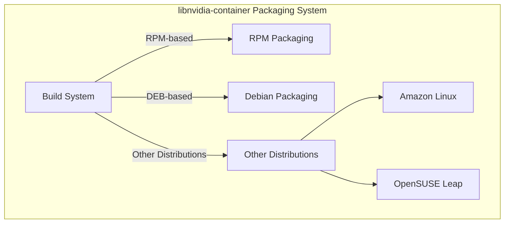
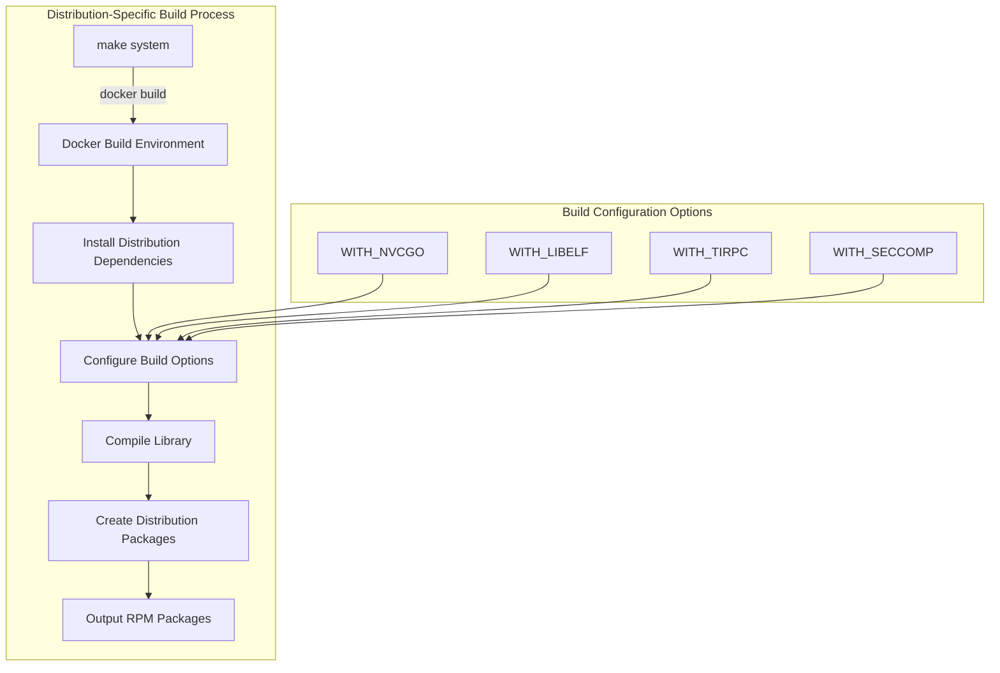
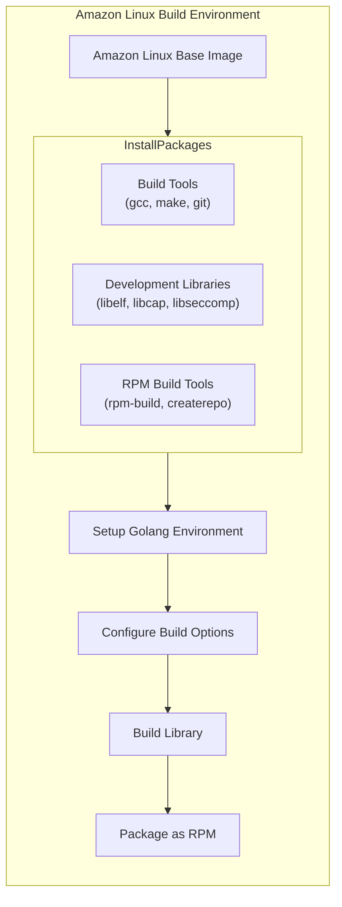
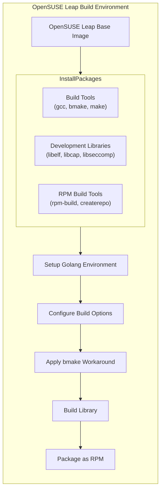
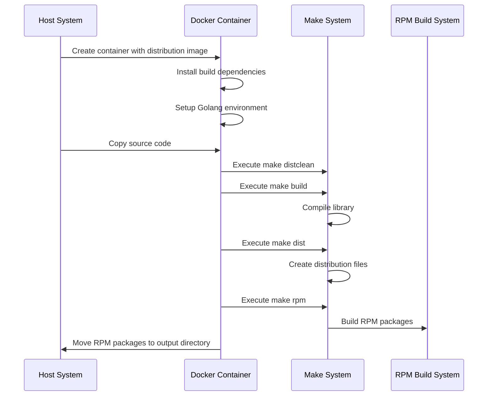

<!-- source: DeepWiki mcp.deepwiki.com · repo NVIDIA/libnvidia-container · page 4.3 Other Distributions · fetched 2026-10-26 -->

# Other Distributions

<details>
<summary>Relevant source files</summary>

The following files were used as context for generating this wiki page:

- [mk/Dockerfile.amazonlinux](mk/Dockerfile.amazonlinux)
- [mk/Dockerfile.opensuse-leap](mk/Dockerfile.opensuse-leap)
- [versions.mk](versions.mk)

</details>


## Purpose and Scope

This page documents the build and packaging process for Linux distributions beyond the standard RPM-based (see [RPM Packaging](#4.1)) and Debian-based (see [Debian Packaging](#4.2)) systems. Specifically, this document covers Amazon Linux and OpenSUSE Leap packaging configurations and build processes for the libnvidia-container library.

## Overview of Distribution Support

The NVIDIA Container Toolkit provides packaging support for several Linux distributions that have specific requirements or package management systems. The build system accommodates these differences while maintaining consistent functionality across all supported platforms.



Sources: [mk/Dockerfile.amazonlinux](), [mk/Dockerfile.opensuse-leap]()

## Build System Architecture

The build system for other distributions utilizes Docker containers to create a consistent build environment. Each supported distribution has a specific Dockerfile that installs the necessary dependencies and executes the build process.



Sources: [mk/Dockerfile.amazonlinux:32-40](), [mk/Dockerfile.opensuse-leap:35-42]()

## Amazon Linux Packaging

The Amazon Linux packaging process uses a specialized Dockerfile that creates the build environment and compiles the libnvidia-container library for Amazon Linux distributions.

### Build Environment Setup

The Docker container for Amazon Linux installs the necessary build tools and dependencies:



Sources: [mk/Dockerfile.amazonlinux:6-21](), [mk/Dockerfile.amazonlinux:24-31]()

### Build Dependencies

Amazon Linux requires specific packages to build the libnvidia-container library:

| Category | Packages |
|----------|----------|
| Build Tools | gcc, make, git, m4 |
| Development Libraries | elfutils-libelf-devel, libcap-devel, libseccomp-devel |
| RPM Tools | rpm-build, createrepo, rpmlint |
| Other | bzip2, redhat-lsb-core, which |

Additionally, if built with `WITH_LIBELF=no`, the build system installs pmake and bmake from Mageia repositories.

Sources: [mk/Dockerfile.amazonlinux:6-21](), [mk/Dockerfile.amazonlinux:42-49]()

## OpenSUSE Leap Packaging

OpenSUSE Leap has its own build environment configured via a dedicated Dockerfile.

### Build Environment Setup

The OpenSUSE Leap Docker container configures a build environment tailored to this distribution:



Sources: [mk/Dockerfile.opensuse-leap:6-24](), [mk/Dockerfile.opensuse-leap:26-33]()

### Special Considerations

OpenSUSE Leap 15 has a bug in its bmake package that requires a workaround:

```
export META_NOECHO=echo
```

This workaround is applied before running the build process to ensure proper operation.

Sources: [mk/Dockerfile.opensuse-leap:56-59]()

## Common Build Configuration Options

Both Amazon Linux and OpenSUSE Leap builds support the same set of configuration options:

| Option | Default | Description |
|--------|---------|-------------|
| WITH_NVCGO | no | Build with nvcgo support |
| WITH_LIBELF | no | Build with libelf support |
| WITH_TIRPC | no | Build with TI-RPC support |
| WITH_SECCOMP | yes | Build with seccomp support |

These options can be adjusted to tailor the build to specific requirements or to accommodate distribution-specific constraints.

Sources: [mk/Dockerfile.amazonlinux:33-40](), [mk/Dockerfile.opensuse-leap:35-42]()

## Versioning System

The build system for all distributions uses the same versioning logic, defined in `versions.mk`. The version information is derived from git tags and is structured as follows:

```
VERSION_STRING = LIB_VERSION[~LIB_TAG][+LIB_BUILD]
```

Where:
- `LIB_VERSION`: The main version number (e.g., 1.2.3)
- `LIB_TAG`: Optional tag (e.g., rc.1)
- `LIB_BUILD`: Optional build number

This versioning system ensures consistent version information across all packaging formats.

Sources: [versions.mk:15-49]()

## Build Process

The build process for other distributions follows these steps:

1. Create a Docker container based on the appropriate distribution image
2. Install necessary build dependencies
3. Set up the Golang environment
4. Configure build options
5. Copy the source code into the container
6. Build the library with `make`
7. Create distribution packages using `make rpm`
8. Output the packages to a designated directory

This standardized process ensures that the resulting packages are compatible with the target distribution while maintaining consistent functionality across platforms.



Sources: [mk/Dockerfile.amazonlinux:63-72](), [mk/Dockerfile.opensuse-leap:58-68]()

## Conclusion

The libnvidia-container build system supports packaging for Amazon Linux and OpenSUSE Leap through specialized Docker-based build environments. These environments install the necessary distribution-specific dependencies and execute a standardized build process to create compatible packages. The configuration options allow for customization of the build to meet specific requirements or constraints of these distributions.

---

