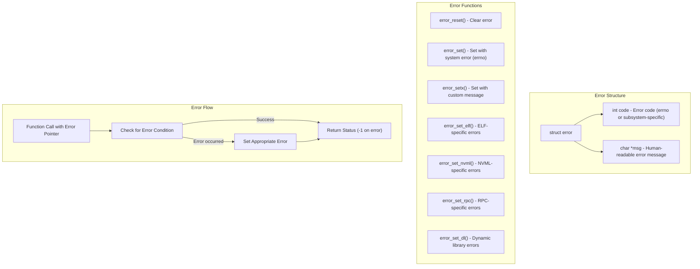
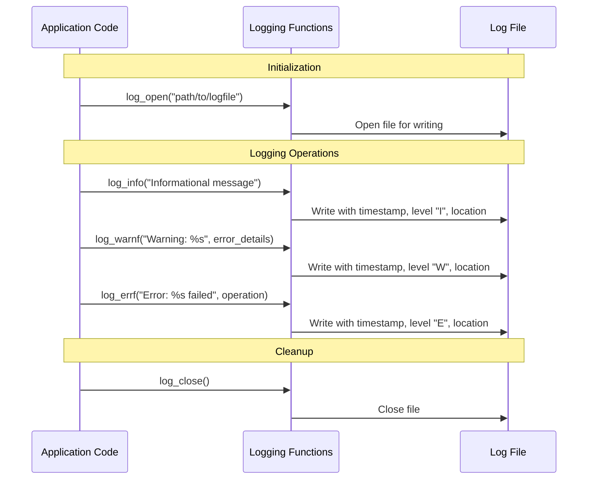
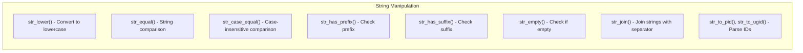
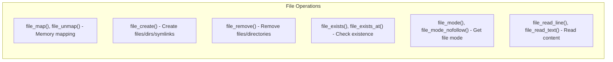
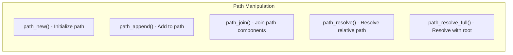
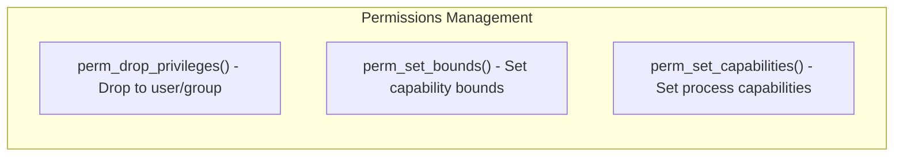
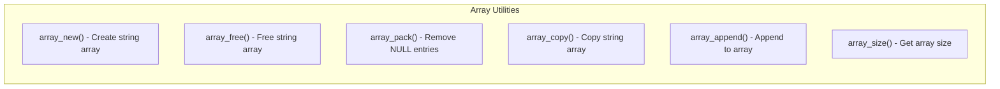
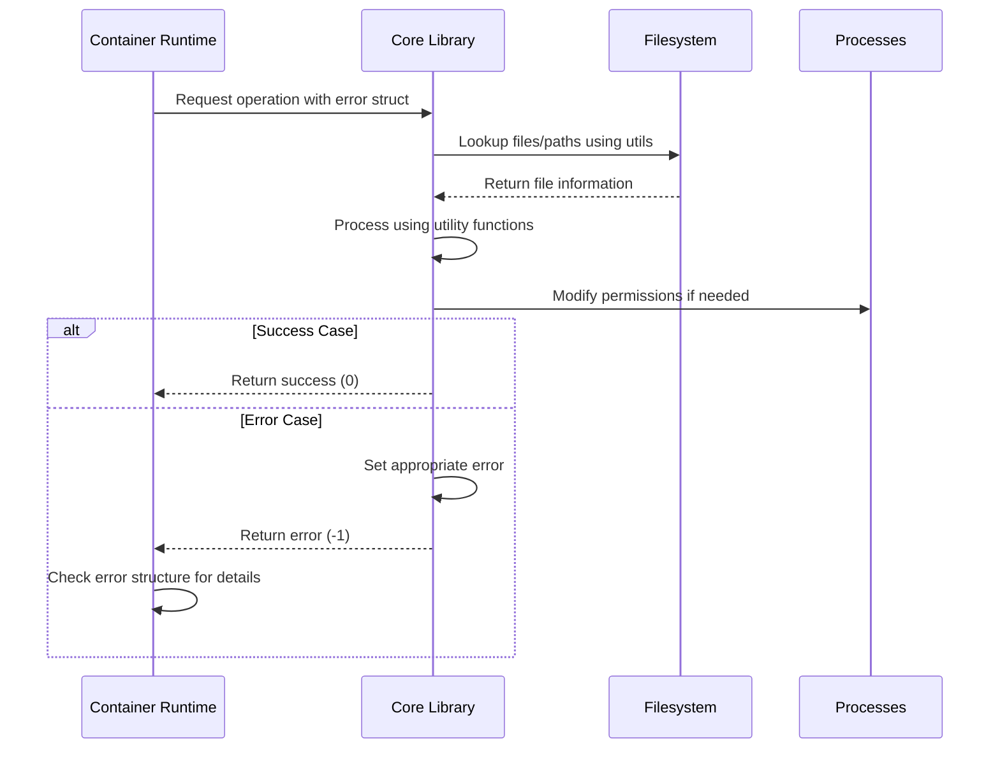
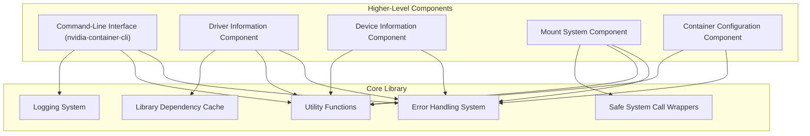

<!-- source: DeepWiki mcp.deepwiki.com · repo NVIDIA/libnvidia-container · page 5 Core Library Internals · fetched 2026-10-26 -->

# Core Library Internals

<details>
<summary>Relevant source files</summary>

The following files were used as context for generating this wiki page:

- [src/error.c](src/error.c)
- [src/error.h](src/error.h)
- [src/error_generic.c](src/error_generic.c)
- [src/error_generic.h](src/error_generic.h)
- [src/ldcache.c](src/ldcache.c)
- [src/nvml.h](src/nvml.h)
- [src/utils.c](src/utils.c)
- [src/utils.h](src/utils.h)
- [src/xfuncs.h](src/xfuncs.h)

</details>


This document provides a detailed examination of the internal components and mechanisms of the libnvidia-container core library. The core library serves as the foundation for the NVIDIA Container Toolkit, implementing critical low-level functionality including error handling, logging, filesystem operations, and utility functions that enable GPU container integration.

For higher-level components that use these internals, refer to other sections such as [Driver and Device Information](#2.1), [Container Filesystem Management](#2.2), and [Container Configuration](#2.3).

## Core Component Overview

The core library consists of several essential subsystems that work together to provide the foundation for container GPU support:

```mermaid
graph TD
    subgraph "Core Library Components"
        ErrorSystem["Error Handling System"]
        LogSystem["Logging System"]
        UtilFuncs["Utility Functions"]
        SafeCalls["Safe System Call Wrappers"]
        LDCache["Library Dependency Cache"]
    end
    
    ErrorSystem --> |"error_set(), error_setx()"|GenericErr["Generic Errors"]
    ErrorSystem --> |"error_set_elf()"|ELFErr["ELF Errors"]
    ErrorSystem --> |"error_set_nvml()"|NVMLErr["NVML Errors"]
    ErrorSystem --> |"error_set_rpc()"|RPCErr["RPC Errors"]
    ErrorSystem --> |"error_set_dl()"|DLErr["Dynamic Library Errors"]
    
    UtilFuncs --> StringUtils["String Utilities"]
    UtilFuncs --> FileOps["File Operations"]
    UtilFuncs --> PathHandling["Path Handling"]
    UtilFuncs --> ArrayMgmt["Array Management"]
    UtilFuncs --> PermCaps["Permissions & Capabilities"]
    
    SafeCalls --> |"xopen(), xfopen()"|FileWrappers["File Operations"]
    SafeCalls --> |"xcalloc(), xstrdup()"|MemWrappers["Memory Operations"]
    
    subgraph "User-Facing Components"
        HighLevel["Higher-Level Components"]
    end
    
    ErrorSystem --> HighLevel
    LogSystem --> HighLevel
    UtilFuncs --> HighLevel
    SafeCalls --> HighLevel
    LDCache --> HighLevel
```



Sources: [src/error.h](), [src/error_generic.h](), [src/utils.h](), [src/xfuncs.h](), [src/ldcache.c]()

## Error Handling System

The error handling system provides a consistent mechanism for error reporting and propagation throughout the library. It's built around the `struct error` type defined in [src/error_generic.h:10-13]():



Sources: [src/error_generic.c](), [src/error.c](), [src/error_generic.h]()

The error handling system provides several key functions:

| Function | Purpose | Source |
|----------|---------|--------|
| `error_reset()` | Clears an error structure | [src/error_generic.c:12-21]() |
| `error_set()` | Sets error with system error message (from errno) | [src/error_generic.c:56-66]() |
| `error_setx()` | Sets error with custom message | [src/error_generic.c:68-78]() |
| `error_set_elf()` | Sets error with ELF-specific error message | [src/error.c:16-28]() |
| `error_set_nvml()` | Sets error with NVML-specific error message | [src/error.c:30-49]() |
| `error_set_rpc()` | Sets error with RPC-specific error message | [src/error.c:51-86]() |
| `error_set_dl()` | Sets error with dynamic library error message | [src/error.c:88-98]() |

Functions throughout the library accept an `error` structure pointer as their first argument, allowing them to report detailed failure information.

## Logging System

The logging system provides diagnostic capabilities with timestamps, thread IDs, and source location information. It supports multiple severity levels and can be enabled or disabled at runtime.



Sources: [src/utils.c:50-97](), [src/utils.h:32-44]()

The logging system includes these key functions:

| Function | Purpose |
|----------|---------|
| `log_open()` | Opens a log file for writing |
| `log_close()` | Closes the current log file |
| `log_active()` | Checks if logging is enabled |
| `log_write()` | Low-level log writing function |
| `log_info()`, `log_infof()` | Log informational messages |
| `log_warn()`, `log_warnf()` | Log warning messages |
| `log_err()`, `log_errf()` | Log error messages |

Log messages contain the following information:
- Severity level (I/W/E)
- Date and time
- Thread ID
- Source file and line number
- Formatted message

## Utility Functions

The core library provides an extensive set of utility functions that handle common operations. These functions are organized into several categories:

### String Utilities



Sources: [src/utils.c:134-255](), [src/utils.h:46-57]()

### File Operations



Sources: [src/utils.c:420-755](), [src/utils.h:69-79]()

### Path Handling



Sources: [src/utils.c:759-933](), [src/utils.h:81-85]()

### Permissions & Capabilities



Sources: [src/utils.c:936-1055](), [src/utils.h:87-89]()

### Array Management



Sources: [src/utils.c:356-418](), [src/utils.h:62-67]()

## Safe System Call Wrappers

The `xfuncs.h` header defines wrappers around system calls that provide consistent error handling. These functions check return values and set appropriate error messages on failure.

```mermaid
graph TD
    subgraph "Safe Function Pattern"
        Call["Function call with error struct"]
        SystemCall["Perform system call"]
        Check["Check return value"]
        SetError["Set error message with context"]
        Return["Return result or error status"]
        
        Call --> SystemCall
        SystemCall --> Check
        Check -->|"Success"| Return
        Check -->|"Failure"| SetError
        SetError --> Return
    end
    
    subgraph "Example: xopen"
        XOpen["xopen(err, path, flags)"]
        Open["rv = open(path, flags)"]
        CheckOpen["rv < 0?"]
        ErrorOpen["error_set(err, \"open failed: %s\", path)"]
        ReturnOpen["return rv"]
        
        XOpen --> Open
        Open --> CheckOpen
        CheckOpen -->|"Yes"| ErrorOpen
        CheckOpen -->|"No"| ReturnOpen
        ErrorOpen --> ReturnOpen
    end
```

Sources: [src/xfuncs.h]()

Key safe wrappers include:

| Function | Wrapped Call | Purpose |
|----------|--------------|---------|
| `xopen()` | `open()` | Safely open a file |
| `xfopen()` | `fopen()` | Safely open a file stream |
| `xcalloc()` | `calloc()` | Safe memory allocation with zeroing |
| `xstat()`, `xlstat()` | `stat()`, `lstat()` | Safe file status functions |
| `xstrdup()` | `strdup()` | Safe string duplication |
| `xasprintf()` | `asprintf()` | Safe formatted string creation |
| `xdlopen()`, `xdlclose()` | `dlopen()`, `dlclose()` | Safe dynamic library operations |
| `xmount()` | `mount()` | Safe filesystem mounting |

## Library Dependency Cache

The library dependency cache system provides functionality to resolve library dependencies from the system's library cache (`ld.so.cache`). It's crucial for locating and mapping the correct NVIDIA libraries into containers.


Sources: [src/ldcache.c]()

The library dependency cache system works with two formats:
1. Legacy LIBC5 format (older systems)
2. Current LIBC6 format (modern systems)

It provides three main functions:
- `ldcache_init()` - Initializes the cache context
- `ldcache_open()` - Opens and memory-maps the cache file
- `ldcache_resolve()` - Resolves libraries by name and architecture
- `ldcache_close()` - Closes and unmaps the cache file

## Data Flow and Integration

The core library components work together to provide a solid foundation for the NVIDIA Container Toolkit. Here's how data flows through the system:



Sources: [src/utils.c](), [src/error_generic.c]()

## Integration with Higher-Level Components

The core library provides essential services to higher-level components of the NVIDIA Container Toolkit:



Sources: [src/utils.h](), [src/error.h](), [src/xfuncs.h]()

## Implementation Best Practices

The core library demonstrates several key design practices:

1. **Consistent Error Handling**: All functions that can fail take an error structure pointer and propagate error information upward.

2. **Memory Management**: Careful allocation and deallocation, with functions that own their returned memory.

3. **Path Safety**: Path manipulation functions prevent buffer overflows and handle relative paths securely.

4. **Safe System Interactions**: System calls are wrapped to properly check for errors and provide meaningful error messages.

5. **File Permissions**: File creation and modification operations respect filesystem permissions and user namespaces.

These patterns make the library robust and suitable for security-sensitive container operations where reliability is critical.

## Summary

The core library of libnvidia-container provides a solid foundation of utility functions, error handling, and system interactions that enable higher-level components to configure containers with NVIDIA GPU support. Its modular design and consistent interfaces make it maintainable and extensible as container technologies evolve.

The carefully designed error handling and utility functions allow the higher-level components to focus on their specific responsibilities while leveraging common functionality for filesystem operations, path manipulation, and system interactions.

---

