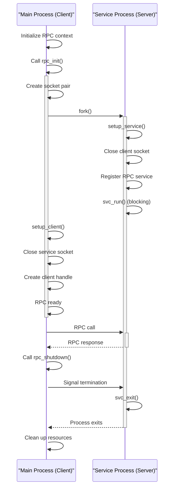
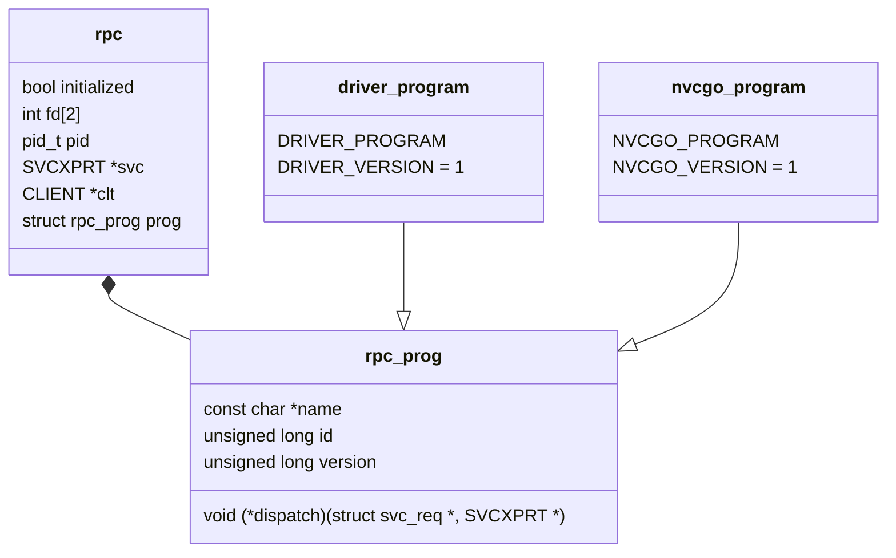
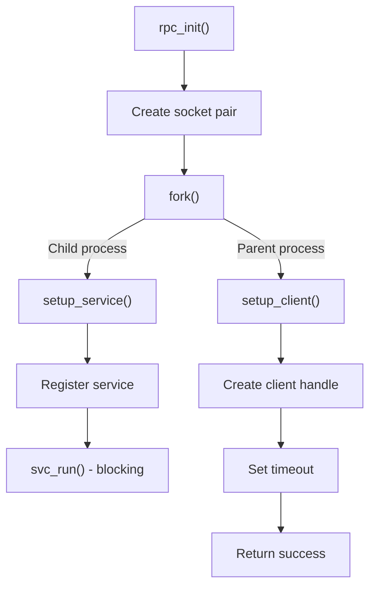
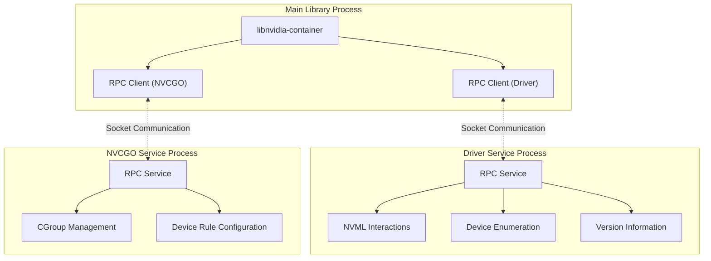

<!-- source: DeepWiki mcp.deepwiki.com · repo NVIDIA/libnvidia-container · page 5.1 Remote Procedure Calls · fetched 2026-10-26 -->

# Remote Procedure Calls

<details>
<summary>Relevant source files</summary>

The following files were used as context for generating this wiki page:

- [src/nvc_rpc.x](src/nvc_rpc.x)
- [src/nvcgo.c](src/nvcgo.c)
- [src/nvcgo.h](src/nvcgo.h)
- [src/nvcgo/go.mod](src/nvcgo/go.mod)
- [src/nvcgo/go.sum](src/nvcgo/go.sum)
- [src/nvcgo/vendor/github.com/opencontainers/runtime-spec/specs-go/config.go](src/nvcgo/vendor/github.com/opencontainers/runtime-spec/specs-go/config.go)
- [src/nvcgo/vendor/github.com/opencontainers/runtime-spec/specs-go/version.go](src/nvcgo/vendor/github.com/opencontainers/runtime-spec/specs-go/version.go)
- [src/nvcgo/vendor/modules.txt](src/nvcgo/vendor/modules.txt)
- [src/rpc.c](src/rpc.c)
- [src/rpc.h](src/rpc.h)

</details>


## Purpose and Overview

This document describes the Remote Procedure Call (RPC) mechanisms used in the libnvidia-container library. The RPC system enables interprocess communication between different components, particularly isolating privileged operations from the main library in separate processes. This design improves security and stability by confining potential issues to isolated processes.

The RPC implementation uses standard Unix domain sockets and follows a client-server architecture where the "server" processes handle specialized tasks like driver information collection and device operations.

Sources: [src/rpc.h:17-58](), [src/rpc.c:17-40]()

## RPC Architecture

The libnvidia-container library employs a fork-based RPC architecture where specialized services run in child processes. This design provides isolation between the main library and components that interact with drivers or hardware, improving security and stability.

### Client-Server Model



Diagram: RPC Process Communication Flow

Sources: [src/rpc.c:43-104](), [src/rpc.c:139-171](), [src/rpc.c:173-187]()

### Key Components



Diagram: RPC Structure and Relationships

Sources: [src/rpc.h:41-55](), [src/nvc_rpc.x:146-213]()

## RPC Implementation Details

### Initialization Process

The RPC initialization process establishes a parent-child relationship between processes:

1. Socket pair creation for bidirectional communication
2. Process forking to create service process
3. Service process setup (child)
4. Client setup (parent)
5. RPC context initialization



Diagram: RPC Initialization Flow

Sources: [src/rpc.c:139-171](), [src/rpc.c:43-63](), [src/rpc.c:65-104]()

### Socket Communication

The RPC implementation uses Unix domain sockets for communication between processes. The socket pair created during initialization provides bidirectional communication channels between the client (parent) and service (child) processes.

| Socket Index | Constant   | Used By  | Purpose                                     |
|--------------|------------|----------|---------------------------------------------|
| 0            | SOCK_CLT   | Client   | For sending requests and receiving responses |
| 1            | SOCK_SVC   | Service  | For receiving requests and sending responses |

Sources: [src/rpc.h:38-39](), [src/rpc.c:50-51](), [src/rpc.c:75-76]()

### Service Process Management

The service process runs in a separate process and handles RPC requests through the standard RPC service loop. Key aspects include:

1. **Process Naming**: The service process is renamed to identify its function
2. **Parent Death Signal**: The service sets up to receive SIGTERM if the parent dies
3. **Service Loop**: The service enters the `svc_run()` loop to handle requests
4. **Graceful Termination**: The service can be terminated by the parent process

When the parent process calls `rpc_shutdown()`, it attempts to gracefully terminate the service process:

1. Try to wait for the process to exit naturally
2. Send SIGTERM if needed
3. Wait with a timeout (10ms)
4. Send SIGKILL if the process doesn't respond to SIGTERM

Sources: [src/rpc.c:65-104](), [src/rpc.c:106-137](), [src/rpc.c:173-187]()

## RPC Protocol

The RPC protocol is defined using XDR (External Data Representation) format in `nvc_rpc.x`. This file defines the data structures and procedure interfaces for RPC communication.

### Programs and Procedures

The system defines two main RPC programs:

1. **DRIVER_PROGRAM**: Handles driver-related operations like version information, device enumeration, and device properties
2. **NVCGO_PROGRAM**: Interfaces with the Go-based cgroup management functionality

#### Driver Program Procedures

| Procedure ID | Name | Description |
|--------------|------|-------------|
| 1 | DRIVER_INIT | Initialize the driver context |
| 2 | DRIVER_SHUTDOWN | Shutdown the driver context |
| 3 | DRIVER_GET_RM_VERSION | Get NVIDIA Resource Manager version |
| 4 | DRIVER_GET_CUDA_VERSION | Get CUDA version |
| 5 | DRIVER_GET_DEVICE_COUNT | Get number of devices |
| 6 | DRIVER_GET_DEVICE | Get device handle by index |
| 7-12 | DRIVER_GET_DEVICE_* | Get device properties (minor, busid, uuid, etc.) |
| 13-17 | DRIVER_GET_DEVICE_MIG_* | Get MIG-related device information |

Sources: [src/nvc_rpc.x:146-166]()

#### NVCGO Program Procedures

| Procedure ID | Name | Description |
|--------------|------|-------------|
| 1 | NVCGO_INIT | Initialize NVCGO context |
| 2 | NVCGO_SHUTDOWN | Shutdown NVCGO context |
| 3 | NVCGO_GET_DEVICE_CGROUP_VERSION | Get cgroup version |
| 4 | NVCGO_FIND_DEVICE_CGROUP_PATH | Find cgroup path for device |
| 5 | NVCGO_SETUP_DEVICE_CGROUP | Configure device cgroup |

Sources: [src/nvc_rpc.x:204-212]()

### Data Types

The RPC protocol defines various data types for request and response handling:

1. **Basic Types**: `ptr_t` (64-bit pointer/handle wrapper)
2. **Result Types**: Each procedure has a corresponding result type (e.g., `driver_init_res`)
3. **Error Handling**: Result types are defined as discriminated unions with error codes and messages

```
union driver_init_res switch (int errcode) {
    case 0:
            void;
    default:
            string errmsg<>;
};
```

Sources: [src/nvc_rpc.x:9-103](), [src/nvc_rpc.x:168-195]()

## RPC Usage in the System

### Error Handling and Call Mechanism

The system provides a `call_rpc` macro for handling RPC calls, which:

1. Executes the RPC function
2. Handles RPC-level errors (like communication failures)
3. Handles application-level errors (returned in the response)
4. Manages signal handling during RPC calls (ignoring SIGPIPE)
5. Converts errors to a standardized format

```c
#define call_rpc(err, ctx, res, func, ...) __extension__ ({
    enum clnt_stat r_;
    struct sigaction osa_, sa_ = {.sa_handler = SIG_IGN};
    
    sigaction(SIGPIPE, &sa_, &osa_);
    if ((r_ = func((ptr_t)ctx, ##__VA_ARGS__, res, (ctx)->clt)) != RPC_SUCCESS)
        error_set_rpc(err, r_, "%s rpc error", (ctx)->prog.name);
    else if ((res)->errcode != 0)
        error_from_xdr(err, res);
    sigaction(SIGPIPE, &osa_, NULL);
    (r_ == RPC_SUCCESS && (res)->errcode == 0) ? 0 : -1;
})
```

Sources: [src/rpc.h:60-72]()

### Integration with System Components

The RPC mechanism is used to communicate with two main subsystems:

1. **Driver Information** - The driver component runs in a separate process and provides information about NVIDIA drivers and devices.
2. **NVCGO** - The Go-based component handles cgroup operations for container device access control.



Diagram: RPC Integration with System Components

Sources: [src/nvcgo.c:41-160](), [src/nvc_rpc.x:146-213]()

### NVCGO Integration Example

The NVCGO component is integrated using the RPC mechanism to provide cgroup management for container device access. The integration involves:

1. Initializing the NVCGO RPC context
2. Calling functions via RPC
3. Dynamically loading the Go-compiled library in the service process

```mermaid
sequenceDiagram
    participant Main as "Main Process"
    participant NVCGO as "NVCGO Service"
    
    Main->>Main: nvcgo_init()
    Main->>+NVCGO: fork() and setup RPC
    NVCGO->>NVCGO: Load libnvcgo.so (Go library)
    NVCGO->>NVCGO: Resolve function pointers
    NVCGO-->>-Main: RPC initialized
    
    Main->>+NVCGO: GetDeviceCGroupVersion()
    NVCGO->>NVCGO: Call Go function
    NVCGO-->>-Main: Return result
    
    Main->>+NVCGO: AddDeviceRules()
    NVCGO->>NVCGO: Call Go function to configure cgroups
    NVCGO-->>-Main: Return result
    
    Main->>+Main: nvcgo_shutdown()
    Main->>NVCGO: Terminate RPC service
    NVCGO->>NVCGO: Unload Go library
    NVCGO-->>-Main: Service terminated
```

Diagram: NVCGO RPC Communication Flow

Sources: [src/nvcgo.c:41-160](), [src/nvcgo.h:25-35]()

## Benefits of the RPC Architecture

The RPC-based architecture in libnvidia-container provides several advantages:

1. **Process Isolation**: By separating privileged operations into different processes, security and stability are improved
2. **Fault Containment**: Failures in one component (like driver interactions) don't crash the entire application
3. **Language Interoperability**: Enables integration with components written in different languages (like Go for NVCGO)
4. **Privilege Separation**: Services can run with different privileges as needed
5. **Modularity**: Clear interfaces between components

Sources: [src/rpc.c:17-40](), [src/nvcgo.c:41-160]()

---

