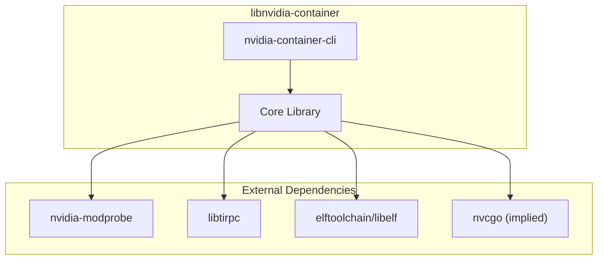
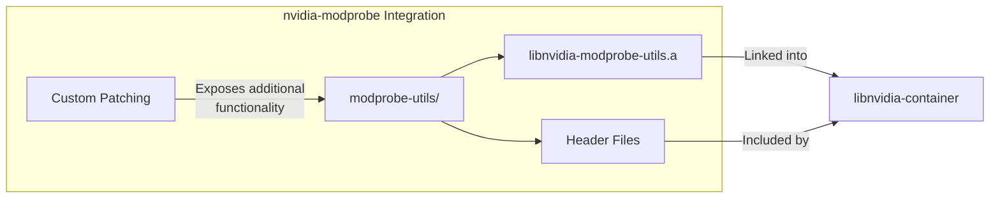
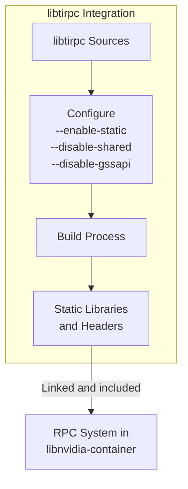
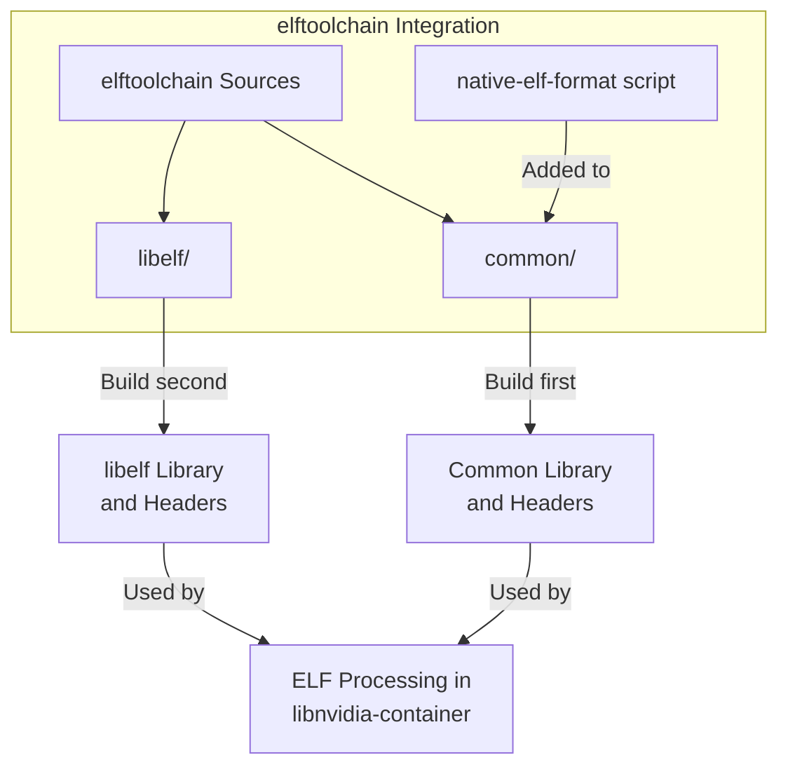
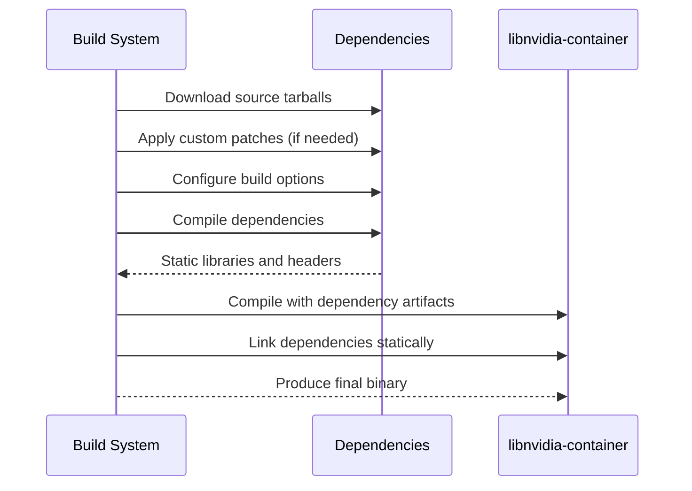
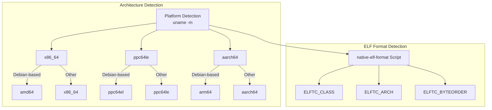

<!-- source: DeepWiki mcp.deepwiki.com · repo NVIDIA/libnvidia-container · page 5.2 Dependencies and Integration · fetched 2026-10-26 -->

# Dependencies and Integration

<details>
<summary>Relevant source files</summary>

The following files were used as context for generating this wiki page:

- [mk/common.mk](mk/common.mk)
- [mk/elftoolchain.mk](mk/elftoolchain.mk)
- [mk/libtirpc.mk](mk/libtirpc.mk)
- [mk/native-elf-format](mk/native-elf-format)
- [mk/nvidia-modprobe.mk](mk/nvidia-modprobe.mk)
- [mk/nvidia-modprobe.patch](mk/nvidia-modprobe.patch)

</details>


This page documents the external dependencies required by the NVIDIA Container Toolkit (libnvidia-container) and how they are integrated into the system. It focuses on the build-time dependencies, their versions, configurations, and how they're incorporated into the toolkit's build system. For information about the build system itself, see [Building and Packaging](#4).

## Overview of Dependencies

The NVIDIA Container Toolkit relies on several external libraries and tools to provide its functionality. These dependencies are carefully managed to ensure compatibility and stability across different platforms and environments.



Sources: [mk/nvidia-modprobe.mk](), [mk/libtirpc.mk](), [mk/elftoolchain.mk]()

## Core Dependencies

### NVIDIA Modprobe

NVIDIA Modprobe provides utilities for loading NVIDIA kernel modules and creating device nodes, which is essential for exposing GPU devices to containers.

**Key details:**
- Version: 550.54.14 (as of the analyzed code)
- Source: GitHub repository
- Component used: `libnvidia-modprobe-utils.a` (static library)
- Header files: `nvidia-modprobe-utils.h`, `pci-enum.h`

The build system applies a custom patch (`nvidia-modprobe.patch`) that exposes an additional function `nvidia_cap_get_device_file_attrs` which is used to retrieve device file attributes from capability files.



Sources: [mk/nvidia-modprobe.mk](), [mk/nvidia-modprobe.patch]()

### libtirpc (Transport Independent RPC)

libtirpc provides transport-independent RPC (Remote Procedure Call) functionality, which is used for communication between components within the NVIDIA Container Toolkit.

**Key details:**
- Version: 1.3.2
- Source: SourceForge
- Configuration: Static linking (--enable-static --disable-shared), disabled GSSAPI



Sources: [mk/libtirpc.mk]()

### elftoolchain (libelf)

elftoolchain provides functionality for parsing and manipulating ELF (Executable and Linkable Format) files, which is used to analyze and manipulate binary files during container setup.

**Key details:**
- Version: 0.7.1
- Source: SourceForge
- Components: libelf, common utilities
- Custom addition: `native-elf-format` script for determining platform-specific ELF format



Sources: [mk/elftoolchain.mk](), [mk/native-elf-format]()

## Integration Approach

The NVIDIA Container Toolkit uses a sophisticated build system to manage and integrate its dependencies. The integration approach follows these key principles:

1. **Static Linking Preference**: Dependencies are generally statically linked to maximize portability and minimize runtime dependencies.
2. **Version Pinning**: Specific dependency versions are pinned to ensure consistent behavior.
3. **Custom Patching**: When necessary, dependencies are patched to expose additional functionality or fix issues.
4. **Modular Makefile System**: Each dependency has its own makefile in the `mk/` directory.

### Build Process Integration

The following table illustrates how each dependency is integrated during the build process:

| Dependency | Download Method | Build Configuration | Integration Style |
|------------|----------------|---------------------|------------------|
| nvidia-modprobe | Tarball from GitHub | Custom compilation | Static library |
| libtirpc | Tarball from SourceForge | Configure with static options | Static library |
| elftoolchain | Tarball from SourceForge | BSD make system | Static library |



Sources: [mk/common.mk](), [mk/nvidia-modprobe.mk](), [mk/libtirpc.mk](), [mk/elftoolchain.mk]()

## Dependency Compilation Configuration

The dependencies are compiled with specific flags to ensure security, optimization, and compatibility:

### Common Compilation Flags

```
CPPFLAGS := -D_FORTIFY_SOURCE=2
CFLAGS   := -O2 -g -fdata-sections -ffunction-sections -fstack-protector -fno-strict-aliasing -fPIC
```

These flags enable:
- Security features (`-D_FORTIFY_SOURCE=2`, `-fstack-protector`)
- Optimization with debugging info (`-O2 -g`)
- Position-independent code (`-fPIC`)
- Size optimizations (`-fdata-sections -ffunction-sections`)

Sources: [mk/nvidia-modprobe.mk:27-28](), [mk/libtirpc.mk:18-19](), [mk/elftoolchain.mk:30-31]()

## Cross-Platform Considerations

The dependency management system takes into account cross-platform compatibility, especially for different architectures:



The `native-elf-format` script is particularly important for cross-platform compatibility, as it determines the native ELF format for a host platform by compiling a test object and examining the resulting binary.

Sources: [mk/common.mk:48-56](), [mk/native-elf-format]()

## Conclusion

The dependency management system in libnvidia-container is designed to be robust, secure, and platform-independent. By carefully managing external dependencies, applying necessary customizations, and using static linking when appropriate, the toolkit maintains a high level of reliability across different environments.

---

