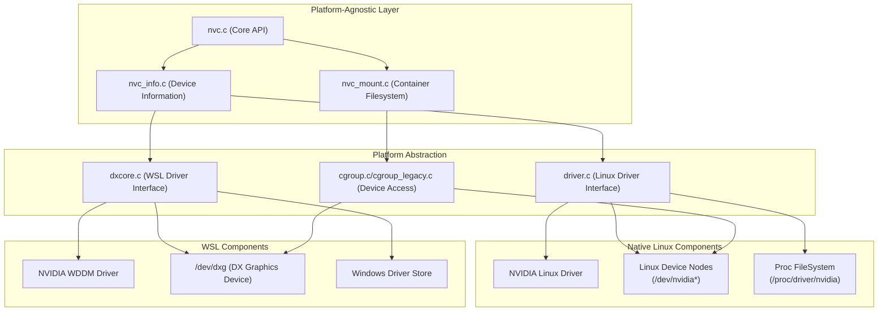
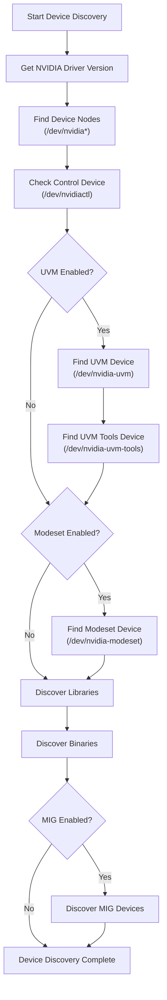
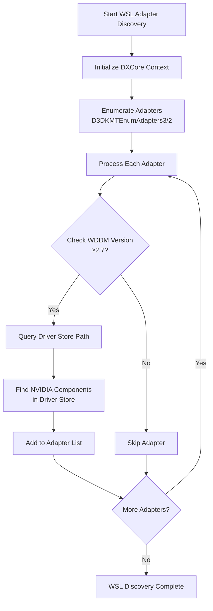
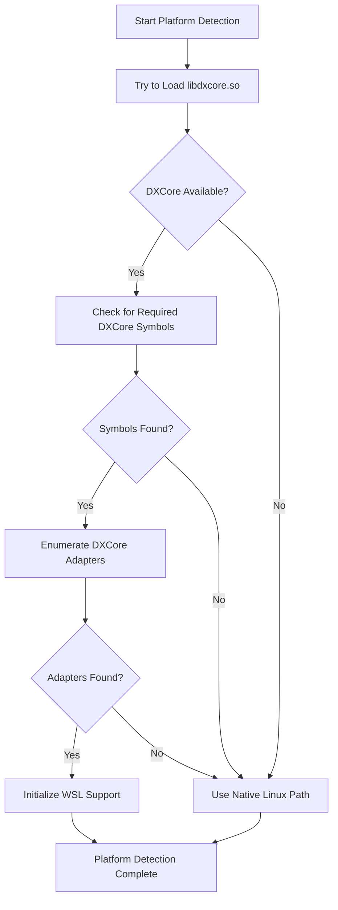
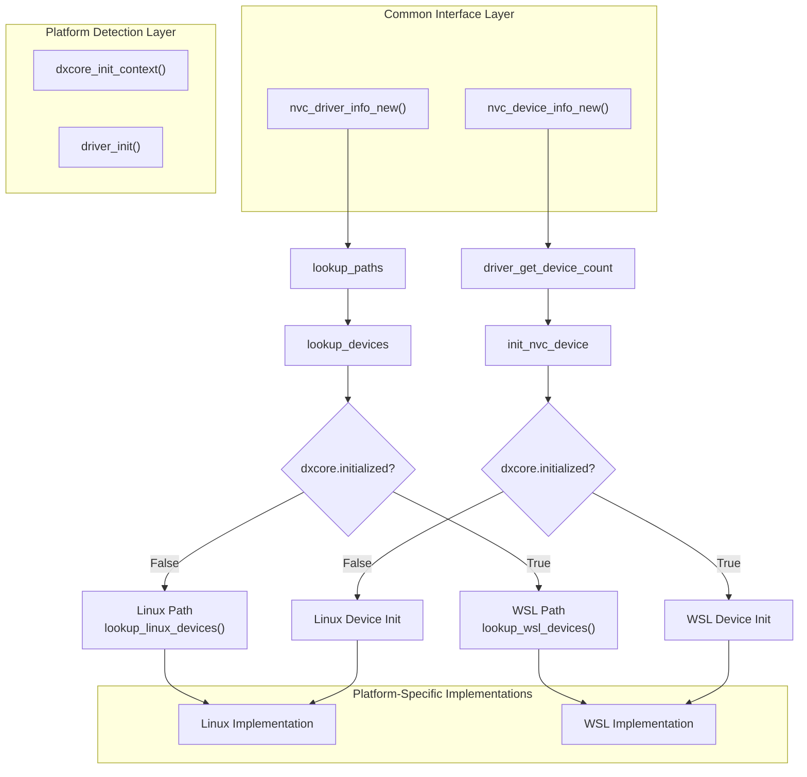

<!-- source: DeepWiki mcp.deepwiki.com · repo NVIDIA/libnvidia-container · page 6 Platform Support · fetched 2026-10-26 -->

# Platform Support

Relevant source files

The following files were used as context for generating this wiki page:

- [CHANGELOG.md](CHANGELOG.md)
- [src/cgroup_legacy.c](src/cgroup_legacy.c)
- [src/dxcore.c](src/dxcore.c)
- [src/dxcore.h](src/dxcore.h)
- [src/nvc_info.c](src/nvc_info.c)
- [src/nvc_internal.h](src/nvc_internal.h)

This document provides a comprehensive overview of the platform-specific implementations and considerations in the NVIDIA Container Toolkit. It focuses on how the toolkit supports different operating environments, with particular emphasis on native Linux systems and Windows Subsystem for Linux (WSL).

## Supported Platforms Overview

The NVIDIA Container Toolkit (libnvidia-container) supports the following platforms:

1. **Native Linux** - Traditional Linux distributions where NVIDIA drivers are installed directly on the host
2. **Windows Subsystem for Linux (WSL2)** - Linux environments running on Windows with GPU support via the Windows display driver

Both environments allow containerized applications to access NVIDIA GPUs, but with different underlying mechanisms.

Sources: [src/nvc_info.c:37-38](), [src/dxcore.h]()

## Platform Architecture

Sources: [src/nvc_internal.h:24-74](), [src/nvc_info.c:37-38](), [src/dxcore.c:363-429]()

## Native Linux Support

On native Linux systems, the toolkit interacts directly with the NVIDIA driver installed on the host through various interface points:

1. **Device Nodes**: Access to GPU hardware via `/dev/nvidia*` device nodes
2. **Control Device**: System-wide operations via `/dev/nvidiactl`
3. **UVM Device**: Unified Virtual Memory support via `/dev/nvidia-uvm` (when available)
4. **Modeset Device**: Display-related functionality via `/dev/nvidia-modeset` (when enabled)
5. **Proc Filesystem**: Driver and device capabilities information via `/proc/driver/nvidia`

The toolkit discovers these components, validates their availability, and configures the container environment to properly expose them to containerized applications.

### Linux Device Discovery Process

Sources: [src/nvc_info.c:514-572](), [src/nvc_info.c:813-820]()

## Windows Subsystem for Linux Support

The toolkit supports containerized GPU applications in Windows Subsystem for Linux (WSL2) environments. This integration leverages Microsoft's DXCore interface to interact with the Windows graphics subsystem.

### DXCore Integration

The DXCore integration allows the toolkit to:

1. Enumerate NVIDIA GPU adapters available to WSL
2. Access the Windows driver store to find NVIDIA driver components
3. Provide container access to GPU hardware via the `/dev/dxg` device

This implementation makes GPU-accelerated containers in WSL work without requiring a separate NVIDIA Linux driver installation within WSL.

### WSL Adapter Discovery Process

Sources: [src/dxcore.c:236-283](), [src/dxcore.c:343-361]()

### Key Components of WSL Support

The toolkit specifically looks for these components in the Windows driver store when running on WSL:

| Component | Purpose |
|-----------|---------|
| `libcuda.so.1.1` | Core CUDA library |
| `libcuda_loader.so` | CUDA loader for WSL |
| `libnvidia-ptxjitcompiler.so.1` | PTX JIT compiler |
| `libnvidia-ml.so.1` | NVIDIA Management Library |
| `libnvidia-ml_loader.so` | NVML loader for WSL |
| `libnvdxgdmal.so.1` | DXG driver abstraction layer |
| `nvidia-smi` | System management interface |
| `nvcubins.bin` | GPU code for CUDA |

Sources: [src/dxcore.c:14-23](), [CHANGELOG.md:6-7]()

## Platform Detection and Switching

The toolkit automatically detects the platform it's running on and adjusts its behavior accordingly. This happens primarily through the initialization of the `dxcore_context` structure:

Sources: [src/dxcore.c:363-405](), [src/nvc_info.c:183-205]()

## Platform-Specific Library Selection

The toolkit uses different strategies for identifying and selecting libraries based on the platform:

### Native Linux Library Selection

On native Linux, the toolkit:
1. Examines ELF metadata to match libraries with the installed driver version
2. Verifies compatibility of libraries with other components
3. Selects both standard and compatibility libraries as needed

### WSL Library Selection

For WSL environments:
1. Libraries are primarily sourced from the Windows driver store
2. Special loaders (`libcuda_loader.so`, `libnvidia-ml_loader.so`) bridge between Linux and Windows APIs
3. WSL-specific libraries like `libdxcore.so` are required

Sources: [src/nvc_info.c:142-181](), [src/nvc_info.c:183-205]()

## Platform Differences in Device Access

There are key differences in how GPU devices are accessed across platforms:

| Feature | Native Linux | WSL |
|---------|-------------|-----|
| Primary Device | Multiple `/dev/nvidia*` devices | Single `/dev/dxg` device |
| Control Device | `/dev/nvidiactl` | `/dev/dxg` |
| UVM Support | Via `/dev/nvidia-uvm` | Not available |
| MIG Support | Available | Not available |
| Device Permissions | Managed via cgroups | Simpler model with single device |
| Firmware Loading | Host-managed | Windows-managed |

Sources: [src/nvc_info.c:514-572](), [src/nvc_info.c:703-755]()

## Inter-Platform Code Sharing

Despite the differences between platforms, the toolkit maintains a unified codebase through abstraction:

Sources: [src/nvc_info.c:794-826](), [src/nvc_info.c:844-885](), [src/nvc_info.c:704-756]()

## Additional Platform Considerations

### Container Integration

The toolkit's interface to container runtimes remains consistent across platforms, though the internal implementation differs. This allows container runtimes to use the same commands regardless of platform.

### Future Platform Support

The modular design allows for potential additional platform support in the future through the implementation of new platform-specific modules that conform to the existing interfaces.

Sources: [src/nvc_internal.h:68-74](), [src/nvc_info.c:37-38]()