# Page: Overview

# Overview

<details>
<summary>Relevant source files</summary>

The following files were used as context for generating this wiki page:

- [.github/workflows/build.yaml](.github/workflows/build.yaml)
- [CHANGELOG.md](CHANGELOG.md)
- [README.md](README.md)
- [src/cgroup_legacy.c](src/cgroup_legacy.c)
- [src/dxcore.c](src/dxcore.c)
- [src/dxcore.h](src/dxcore.h)

</details>


The libnvidia-container project provides a low-level library and a CLI utility for configuring GNU/Linux containers with NVIDIA GPU support. This system is designed to be container runtime agnostic, relying on kernel primitives to properly isolate and expose NVIDIA GPU devices to containerized applications. This overview explains the purpose, components, and architecture of libnvidia-container, providing a foundation for understanding how it enables GPU acceleration in container environments.

For detailed information about the system architecture, see [Architecture](#2).

Sources: [README.md:10-11]()

## Purpose and Core Functionality

The libnvidia-container library enables container runtimes to:

1. Detect NVIDIA hardware and drivers on the host system
2. Mount necessary driver components inside containers
3. Configure device nodes and permissions for GPU access
4. Manage cgroup-based isolation and access control
5. Support specialized configurations (e.g., Multi-Instance GPU)
6. Work across different platforms (Native Linux and Windows Subsystem for Linux)

The project is designed as a building block for more complex container technologies, providing the fundamental capabilities needed for containerized GPU workloads.

Sources: [README.md:10-11](), [README.md:43-45]()

## Key Components

### Component Architecture

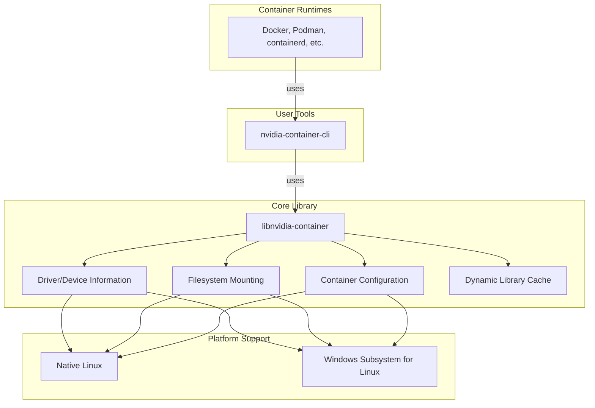

Sources: [src/dxcore.c:1-430](), [README.md:10-11]()

### Library and CLI Relationship

The project consists of two main components:

1. **libnvidia-container library**: Core implementation providing programmatic access to GPU configuration capabilities
2. **nvidia-container-cli**: Command-line utility that exposes the library's functionality

Container runtimes typically integrate with the CLI tool, which in turn leverages the library's functionality to configure containers with NVIDIA GPU support.

Sources: [README.md:10-11](), [README.md:47-77]()

## System Integration

### Integration with Container Environments

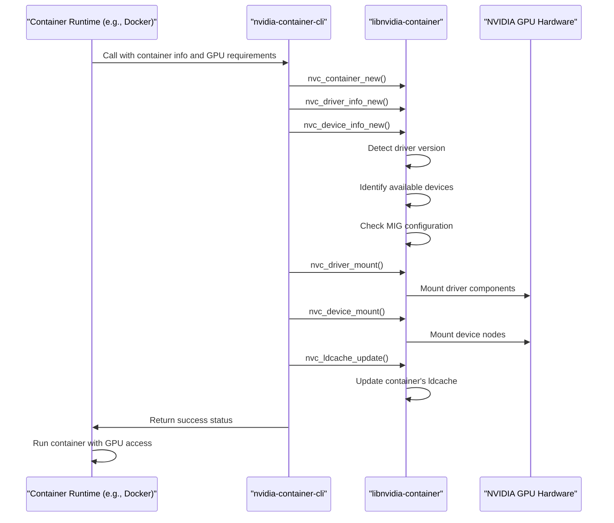

Sources: [README.md:47-77]()

### Container Runtime Example

The library is used by projects like [nvidia-container-runtime](#2.3) to enable GPU support in container platforms. This usage follows a pattern where:

1. The container runtime invokes `nvidia-container-cli`
2. The CLI configures the container's namespaces with required GPU access
3. The container gains access to specified GPU devices

A practical command-line example demonstrating this integration is shown in the README:

```
nvidia-container-cli --load-kmods configure --ldconfig=@/sbin/ldconfig.real --no-cgroups --utility --device 0 $(pwd)
```

This command configures the current directory as a container root with access to GPU device 0, along with required utilities.

Sources: [README.md:44-77]()

## Platform Support

The library supports both native Linux environments and Windows Subsystem for Linux (WSL):

### Native Linux Support

On native Linux, the library:
- Interacts directly with the NVIDIA driver via device nodes
- Uses cgroups for access control
- Manages filesystem mounts within container namespaces

### Windows Subsystem for Linux Support

For WSL environments, the system:
- Uses the DXCore interface to interact with Windows display drivers
- Detects NVIDIA hardware through Windows APIs
- Maps driver components from Windows driver store to Linux containers

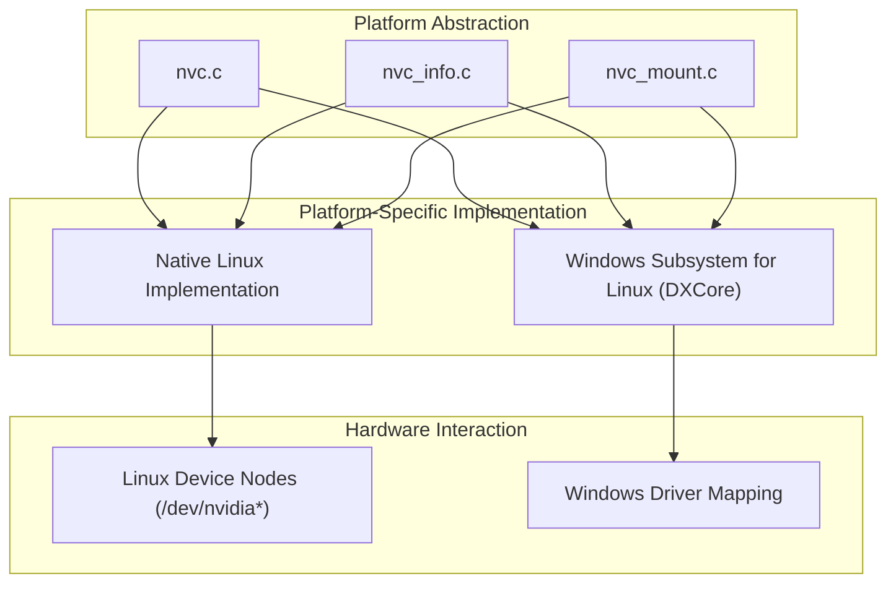

The DXCore implementation enables GPUs on Windows hosts to be properly exposed to containers running in WSL environments, bridging the gap between Windows drivers and Linux containers.

Sources: [src/dxcore.c:1-430](), [src/dxcore.h:1-40]()

## Container Integration Mechanisms

### Device Access Control

The library uses cgroups to control access to GPU devices within containers:

- For cgroup v1: Modifies `devices.allow` entries to permit access to specific device nodes
- For cgroup v2: Uses the appropriate mechanisms for the newer cgroup version

This ensures containers can only access the specific GPU devices that have been explicitly assigned to them.

Sources: [src/cgroup_legacy.c:1-206]()

### Filesystem Mounting

To provide GPU access, the library mounts several components into containers:

1. **Driver libraries**: CUDA libraries, display drivers, etc.
2. **Device nodes**: `/dev/nvidia*` devices for direct hardware access
3. **Utility binaries**: Tools like `nvidia-smi` for monitoring and management

The mounting process ensures that only required components are exposed, maintaining container isolation principles.

## Summary

The libnvidia-container project provides the foundation for GPU acceleration in container environments by:

1. Offering a container-runtime-agnostic solution for NVIDIA GPU integration
2. Providing both a programmable library and command-line utilities
3. Supporting multiple platforms including native Linux and WSL
4. Ensuring proper isolation and access control for containerized GPU workloads
5. Enabling container technologies to leverage NVIDIA hardware capabilities

This overview provides the context for understanding the more detailed aspects of the system covered in other documentation sections.

---

# Page: Architecture

# Architecture

<details>
<summary>Relevant source files</summary>

The following files were used as context for generating this wiki page:

- [pkg/deb/libnvidia-container@MAJOR@.symbols](pkg/deb/libnvidia-container@MAJOR@.symbols)
- [src/libnvidia-container.lds](src/libnvidia-container.lds)
- [src/nvc.c](src/nvc.c)
- [src/nvc.h.template](src/nvc.h.template)
- [src/nvc_info.c](src/nvc_info.c)
- [src/nvc_internal.h](src/nvc_internal.h)

</details>


This document describes the architecture of libnvidia-container, a key component of the NVIDIA Container Toolkit that enables GPU support in containerized applications. It explains the core subsystems, their interactions, and how they work together to expose NVIDIA GPUs to containers in a secure and isolated manner.

For information about specific commands and usage patterns, see [Command-Line Interface](#3). For details about building the project, see [Building and Packaging](#4).

## System Overview

libnvidia-container operates as a foundational component that manages the complex task of properly configuring Linux containers with NVIDIA GPU support. It's designed to be container runtime agnostic, allowing integration with Docker, containerd, CRI-O, and other container runtimes.

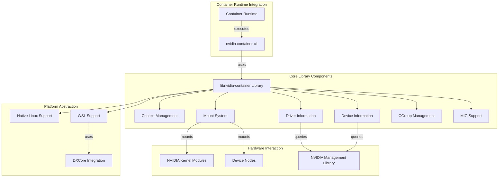

Sources: [src/nvc_internal.h:1-181](), [src/nvc.c:1-496](), [src/nvc_info.c:1-940]()

## Core Components

### Context and Configuration Management

The library uses a context-based design where operations are performed against an initialized context. The context maintains configuration details, error state, and platform-specific information.

```mermaid
classDiagram
    class nvc_context {
        bool initialized
        struct error err
        struct nvc_config cfg
        int mnt_ns
        bool no_pivot
        struct dxcore_context dxcore
    }

    class nvc_config {
        char* root
        char* ldcache
        uid_t uid
        gid_t gid
        struct nvc_imex_info imex
    }

    class nvc_container {
        int32_t flags
        struct nvc_container_config cfg
        uid_t uid
        gid_t gid
        char* mnt_ns
        int dev_cg_version
        char* dev_cg
        char** libs
        size_t nlibs
    }

    nvc_context --> nvc_config : "contains"
    nvc_container --> "nvc_container_config" : "contains"
```

The library's lifecycle begins with context initialization through `nvc_init()` and ends with `nvc_shutdown()`. The initialization process:

1. Parses configuration options
2. Loads necessary kernel modules (if requested)
3. Initializes platform-specific components (native Linux or WSL)
4. Sets up driver communication

Sources: [src/nvc.c:94-131](), [src/nvc.c:376-447](), [src/nvc_internal.h:68-87]()

### Driver and Device Information

A key responsibility of the library is discovering and providing information about available drivers and devices. This is handled by two main components:

#### Driver Information System

The driver information system collects details about installed NVIDIA drivers, including:
- NVIDIA driver version
- CUDA version
- Required libraries and binaries
- Device nodes

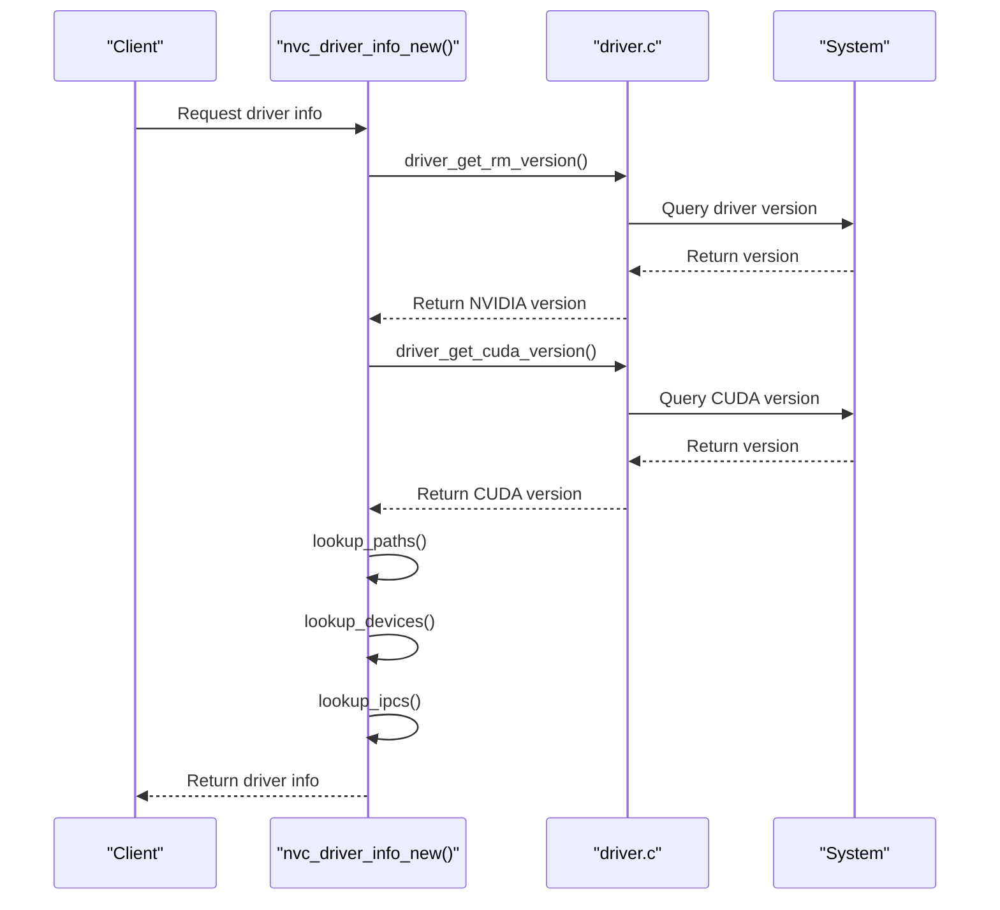

The driver information system scans the system for required NVIDIA components such as libraries (both 32-bit and 64-bit), binaries, device nodes, and IPC mechanisms. It uses the dynamic linker cache to locate libraries and resolves binary paths using the system PATH.

Sources: [src/nvc_info.c:794-826](), [src/nvc_info.c:365-420]()

#### Device Information System

The device information system discovers and provides details about NVIDIA GPUs in the system:
- Device model
- UUID
- PCI bus ID
- Architecture
- MIG configuration (if applicable)

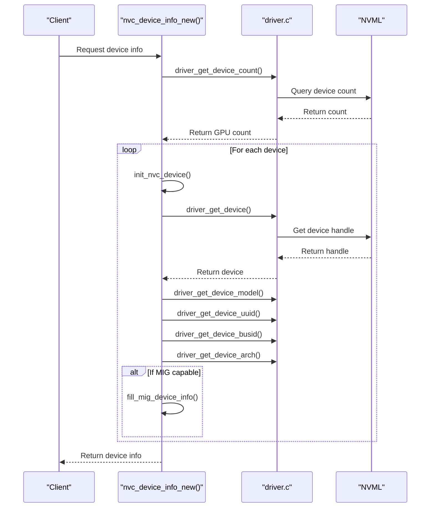

MIG (Multi-Instance GPU) support is a key feature that allows for partitioning GPUs into multiple isolated instances. The device information system detects MIG-capable GPUs and collects information about configured MIG devices.

Sources: [src/nvc_info.c:844-885](), [src/nvc_info.c:703-761](), [src/nvc_info.c:603-701]()

### Mount System

The mount system is responsible for exposing driver components and device nodes inside containers. It handles:

1. Mounting NVIDIA driver libraries
2. Mounting NVIDIA device nodes
3. Mounting MIG capability files
4. Updating the container's loader cache

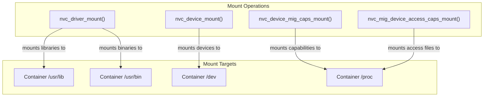

The mount system uses Linux mount operations to expose the required files and devices to containers. It handles both standard device access and more complex MIG configurations.

Sources: [src/nvc.h.template:162-175](), [src/libnvidia-container.lds:34-42]()

### CGroup Management

Container isolation is enforced through Linux cgroups, particularly for device access control. The library:

1. Identifies the container's cgroup
2. Determines the cgroup version (v1 or v2)
3. Configures device access permissions for NVIDIA devices

This ensures that containers only have access to the specific GPUs assigned to them, enforcing hardware-level isolation.

Sources: [src/nvc_internal.h:123-128]()

## Platform Support

libnvidia-container supports both native Linux environments and Windows Subsystem for Linux (WSL):

### Native Linux Support

On native Linux, the library:
- Loads required kernel modules (nvidia, nvidia-uvm, nvidia-modeset)
- Creates device nodes if they don't exist
- Uses procfs and sysfs for hardware detection and configuration

### WSL Support

WSL support is implemented through Microsoft's DXCore API:

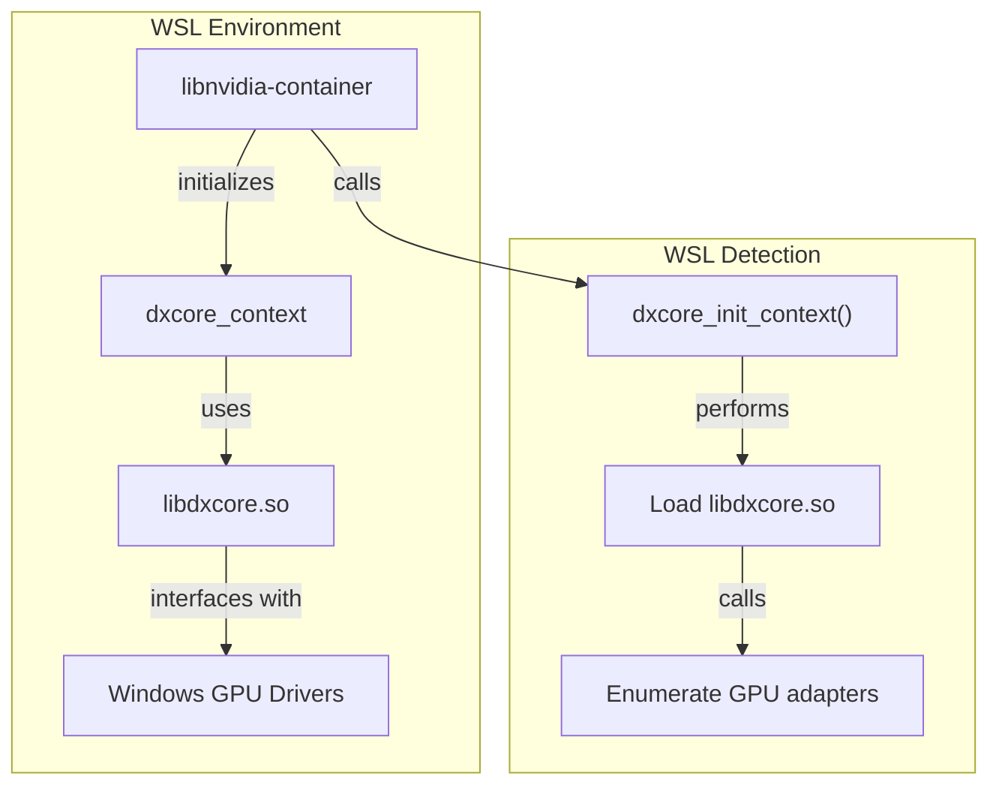

In WSL environments, the library detects the presence of DXCore and uses it instead of the traditional Linux interfaces. This allows containers running in WSL to access GPUs through the Windows host.

Sources: [src/nvc.c:408-436](), [src/nvc_info.c:183-205](), [src/nvc_info.c:722-736]()

## Initialization and Discovery Flow

The following diagram illustrates the initialization sequence and discovery flow of the library:

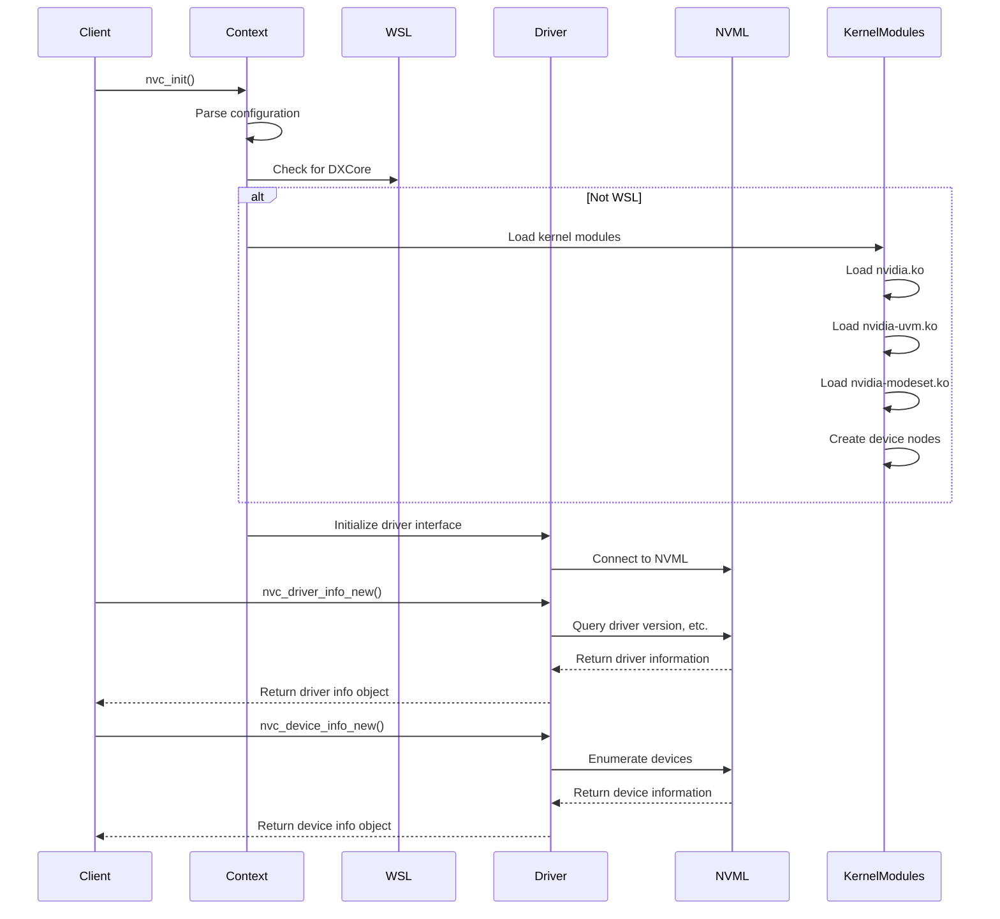

This initialization process prepares the library for operations and discovers the available GPUs and driver components that can be exposed to containers.

Sources: [src/nvc.c:376-447](), [src/nvc_info.c:794-826](), [src/nvc_info.c:844-885]()

## Container Integration

The library integrates with containers through the following steps:

1. Create a container configuration with `nvc_container_config_new()`
2. Create a container object with `nvc_container_new()`
3. Mount driver components with `nvc_driver_mount()`
4. Mount device nodes with `nvc_device_mount()`
5. Update the dynamic linker cache with `nvc_ldcache_update()`

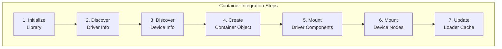

This process ensures that NVIDIA GPU devices and required software components are properly exposed to containers while maintaining isolation.

Sources: [src/nvc.h.template:146-176]()

## MIG Support Architecture

Multi-Instance GPU (MIG) support allows partitioning NVIDIA GPUs into multiple isolated instances. The library detects MIG-capable GPUs and provides mechanisms to mount the necessary capability files:

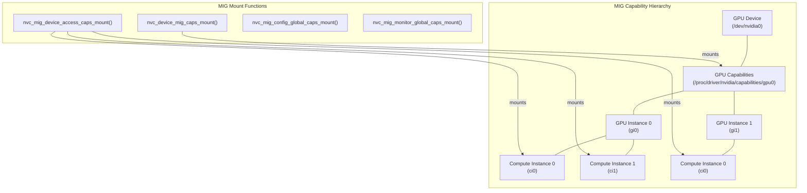

The MIG support architecture involves:
- Detecting MIG-capable GPUs
- Identifying configured GPU instances and compute instances
- Mounting the appropriate capability files in the container
- Managing access permissions

Sources: [src/nvc_info.c:603-701](), [src/nvc.h.template:166-170](), [src/nvc.c:147-229]()

## External Interface

The library exposes a C API defined in `nvc.h` with the following key functions:

| Function Group | Purpose | Key Functions |
|----------------|---------|---------------|
| Context Management | Initialize and manage the library context | `nvc_context_new`, `nvc_init`, `nvc_shutdown` |
| Configuration | Configure library behavior | `nvc_config_new` |
| Information | Discover driver and device information | `nvc_driver_info_new`, `nvc_device_info_new` |
| Container Management | Create and manage container objects | `nvc_container_new` |
| Mounting | Mount driver and device components | `nvc_driver_mount`, `nvc_device_mount` |
| MIG Support | Mount MIG capability files | `nvc_device_mig_caps_mount` |
| Error Handling | Get error information | `nvc_error` |

The functions are exported through a versioned API with the symbol version `NVC_1.0`.

Sources: [src/nvc.h.template:135-179](), [src/libnvidia-container.lds:14-48](), [pkg/deb/libnvidia-container@MAJOR@.symbols:1-29]()

## Summary

The libnvidia-container architecture is designed with modularity and platform abstraction in mind. It provides a clean interface for container runtimes to integrate NVIDIA GPU support while handling the complex details of driver discovery, device management, and isolation. The library supports both native Linux and WSL environments, with special handling for MIG configurations.

This architecture enables the NVIDIA Container Toolkit to provide consistent GPU support across different container runtimes and platforms, making GPU acceleration accessible to containerized applications with proper isolation and security.

---

# Page: Driver and Device Information

# Driver and Device Information

<details>
<summary>Relevant source files</summary>

The following files were used as context for generating this wiki page:

- [src/driver.c](src/driver.c)
- [src/driver.h](src/driver.h)
- [src/nvc_info.c](src/nvc_info.c)
- [src/nvc_internal.h](src/nvc_internal.h)

</details>


This document describes the driver and device information subsystem within the NVIDIA Container Toolkit. This subsystem is responsible for discovering NVIDIA drivers and GPU devices, gathering their capabilities, and providing this information to other components for container configuration.

For details about how this information is used to set up container filesystems, see [Container Filesystem Management](#2.2).

## Overview

The driver and device information subsystem is a core part of the NVIDIA Container Toolkit architecture that:

1. Detects installed NVIDIA drivers and their versions
2. Discovers available NVIDIA GPU devices and their capabilities
3. Identifies required libraries, binaries, and driver components
4. Provides Multi-Instance GPU (MIG) device detection
5. Supports both standard Linux environments and Windows Subsystem for Linux (WSL)

This information forms the foundation for proper GPU access inside containers.

Sources: [src/nvc_info.c:794-825](). [src/nvc_info.c:844-885]()

## Architecture

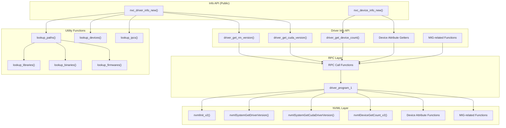

Sources: [src/driver.c:214-985](). [src/nvc_info.c:794-885]()

## Driver Information Collection

The driver information subsystem provides details about installed NVIDIA drivers including version information, required libraries, binaries, devices, and IPCs. This is implemented through the `nvc_driver_info_new()` function.

### Driver Collection Process

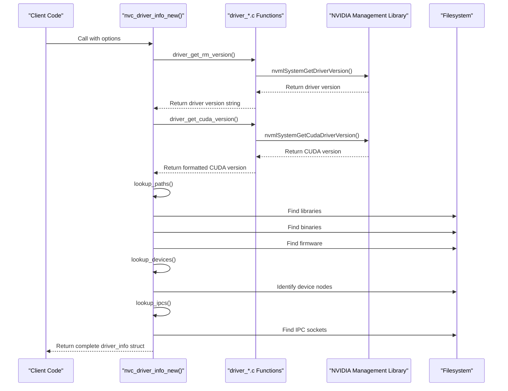

Sources: [src/nvc_info.c:794-825](). [src/driver.c:214-287]()

### Driver Information Structure

The `nvc_driver_info` structure contains:

1. **Version Information**:
   - NVIDIA driver version
   - CUDA driver version

2. **Libraries**: NVIDIA GPU-related libraries with both 64-bit and 32-bit support
   - Utility libraries (e.g., `libnvidia-ml.so`)
   - Compute libraries (e.g., `libcuda.so`)
   - Graphics libraries (OpenGL, EGL, etc.)
   - Video acceleration libraries

3. **Binaries**: NVIDIA utilities and tools
   - System management tools (e.g., `nvidia-smi`)
   - Compute-related tools (e.g., `nvidia-cuda-mps-control`)

4. **Devices**: Device nodes that need to be exposed to containers
   - Control device (`/dev/nvidiactl`)
   - GPU devices (`/dev/nvidia*`)
   - UVM devices if enabled (`/dev/nvidia-uvm*`)

5. **IPCs**: Inter-process communication sockets
   - NVIDIA Persistence daemon socket
   - NVIDIA Fabric Manager socket
   - CUDA MPS socket

Sources: [src/nvc_info.c:366-420](). [src/nvc_info.c:513-572](). [src/nvc_info.c:574-601]()

### Library and Binary Discovery

The system uses sophisticated methods to discover required libraries and binaries:

1. For libraries:
   - Uses the system's library cache (`ldcache`) to locate libraries
   - Validates libraries by checking their ABI compatibility
   - Handles both standard and GLVND (GL Vendor-Neutral Dispatch) configurations
   - Special handling for WSL environments

2. For binaries:
   - Searches through the system's PATH
   - Special handling for WSL environments to find binaries in the driver store

Sources: [src/nvc_info.c:141-310](). [src/nvc_info.c:387-420](). [src/nvc_info.c:422-441]()

## Device Information Collection

The device information subsystem discovers and provides details about NVIDIA GPU devices in the system. This is implemented through the `nvc_device_info_new()` function.

### Device Collection Process

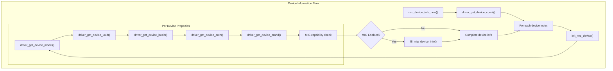

Sources: [src/nvc_info.c:844-885](). [src/nvc_info.c:703-761]()

### Device Information Structure

The `nvc_device_info` structure contains:

| Field | Description |
|-------|-------------|
| `ngpus` | Number of GPU devices found |
| `gpus` | Array of device information structures |

Each GPU device structure contains:

| Field | Description |
|-------|-------------|
| `model` | Device model name (e.g., "Tesla V100") |
| `uuid` | Unique device identifier |
| `busid` | PCI bus identifier |
| `arch` | GPU architecture version (e.g., "7.0") |
| `brand` | Brand name (e.g., "Tesla", "Quadro") |
| `node` | Device node information |
| `mig_capable` | Whether MIG is supported by this device |
| `mig_enabled` | Whether MIG is currently enabled |
| `mig_devices` | Information about MIG device instances |

Sources: [src/nvc_info.c:703-761](). [src/driver.c:476-607]()

### Device Node Information

Device nodes are managed through the `nvc_device_node` structure:

| Field | Description |
|-------|-------------|
| `path` | Path to the device node (e.g., `/dev/nvidia0`) |
| `id` | Device ID (major/minor numbers) |

Sources: [src/nvc_info.c:513-572](). [src/nvc_info.c:313-329]()

## Multi-Instance GPU (MIG) Support

The system includes comprehensive support for Multi-Instance GPU (MIG) technology, which allows a single physical GPU to be partitioned into multiple independent GPU instances.

### MIG Detection Process

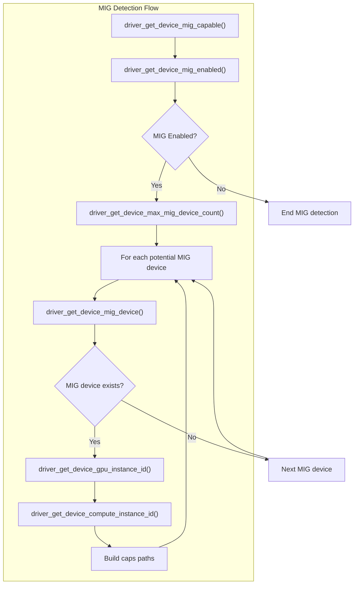

Sources: [src/nvc_info.c:603-701](). [src/driver.c:649-982]()

### MIG Device Information

The `nvc_mig_device_info` structure contains:

| Field | Description |
|-------|-------------|
| `ndevices` | Number of MIG devices found |
| `devices` | Array of MIG device structures |

Each MIG device contains:

| Field | Description |
|-------|-------------|
| `gi` | GPU Instance ID |
| `ci` | Compute Instance ID |
| `uuid` | Unique identifier for the MIG device |
| `parent` | Reference to the parent physical GPU |
| `gi_caps_path` | Path to the GPU Instance capability in procfs |
| `ci_caps_path` | Path to the Compute Instance capability in procfs |

Sources: [src/nvc_info.c:603-701](). [src/driver.c:877-982]()

## Cross-Platform Considerations

The system supports both standard Linux environments and Windows Subsystem for Linux (WSL).

### Linux vs WSL Implementation

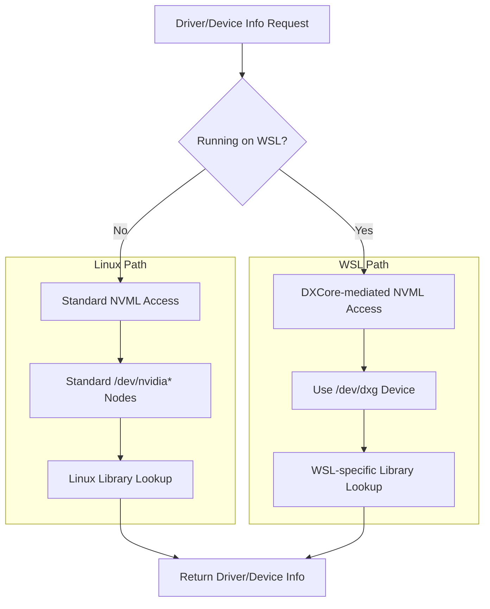

Key differences in the WSL implementation:

1. **Device Access**:
   - Linux: Uses native `/dev/nvidia*` device nodes
   - WSL: Uses the Windows DXG device (`/dev/dxg`)

2. **Library Selection**:
   - Linux: Uses standard library selection based on NVIDIA driver version
   - WSL: Prioritizes libraries in the Windows driver store path

3. **MIG Support**:
   - Linux: Full MIG support
   - WSL: No MIG support

Sources: [src/nvc_info.c:183-205](). [src/nvc_info.c:724-736](). [src/nvc_info.c:513-572]()

## Key Data Structures

### Driver Information Structure

The `nvc_driver_info` structure is the primary container for driver-related information:

```
struct nvc_driver_info {
    char *nvrm_version;          // NVIDIA driver version
    char *cuda_version;          // CUDA version 
    char **bins;                 // Array of binary paths
    size_t nbins;                // Number of binaries
    char **libs;                 // Array of 64-bit library paths
    size_t nlibs;                // Number of 64-bit libraries
    char **libs32;               // Array of 32-bit library paths 
    size_t nlibs32;              // Number of 32-bit libraries
    struct nvc_device_node *devs;// Array of device nodes
    size_t ndevs;                // Number of device nodes
    char **ipcs;                 // Array of IPC sockets
    size_t nipcs;                // Number of IPC sockets
    char **firmwares;            // Array of firmware files
    size_t nfirmwares;           // Number of firmware files
}
```

Sources: [src/nvc_info.c:794-842]()

### Device Information Structure

The `nvc_device_info` structure holds information about all detected GPU devices:

```
struct nvc_device_info {
    size_t ngpus;                // Number of GPUs
    struct nvc_device *gpus;     // Array of GPU information
}

struct nvc_device {
    char *model;                 // Device model name
    char *uuid;                  // Device UUID
    char *busid;                 // Device bus ID
    char *arch;                  // Device architecture
    char *brand;                 // Device brand
    struct nvc_device_node node; // Device node information
    bool mig_capable;            // MIG capability flag
    char *mig_caps_path;         // Path to MIG capabilities
    struct nvc_mig_device_info mig_devices; // MIG device information
}
```

Sources: [src/nvc_info.c:844-904]()

## Integration with NVML

The driver and device information system relies on the NVIDIA Management Library (NVML) for low-level interaction with NVIDIA hardware. This is implemented through a secure RPC mechanism.

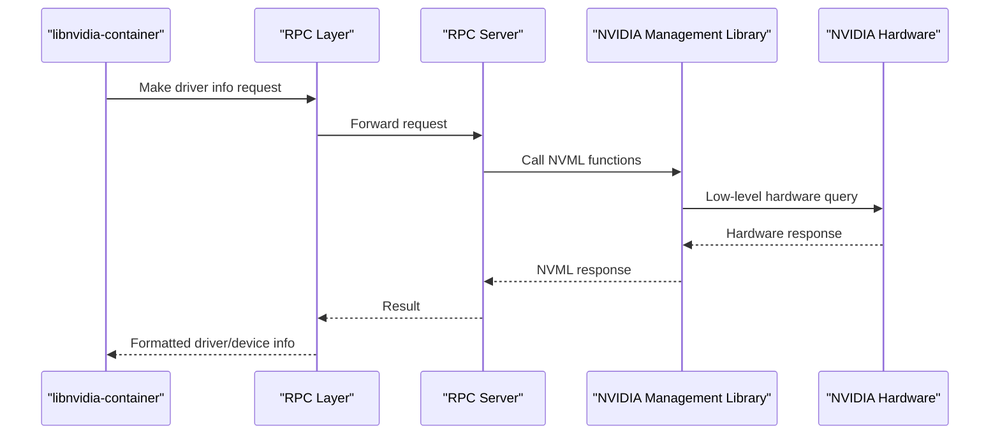

Key security aspects:

1. **Privilege Separation**: The RPC server drops privileges and capabilities to minimize security risks
2. **Chroot**: In container environments, the server changes root to properly interact with the container's view
3. **Capability Management**: The system carefully manages Linux capabilities to provide only required access

Sources: [src/driver.c:69-173](). [src/driver.c:117-166]()

## Conclusion

The Driver and Device Information subsystem provides a secure, comprehensive, and platform-independent way to discover and interact with NVIDIA drivers and GPU devices. It forms the foundation for proper GPU access inside containers by identifying all required components and hardware capabilities.

---

# Page: Container Filesystem Management

# Container Filesystem Management

<details>
<summary>Relevant source files</summary>

The following files were used as context for generating this wiki page:

- [src/common.h](src/common.h)
- [src/nvc_ldcache.c](src/nvc_ldcache.c)
- [src/nvc_mount.c](src/nvc_mount.c)

</details>


## Purpose and Scope

This document details how the NVIDIA Container Toolkit manages filesystems within containers to provide access to NVIDIA GPU resources. It covers the mounting of driver files, device nodes, libraries, and other necessary components to enable GPU acceleration in containerized environments. This document focuses specifically on filesystem operations and does not cover driver and device discovery (see [Driver and Device Information](#2.1)) or container configuration through cgroups (see [Container Configuration](#2.3)).

## Overview

The Container Filesystem Management system enables GPU-accelerated containers by exposing the necessary NVIDIA drivers, libraries, device nodes, and other resources into the container filesystem. It handles mounting these components from the host system into the container while respecting container isolation and security constraints.

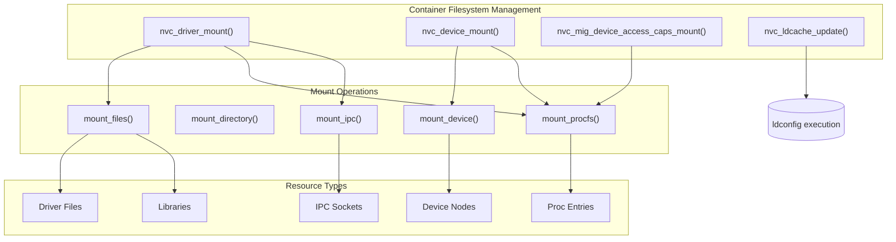

Sources: [src/nvc_mount.c:716-841](), [src/nvc_mount.c:844-865](), [src/nvc_mount.c:868-936](), [src/nvc_ldcache.c:460-536]()

## Core Mount Operations

The filesystem management system provides several mounting mechanisms to handle different types of resources that need to be exposed to containers.

### Mount Function Hierarchy

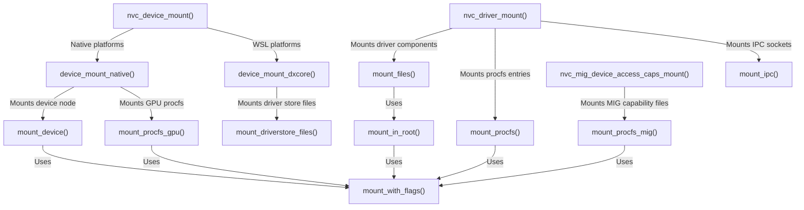

Sources: [src/nvc_mount.c:27-47](), [src/nvc_mount.c:716-841](), [src/nvc_mount.c:844-865](), [src/nvc_mount.c:868-936]()

### Basic Mount Functions

The system uses several low-level mounting functions that form the foundation of the filesystem management:

- `mount_with_flags()`: Performs the actual bind mounting with specified flags
- `mount_in_root()`: Ensures the destination is within container rootfs before mounting
- `mount_directory()`: Mounts a directory into the container
- `unmount()`: Safely unmounts any previously mounted filesystem

These basic functions are used by higher-level functions that focus on specific resource types.

Sources: [src/nvc_mount.c:49-102](), [src/nvc_mount.c:510-517]()

## Driver Mounting

The `nvc_driver_mount` function is the primary entry point for mounting NVIDIA driver components inside a container. It handles:

1. Mounting procfs entries for driver information
2. Setting up application profiles (for graphics libraries)
3. Mounting binary files (commands) and libraries
4. Mounting firmware files
5. Mounting IPC sockets
6. Mounting device nodes

```mermaid
flowchart TD
    start["nvc_driver_mount()"] --> validateContext["Validate context and arguments"]
    validateContext --> enterMntNs["Enter container mount namespace"]
    enterMntNs --> mountProc["Mount procfs (if not WSL)"]
    mountProc --> checkGraphics{"Graphics libraries needed?"}
    
    checkGraphics -->|"Yes"| mountAppProfile["Mount application profile"]
    checkGraphics -->|"No"| mountBins["Mount binary files"]
    mountAppProfile --> mountBins
    
    mountBins --> mountLibs["Mount libraries (primary)"]
    mountLibs --> checkCompat32{"32-bit compatibility?"}
    
    checkCompat32 -->|"Yes"| mountLibs32["Mount 32-bit libraries"]
    checkCompat32 -->|"No"| symlinkLibs["Create library symlinks"]
    mountLibs32 --> symlinkLibs
    
    symlinkLibs --> mountContainerLibs["Mount container-specific libraries"]
    mountContainerLibs --> mountFirmware["Mount firmware files"]
    mountFirmware --> mountIPCs["Mount IPC sockets"]
    mountIPCs --> mountDevices["Mount device nodes"]
    mountDevices --> exitMntNs["Exit mount namespace"]
    exitMntNs --> finish["End"]
```

Sources: [src/nvc_mount.c:716-841]()

### Library Management

Libraries are mounted into the container to provide GPU acceleration capabilities. The system handles:

1. 64-bit libraries in the primary library directory
2. 32-bit libraries for compatibility (when requested)
3. Container-specific libraries
4. Creation of necessary symbolic links for proper library discovery

The file paths for mounting libraries are determined based on the container configuration:

| Library Type | Default Container Path |
|--------------|------------------------|
| 64-bit libraries | `/usr/lib64` |
| 32-bit libraries | `/usr/lib32` or `/usr/lib` |
| Container-specific libraries | Configured by container |

Sources: [src/nvc_mount.c:104-155](), [src/nvc_mount.c:519-563](), [src/common.h:27-59]()

### Library Filtering

The toolkit filters libraries based on version compatibility to prevent unsupported configurations:

```c
/* Filter out any library that matches the major version of RM to prevent running
   into unsupported configurations (e.g. CUDA compat on Geforce or non-LTS drivers) */
```

The `filter_libraries` function examines the library names and versions to ensure only compatible libraries are mounted into the container.

Sources: [src/nvc_mount.c:565-584]()

## Device Mounting

Device nodes are mounted to provide direct access to GPU hardware. The `nvc_device_mount` function handles the platform-specific mounting of device nodes:

1. For native Linux, it uses `device_mount_native` which:
   - Mounts the device node (e.g., `/dev/nvidia0`)
   - Mounts GPU-specific procfs entries
   - Updates application profiles for graphics
   - Sets up device cgroups

2. For Windows Subsystem for Linux (WSL), it uses `device_mount_dxcore` which:
   - Mounts DriverStore components instead of device nodes
   - Relies on `/dev/dxg` for hardware access

```mermaid
flowchart TD
    start["nvc_device_mount()"] --> validateArgs["Validate arguments"]
    validateArgs --> enterNs["Enter container mount namespace"]
    enterNs --> checkPlatform{"Platform?"}
    
    checkPlatform -->|"WSL"| dxcoreMount["device_mount_dxcore()"]
    checkPlatform -->|"Native Linux"| nativeMount["device_mount_native()"]
    
    dxcoreMount --> mountDriverStore["Mount driver store components"]
    
    nativeMount --> checkDevBind{"No device bind?"}
    checkDevBind -->|"No"| mountDev["Mount device node"]
    checkDevBind -->|"Yes"| mountProcfs["Mount procfs GPU entries"]
    mountDev --> mountProcfs
    
    mountProcfs --> checkGraphics{"Graphics libraries?"}
    checkGraphics -->|"Yes"| updateProfile["Update application profile"]
    checkGraphics -->|"No"| checkCgroups{"No cgroups?"}
    updateProfile --> checkCgroups
    
    checkCgroups -->|"No"| setupCgroups["Setup device cgroups"]
    checkCgroups -->|"Yes"| exitNs["Exit mount namespace"]
    setupCgroups --> exitNs
    
    mountDriverStore --> exitNs
    exitNs --> finish["End"]
```

Sources: [src/nvc_mount.c:210-246](), [src/nvc_mount.c:586-651](), [src/nvc_mount.c:844-865]()

## MIG Capability Mounting

For Multi-Instance GPU (MIG) support, additional mounting operations are required to expose MIG capabilities to containers. The system provides several functions:

- `nvc_mig_device_access_caps_mount`: Mounts MIG device access capability files
- `nvc_mig_config_global_caps_mount`: Mounts MIG configuration capability files
- `nvc_mig_monitor_global_caps_mount`: Mounts MIG monitoring capability files
- `nvc_device_mig_caps_mount`: Mounts device-specific MIG capabilities

These functions manage both procfs-based capabilities and device-based capabilities depending on the driver configuration.

Sources: [src/nvc_mount.c:460-508](), [src/nvc_mount.c:868-1098]()

## IPC Socket Mounting

IPC sockets are mounted to enable communication between components within the container and potentially with the host. The system mounts sockets selectively based on the container's requirements:

- Persistenced socket: Mounted only for utility libraries
- Fabricmanager socket: Mounted only for utility libraries
- Other IPC sockets: Mounted for compute libraries

```c
/* Only utility libraries require persistenced or fabricmanager IPC, everything else is compute only */
if (str_has_suffix(NV_PERSISTENCED_SOCKET, info->ipcs[i]) || str_has_suffix(NV_FABRICMANAGER_SOCKET, info->ipcs[i])) {
    if (!(cnt->flags & OPT_UTILITY_LIBS))
        continue;
} else if (!(cnt->flags & OPT_COMPUTE_LIBS))
    continue;
```

Sources: [src/nvc_mount.c:248-277](), [src/nvc_mount.c:796-806]()

## ProcFS Management

The toolkit mounts several procfs entries to provide container access to driver and device information:

1. **Driver procfs entries**: `/proc/driver/nvidia/*` including:
   - `params`: Driver parameters (modified to prevent device node modification)
   - `version`: Driver version information
   - `registry`: Driver registry information

2. **GPU-specific procfs entries**: `/proc/driver/nvidia/gpus/<busid>/*`

3. **MIG-specific procfs entries**: Access files for MIG instances

All procfs mounts are created as read-only to maintain container security.

Sources: [src/nvc_mount.c:349-414](), [src/nvc_mount.c:416-458](), [src/nvc_mount.c:460-508]()

## Library Cache Management

To ensure containerized applications can find the NVIDIA libraries, the system updates the container's LD cache after mounting libraries. This is done through the `nvc_ldcache_update` function, which:

1. Executes the `ldconfig` command within the container context
2. Uses namespace isolation for secure execution
3. Restricts resources and capabilities for the `ldconfig` process
4. Handles both container-provided and host-provided `ldconfig` executables

```mermaid
flowchart TD
    start["nvc_ldcache_update()"] --> validateArgs["Validate arguments"]
    validateArgs --> prepareArgs["Prepare ldconfig arguments"]
    prepareArgs --> checkHostLdconfig{"Host ldconfig?"}
    
    checkHostLdconfig -->|"Yes"| createMemfd["Create virtual copy using memfd"]
    checkHostLdconfig -->|"No"| createProcess["Create isolated process"]
    createMemfd --> createProcess
    
    createProcess --> enterNamespaces["Enter container namespaces"]
    enterNamespaces --> adjustCapabilities["Adjust capabilities"]
    adjustCapabilities --> changeRootfs["Change rootfs"]
    changeRootfs --> limitResources["Limit resources"]
    limitResources --> adjustPrivileges["Adjust privileges"]
    adjustPrivileges --> limitSyscalls["Limit syscalls"]
    limitSyscalls --> execLdconfig["Execute ldconfig"]
    execLdconfig --> waitForCompletion["Wait for completion"]
    waitForCompletion --> finish["End"]
```

Sources: [src/nvc_ldcache.c:460-536]()

## Security Considerations

The filesystem management system implements several security measures:

1. All mounts are created with restrictive flags:
   - Read-only where possible
   - No execution for most mounts
   - No SUID for all mounts

2. Resource limiting during ldconfig execution:
   - CPU time limits
   - Memory limits
   - File descriptor limits
   - File size limits

3. Capability restrictions:
   - Dropping capabilities when not needed
   - Limited capabilities for ldconfig execution

4. Syscall filtering with seccomp (when enabled)

Sources: [src/nvc_mount.c:79-102](), [src/nvc_ldcache.c:239-261](), [src/nvc_ldcache.c:263-365]()

## Integration with Container Runtimes

The Container Filesystem Management system is designed to be invoked by container runtimes through the NVIDIA Container CLI. The workflow typically follows:

1. Container runtime calls `nvidia-container-cli configure`
2. The CLI uses the core library functions:
   - `nvc_driver_mount`: Mounts driver components
   - `nvc_device_mount`: Mounts specific device nodes
   - `nvc_mig_device_access_caps_mount`: Handles MIG capabilities if needed
   - `nvc_ldcache_update`: Updates the LD cache

This design allows container runtimes like Docker, containerd, CRI-O, and others to integrate GPU support with minimal changes to their codebase.

## Windows Subsystem for Linux Support

The system includes special handling for WSL environments:

1. Uses `device_mount_dxcore` instead of `device_mount_native`
2. Mounts driver store components rather than device nodes
3. Skips procfs mounts that aren't applicable to WSL
4. Works with DXCore to access Windows display drivers

In WSL, instead of mounting device nodes directly, the system mounts the required libraries from the Windows driver store and relies on the `/dev/dxg` device for hardware access.

Sources: [src/nvc_mount.c:586-614](), [src/nvc_mount.c:736-747]()

---

# Page: Container Configuration

# Container Configuration

<details>
<summary>Relevant source files</summary>

The following files were used as context for generating this wiki page:

- [src/cgroup.c](src/cgroup.c)
- [src/cgroup.h](src/cgroup.h)
- [src/debug.h](src/debug.h)
- [src/ldcache.h](src/ldcache.h)
- [src/nvc_container.c](src/nvc_container.c)
- [src/options.h](src/options.h)

</details>


## Purpose and Scope

The Container Configuration system in the NVIDIA Container Toolkit provides mechanisms for defining, managing, and controlling how NVIDIA devices and related software components are exposed to containerized applications. This system handles container configuration parameters, cgroup device access control, and compatible library path determination.

This document describes how containers are configured within the libnvidia-container library, including:
- Container configuration structures and options
- Device access controls through cgroups
- Path handling for libraries and binaries

For information about mounting files into containers, see [Container Filesystem Management](#2.2). For driver and device discovery, see [Driver and Device Information](#2.1).

Sources: [src/nvc_container.c](), [src/options.h](), [src/cgroup.h]()

## Container Configuration Architecture

The container configuration system provides the foundation for specifying how NVIDIA components should be exposed to containers. It includes:

1. **Configuration structures** - Core data structures that define container parameters
2. **Option flags** - Control behavior of the container configuration
3. **Cgroup management** - Controls device access permissions
4. **Library path handling** - Determines which libraries to expose to containers

```mermaid
graph TD
    subgraph "Container Configuration System"
        ConfigStructs["Configuration Structures"] --> ContainerConfig["nvc_container_config"]
        ConfigStructs --> NVCContainer["nvc_container"]
        
        OptionFlags["Option Flags"] --> Operational["Operational Modes<br/>OPT_STANDALONE/OPT_SUPERVISED"]
        OptionFlags --> CgroupOpts["Cgroup Options<br/>OPT_NO_CGROUPS"]
        OptionFlags --> LibraryOpts["Library Options<br/>OPT_COMPUTE_LIBS/OPT_UTILITY_LIBS/etc"]
        OptionFlags --> BindingOpts["Binding Options<br/>OPT_NO_DEVBIND"]
        
        CgroupMgmt["Cgroup Management"] --> CgroupVersion["get_device_cgroup_version()"]
        CgroupMgmt --> CgroupPath["find_device_cgroup_path()"]
        CgroupMgmt --> DeviceSetup["setup_device_cgroup()"]
        
        LibPathHandling["Library Path Handling"] --> CompatLibs["find_compat_library_paths()"]
    end
    
    subgraph "External Systems"
        NVCGO["NVCGO Library<br/>(Cgroup Operations)"]
        ContainerRuntime["Container Runtime"]
    end
    
    CgroupMgmt --> NVCGO
    ContainerRuntime --> ConfigStructs
```

Sources: [src/nvc_container.c](), [src/options.h](), [src/cgroup.c]()

## Container Configuration Structures

The container configuration system is built around two primary structures:

1. **`nvc_container_config`** - A lightweight structure containing essential container properties:
   - Process ID (`pid`)
   - Root filesystem path (`rootfs`)

2. **`nvc_container`** - A comprehensive structure that extends the config with additional information:
   - Configuration flags (`flags`)
   - Extended path configuration (bins, libs, libs32, cudart, ldconfig)
   - User and group IDs (`uid`, `gid`)
   - Mount namespace path (`mnt_ns`)
   - Device cgroup information (`dev_cg_version`, `dev_cg`)
   - Compatible libraries (`libs`, `nlibs`)

### Configuration Management Functions

| Function | Purpose |
|----------|---------|
| `nvc_container_config_new()` | Creates a new container configuration |
| `nvc_container_config_free()` | Releases container configuration resources |
| `nvc_container_new()` | Creates a fully configured container structure |
| `nvc_container_free()` | Releases container resources |
| `find_namespace_path()` | Locates container namespace paths |
| `copy_config()` | Transfers configuration from source to container |
| `lookup_owner()` | Determines container's user/group ownership |

Sources: [src/nvc_container.c:28-47](), [src/nvc_container.c:220-297]()

## Container Options

Container behavior is controlled through option flags defined in `options.h`. These options dictate how the container interacts with NVIDIA components.

### Option Categories

1. **Operational Modes**
   - `OPT_SUPERVISED` - Container is monitored by a supervisor process
   - `OPT_STANDALONE` - Container operates independently

2. **Resource Access**
   - `OPT_NO_CGROUPS` - Disables cgroup-based device access control
   - `OPT_NO_DEVBIND` - Prevents device binding in container

3. **Library Controls**
   - `OPT_NO_CNTLIBS` - Prevents container library injection
   - `OPT_UTILITY_LIBS` - Enables utility libraries
   - `OPT_COMPUTE_LIBS` - Enables compute libraries
   - `OPT_NGX_LIBS` - Enables NGX libraries
   - `OPT_VIDEO_LIBS` - Enables video encoding/decoding libraries
   - `OPT_GRAPHICS_LIBS` - Enables graphics libraries

4. **Display and Binary Controls**
   - `OPT_DISPLAY` - Enables display capability
   - `OPT_UTILITY_BINS` - Enables utility binaries
   - `OPT_COMPUTE_BINS` - Enables compute binaries
   - `OPT_COMPAT32` - Enables 32-bit compatibility (except on PowerPC)

The default container options are: `standalone no-cgroups no-devbind utility`

```mermaid
flowchart TD
    subgraph "Container Options Flags"
        direction LR
        Options["Container Options"] --> OperationalModes
        Options --> ResourceAccess
        Options --> LibraryControls
        Options --> DisplayBinaryControls
        
        subgraph "Operational Modes"
            direction TB
            OPT_SUPERVISED["OPT_SUPERVISED<br/>(1 << 0)"]
            OPT_STANDALONE["OPT_STANDALONE<br/>(1 << 1)"]
        end
        
        subgraph "Resource Access"
            direction TB
            OPT_NO_CGROUPS["OPT_NO_CGROUPS<br/>(1 << 2)"]
            OPT_NO_DEVBIND["OPT_NO_DEVBIND<br/>(1 << 3)"]
        end
        
        subgraph "Library Controls"
            direction TB
            OPT_NO_CNTLIBS["OPT_NO_CNTLIBS<br/>(1 << 4)"]
            OPT_UTILITY_LIBS["OPT_UTILITY_LIBS<br/>(1 << 5)"]
            OPT_COMPUTE_LIBS["OPT_COMPUTE_LIBS<br/>(1 << 6)"]
            OPT_NGX_LIBS["OPT_NGX_LIBS<br/>(1 << 7)"]
            OPT_VIDEO_LIBS["OPT_VIDEO_LIBS<br/>(1 << 8)"]
            OPT_GRAPHICS_LIBS["OPT_GRAPHICS_LIBS<br/>(1 << 9)"]
        end
        
        subgraph "Display Binary Controls"
            direction TB
            OPT_DISPLAY["OPT_DISPLAY<br/>(1 << 10)"]
            OPT_UTILITY_BINS["OPT_UTILITY_BINS<br/>(1 << 11)"]
            OPT_COMPUTE_BINS["OPT_COMPUTE_BINS<br/>(1 << 12)"]
            OPT_COMPAT32["OPT_COMPAT32<br/>(1 << 13)"]
        end
    end
```

Sources: [src/options.h:59-77](), [src/options.h:80-95]()

## Container Creation and Configuration Process

The container creation process involves several steps to properly configure a container for NVIDIA GPU access:

1. **Create container configuration** - Initialize basic container parameters (PID, rootfs)
2. **Parse container options** - Process options string into flags
3. **Copy and resolve paths** - Determine actual filesystem paths in the container
4. **Lookup container owner** - Identify the UID/GID for the container
5. **Find library paths** - Locate compatible libraries if needed
6. **Determine namespace path** - Find the mount namespace for the container
7. **Setup cgroup access** - Configure device cgroup if enabled

```mermaid
sequenceDiagram
    participant Client
    participant ContainerConfig as "nvc_container_config"
    participant Container as "nvc_container"
    participant Options as "options_parse()"
    participant CopyConfig as "copy_config()"
    participant LookupOwner as "lookup_owner()"
    participant FindLibs as "find_compat_library_paths()"
    participant FindNS as "find_namespace_path()"
    participant FindCgroup as "find_device_cgroup_path()"
    
    Client->>ContainerConfig: nvc_container_config_new(pid, rootfs)
    Client->>Container: nvc_container_new(ctx, cfg, opts)
    Container->>Options: options_parse(opts, container_opts)
    Note over Options: Convert option string to flags
    Container->>CopyConfig: copy_config(cnt, cfg)
    Note over CopyConfig: Set paths for libraries and binaries
    Container->>LookupOwner: lookup_owner(cnt)
    Note over LookupOwner: Determine UID/GID of container
    Container->>FindLibs: find_compat_library_paths(cnt)
    Note over FindLibs: Find compatible libraries if needed
    Container->>FindNS: find_namespace_path(cnt, "mnt")
    Note over FindNS: Locate mount namespace
    Container->>FindCgroup: find_device_cgroup_path(cnt)
    Note over FindCgroup: Find device cgroup path if enabled
    Client->>Client: Container ready for use
```

Sources: [src/nvc_container.c:220-280](), [src/nvc_container.c:119-218](), [src/nvc_container.c:60-100]()

## Cgroup Management

The cgroup management system is responsible for controlling device access within containers. It uses the NVCGO library through RPC calls to interact with the Linux cgroup filesystem.

### Cgroup Version Detection

The toolkit automatically detects the cgroup version (v1 or v2) used by the host system:

1. `get_device_cgroup_version()` - Determines cgroup version through RPC to NVCGO
2. This determines which cgroup APIs will be used for subsequent operations

### Cgroup Path Determination

For proper device access control, the system must find the correct cgroup path:

1. `find_device_cgroup_path()` - Locates the device cgroup path for the container
2. For standalone containers, uses the container's PID
3. For supervised containers, uses the parent process's PID

### Device Access Control

When a device needs to be exposed to a container:

1. `setup_device_cgroup()` - Adds device access rules to the container's cgroup
2. Creates appropriate device rules based on device major/minor numbers
3. Applies rules to allow read/write access to specific devices

```mermaid
graph TD
    subgraph "CGroup Management System"
        GetVersion["get_device_cgroup_version()<br/>(cgroup.c)"] --> DetectVersion["Detect cgroup version<br/>(v1 or v2)"]
        FindPath["find_device_cgroup_path()<br/>(cgroup.c)"] --> LocatePath["Locate container's<br/>device cgroup path"]
        SetupDevice["setup_device_cgroup()<br/>(cgroup.c)"] --> AddRule["Add device access rules<br/>to container's cgroup"]
    end
    
    subgraph "NVCGO Interface"
        RPCGetVersion["nvcgo_get_device_cgroup_version_1_svc()"]
        RPCFindPath["nvcgo_find_device_cgroup_path_1_svc()"]
        RPCSetupDevice["nvcgo_setup_device_cgroup_1_svc()"]
    end
    
    GetVersion --> RPCGetVersion
    FindPath --> RPCFindPath
    SetupDevice --> RPCSetupDevice
    
    RPCGetVersion --> GetDeviceCGroupVersion["GetDeviceCGroupVersion()"]
    RPCFindPath --> GetDeviceCGroupMountPath["GetDeviceCGroupMountPath()"]
    RPCFindPath --> GetDeviceCGroupRootPath["GetDeviceCGroupRootPath()"]
    RPCSetupDevice --> AddDeviceRules["AddDeviceRules()"]
```

Sources: [src/cgroup.c:28-44](), [src/cgroup.c:85-103](), [src/cgroup.c:165-179]()

## Library Path Management

The container configuration system includes mechanisms for finding and managing library paths within containers.

### Compatible Library Path Detection

For CUDA runtime compatibility, the system locates appropriate libraries:

1. `find_compat_library_paths()` - Finds compatible libraries in the container
2. Only runs if `OPT_COMPUTE_LIBS` flag is set
3. Searches for compatibility libraries in the container's CUDA runtime directory
4. Stores found libraries in the container structure for later mounting

### Path Resolution

The system resolves paths in the container context:

1. **Standalone mode** - Paths are resolved relative to the container's rootfs
2. **Supervised mode** - Paths are resolved through process root references

### Library Directory Detection

To accommodate different Linux distributions, the system automatically detects:

1. **Multiarch support** - Checks for Debian-style multiarch directories
2. **Standard directories** - Falls back to common library paths
3. **32-bit compatibility** - Detects 32-bit library locations based on distribution

Sources: [src/nvc_container.c:60-100](), [src/nvc_container.c:119-218]()

## Integration with Container Lifecycle

The container configuration integrates with the broader container toolkit lifecycle:

1. **Container Creation** - Configure container parameters through `nvc_container_new()`
2. **Device Setup** - Configure device access through cgroups
3. **Filesystem Mounting** - Use container configuration for mounting driver components
4. **Library Resolution** - Use configured paths to locate and mount libraries
5. **Cleanup** - Release resources with `nvc_container_free()`

```mermaid
graph TD
    subgraph "Container Lifecycle"
        Create["Container Creation<br/>nvc_container_new()"] --> Config["Container Configuration<br/>copy_config()"]
        Config --> CgroupSetup["CGroup Setup<br/>find_device_cgroup_path()"]
        Config --> LibConfig["Library Configuration<br/>find_compat_library_paths()"]
        CgroupSetup --> DeviceAccess["Device Access Control<br/>setup_device_cgroup()"]
        LibConfig --> MountFS["Filesystem Mounting<br/>(See Container Filesystem Management)"]
        DeviceAccess --> MountFS
        MountFS --> Cleanup["Cleanup<br/>nvc_container_free()"]
    end
    
    subgraph "External Components"
        Driver["Driver Information<br/>(See Driver and Device Information)"]
        DeviceInfo["Device Information<br/>(See Driver and Device Information)"]
        CLI["nvidia-container-cli<br/>(See Command-Line Interface)"]
    end
    
    Driver --> Create
    DeviceInfo --> Create
    CLI --> Create
    Cleanup --> CLI
```

Sources: [src/nvc_container.c:220-280](), [src/nvc_container.c:282-297]()

## Default Configuration Behavior

The default container configuration behavior is defined by `default_container_opts` in [src/options.h:95]():

```
standalone no-cgroups no-devbind utility
```

This means:
- Container operates in standalone mode
- No cgroup-based device access control is used
- No device binding is performed
- Utility libraries and binaries are included

To override this default, applications can provide custom options when calling `nvc_container_new()`.

Sources: [src/options.h:95](), [src/nvc_container.c:232-234]()

---

# Page: Command-Line Interface

# Command-Line Interface

<details>
<summary>Relevant source files</summary>

The following files were used as context for generating this wiki page:

- [src/cli/cli.h](src/cli/cli.h)
- [src/cli/common.c](src/cli/common.c)
- [src/cli/configure.c](src/cli/configure.c)
- [src/cli/info.c](src/cli/info.c)
- [src/cli/list.c](src/cli/list.c)
- [src/cli/main.c](src/cli/main.c)

</details>


The NVIDIA Container Toolkit provides a command-line interface (CLI) tool called `nvidia-container-cli` that enables users to configure Linux containers with NVIDIA GPU support. This page documents the CLI command structure, options, and usage patterns. For information about the underlying library implementation, see [Core Library Internals](#5).

## Overview

The `nvidia-container-cli` tool is the primary user interface for the NVIDIA Container Toolkit. It provides commands to:
1. Query driver and device information
2. List required driver components
3. Configure containers with GPU access

The CLI is designed to be container-runtime agnostic and is typically invoked by container runtimes (like Docker or containerd) via the integration hook.

```mermaid
flowchart TD
    subgraph "Container Runtime"
        CR["Container Runtime\n(Docker/Containerd/etc.)"]
    end
    
    subgraph "NVIDIA Container Toolkit"
        Hook["Integration Hook"]
        CLI["nvidia-container-cli"]
        Library["libnvidia-container"]
    end
    
    subgraph "System Resources"
        Driver["NVIDIA Driver"]
        GPUs["NVIDIA GPUs"]
    end
    
    CR --> Hook
    Hook --> CLI
    CLI --> Library
    Library --> Driver
    Library --> GPUs
```

Sources: [src/cli/main.c:138-159]()

## Command Structure

The CLI provides a hierarchical command structure with global options and command-specific options:

```mermaid
flowchart TD
    CLI["nvidia-container-cli"] --> GlobalOpts["Global Options"]
    CLI --> Commands["Commands"]
    
    Commands --> Info["info\nQuery driver & device info"]
    Commands --> List["list\nList driver components"]
    Commands --> Configure["configure\nSetup container GPU access"]
    
    Info --> InfoOpts["Info Options"]
    List --> ListOpts["List Options"]
    Configure --> ConfigOpts["Configure Options"]
```

Sources: [src/cli/main.c:26-48](), [src/cli/main.c:50-54]()

### Global Options

The following options apply to all commands:

| Option | Short | Argument | Description |
|--------|-------|----------|-------------|
| `--debug` | `-d` | FILE | Log debug information to FILE |
| `--load-kmods` | `-k` | | Load kernel modules |
| `--no-pivot` | `-n` | | Do not use pivot_root |
| `--user` | `-u` | UID[:GID] | User and group for privilege separation |
| `--root` | `-r` | PATH | Path to the driver root directory |
| `--ldcache` | `-l` | FILE | Path to the system's DSO cache |
| `--no-create-imex-channels` | | | Don't create IMEX channel device nodes |

Sources: [src/cli/main.c:26-36]()

## Commands

### info

The `info` command queries the driver and reports information about the driver and detected devices.

#### Usage

```
nvidia-container-cli info [OPTIONS]
```

#### Options

| Option | Description |
|--------|-------------|
| `--csv` | Output in CSV format |

#### Output

The command displays:
- NVIDIA driver version
- CUDA version
- List of detected GPU devices with:
  - Device index
  - Device minor number
  - Model
  - Brand
  - GPU UUID
  - Bus location
  - Architecture

Sources: [src/cli/info.c:15-27](), [src/cli/info.c:96-109]()

### list

The `list` command queries the driver and lists the components required to configure a container with GPU support.

#### Usage

```
nvidia-container-cli list [OPTIONS]
```

#### Options

| Option | Short | Argument | Description |
|--------|-------|----------|-------------|
| `--device` | `-d` | ID | Device UUID(s) or index(es) to list |
| `--libraries` | `-l` | | List driver libraries |
| `--binaries` | `-b` | | List driver binaries |
| `--ipcs` | `-i` | | List driver IPCs |
| `--firmwares` | `-f` | | List driver firmwares |
| `--compat32` | | | Enable 32-bit compatibility |
| `--mig-config` | | ID | MIG devices to list config capabilities files for |
| `--mig-monitor` | | ID | MIG devices to list monitor capabilities files for |
| `--imex-channel` | | CHANNEL | IMEX channel ID(s) to inject |
| `--no-persistenced` | | | Don't include the NVIDIA persistenced socket |
| `--no-fabricmanager` | | | Don't include the NVIDIA fabricmanager socket |
| `--no-gsp-firmware` | | | Don't include GSP Firmware |
| `--no-cntlibs` | | | Don't overwrite host mounts with CUDA compat libs |

When run without arguments, it defaults to listing all components for all devices.

Sources: [src/cli/list.c:13-37](), [src/cli/list.c:117-290]()

### configure

The `configure` command sets up a container with NVIDIA GPU support by exposing device drivers to it.

#### Usage

```
nvidia-container-cli configure [OPTIONS] ROOTFS
```

#### Options

| Option | Short | Argument | Description |
|--------|-------|----------|-------------|
| `--pid` | `-p` | PID | Container PID |
| `--device` | `-d` | ID | Device UUID(s) or index(es) to isolate |
| `--require` | `-r` | EXPR | Check container requirements |
| `--ldconfig` | `-l` | PATH | Path to the ldconfig binary |
| `--compute` | `-c` | | Enable compute capability |
| `--utility` | `-u` | | Enable utility capability |
| `--video` | `-v` | | Enable video capability |
| `--graphics` | `-g` | | Enable graphics capability |
| `--display` | `-D` | | Enable display capability |
| `--ngx` | `-n` | | Enable NGX capability |
| `--compat32` | | | Enable 32-bit compatibility |
| `--mig-config` | | ID | Enable configuration of MIG devices |
| `--mig-monitor` | | ID | Enable monitoring of MIG devices |
| `--imex-channel` | | CHANNEL | IMEX channel ID(s) to inject |
| `--no-cgroups` | | | Don't use cgroup enforcement |
| `--no-devbind` | | | Don't bind mount devices |
| `--no-persistenced` | | | Don't include the NVIDIA persistenced socket |
| `--no-fabricmanager` | | | Don't include the NVIDIA fabricmanager socket |
| `--no-gsp-firmware` | | | Don't include GSP Firmware |
| `--no-cntlibs` | | | Don't overwrite host mounts with CUDA compat libs |

Sources: [src/cli/configure.c:17-51](), [src/cli/configure.c:250-473]()

## Device Selection

The CLI supports specifying GPU devices in multiple formats:

```mermaid
flowchart TD
    Device["Device Specification"] --> UUID["GPU UUID\ne.g., GPU-xxxxxxxx-xxxx-xxxx-xxxx-xxxxxxxxxxxx"]
    Device --> PCI["PCI Bus ID\ne.g., 0000:01:00.0"]
    Device --> Index["Device Index\ne.g., 0, 1, 2, ..."]
    Device --> All["All Devices\nSpecified as 'all'"]
    
    MIG["MIG Device Specification"] --> MIGUUID["MIG UUID\ne.g., MIG-xxxxxxxx-xxxx-xxxx-xxxx-xxxxxxxxxxxx"]
    MIG --> MIGIndex["MIG Index\ne.g., 0:1 (GPU 0, MIG instance 1)"]
```

Sources: [src/cli/common.c:158-324]()

### GPU Device Selection

The toolkit identifies GPU devices using one of the following methods:

1. **GPU UUID**: Formatted as `GPU-xxxxxxxx-xxxx-xxxx-xxxx-xxxxxxxxxxxx`
2. **PCI Bus ID**: Formatted as `domain:bus:device.0` (e.g., `0000:01:00.0`)
3. **Device Index**: A numeric index (e.g., `0`, `1`, `2`, etc.)
4. **All devices**: Specified using the keyword `all`

Multiple devices can be specified as a comma-separated list.

Sources: [src/cli/common.c:158-214]()

### MIG Device Selection

For systems with Multi-Instance GPU (MIG) capability, MIG devices can be specified:

1. **MIG UUID**: Formatted as `MIG-xxxxxxxx-xxxx-xxxx-xxxx-xxxxxxxxxxxx`
2. **MIG Index**: Using the format `<GPU_idx>:<MIG_idx>` (e.g., `0:1` for the second MIG instance on the first GPU)

Sources: [src/cli/common.c:216-274]()

## Usage Examples

### Querying Driver and Device Information

```bash
# Display driver and device information
nvidia-container-cli info

# Output in CSV format
nvidia-container-cli info --csv
```

### Listing Required Components

```bash
# List all components for all devices
nvidia-container-cli list

# List libraries for a specific GPU
nvidia-container-cli list -d GPU-xxxxxxxx-xxxx-xxxx-xxxx-xxxxxxxxxxxx -l

# List all libraries and binaries
nvidia-container-cli list -l -b
```

### Configuring a Container

```bash
# Configure a container with all available GPUs and compute capability
nvidia-container-cli configure -c /path/to/rootfs

# Configure with specific GPU by index, enabling compute and utility capabilities
nvidia-container-cli configure -d 0 -c -u /path/to/rootfs

# Configure with specific GPU by UUID, enabling graphics capability
nvidia-container-cli configure -d GPU-xxxxxxxx-xxxx-xxxx-xxxx-xxxxxxxxxxxx -g /path/to/rootfs

# Configure with specific MIG instance
nvidia-container-cli configure -d MIG-xxxxxxxx-xxxx-xxxx-xxxx-xxxxxxxxxxxx -c /path/to/rootfs
```

## Internal Command Flow

The CLI follows this execution flow when processing commands:

```mermaid
sequenceDiagram
    participant CLI as nvidia-container-cli
    participant LibNVC as libnvidia-container
    participant System as System Resources
    
    CLI->>CLI: Parse global options
    CLI->>CLI: Parse command and arguments
    
    alt info command
        CLI->>LibNVC: Initialize library context
        LibNVC->>System: Query driver information
        LibNVC->>System: Query device information
        LibNVC-->>CLI: Return information
        CLI->>CLI: Format and display output
    else list command
        CLI->>LibNVC: Initialize library context
        LibNVC->>System: Query driver information
        LibNVC->>System: Query device information
        CLI->>CLI: Parse device specifications
        CLI->>CLI: Select specified devices
        CLI->>CLI: Display requested components
    else configure command
        CLI->>LibNVC: Initialize library context
        LibNVC->>System: Query driver information
        LibNVC->>System: Query device information
        CLI->>CLI: Parse device specifications 
        CLI->>CLI: Select specified devices
        CLI->>CLI: Check container requirements
        CLI->>LibNVC: Mount driver components
        CLI->>LibNVC: Mount device nodes
        CLI->>LibNVC: Configure capabilities
        CLI->>LibNVC: Update container ldcache
    end
    
    CLI->>LibNVC: Shutdown library
```

Sources: [src/cli/main.c:138-159](), [src/cli/info.c:45-124](), [src/cli/list.c:117-307](), [src/cli/configure.c:250-473]()

## Error Handling

The CLI follows standard Unix conventions for error reporting:
- Successful operations return exit code 0
- Error conditions return non-zero exit codes
- Error messages are printed to stderr
- When parsing fails, usage information is displayed

Sources: [src/cli/main.c:134-137](), [src/cli/configure.c:201-203](), [src/cli/list.c:112-114]()

---

# Page: Building and Packaging

# Building and Packaging

<details>
<summary>Relevant source files</summary>

The following files were used as context for generating this wiki page:

- [Makefile](Makefile)
- [mk/Dockerfile.centos](mk/Dockerfile.centos)
- [mk/docker.mk](mk/docker.mk)

</details>


This document provides a comprehensive overview of the build system and package generation process for libnvidia-container. It covers building from source, Docker-based builds, and packaging for various Linux distributions. For information about installing and using the packages, see [Command-Line Interface](#3).

## 1. Build System Overview

The libnvidia-container build system is designed to compile the core library and CLI tool across multiple Linux distributions and architectures. It uses GNU Make as the primary build tool and supports Docker-based builds for cross-platform compatibility.

```mermaid
graph TD
    subgraph "Build Components"
        MakefileRoot["Makefile"]
        DockerMk["mk/docker.mk"]
        CommonMk["mk/common.mk"]
        Dockerfiles["Dockerfiles"]
    end
    
    subgraph "Build Targets"
        LibShared["Shared Library (libnvidia-container.so)"]
        LibStatic["Static Library (libnvidia-container.a)"]
        CLI["CLI Tool (nvidia-container-cli)"]
    end
    
    subgraph "Package Generation"
        DEBGen["DEB Packaging (dch, debuild)"]
        RPMGen["RPM Packaging (rpmbuild)"]
    end
    
    MakefileRoot --> LibShared
    MakefileRoot --> LibStatic
    MakefileRoot --> CLI
    MakefileRoot --> DockerMk
    
    DockerMk --> Dockerfiles
    Dockerfiles --> DEBGen
    Dockerfiles --> RPMGen
    
    LibShared --> DEBGen
    LibShared --> RPMGen
    LibStatic --> DEBGen
    LibStatic --> RPMGen
    CLI --> DEBGen
    CLI --> RPMGen
```

Sources: [Makefile:15-16](), [Makefile:102-130](), [mk/docker.mk:16-21]()

### 1.1 Key Build Components

The build system consists of several key components:

| Component | Path | Purpose |
|-----------|------|---------|
| Main Makefile | `Makefile` | Defines core build targets and rules |
| Docker Makefile | `mk/docker.mk` | Defines Docker-based build system for cross-platform support |
| Dockerfiles | `mk/Dockerfile.*` | Container definitions for each supported OS |
| Package Definitions | `pkg/deb`, `pkg/rpm` | Packaging specifications for DEB and RPM |

Sources: [Makefile:39-40](), [mk/docker.mk:105]()

## 2. Building from Source

### 2.1 Build Prerequisites

The following dependencies are required for building:

- C compiler (gcc or compatible)
- GNU Make
- pkg-config
- libcap-dev
- libseccomp-dev (optional)
- NVIDIA driver utilities (nvidia-modprobe)

Additional dependencies may be needed depending on build options:
- elftoolchain or libelf
- libtirpc
- golang (when building with NVCGO support)

Sources: [mk/Dockerfile.centos:23-38]()

### 2.2 Build Options

libnvidia-container supports several build options that can be enabled or disabled:

| Option | Default | Description |
|--------|---------|-------------|
| WITH_NVCGO | yes | Enable NVCGO support for modern cgroup handling |
| WITH_LIBELF | no | Use system libelf instead of building elftoolchain |
| WITH_TIRPC | no | Enable TI-RPC support (required for some distros) |
| WITH_SECCOMP | yes | Enable seccomp support for improved security |

Sources: [Makefile:20-23](), [mk/docker.mk:21-24]()

### 2.3 Basic Build Commands

To build the entire project:

```bash
make
```

To build specific components:

```bash
make shared  # Build shared library only
make static  # Build static library only
make tools   # Build CLI tool only
```

To install to the system:

```bash
make install
```

Sources: [Makefile:242-243](), [Makefile:250-254](), [Makefile:269-290]()

## 3. Docker-based Builds

The project includes a Docker-based build system that creates packages for multiple Linux distributions and architectures without requiring native build environments.

```mermaid
graph TD
    subgraph "Docker Build Process"
        DockerMk["mk/docker.mk"]
        Dockerfile["mk/Dockerfile.{os}"]
        BuildImage["docker build"]
        RunContainer["docker run"]
        Artifacts["Package Artifacts"]
    end
    
    subgraph "Supported Platforms"
        DebianBased["Ubuntu/Debian"]
        RPMBased["CentOS/RHEL/Amazon Linux/OpenSUSE"]
    end
    
    subgraph "Architectures"
        AMD64["amd64/x86_64"]
        ARM64["arm64/aarch64"]
        PPC64LE["ppc64le"]
    end
    
    DockerMk --> Dockerfile
    Dockerfile --> BuildImage
    BuildImage --> RunContainer
    RunContainer --> Artifacts
    
    DebianBased --- AMD64
    DebianBased --- ARM64
    DebianBased --- PPC64LE
    
    RPMBased --- AMD64
    RPMBased --- ARM64
    RPMBased --- PPC64LE
```

Sources: [mk/docker.mk:37-95](), [mk/docker.mk:149-179]()

### 3.1 Supported Platforms

The Docker build system supports the following platforms:

#### 3.1.1 x86_64/amd64
- Ubuntu: 16.04, 18.04, 20.04
- Debian: 9, 10
- CentOS: 7, 8
- RHEL: 7, 8
- Amazon Linux: 2
- OpenSUSE Leap: 15.1

#### 3.1.2 ppc64le
- Ubuntu: 16.04, 18.04
- CentOS: 7, 8
- RHEL: 7, 8

#### 3.1.3 arm64/aarch64
- Ubuntu: 18.04
- CentOS: 7, 8
- RHEL: 7, 8
- Amazon Linux: 2

Sources: [mk/docker.mk:37-41]()

### 3.2 Running Docker Builds

To build for a specific platform:

```bash
make ubuntu18.04                 # Build for Ubuntu 18.04 on native architecture
make ubuntu18.04-amd64           # Build for Ubuntu 18.04 on amd64
make centos7-ppc64le             # Build for CentOS 7 on ppc64le
```

To build for all supported platforms:

```bash
make docker-all
```

Sources: [mk/docker.mk:47-58](), [mk/docker.mk:93-95]()

## 4. Packaging System

The packaging system generates distribution-specific packages (DEB and RPM) that can be installed on target systems.

```mermaid
graph TD
    subgraph "Building"
        LibraryBuild["Library Build"]
        CLIBuild["CLI Build"]
    end
    
    subgraph "Packaging"
        DEBProcess[".deb Generation (debuild)"]
        RPMProcess[".rpm Generation (rpmbuild)"]
    end
    
    subgraph "Distribution"
        DebPackages["DEB Packages:
                    - libnvidia-container1
                    - libnvidia-container-dev
                    - libnvidia-container-tools"]
        
        RpmPackages["RPM Packages:
                    - libnvidia-container1
                    - libnvidia-container-devel
                    - libnvidia-container-tools"]
    end
    
    LibraryBuild --> DEBProcess
    LibraryBuild --> RPMProcess
    CLIBuild --> DEBProcess
    CLIBuild --> RPMProcess
    
    DEBProcess --> DebPackages
    RPMProcess --> RpmPackages
```

Sources: [Makefile:337-351](), [Makefile:353-368]()

### 4.1 DEB Packaging (Ubuntu/Debian)

The DEB packaging process uses `debuild` to create packages for Debian-based distributions:

1. The source is built using the main Makefile
2. Package metadata is created using the `dch` tool
3. Packages are built using `debuild`

To build DEB packages:

```bash
make deb
```

Sources: [Makefile:337-351]()

### 4.2 RPM Packaging (CentOS/RHEL/Amazon Linux/OpenSUSE)

The RPM packaging process uses `rpmbuild` to create packages for RPM-based distributions:

1. The source is built using the main Makefile
2. Spec files are prepared with appropriate version information
3. Packages are built using `rpmbuild`

To build RPM packages:

```bash
make rpm
```

Sources: [Makefile:353-368]()

## 5. Build Artifacts

The build process generates the following key artifacts:

| Artifact | Description |
|----------|-------------|
| libnvidia-container.so.{version} | Main shared library |
| libnvidia-container.a | Static library |
| libnvidia-container-go.so.{version} | Go bindings library (if enabled) |
| nvidia-container-cli | Command-line utility |
| libnvidia-container.pc | pkg-config file |

For DEB packages:
- libnvidia-container1 - Runtime library
- libnvidia-container-dev - Development files
- libnvidia-container-tools - CLI tools

For RPM packages:
- libnvidia-container1 - Runtime library
- libnvidia-container-devel - Development files
- libnvidia-container-tools - CLI tools

Sources: [Makefile:123-134](), [Makefile:272-290]()

## 6. Continuous Integration and Testing

The build system includes verification targets that can run basic functionality tests to ensure the built components work correctly:

```bash
make ubuntu18.04-verify
```

This runs a minimal sanity check that verifies the built packages can successfully interact with NVIDIA GPUs on the host system.

Sources: [mk/docker.mk:110-121](), [mk/docker.mk:180-187]()

---

# Page: RPM Packaging

# RPM Packaging

<details>
<summary>Relevant source files</summary>

The following files were used as context for generating this wiki page:

- [pkg/rpm/SPECS/libnvidia-container.spec](pkg/rpm/SPECS/libnvidia-container.spec)

</details>


This document details the RPM packaging process and specifications for the NVIDIA Container Toolkit's libnvidia-container library. It covers the structure of the RPM packages, the spec file configuration, and how the library is packaged for RPM-based Linux distributions like CentOS, RHEL, and Fedora. For information about Debian packaging, see [Debian Packaging](#4.2).

## Package Structure Overview

The libnvidia-container RPM packaging system produces multiple packages to separate runtime dependencies from development tools and debugging information, allowing users to install only what they need.

```mermaid
graph TD
    subgraph "RPM Packages"
        core["libnvidia-container{major}"]
        devel["libnvidia-container-devel"]
        static["libnvidia-container-static"]
        debug["libnvidia-container{major}-debuginfo"]
        tools["libnvidia-container-tools"]
        libsec["libnvidia-container-libseccomp2"]
    end

    devel -->|"requires"| core
    static -->|"requires"| devel
    debug -->|"requires"| core
    tools -->|"requires"| core
    libsec -->|"provides"| libseccomp["libseccomp.so"]
```

Sources: [pkg/rpm/SPECS/libnvidia-container.spec:30-108]()

## Spec File Structure

The RPM spec file defines how the packages are built, their dependencies, contents, and installation processes.

### Basic Package Information

The spec file begins with metadata about the package, including:

- Package name: libnvidia-container
- License information: Multiple licenses (BSD-3-Clause, Apache-2.0, GPL-3.0-or-later, LGPL-3.0-or-later, MIT, GPL-2.0-only)
- Vendor and maintainer information
- Build requirements
- Version and release information

Sources: [pkg/rpm/SPECS/libnvidia-container.spec:1-25]()

### Package Definitions

The spec file defines six distinct packages:

1. **libnvidia-container{major}** - Core runtime library
2. **libnvidia-container-devel** - Development files (headers, pkg-config)
3. **libnvidia-container-static** - Static library for statically linked applications
4. **libnvidia-container{major}-debuginfo** - Debugging symbols
5. **libnvidia-container-tools** - Command-line utilities
6. **libnvidia-container-libseccomp2** - Virtual package for libseccomp dependency

Each package definition includes:
- Summary description
- Package dependencies
- File listings
- Pre/post installation scripts if needed

Sources: [pkg/rpm/SPECS/libnvidia-container.spec:30-108]()

```mermaid
classDiagram
    class SpecFile {
        +metadata
        +package_definitions
        +install_script
        +changelog
    }
    
    class CoreLibrary {
        +libdir/lib*.so.*
        +requires: NVIDIA driver (>= 340.29)
        +post: ldconfig
        +postun: ldconfig
    }
    
    class DevelopmentFiles {
        +includedir/*.h
        +libdir/lib*.so
        +libdir/pkgconfig/*.pc
        +requires: CoreLibrary
    }
    
    class StaticLibrary {
        +libdir/lib*.a
        +requires: DevelopmentFiles
    }
    
    class DebugInfo {
        +prefix/lib/debug/libdir/lib*.so.*
        +requires: CoreLibrary
    }
    
    class Tools {
        +bindir/*
        +requires: CoreLibrary
    }
    
    class LibSeccomp {
        +provides: libseccomp.so
        +conflicts: libseccomp.so
        +requires: libseccomp2
    }
    
    SpecFile --> CoreLibrary
    SpecFile --> DevelopmentFiles
    SpecFile --> StaticLibrary
    SpecFile --> DebugInfo
    SpecFile --> Tools
    SpecFile --> LibSeccomp
```

Sources: [pkg/rpm/SPECS/libnvidia-container.spec:30-108]()

## Installation Process

The installation process is defined in the `%install` section, which specifies how the files should be installed into the RPM build root directory. The libnvidia-container installation uses the project's Makefile to handle the installation with the appropriate directory structures.

```
DESTDIR=%{buildroot} %{__make} install prefix=%{_prefix} exec_prefix=%{_exec_prefix} bindir=%{_bindir} libdir=%{_libdir} includedir=%{_includedir} docdir=%{_licensedir}
```

This command installs the compiled files to the correct locations within the build root, which will then be packaged into the respective RPM packages.

Sources: [pkg/rpm/SPECS/libnvidia-container.spec:27-28]()

## Package Contents and Dependencies

### Core Library Package

The core library package (`libnvidia-container%{_major}`) contains the shared library files:

| Content | Description |
|---------|-------------|
| `%{_libdir}/lib*.so.*` | Shared library files |
| `%{_licensedir}/*` | License files |

It requires NVIDIA drivers (>= 340.29) to be installed separately.

Post-installation and post-uninstallation scripts run `ldconfig` to update the shared library cache.

Sources: [pkg/rpm/SPECS/libnvidia-container.spec:30-42]()

### Development Package

The development package (`libnvidia-container-devel`) contains files needed for developing applications that use the library:

| Content | Description |
|---------|-------------|
| `%{_includedir}/*.h` | Header files |
| `%{_libdir}/lib*.so` | Symbolic links to the shared libraries |
| `%{_libdir}/pkgconfig/*.pc` | pkg-config files |

This package depends on the core library package.

Sources: [pkg/rpm/SPECS/libnvidia-container.spec:44-57]()

### Static Library Package

The static library package (`libnvidia-container-static`) contains the static version of the library:

| Content | Description |
|---------|-------------|
| `%{_libdir}/lib*.a` | Static library files |

This package depends on the development package.

Sources: [pkg/rpm/SPECS/libnvidia-container.spec:59-70]()

### Debug Information Package

The debug information package (`libnvidia-container%{_major}-debuginfo`) contains debugging symbols:

| Content | Description |
|---------|-------------|
| `%{_prefix}/lib/debug%{_libdir}/lib*.so.*` | Debugging symbols |

This package depends on the core library package.

Sources: [pkg/rpm/SPECS/libnvidia-container.spec:72-84]()

### Tools Package

The tools package (`libnvidia-container-tools`) contains command-line utilities:

| Content | Description |
|---------|-------------|
| `%{_bindir}/*` | Executable binaries, including nvidia-container-cli |

This package depends on the core library package.

Sources: [pkg/rpm/SPECS/libnvidia-container.spec:86-97]()

### LibSeccomp Virtual Package

The libseccomp virtual package (`libnvidia-container-libseccomp2`) provides a compatibility layer:

- Requires: libseccomp2
- Provides: libseccomp.so
- Conflicts: libseccomp.so

This is used to satisfy the libseccomp.so dependency through libseccomp2.

Sources: [pkg/rpm/SPECS/libnvidia-container.spec:99-108]()

## Build Process Integration

The RPM packaging process integrates with the overall build system of the project. Below is a diagram showing how the RPM packaging fits into the build workflow:

```mermaid
graph TB
    subgraph "Source Code"
        src["libnvidia-container source code"]
    end
    
    subgraph "Build System"
        make["Makefile"]
        src --> make
        make --> compile["Compile library and tools"]
        compile --> artifacts["Built artifacts"]
    end
    
    subgraph "RPM Packaging"
        spec["libnvidia-container.spec"]
        artifacts --> rpmbuild["rpmbuild"]
        spec --> rpmbuild
        rpmbuild --> packages["RPM Packages"]
    end
    
    packages --> install["Installation on system"]
```

Sources: [pkg/rpm/SPECS/libnvidia-container.spec:27-28]()

## Changelog Management

The spec file includes a `%changelog` section that documents the changes in each release. For versions 1.14.0-1 and later, the changelog information is automatically generated and references the GitLab repository's CHANGELOG.md file.

Sources: [pkg/rpm/SPECS/libnvidia-container.spec:110-113]()

## RPM Variables

The spec file uses several RPM variables that are defined externally during the build process:

| Variable | Description |
|----------|-------------|
| `%{version}` | Package version number |
| `%{release}` | Package release number |
| `%{_major}` | Major version number used in package names |
| `%{release_date}` | Automatically generated release date |
| `%{git_commit}` | Git commit hash for changelog reference |
| `%{_prefix}` | Installation prefix (typically /usr) |
| `%{_exec_prefix}` | Executable files prefix |
| `%{_bindir}` | Binary directory (typically /usr/bin) |
| `%{_libdir}` | Library directory (typically /usr/lib64 on 64-bit systems) |
| `%{_includedir}` | Header files directory (typically /usr/include) |
| `%{_licensedir}` | License files directory |

These variables allow the spec file to be flexible and work across different RPM-based distributions.

Sources: [pkg/rpm/SPECS/libnvidia-container.spec:19-20](), [pkg/rpm/SPECS/libnvidia-container.spec:27-28](), [pkg/rpm/SPECS/libnvidia-container.spec:112]()

---

# Page: Debian Packaging

# Debian Packaging

<details>
<summary>Relevant source files</summary>

The following files were used as context for generating this wiki page:

- [mk/Dockerfile.debian](mk/Dockerfile.debian)
- [mk/Dockerfile.ubuntu](mk/Dockerfile.ubuntu)
- [pkg/deb/libnvidia-container@MAJOR@.symbols](pkg/deb/libnvidia-container@MAJOR@.symbols)
- [src/libnvidia-container.lds](src/libnvidia-container.lds)
- [src/nvc.h.template](src/nvc.h.template)

</details>


## Purpose and Scope

This document details the Debian packaging process for libnvidia-container, explaining how the library and CLI components are packaged as Debian (.deb) packages. It covers the build environment configuration, package structure, symbol management, and the steps required to create Debian packages for distribution. For information about RPM packaging, see [RPM Packaging](#4.1).

## Overview of Debian Packaging

The libnvidia-container project uses a Docker-based build system to create Debian packages that can be installed on Debian and Ubuntu-based Linux distributions. This approach ensures consistent packaging across different environments and versions.

```mermaid
graph TD
    subgraph "Debian Packaging Workflow"
        sourceCode["Source Code"]
        buildEnv["Docker Build Environment"]
        makeSource["make dist"]
        makePackage["make deb"]
        debPackages["Debian Packages (.deb)"]
        
        sourceCode --> buildEnv
        buildEnv --> makeSource
        makeSource --> makePackage
        makePackage --> debPackages
    end
```

Sources: [mk/Dockerfile.debian:69-74]()

## Package Structure

The Debian packaging process creates several packages from the libnvidia-container codebase:

1. **libnvidia-container1** - The runtime shared library package
2. **libnvidia-container-dev** - Development files including headers and static libraries
3. **libnvidia-container-tools** - Command-line tools such as nvidia-container-cli

```mermaid
graph TD
    subgraph "Debian Package Components"
        source["libnvidia-container Source"]
        
        source --> lib["libnvidia-container1<br>(Shared Library)"]
        source --> dev["libnvidia-container-dev<br>(Headers & Development Files)"]
        source --> tools["libnvidia-container-tools<br>(nvidia-container-cli)"]
        
        lib --> symbols["Symbol Versioning<br>(NVC_1.0)"]
    end
```

Sources: [pkg/deb/libnvidia-container@MAJOR@.symbols:1-28](), [src/libnvidia-container.lds:14-48]()

## Build Environment Setup

The build environment for Debian packages is defined in Docker files, which install all necessary build dependencies and tools required for the Debian packaging process.

```mermaid
graph TD
    subgraph "Build Environment Configuration"
        dockerfile["Dockerfile.debian"]
        baseImage["Debian Base Image"]
        buildDeps["Build Dependencies"]
        buildTools["Packaging Tools<br>(devscripts, dh-make, etc.)"]
        
        dockerfile --> baseImage
        baseImage --> buildDeps
        buildDeps --> buildTools
        buildTools --> readyEnv["Ready Build Environment"]
    end
```

Sources: [mk/Dockerfile.debian:6-27]()

### Build Dependencies

The following dependencies are installed in the build environment:

| Dependency | Purpose |
|------------|---------|
| bmake | BSD make utility |
| build-essential | Basic compilation tools (gcc, g++, make) |
| libcap-dev | Development files for capability support |
| libelf-dev | Development files for ELF file handling |
| libseccomp-dev | Development files for seccomp filtering |
| devscripts | Scripts for Debian package maintenance |
| dh-make | Tool for creating Debian packages |
| fakeroot | Tool for simulating root privileges |
| lintian | Debian package checker |

Sources: [mk/Dockerfile.debian:7-26](), [mk/Dockerfile.ubuntu:7-26]()

## Symbol Management

The Debian packaging system uses a symbols file to define the exported symbols of the shared library. This ensures binary compatibility across package updates.

### Symbol Versioning

The symbols file `libnvidia-container@MAJOR@.symbols` defines the public API of the library:

```
libnvidia-container.so.1 libnvidia-container1 #MINVER#
 NVC_1.0@NVC_1.0 @VERSION_TAG@
 nvc_config_free@NVC_1.0 @VERSION_TAG@
 nvc_config_new@NVC_1.0 @VERSION_TAG@
 ...
```

This corresponds to the linker version script in `src/libnvidia-container.lds`:

```
VERSION {
    NVC_1.0 {
        global:
            nvc_version;
            nvc_context_new;
            ...
        local:
            *;
    };
}
```

The symbol versioning ensures that:
1. Applications compiled against one version of the library continue to work with newer versions
2. The package system can detect ABI compatibility issues

Sources: [pkg/deb/libnvidia-container@MAJOR@.symbols:1-28](), [src/libnvidia-container.lds:14-48]()

## Package Versioning

The Debian package version is derived from the REVISION environment variable set during the build process. This is combined with the library version and tag to create the complete package version.

```mermaid
flowchart TD
    subgraph "Package Versioning"
        revision["REVISION<br>(Git Revision/Tag)"]
        libVersion["LIB_VERSION<br>(Major.Minor.Patch)"]
        libTag["LIB_TAG<br>(Release Tag)"]
        
        revision --> pkgVersion["Package Version"]
        libVersion --> pkgVersion
        libTag --> pkgVersion
    end
```

Sources: [mk/Dockerfile.debian:51-58](), [mk/Dockerfile.ubuntu:51-58]()

## Building Debian Packages

The process of building Debian packages consists of the following steps:

1. **Prepare source distribution** (`make dist`)
   - Creates a source distribution archive

2. **Build Debian packages** (`make deb`)
   - Converts the source distribution into Debian packages
   - Runs `debuild` to create the packages
   - Generates `.deb` files

### Build Process Steps

```mermaid
sequenceDiagram
    participant Source as "Source Code"
    participant Docker as "Docker Container"
    participant Dist as "Distribution Archive"
    participant Deb as "Debian Packages"
    
    Source->>Docker: Copy source code
    Docker->>Docker: make distclean
    Docker->>Docker: make -j"$(nproc)"
    Docker->>Dist: make dist
    Dist->>Deb: make deb
    Deb->>Docker: Move .deb files to /dist
```

Sources: [mk/Dockerfile.debian:69-74](), [mk/Dockerfile.ubuntu:69-74]()

## Distribution-Specific Considerations

The build system detects the specific Debian-based distribution (using `lsb_release -c -s`) and adjusts the packaging accordingly. This ensures that the packages are compatible with the target distribution's package management system.

Sources: [mk/Dockerfile.debian:69-70](), [mk/Dockerfile.ubuntu:69-70]()

## Using the Docker Build System

To build Debian packages using the provided Docker build system:

1. Ensure Docker is installed on your system
2. Clone the libnvidia-container repository
3. Run the appropriate build command for your target distribution

For example:

```
make docker-ubuntu
# or
make docker-debian
```

The resulting `.deb` packages will be placed in the build output directory.

Sources: [mk/Dockerfile.debian](), [mk/Dockerfile.ubuntu]()

## Package Testing and Installation

After building the Debian packages, they can be installed on a Debian-based system using:

```
sudo dpkg -i libnvidia-container1_*.deb libnvidia-container-tools_*.deb
```

For development purposes, you may also want to install the development package:

```
sudo dpkg -i libnvidia-container-dev_*.deb
```

Sources: [pkg/deb/libnvidia-container@MAJOR@.symbols]()

---

# Page: Other Distributions

# Other Distributions

<details>
<summary>Relevant source files</summary>

The following files were used as context for generating this wiki page:

- [mk/Dockerfile.amazonlinux](mk/Dockerfile.amazonlinux)
- [mk/Dockerfile.opensuse-leap](mk/Dockerfile.opensuse-leap)
- [versions.mk](versions.mk)

</details>


## Purpose and Scope

This page documents the build and packaging process for Linux distributions beyond the standard RPM-based (see [RPM Packaging](#4.1)) and Debian-based (see [Debian Packaging](#4.2)) systems. Specifically, this document covers Amazon Linux and OpenSUSE Leap packaging configurations and build processes for the libnvidia-container library.

## Overview of Distribution Support

The NVIDIA Container Toolkit provides packaging support for several Linux distributions that have specific requirements or package management systems. The build system accommodates these differences while maintaining consistent functionality across all supported platforms.

```mermaid
flowchart TD
    subgraph "libnvidia-container Packaging System"
        BuildSystem["Build System"]
        BuildSystem -->|"RPM-based"| RPMPackaging["RPM Packaging"]
        BuildSystem -->|"DEB-based"| DebianPackaging["Debian Packaging"]
        BuildSystem -->|"Other Distributions"| OtherDist["Other Distributions"]
        
        OtherDist --> AmazonLinux["Amazon Linux"]
        OtherDist --> OpenSUSELeap["OpenSUSE Leap"]
    end
```

Sources: [mk/Dockerfile.amazonlinux](), [mk/Dockerfile.opensuse-leap]()

## Build System Architecture

The build system for other distributions utilizes Docker containers to create a consistent build environment. Each supported distribution has a specific Dockerfile that installs the necessary dependencies and executes the build process.

```mermaid
flowchart TD
    subgraph "Distribution-Specific Build Process"
        MakefileSystem["make system"] -->|"docker build"| DockerBuild["Docker Build Environment"]
        DockerBuild --> InstallDeps["Install Distribution Dependencies"]
        InstallDeps --> ConfigureBuild["Configure Build Options"]
        ConfigureBuild --> CompileLibrary["Compile Library"]
        CompileLibrary --> CreatePackages["Create Distribution Packages"]
        CreatePackages --> Output["Output RPM Packages"]
    end

    subgraph "Build Configuration Options"
        WITH_NVCGO["WITH_NVCGO"]
        WITH_LIBELF["WITH_LIBELF"]
        WITH_TIRPC["WITH_TIRPC"]
        WITH_SECCOMP["WITH_SECCOMP"]
    end

    WITH_NVCGO --> ConfigureBuild
    WITH_LIBELF --> ConfigureBuild
    WITH_TIRPC --> ConfigureBuild
    WITH_SECCOMP --> ConfigureBuild
```

Sources: [mk/Dockerfile.amazonlinux:32-40](), [mk/Dockerfile.opensuse-leap:35-42]()

## Amazon Linux Packaging

The Amazon Linux packaging process uses a specialized Dockerfile that creates the build environment and compiles the libnvidia-container library for Amazon Linux distributions.

### Build Environment Setup

The Docker container for Amazon Linux installs the necessary build tools and dependencies:

```mermaid
flowchart LR
    subgraph "Amazon Linux Build Environment"
        BaseImage["Amazon Linux Base Image"] --> InstallPackages
        
        subgraph "InstallPackages"
            BuildTools["Build Tools\n(gcc, make, git)"]
            DevLibs["Development Libraries\n(libelf, libcap, libseccomp)"]
            RPMTools["RPM Build Tools\n(rpm-build, createrepo)"]
        end
        
        InstallPackages --> SetupGolang["Setup Golang Environment"]
        SetupGolang --> ConfigureBuildOpts["Configure Build Options"]
        ConfigureBuildOpts --> BuildLibrary["Build Library"]
        BuildLibrary --> PackageRPM["Package as RPM"]
    end
```

Sources: [mk/Dockerfile.amazonlinux:6-21](), [mk/Dockerfile.amazonlinux:24-31]()

### Build Dependencies

Amazon Linux requires specific packages to build the libnvidia-container library:

| Category | Packages |
|----------|----------|
| Build Tools | gcc, make, git, m4 |
| Development Libraries | elfutils-libelf-devel, libcap-devel, libseccomp-devel |
| RPM Tools | rpm-build, createrepo, rpmlint |
| Other | bzip2, redhat-lsb-core, which |

Additionally, if built with `WITH_LIBELF=no`, the build system installs pmake and bmake from Mageia repositories.

Sources: [mk/Dockerfile.amazonlinux:6-21](), [mk/Dockerfile.amazonlinux:42-49]()

## OpenSUSE Leap Packaging

OpenSUSE Leap has its own build environment configured via a dedicated Dockerfile.

### Build Environment Setup

The OpenSUSE Leap Docker container configures a build environment tailored to this distribution:

```mermaid
flowchart LR
    subgraph "OpenSUSE Leap Build Environment"
        BaseImage["OpenSUSE Leap Base Image"] --> InstallPackages
        
        subgraph "InstallPackages"
            BuildTools["Build Tools\n(gcc, bmake, make)"]
            DevLibs["Development Libraries\n(libelf, libcap, libseccomp)"]
            RPMTools["RPM Build Tools\n(rpm-build, createrepo)"]
        end
        
        InstallPackages --> SetupGolang["Setup Golang Environment"]
        SetupGolang --> ConfigureBuildOpts["Configure Build Options"]
        ConfigureBuildOpts --> WorkaroundBMakeBug["Apply bmake Workaround"]
        WorkaroundBMakeBug --> BuildLibrary["Build Library"]
        BuildLibrary --> PackageRPM["Package as RPM"]
    end
```

Sources: [mk/Dockerfile.opensuse-leap:6-24](), [mk/Dockerfile.opensuse-leap:26-33]()

### Special Considerations

OpenSUSE Leap 15 has a bug in its bmake package that requires a workaround:

```
export META_NOECHO=echo
```

This workaround is applied before running the build process to ensure proper operation.

Sources: [mk/Dockerfile.opensuse-leap:56-59]()

## Common Build Configuration Options

Both Amazon Linux and OpenSUSE Leap builds support the same set of configuration options:

| Option | Default | Description |
|--------|---------|-------------|
| WITH_NVCGO | no | Build with nvcgo support |
| WITH_LIBELF | no | Build with libelf support |
| WITH_TIRPC | no | Build with TI-RPC support |
| WITH_SECCOMP | yes | Build with seccomp support |

These options can be adjusted to tailor the build to specific requirements or to accommodate distribution-specific constraints.

Sources: [mk/Dockerfile.amazonlinux:33-40](), [mk/Dockerfile.opensuse-leap:35-42]()

## Versioning System

The build system for all distributions uses the same versioning logic, defined in `versions.mk`. The version information is derived from git tags and is structured as follows:

```
VERSION_STRING = LIB_VERSION[~LIB_TAG][+LIB_BUILD]
```

Where:
- `LIB_VERSION`: The main version number (e.g., 1.2.3)
- `LIB_TAG`: Optional tag (e.g., rc.1)
- `LIB_BUILD`: Optional build number

This versioning system ensures consistent version information across all packaging formats.

Sources: [versions.mk:15-49]()

## Build Process

The build process for other distributions follows these steps:

1. Create a Docker container based on the appropriate distribution image
2. Install necessary build dependencies
3. Set up the Golang environment
4. Configure build options
5. Copy the source code into the container
6. Build the library with `make`
7. Create distribution packages using `make rpm`
8. Output the packages to a designated directory

This standardized process ensures that the resulting packages are compatible with the target distribution while maintaining consistent functionality across platforms.

```mermaid
sequenceDiagram
    participant Host as Host System
    participant Docker as Docker Container
    participant Make as Make System
    participant RPM as RPM Build System

    Host->>Docker: Create container with distribution image
    Docker->>Docker: Install build dependencies
    Docker->>Docker: Setup Golang environment
    Host->>Docker: Copy source code
    Docker->>Make: Execute make distclean
    Docker->>Make: Execute make build
    Make->>Make: Compile library
    Docker->>Make: Execute make dist
    Make->>Make: Create distribution files
    Docker->>Make: Execute make rpm
    Make->>RPM: Build RPM packages
    Docker->>Host: Move RPM packages to output directory
```

Sources: [mk/Dockerfile.amazonlinux:63-72](), [mk/Dockerfile.opensuse-leap:58-68]()

## Conclusion

The libnvidia-container build system supports packaging for Amazon Linux and OpenSUSE Leap through specialized Docker-based build environments. These environments install the necessary distribution-specific dependencies and execute a standardized build process to create compatible packages. The configuration options allow for customization of the build to meet specific requirements or constraints of these distributions.

---

# Page: Core Library Internals

# Core Library Internals

<details>
<summary>Relevant source files</summary>

The following files were used as context for generating this wiki page:

- [src/error.c](src/error.c)
- [src/error.h](src/error.h)
- [src/error_generic.c](src/error_generic.c)
- [src/error_generic.h](src/error_generic.h)
- [src/ldcache.c](src/ldcache.c)
- [src/nvml.h](src/nvml.h)
- [src/utils.c](src/utils.c)
- [src/utils.h](src/utils.h)
- [src/xfuncs.h](src/xfuncs.h)

</details>


This document provides a detailed examination of the internal components and mechanisms of the libnvidia-container core library. The core library serves as the foundation for the NVIDIA Container Toolkit, implementing critical low-level functionality including error handling, logging, filesystem operations, and utility functions that enable GPU container integration.

For higher-level components that use these internals, refer to other sections such as [Driver and Device Information](#2.1), [Container Filesystem Management](#2.2), and [Container Configuration](#2.3).

## Core Component Overview

The core library consists of several essential subsystems that work together to provide the foundation for container GPU support:

```mermaid
graph TD
    subgraph "Core Library Components"
        ErrorSystem["Error Handling System"]
        LogSystem["Logging System"]
        UtilFuncs["Utility Functions"]
        SafeCalls["Safe System Call Wrappers"]
        LDCache["Library Dependency Cache"]
    end
    
    ErrorSystem --> |"error_set(), error_setx()"|GenericErr["Generic Errors"]
    ErrorSystem --> |"error_set_elf()"|ELFErr["ELF Errors"]
    ErrorSystem --> |"error_set_nvml()"|NVMLErr["NVML Errors"]
    ErrorSystem --> |"error_set_rpc()"|RPCErr["RPC Errors"]
    ErrorSystem --> |"error_set_dl()"|DLErr["Dynamic Library Errors"]
    
    UtilFuncs --> StringUtils["String Utilities"]
    UtilFuncs --> FileOps["File Operations"]
    UtilFuncs --> PathHandling["Path Handling"]
    UtilFuncs --> ArrayMgmt["Array Management"]
    UtilFuncs --> PermCaps["Permissions & Capabilities"]
    
    SafeCalls --> |"xopen(), xfopen()"|FileWrappers["File Operations"]
    SafeCalls --> |"xcalloc(), xstrdup()"|MemWrappers["Memory Operations"]
    
    subgraph "User-Facing Components"
        HighLevel["Higher-Level Components"]
    end
    
    ErrorSystem --> HighLevel
    LogSystem --> HighLevel
    UtilFuncs --> HighLevel
    SafeCalls --> HighLevel
    LDCache --> HighLevel
```

Sources: [src/error.h](), [src/error_generic.h](), [src/utils.h](), [src/xfuncs.h](), [src/ldcache.c]()

## Error Handling System

The error handling system provides a consistent mechanism for error reporting and propagation throughout the library. It's built around the `struct error` type defined in [src/error_generic.h:10-13]():

```mermaid
graph TD
    subgraph "Error Structure"
        ErrorStruct["struct error"]
        Code["int code - Error code (errno or subsystem-specific)"]
        Message["char *msg - Human-readable error message"]
        
        ErrorStruct --> Code
        ErrorStruct --> Message
    end
    
    subgraph "Error Functions"
        Reset["error_reset() - Clear error"]
        Generic["error_set() - Set with system error (errno)"]
        Custom["error_setx() - Set with custom message"]
        ELF["error_set_elf() - ELF-specific errors"]
        NVML["error_set_nvml() - NVML-specific errors"]
        RPC["error_set_rpc() - RPC-specific errors"]
        DL["error_set_dl() - Dynamic library errors"]
    end
    
    subgraph "Error Flow"
        FunctionCall["Function Call with Error Pointer"]
        ErrorCheck["Check for Error Condition"]
        SetError["Set Appropriate Error"]
        ReturnStatus["Return Status (-1 on error)"]
        
        FunctionCall --> ErrorCheck
        ErrorCheck --> |"Error occurred"| SetError
        ErrorCheck --> |"Success"| ReturnStatus
        SetError --> ReturnStatus
    end
```

Sources: [src/error_generic.c](), [src/error.c](), [src/error_generic.h]()

The error handling system provides several key functions:

| Function | Purpose | Source |
|----------|---------|--------|
| `error_reset()` | Clears an error structure | [src/error_generic.c:12-21]() |
| `error_set()` | Sets error with system error message (from errno) | [src/error_generic.c:56-66]() |
| `error_setx()` | Sets error with custom message | [src/error_generic.c:68-78]() |
| `error_set_elf()` | Sets error with ELF-specific error message | [src/error.c:16-28]() |
| `error_set_nvml()` | Sets error with NVML-specific error message | [src/error.c:30-49]() |
| `error_set_rpc()` | Sets error with RPC-specific error message | [src/error.c:51-86]() |
| `error_set_dl()` | Sets error with dynamic library error message | [src/error.c:88-98]() |

Functions throughout the library accept an `error` structure pointer as their first argument, allowing them to report detailed failure information.

## Logging System

The logging system provides diagnostic capabilities with timestamps, thread IDs, and source location information. It supports multiple severity levels and can be enabled or disabled at runtime.

```mermaid
sequenceDiagram
    participant App as Application Code
    participant Logger as Logging Functions
    participant LogFile as Log File
    
    Note over App, LogFile: Initialization
    App->>Logger: log_open("path/to/logfile")
    Logger->>LogFile: Open file for writing
    
    Note over App, LogFile: Logging Operations
    App->>Logger: log_info("Informational message")
    Logger->>LogFile: Write with timestamp, level "I", location
    App->>Logger: log_warnf("Warning: %s", error_details)
    Logger->>LogFile: Write with timestamp, level "W", location
    App->>Logger: log_errf("Error: %s failed", operation)
    Logger->>LogFile: Write with timestamp, level "E", location
    
    Note over App, LogFile: Cleanup
    App->>Logger: log_close()
    Logger->>LogFile: Close file
```

Sources: [src/utils.c:50-97](), [src/utils.h:32-44]()

The logging system includes these key functions:

| Function | Purpose |
|----------|---------|
| `log_open()` | Opens a log file for writing |
| `log_close()` | Closes the current log file |
| `log_active()` | Checks if logging is enabled |
| `log_write()` | Low-level log writing function |
| `log_info()`, `log_infof()` | Log informational messages |
| `log_warn()`, `log_warnf()` | Log warning messages |
| `log_err()`, `log_errf()` | Log error messages |

Log messages contain the following information:
- Severity level (I/W/E)
- Date and time
- Thread ID
- Source file and line number
- Formatted message

## Utility Functions

The core library provides an extensive set of utility functions that handle common operations. These functions are organized into several categories:

### String Utilities

```mermaid
graph LR
    subgraph "String Manipulation"
        StrLower["str_lower() - Convert to lowercase"]
        StrEqual["str_equal() - String comparison"]
        StrCaseEqual["str_case_equal() - Case-insensitive comparison"]
        StrPrefix["str_has_prefix() - Check prefix"]
        StrSuffix["str_has_suffix() - Check suffix"]
        StrEmpty["str_empty() - Check if empty"]
        StrJoin["str_join() - Join strings with separator"]
        StrToID["str_to_pid(), str_to_ugid() - Parse IDs"]
    end
```

Sources: [src/utils.c:134-255](), [src/utils.h:46-57]()

### File Operations

```mermaid
graph LR
    subgraph "File Operations"
        FileMap["file_map(), file_unmap() - Memory mapping"]
        FileCreate["file_create() - Create files/dirs/symlinks"]
        FileRemove["file_remove() - Remove files/directories"]
        FileExists["file_exists(), file_exists_at() - Check existence"]
        FileMode["file_mode(), file_mode_nofollow() - Get file mode"]
        FileRead["file_read_line(), file_read_text() - Read content"]
    end
```

Sources: [src/utils.c:420-755](), [src/utils.h:69-79]()

### Path Handling

```mermaid
graph LR
    subgraph "Path Manipulation"
        PathNew["path_new() - Initialize path"]
        PathAppend["path_append() - Add to path"]
        PathJoin["path_join() - Join path components"]
        PathResolve["path_resolve() - Resolve relative path"]
        PathResolveFull["path_resolve_full() - Resolve with root"]
    end
```

Sources: [src/utils.c:759-933](), [src/utils.h:81-85]()

### Permissions & Capabilities

```mermaid
graph LR
    subgraph "Permissions Management"
        DropPrivs["perm_drop_privileges() - Drop to user/group"]
        SetBounds["perm_set_bounds() - Set capability bounds"]
        SetCaps["perm_set_capabilities() - Set process capabilities"]
    end
```

Sources: [src/utils.c:936-1055](), [src/utils.h:87-89]()

### Array Management

```mermaid
graph LR
    subgraph "Array Utilities"
        ArrayNew["array_new() - Create string array"]
        ArrayFree["array_free() - Free string array"]
        ArrayPack["array_pack() - Remove NULL entries"]
        ArrayCopy["array_copy() - Copy string array"]
        ArrayAppend["array_append() - Append to array"]
        ArraySize["array_size() - Get array size"]
    end
```

Sources: [src/utils.c:356-418](), [src/utils.h:62-67]()

## Safe System Call Wrappers

The `xfuncs.h` header defines wrappers around system calls that provide consistent error handling. These functions check return values and set appropriate error messages on failure.

```mermaid
graph TD
    subgraph "Safe Function Pattern"
        Call["Function call with error struct"]
        SystemCall["Perform system call"]
        Check["Check return value"]
        SetError["Set error message with context"]
        Return["Return result or error status"]
        
        Call --> SystemCall
        SystemCall --> Check
        Check -->|"Success"| Return
        Check -->|"Failure"| SetError
        SetError --> Return
    end
    
    subgraph "Example: xopen"
        XOpen["xopen(err, path, flags)"]
        Open["rv = open(path, flags)"]
        CheckOpen["rv < 0?"]
        ErrorOpen["error_set(err, \"open failed: %s\", path)"]
        ReturnOpen["return rv"]
        
        XOpen --> Open
        Open --> CheckOpen
        CheckOpen -->|"Yes"| ErrorOpen
        CheckOpen -->|"No"| ReturnOpen
        ErrorOpen --> ReturnOpen
    end
```

Sources: [src/xfuncs.h]()

Key safe wrappers include:

| Function | Wrapped Call | Purpose |
|----------|--------------|---------|
| `xopen()` | `open()` | Safely open a file |
| `xfopen()` | `fopen()` | Safely open a file stream |
| `xcalloc()` | `calloc()` | Safe memory allocation with zeroing |
| `xstat()`, `xlstat()` | `stat()`, `lstat()` | Safe file status functions |
| `xstrdup()` | `strdup()` | Safe string duplication |
| `xasprintf()` | `asprintf()` | Safe formatted string creation |
| `xdlopen()`, `xdlclose()` | `dlopen()`, `dlclose()` | Safe dynamic library operations |
| `xmount()` | `mount()` | Safe filesystem mounting |

## Library Dependency Cache

The library dependency cache system provides functionality to resolve library dependencies from the system's library cache (`ld.so.cache`). It's crucial for locating and mapping the correct NVIDIA libraries into containers.

```mermaid
graph TD
    subgraph "Library Cache Resolution"
        Init["ldcache_init() - Initialize cache context"]
        Open["ldcache_open() - Open and map cache file"]
        Parse["Parse cache format (LIBC5 or LIBC6)"]
        Resolve["ldcache_resolve() - Find libraries by name/arch"]
        Close["ldcache_close() - Unmap and close cache"]
        
        Init --> Open
        Open --> Parse
        Parse --> Resolve
        Resolve --> Close
    end
    
    subgraph "Cache Format Parsing"
        Header["Read cache header"]
        Format["Determine format (LIBC5/LIBC6)"]
        Version["Check version compatibility"]
        Entries["Access library entries"]
        
        Header --> Format
        Format --> Version
        Version --> Entries
    end
    
    subgraph "Library Resolution"
        Filter["Filter by architecture"]
        Match["Match library name"]
        PathResolve["Resolve path in container context"]
        Select["Apply selection callback"]
        Return["Return resolved path"]
        
        Filter --> Match
        Match --> PathResolve
        PathResolve --> Select
        Select --> Return
    end
```

Sources: [src/ldcache.c]()

The library dependency cache system works with two formats:
1. Legacy LIBC5 format (older systems)
2. Current LIBC6 format (modern systems)

It provides three main functions:
- `ldcache_init()` - Initializes the cache context
- `ldcache_open()` - Opens and memory-maps the cache file
- `ldcache_resolve()` - Resolves libraries by name and architecture
- `ldcache_close()` - Closes and unmaps the cache file

## Data Flow and Integration

The core library components work together to provide a solid foundation for the NVIDIA Container Toolkit. Here's how data flows through the system:

```mermaid
sequenceDiagram
    participant CLI as Container Runtime
    participant Lib as Core Library
    participant FS as Filesystem
    participant Proc as Processes
    
    CLI->>Lib: Request operation with error struct
    
    Lib->>FS: Lookup files/paths using utils
    FS-->>Lib: Return file information
    
    Lib->>Lib: Process using utility functions
    
    Lib->>Proc: Modify permissions if needed
    
    alt Success Case
        Lib-->>CLI: Return success (0)
    else Error Case
        Lib->>Lib: Set appropriate error
        Lib-->>CLI: Return error (-1)
        CLI->>CLI: Check error structure for details
    end
```

Sources: [src/utils.c](), [src/error_generic.c]()

## Integration with Higher-Level Components

The core library provides essential services to higher-level components of the NVIDIA Container Toolkit:

```mermaid
graph TD
    subgraph "Higher-Level Components"
        CLI["Command-Line Interface (nvidia-container-cli)"]
        Driver["Driver Information Component"]
        Device["Device Information Component"]
        Mount["Mount System Component"]
        Config["Container Configuration Component"]
    end
    
    subgraph "Core Library"
        Error["Error Handling System"]
        Utils["Utility Functions"]
        XFuncs["Safe System Call Wrappers"]
        Log["Logging System"]
        LDCache["Library Dependency Cache"]
    end
    
    CLI --> Error
    CLI --> Utils
    CLI --> Log
    
    Driver --> Error
    Driver --> Utils
    Driver --> LDCache
    
    Device --> Error
    Device --> Utils
    
    Mount --> Error
    Mount --> Utils
    Mount --> XFuncs
    
    Config --> Error
    Config --> Utils
```

Sources: [src/utils.h](), [src/error.h](), [src/xfuncs.h]()

## Implementation Best Practices

The core library demonstrates several key design practices:

1. **Consistent Error Handling**: All functions that can fail take an error structure pointer and propagate error information upward.

2. **Memory Management**: Careful allocation and deallocation, with functions that own their returned memory.

3. **Path Safety**: Path manipulation functions prevent buffer overflows and handle relative paths securely.

4. **Safe System Interactions**: System calls are wrapped to properly check for errors and provide meaningful error messages.

5. **File Permissions**: File creation and modification operations respect filesystem permissions and user namespaces.

These patterns make the library robust and suitable for security-sensitive container operations where reliability is critical.

## Summary

The core library of libnvidia-container provides a solid foundation of utility functions, error handling, and system interactions that enable higher-level components to configure containers with NVIDIA GPU support. Its modular design and consistent interfaces make it maintainable and extensible as container technologies evolve.

The carefully designed error handling and utility functions allow the higher-level components to focus on their specific responsibilities while leveraging common functionality for filesystem operations, path manipulation, and system interactions.

---

# Page: Remote Procedure Calls

# Remote Procedure Calls

<details>
<summary>Relevant source files</summary>

The following files were used as context for generating this wiki page:

- [src/nvc_rpc.x](src/nvc_rpc.x)
- [src/nvcgo.c](src/nvcgo.c)
- [src/nvcgo.h](src/nvcgo.h)
- [src/nvcgo/go.mod](src/nvcgo/go.mod)
- [src/nvcgo/go.sum](src/nvcgo/go.sum)
- [src/nvcgo/vendor/github.com/opencontainers/runtime-spec/specs-go/config.go](src/nvcgo/vendor/github.com/opencontainers/runtime-spec/specs-go/config.go)
- [src/nvcgo/vendor/github.com/opencontainers/runtime-spec/specs-go/version.go](src/nvcgo/vendor/github.com/opencontainers/runtime-spec/specs-go/version.go)
- [src/nvcgo/vendor/modules.txt](src/nvcgo/vendor/modules.txt)
- [src/rpc.c](src/rpc.c)
- [src/rpc.h](src/rpc.h)

</details>


## Purpose and Overview

This document describes the Remote Procedure Call (RPC) mechanisms used in the libnvidia-container library. The RPC system enables interprocess communication between different components, particularly isolating privileged operations from the main library in separate processes. This design improves security and stability by confining potential issues to isolated processes.

The RPC implementation uses standard Unix domain sockets and follows a client-server architecture where the "server" processes handle specialized tasks like driver information collection and device operations.

Sources: [src/rpc.h:17-58](), [src/rpc.c:17-40]()

## RPC Architecture

The libnvidia-container library employs a fork-based RPC architecture where specialized services run in child processes. This design provides isolation between the main library and components that interact with drivers or hardware, improving security and stability.

### Client-Server Model

```mermaid
sequenceDiagram
    participant Main as "Main Process (Client)"
    participant Service as "Service Process (Server)"
    
    Main->>Main: Initialize RPC context
    Main->>+Main: Call rpc_init()
    Main->>Main: Create socket pair
    Main->>+Service: fork()
    Service->>Service: setup_service()
    Service->>Service: Close client socket
    Service->>Service: Register RPC service
    Service->>Service: svc_run() (blocking)
    Main->>Main: setup_client()
    Main->>Main: Close service socket
    Main->>Main: Create client handle
    Main->>-Main: RPC ready
    
    Main->>+Service: RPC call
    Service-->>-Main: RPC response
    
    Main->>+Main: Call rpc_shutdown()
    Main->>Service: Signal termination
    Service->>Service: svc_exit()
    Service-->>-Main: Process exits
    Main->>Main: Clean up resources
```

Diagram: RPC Process Communication Flow

Sources: [src/rpc.c:43-104](), [src/rpc.c:139-171](), [src/rpc.c:173-187]()

### Key Components

```mermaid
classDiagram
    class rpc {
        bool initialized
        int fd[2]
        pid_t pid
        SVCXPRT *svc
        CLIENT *clt
        struct rpc_prog prog
    }
    
    class rpc_prog {
        const char *name
        unsigned long id
        unsigned long version
        void (*dispatch)(struct svc_req *, SVCXPRT *)
    }
    
    rpc *-- rpc_prog
    
    class driver_program {
        DRIVER_PROGRAM
        DRIVER_VERSION = 1
    }
    
    class nvcgo_program {
        NVCGO_PROGRAM
        NVCGO_VERSION = 1
    }
    
    driver_program --|> rpc_prog
    nvcgo_program --|> rpc_prog
```

Diagram: RPC Structure and Relationships

Sources: [src/rpc.h:41-55](), [src/nvc_rpc.x:146-213]()

## RPC Implementation Details

### Initialization Process

The RPC initialization process establishes a parent-child relationship between processes:

1. Socket pair creation for bidirectional communication
2. Process forking to create service process
3. Service process setup (child)
4. Client setup (parent)
5. RPC context initialization

```mermaid
flowchart TD
    A["rpc_init()"] --> B["Create socket pair"]
    B --> C["fork()"]
    
    C -->|"Parent process"| D["setup_client()"]
    C -->|"Child process"| E["setup_service()"]
    
    E --> F["Register service"]
    F --> G["svc_run() - blocking"]
    
    D --> H["Create client handle"]
    H --> I["Set timeout"]
    I --> J["Return success"]
```

Diagram: RPC Initialization Flow

Sources: [src/rpc.c:139-171](), [src/rpc.c:43-63](), [src/rpc.c:65-104]()

### Socket Communication

The RPC implementation uses Unix domain sockets for communication between processes. The socket pair created during initialization provides bidirectional communication channels between the client (parent) and service (child) processes.

| Socket Index | Constant   | Used By  | Purpose                                     |
|--------------|------------|----------|---------------------------------------------|
| 0            | SOCK_CLT   | Client   | For sending requests and receiving responses |
| 1            | SOCK_SVC   | Service  | For receiving requests and sending responses |

Sources: [src/rpc.h:38-39](), [src/rpc.c:50-51](), [src/rpc.c:75-76]()

### Service Process Management

The service process runs in a separate process and handles RPC requests through the standard RPC service loop. Key aspects include:

1. **Process Naming**: The service process is renamed to identify its function
2. **Parent Death Signal**: The service sets up to receive SIGTERM if the parent dies
3. **Service Loop**: The service enters the `svc_run()` loop to handle requests
4. **Graceful Termination**: The service can be terminated by the parent process

When the parent process calls `rpc_shutdown()`, it attempts to gracefully terminate the service process:

1. Try to wait for the process to exit naturally
2. Send SIGTERM if needed
3. Wait with a timeout (10ms)
4. Send SIGKILL if the process doesn't respond to SIGTERM

Sources: [src/rpc.c:65-104](), [src/rpc.c:106-137](), [src/rpc.c:173-187]()

## RPC Protocol

The RPC protocol is defined using XDR (External Data Representation) format in `nvc_rpc.x`. This file defines the data structures and procedure interfaces for RPC communication.

### Programs and Procedures

The system defines two main RPC programs:

1. **DRIVER_PROGRAM**: Handles driver-related operations like version information, device enumeration, and device properties
2. **NVCGO_PROGRAM**: Interfaces with the Go-based cgroup management functionality

#### Driver Program Procedures

| Procedure ID | Name | Description |
|--------------|------|-------------|
| 1 | DRIVER_INIT | Initialize the driver context |
| 2 | DRIVER_SHUTDOWN | Shutdown the driver context |
| 3 | DRIVER_GET_RM_VERSION | Get NVIDIA Resource Manager version |
| 4 | DRIVER_GET_CUDA_VERSION | Get CUDA version |
| 5 | DRIVER_GET_DEVICE_COUNT | Get number of devices |
| 6 | DRIVER_GET_DEVICE | Get device handle by index |
| 7-12 | DRIVER_GET_DEVICE_* | Get device properties (minor, busid, uuid, etc.) |
| 13-17 | DRIVER_GET_DEVICE_MIG_* | Get MIG-related device information |

Sources: [src/nvc_rpc.x:146-166]()

#### NVCGO Program Procedures

| Procedure ID | Name | Description |
|--------------|------|-------------|
| 1 | NVCGO_INIT | Initialize NVCGO context |
| 2 | NVCGO_SHUTDOWN | Shutdown NVCGO context |
| 3 | NVCGO_GET_DEVICE_CGROUP_VERSION | Get cgroup version |
| 4 | NVCGO_FIND_DEVICE_CGROUP_PATH | Find cgroup path for device |
| 5 | NVCGO_SETUP_DEVICE_CGROUP | Configure device cgroup |

Sources: [src/nvc_rpc.x:204-212]()

### Data Types

The RPC protocol defines various data types for request and response handling:

1. **Basic Types**: `ptr_t` (64-bit pointer/handle wrapper)
2. **Result Types**: Each procedure has a corresponding result type (e.g., `driver_init_res`)
3. **Error Handling**: Result types are defined as discriminated unions with error codes and messages

```
union driver_init_res switch (int errcode) {
    case 0:
            void;
    default:
            string errmsg<>;
};
```

Sources: [src/nvc_rpc.x:9-103](), [src/nvc_rpc.x:168-195]()

## RPC Usage in the System

### Error Handling and Call Mechanism

The system provides a `call_rpc` macro for handling RPC calls, which:

1. Executes the RPC function
2. Handles RPC-level errors (like communication failures)
3. Handles application-level errors (returned in the response)
4. Manages signal handling during RPC calls (ignoring SIGPIPE)
5. Converts errors to a standardized format

```c
#define call_rpc(err, ctx, res, func, ...) __extension__ ({
    enum clnt_stat r_;
    struct sigaction osa_, sa_ = {.sa_handler = SIG_IGN};
    
    sigaction(SIGPIPE, &sa_, &osa_);
    if ((r_ = func((ptr_t)ctx, ##__VA_ARGS__, res, (ctx)->clt)) != RPC_SUCCESS)
        error_set_rpc(err, r_, "%s rpc error", (ctx)->prog.name);
    else if ((res)->errcode != 0)
        error_from_xdr(err, res);
    sigaction(SIGPIPE, &osa_, NULL);
    (r_ == RPC_SUCCESS && (res)->errcode == 0) ? 0 : -1;
})
```

Sources: [src/rpc.h:60-72]()

### Integration with System Components

The RPC mechanism is used to communicate with two main subsystems:

1. **Driver Information** - The driver component runs in a separate process and provides information about NVIDIA drivers and devices.
2. **NVCGO** - The Go-based component handles cgroup operations for container device access control.

```mermaid
flowchart TD
    subgraph "Main Library Process"
        A["libnvidia-container"]
        C["RPC Client (Driver)"]
        E["RPC Client (NVCGO)"]
    end
    
    subgraph "Driver Service Process"
        D["RPC Service"]
        D1["NVML Interactions"]
        D2["Device Enumeration"]
        D3["Version Information"]
    end
    
    subgraph "NVCGO Service Process"
        F["RPC Service"]
        F1["CGroup Management"]
        F2["Device Rule Configuration"]
    end
    
    A --> C
    A --> E
    
    C <-.Socket Communication.-> D
    E <-.Socket Communication.-> F
    
    D --> D1
    D --> D2
    D --> D3
    
    F --> F1
    F --> F2
```

Diagram: RPC Integration with System Components

Sources: [src/nvcgo.c:41-160](), [src/nvc_rpc.x:146-213]()

### NVCGO Integration Example

The NVCGO component is integrated using the RPC mechanism to provide cgroup management for container device access. The integration involves:

1. Initializing the NVCGO RPC context
2. Calling functions via RPC
3. Dynamically loading the Go-compiled library in the service process

```mermaid
sequenceDiagram
    participant Main as "Main Process"
    participant NVCGO as "NVCGO Service"
    
    Main->>Main: nvcgo_init()
    Main->>+NVCGO: fork() and setup RPC
    NVCGO->>NVCGO: Load libnvcgo.so (Go library)
    NVCGO->>NVCGO: Resolve function pointers
    NVCGO-->>-Main: RPC initialized
    
    Main->>+NVCGO: GetDeviceCGroupVersion()
    NVCGO->>NVCGO: Call Go function
    NVCGO-->>-Main: Return result
    
    Main->>+NVCGO: AddDeviceRules()
    NVCGO->>NVCGO: Call Go function to configure cgroups
    NVCGO-->>-Main: Return result
    
    Main->>+Main: nvcgo_shutdown()
    Main->>NVCGO: Terminate RPC service
    NVCGO->>NVCGO: Unload Go library
    NVCGO-->>-Main: Service terminated
```

Diagram: NVCGO RPC Communication Flow

Sources: [src/nvcgo.c:41-160](), [src/nvcgo.h:25-35]()

## Benefits of the RPC Architecture

The RPC-based architecture in libnvidia-container provides several advantages:

1. **Process Isolation**: By separating privileged operations into different processes, security and stability are improved
2. **Fault Containment**: Failures in one component (like driver interactions) don't crash the entire application
3. **Language Interoperability**: Enables integration with components written in different languages (like Go for NVCGO)
4. **Privilege Separation**: Services can run with different privileges as needed
5. **Modularity**: Clear interfaces between components

Sources: [src/rpc.c:17-40](), [src/nvcgo.c:41-160]()

---

# Page: Dependencies and Integration

# Dependencies and Integration

<details>
<summary>Relevant source files</summary>

The following files were used as context for generating this wiki page:

- [mk/common.mk](mk/common.mk)
- [mk/elftoolchain.mk](mk/elftoolchain.mk)
- [mk/libtirpc.mk](mk/libtirpc.mk)
- [mk/native-elf-format](mk/native-elf-format)
- [mk/nvidia-modprobe.mk](mk/nvidia-modprobe.mk)
- [mk/nvidia-modprobe.patch](mk/nvidia-modprobe.patch)

</details>


This page documents the external dependencies required by the NVIDIA Container Toolkit (libnvidia-container) and how they are integrated into the system. It focuses on the build-time dependencies, their versions, configurations, and how they're incorporated into the toolkit's build system. For information about the build system itself, see [Building and Packaging](#4).

## Overview of Dependencies

The NVIDIA Container Toolkit relies on several external libraries and tools to provide its functionality. These dependencies are carefully managed to ensure compatibility and stability across different platforms and environments.

```mermaid
flowchart TD
    subgraph "libnvidia-container"
        CoreLib["Core Library"]
        CLI["nvidia-container-cli"]
    end
    
    subgraph "External Dependencies"
        NVModprobe["nvidia-modprobe"]
        LibTIRPC["libtirpc"]
        ElfToolchain["elftoolchain/libelf"]
        NVCGO["nvcgo (implied)"]
    end
    
    CoreLib --> NVModprobe
    CoreLib --> LibTIRPC
    CoreLib --> ElfToolchain
    CoreLib --> NVCGO
    
    CLI --> CoreLib
```

Sources: [mk/nvidia-modprobe.mk](), [mk/libtirpc.mk](), [mk/elftoolchain.mk]()

## Core Dependencies

### NVIDIA Modprobe

NVIDIA Modprobe provides utilities for loading NVIDIA kernel modules and creating device nodes, which is essential for exposing GPU devices to containers.

**Key details:**
- Version: 550.54.14 (as of the analyzed code)
- Source: GitHub repository
- Component used: `libnvidia-modprobe-utils.a` (static library)
- Header files: `nvidia-modprobe-utils.h`, `pci-enum.h`

The build system applies a custom patch (`nvidia-modprobe.patch`) that exposes an additional function `nvidia_cap_get_device_file_attrs` which is used to retrieve device file attributes from capability files.

```mermaid
flowchart LR
    subgraph "nvidia-modprobe Integration"
        ModprobeUtils["modprobe-utils/"]
        StaticLib["libnvidia-modprobe-utils.a"]
        Headers["Header Files"]
        Patching["Custom Patching"]
    end
    
    ModprobeUtils --> StaticLib
    ModprobeUtils --> Headers
    Patching -- "Exposes additional\nfunctionality" --> ModprobeUtils
    
    StaticLib -- "Linked into" --> LibNVC["libnvidia-container"]
    Headers -- "Included by" --> LibNVC
```

Sources: [mk/nvidia-modprobe.mk](), [mk/nvidia-modprobe.patch]()

### libtirpc (Transport Independent RPC)

libtirpc provides transport-independent RPC (Remote Procedure Call) functionality, which is used for communication between components within the NVIDIA Container Toolkit.

**Key details:**
- Version: 1.3.2
- Source: SourceForge
- Configuration: Static linking (--enable-static --disable-shared), disabled GSSAPI

```mermaid
flowchart TD
    subgraph "libtirpc Integration"
        TIRPC["libtirpc Sources"]
        Configure["Configure\n--enable-static\n--disable-shared\n--disable-gssapi"]
        Build["Build Process"]
        Artifacts["Static Libraries\nand Headers"]
    end
    
    TIRPC --> Configure
    Configure --> Build
    Build --> Artifacts
    
    Artifacts -- "Linked and included" --> RPC["RPC System in\nlibnvidia-container"]
```

Sources: [mk/libtirpc.mk]()

### elftoolchain (libelf)

elftoolchain provides functionality for parsing and manipulating ELF (Executable and Linkable Format) files, which is used to analyze and manipulate binary files during container setup.

**Key details:**
- Version: 0.7.1
- Source: SourceForge
- Components: libelf, common utilities
- Custom addition: `native-elf-format` script for determining platform-specific ELF format

```mermaid
flowchart TD
    subgraph "elftoolchain Integration"
        ElfSrc["elftoolchain Sources"]
        CommonLib["common/"]
        LibELF["libelf/"]
        NativeElfFormat["native-elf-format script"]
    end
    
    ElfSrc --> CommonLib
    ElfSrc --> LibELF
    NativeElfFormat -- "Added to" --> CommonLib
    
    CommonLib -- "Build first" --> CommonArtifacts["Common Library\nand Headers"]
    LibELF -- "Build second" --> LibELFArtifacts["libelf Library\nand Headers"]
    
    CommonArtifacts -- "Used by" --> LibraryInternal["ELF Processing in\nlibnvidia-container"]
    LibELFArtifacts -- "Used by" --> LibraryInternal
```

Sources: [mk/elftoolchain.mk](), [mk/native-elf-format]()

## Integration Approach

The NVIDIA Container Toolkit uses a sophisticated build system to manage and integrate its dependencies. The integration approach follows these key principles:

1. **Static Linking Preference**: Dependencies are generally statically linked to maximize portability and minimize runtime dependencies.
2. **Version Pinning**: Specific dependency versions are pinned to ensure consistent behavior.
3. **Custom Patching**: When necessary, dependencies are patched to expose additional functionality or fix issues.
4. **Modular Makefile System**: Each dependency has its own makefile in the `mk/` directory.

### Build Process Integration

The following table illustrates how each dependency is integrated during the build process:

| Dependency | Download Method | Build Configuration | Integration Style |
|------------|----------------|---------------------|------------------|
| nvidia-modprobe | Tarball from GitHub | Custom compilation | Static library |
| libtirpc | Tarball from SourceForge | Configure with static options | Static library |
| elftoolchain | Tarball from SourceForge | BSD make system | Static library |

```mermaid
sequenceDiagram
    participant Build as Build System
    participant Deps as Dependencies
    participant LibNVC as libnvidia-container
    
    Build->>Deps: Download source tarballs
    Build->>Deps: Apply custom patches (if needed)
    Build->>Deps: Configure build options
    Build->>Deps: Compile dependencies
    Deps-->>Build: Static libraries and headers
    Build->>LibNVC: Compile with dependency artifacts
    Build->>LibNVC: Link dependencies statically
    Build-->>LibNVC: Produce final binary
```

Sources: [mk/common.mk](), [mk/nvidia-modprobe.mk](), [mk/libtirpc.mk](), [mk/elftoolchain.mk]()

## Dependency Compilation Configuration

The dependencies are compiled with specific flags to ensure security, optimization, and compatibility:

### Common Compilation Flags

```
CPPFLAGS := -D_FORTIFY_SOURCE=2
CFLAGS   := -O2 -g -fdata-sections -ffunction-sections -fstack-protector -fno-strict-aliasing -fPIC
```

These flags enable:
- Security features (`-D_FORTIFY_SOURCE=2`, `-fstack-protector`)
- Optimization with debugging info (`-O2 -g`)
- Position-independent code (`-fPIC`)
- Size optimizations (`-fdata-sections -ffunction-sections`)

Sources: [mk/nvidia-modprobe.mk:27-28](), [mk/libtirpc.mk:18-19](), [mk/elftoolchain.mk:30-31]()

## Cross-Platform Considerations

The dependency management system takes into account cross-platform compatibility, especially for different architectures:

```mermaid
flowchart TD
    subgraph "Architecture Detection"
        Platform["Platform Detection\nuname -m"]
        
        Platform --> x86_64["x86_64"]
        Platform --> ppc64le["ppc64le"]
        Platform --> aarch64["aarch64"]
        
        x86_64 -- "Debian-based" --> amd64["amd64"]
        x86_64 -- "Other" --> x86_64_out["x86_64"]
        
        ppc64le -- "Debian-based" --> ppc64el["ppc64el"]
        ppc64le -- "Other" --> ppc64le_out["ppc64le"]
        
        aarch64 -- "Debian-based" --> arm64["arm64"]
        aarch64 -- "Other" --> aarch64_out["aarch64"]
    end
    
    subgraph "ELF Format Detection"
        NativeElfFormat["native-elf-format Script"]
        ELFClass["ELFTC_CLASS"]
        ELFArch["ELFTC_ARCH"]
        ELFByteOrder["ELFTC_BYTEORDER"]
    end
    
    Platform --> NativeElfFormat
    NativeElfFormat --> ELFClass
    NativeElfFormat --> ELFArch
    NativeElfFormat --> ELFByteOrder
```

The `native-elf-format` script is particularly important for cross-platform compatibility, as it determines the native ELF format for a host platform by compiling a test object and examining the resulting binary.

Sources: [mk/common.mk:48-56](), [mk/native-elf-format]()

## Conclusion

The dependency management system in libnvidia-container is designed to be robust, secure, and platform-independent. By carefully managing external dependencies, applying necessary customizations, and using static linking when appropriate, the toolkit maintains a high level of reliability across different environments.

---

# Page: Platform Support

# Platform Support

<details>
<summary>Relevant source files</summary>

The following files were used as context for generating this wiki page:

- [CHANGELOG.md](CHANGELOG.md)
- [src/cgroup_legacy.c](src/cgroup_legacy.c)
- [src/dxcore.c](src/dxcore.c)
- [src/dxcore.h](src/dxcore.h)
- [src/nvc_info.c](src/nvc_info.c)
- [src/nvc_internal.h](src/nvc_internal.h)

</details>


This document provides a comprehensive overview of the platform-specific implementations and considerations in the NVIDIA Container Toolkit. It focuses on how the toolkit supports different operating environments, with particular emphasis on native Linux systems and Windows Subsystem for Linux (WSL).

## Supported Platforms Overview

The NVIDIA Container Toolkit (libnvidia-container) supports the following platforms:

1. **Native Linux** - Traditional Linux distributions where NVIDIA drivers are installed directly on the host
2. **Windows Subsystem for Linux (WSL2)** - Linux environments running on Windows with GPU support via the Windows display driver

Both environments allow containerized applications to access NVIDIA GPUs, but with different underlying mechanisms.

Sources: [src/nvc_info.c:37-38](), [src/dxcore.h]()

## Platform Architecture

```mermaid
graph TD
    subgraph "Platform-Agnostic Layer"
        NVC["nvc.c (Core API)"]
        NVCInfo["nvc_info.c (Device Information)"]
        NVCMount["nvc_mount.c (Container Filesystem)"]
    end

    subgraph "Platform Abstraction"
        Driver["driver.c (Linux Driver Interface)"]
        DXCore["dxcore.c (WSL Driver Interface)"]
        CGroup["cgroup.c/cgroup_legacy.c (Device Access)"]
    end

    subgraph "Native Linux Components"
        LinuxDriver["NVIDIA Linux Driver"]
        LinuxDeviceNodes["Linux Device Nodes\n(/dev/nvidia*)"]
        ProcFS["Proc FileSystem\n(/proc/driver/nvidia)"]
    end

    subgraph "WSL Components"
        WDDMDriver["NVIDIA WDDM Driver"]
        DXGDevice["/dev/dxg (DX Graphics Device)"]
        DriverStore["Windows Driver Store"]
    end

    NVC --> NVCInfo
    NVC --> NVCMount
    
    NVCInfo --> Driver
    NVCInfo --> DXCore
    
    Driver --> LinuxDriver
    Driver --> LinuxDeviceNodes
    Driver --> ProcFS
    
    DXCore --> WDDMDriver
    DXCore --> DXGDevice
    DXCore --> DriverStore
    
    NVCMount --> CGroup
    CGroup --> LinuxDeviceNodes
    CGroup --> DXGDevice
```

Sources: [src/nvc_internal.h:24-74](), [src/nvc_info.c:37-38](), [src/dxcore.c:363-429]()

## Native Linux Support

On native Linux systems, the toolkit interacts directly with the NVIDIA driver installed on the host through various interface points:

1. **Device Nodes**: Access to GPU hardware via `/dev/nvidia*` device nodes
2. **Control Device**: System-wide operations via `/dev/nvidiactl`
3. **UVM Device**: Unified Virtual Memory support via `/dev/nvidia-uvm` (when available)
4. **Modeset Device**: Display-related functionality via `/dev/nvidia-modeset` (when enabled)
5. **Proc Filesystem**: Driver and device capabilities information via `/proc/driver/nvidia`

The toolkit discovers these components, validates their availability, and configures the container environment to properly expose them to containerized applications.

### Linux Device Discovery Process

```mermaid
flowchart TD
    Start["Start Device Discovery"] --> DriverVersion["Get NVIDIA Driver Version"]
    DriverVersion --> DeviceNodes["Find Device Nodes\n(/dev/nvidia*)"]
    DeviceNodes --> CtlDevice["Check Control Device\n(/dev/nvidiactl)"]
    CtlDevice --> UVM{"UVM Enabled?"}
    
    UVM -->|"Yes"| UVMDevice["Find UVM Device\n(/dev/nvidia-uvm)"]
    UVM -->|"No"| ModeSet
    UVMDevice --> UVMTools["Find UVM Tools Device\n(/dev/nvidia-uvm-tools)"]
    UVMTools --> ModeSet{"Modeset Enabled?"}
    
    ModeSet -->|"Yes"| ModesetDevice["Find Modeset Device\n(/dev/nvidia-modeset)"]
    ModeSet -->|"No"| Libraries
    ModesetDevice --> Libraries["Discover Libraries"]
    
    Libraries --> Binaries["Discover Binaries"]
    Binaries --> MIG{"MIG Enabled?"}
    
    MIG -->|"Yes"| MIGDevices["Discover MIG Devices"]
    MIG -->|"No"| Complete
    MIGDevices --> Complete["Device Discovery Complete"]
```

Sources: [src/nvc_info.c:514-572](), [src/nvc_info.c:813-820]()

## Windows Subsystem for Linux Support

The toolkit supports containerized GPU applications in Windows Subsystem for Linux (WSL2) environments. This integration leverages Microsoft's DXCore interface to interact with the Windows graphics subsystem.

### DXCore Integration

The DXCore integration allows the toolkit to:

1. Enumerate NVIDIA GPU adapters available to WSL
2. Access the Windows driver store to find NVIDIA driver components
3. Provide container access to GPU hardware via the `/dev/dxg` device

This implementation makes GPU-accelerated containers in WSL work without requiring a separate NVIDIA Linux driver installation within WSL.

### WSL Adapter Discovery Process

```mermaid
flowchart TD
    Start["Start WSL Adapter Discovery"] --> DXCoreInit["Initialize DXCore Context"]
    DXCoreInit --> EnumAdapters["Enumerate Adapters\nD3DKMTEnumAdapters3/2"]
    EnumAdapters --> ProcessAdapters["Process Each Adapter"]
    
    ProcessAdapters --> CheckWDDM{"Check WDDM Version\n≥2.7?"}
    CheckWDDM -->|"No"| Skip["Skip Adapter"]
    CheckWDDM -->|"Yes"| DriverStore["Query Driver Store Path"]
    
    DriverStore --> FindComponents["Find NVIDIA Components\nin Driver Store"]
    FindComponents --> AddAdapter["Add to Adapter List"]
    
    AddAdapter --> MoreAdapters{"More Adapters?"}
    MoreAdapters -->|"Yes"| ProcessAdapters
    MoreAdapters -->|"No"| Complete["WSL Discovery Complete"]
    
    Skip --> MoreAdapters
```

Sources: [src/dxcore.c:236-283](), [src/dxcore.c:343-361]()

### Key Components of WSL Support

The toolkit specifically looks for these components in the Windows driver store when running on WSL:

| Component | Purpose |
|-----------|---------|
| `libcuda.so.1.1` | Core CUDA library |
| `libcuda_loader.so` | CUDA loader for WSL |
| `libnvidia-ptxjitcompiler.so.1` | PTX JIT compiler |
| `libnvidia-ml.so.1` | NVIDIA Management Library |
| `libnvidia-ml_loader.so` | NVML loader for WSL |
| `libnvdxgdmal.so.1` | DXG driver abstraction layer |
| `nvidia-smi` | System management interface |
| `nvcubins.bin` | GPU code for CUDA |

Sources: [src/dxcore.c:14-23](), [CHANGELOG.md:6-7]()

## Platform Detection and Switching

The toolkit automatically detects the platform it's running on and adjusts its behavior accordingly. This happens primarily through the initialization of the `dxcore_context` structure:

```mermaid
flowchart TD
    Start["Start Platform Detection"] --> TryDXCore["Try to Load libdxcore.so"]
    
    TryDXCore --> DXCoreCheck{"DXCore Available?"}
    DXCoreCheck -->|"Yes"| TrySymbols["Check for Required DXCore Symbols"]
    DXCoreCheck -->|"No"| NativeLinux["Use Native Linux Path"]
    
    TrySymbols --> SymbolsCheck{"Symbols Found?"}
    SymbolsCheck -->|"Yes"| EnumAdapters["Enumerate DXCore Adapters"]
    SymbolsCheck -->|"No"| NativeLinux
    
    EnumAdapters --> AdaptersCheck{"Adapters Found?"}
    AdaptersCheck -->|"Yes"| InitWSL["Initialize WSL Support"]
    AdaptersCheck -->|"No"| NativeLinux
    
    InitWSL --> Complete["Platform Detection Complete"]
    NativeLinux --> Complete
```

Sources: [src/dxcore.c:363-405](), [src/nvc_info.c:183-205]()

## Platform-Specific Library Selection

The toolkit uses different strategies for identifying and selecting libraries based on the platform:

### Native Linux Library Selection

On native Linux, the toolkit:
1. Examines ELF metadata to match libraries with the installed driver version
2. Verifies compatibility of libraries with other components
3. Selects both standard and compatibility libraries as needed

### WSL Library Selection

For WSL environments:
1. Libraries are primarily sourced from the Windows driver store
2. Special loaders (`libcuda_loader.so`, `libnvidia-ml_loader.so`) bridge between Linux and Windows APIs
3. WSL-specific libraries like `libdxcore.so` are required

Sources: [src/nvc_info.c:142-181](), [src/nvc_info.c:183-205]()

## Platform Differences in Device Access

There are key differences in how GPU devices are accessed across platforms:

| Feature | Native Linux | WSL |
|---------|-------------|-----|
| Primary Device | Multiple `/dev/nvidia*` devices | Single `/dev/dxg` device |
| Control Device | `/dev/nvidiactl` | `/dev/dxg` |
| UVM Support | Via `/dev/nvidia-uvm` | Not available |
| MIG Support | Available | Not available |
| Device Permissions | Managed via cgroups | Simpler model with single device |
| Firmware Loading | Host-managed | Windows-managed |

Sources: [src/nvc_info.c:514-572](), [src/nvc_info.c:703-755]()

## Inter-Platform Code Sharing

Despite the differences between platforms, the toolkit maintains a unified codebase through abstraction:

```mermaid
flowchart TD
    subgraph "Common Interface Layer"
        nvc_driver_info_new["nvc_driver_info_new()"]
        nvc_device_info_new["nvc_device_info_new()"]
    end
    
    subgraph "Platform Detection Layer"
        dxcore_init_context["dxcore_init_context()"]
        driver_init["driver_init()"]
    end
    
    subgraph "Platform-Specific Implementations"
        Linux["Linux Implementation"]
        WSL["WSL Implementation"]
    end
    
    nvc_driver_info_new --> lookup_paths
    lookup_paths --> lookup_devices
    lookup_devices --> Platform{"dxcore.initialized?"}
    
    Platform -->|"True"| WSLPath["WSL Path\nlookup_wsl_devices()"]
    Platform -->|"False"| LinuxPath["Linux Path\nlookup_linux_devices()"]
    
    WSLPath --> WSL
    LinuxPath --> Linux
    
    nvc_device_info_new --> driver_get_device_count
    driver_get_device_count --> init_nvc_device
    init_nvc_device --> Platform2{"dxcore.initialized?"}
    
    Platform2 -->|"True"| WSLDevice["WSL Device Init"]
    Platform2 -->|"False"| LinuxDevice["Linux Device Init"]
    
    WSLDevice --> WSL
    LinuxDevice --> Linux
```

Sources: [src/nvc_info.c:794-826](), [src/nvc_info.c:844-885](), [src/nvc_info.c:704-756]()

## Additional Platform Considerations

### Container Integration

The toolkit's interface to container runtimes remains consistent across platforms, though the internal implementation differs. This allows container runtimes to use the same commands regardless of platform.

### Future Platform Support

The modular design allows for potential additional platform support in the future through the implementation of new platform-specific modules that conform to the existing interfaces.

Sources: [src/nvc_internal.h:68-74](), [src/nvc_info.c:37-38]()