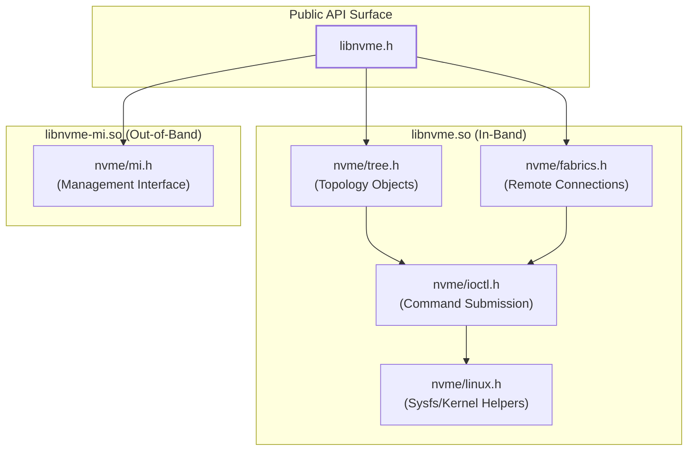
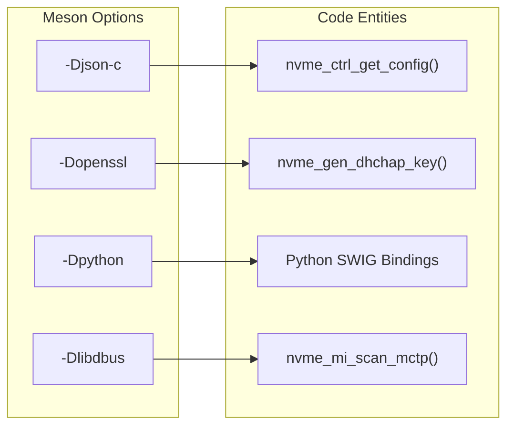

<!-- source: DeepWiki mcp.deepwiki.com · repo NVIDIA/libnvme · page 1 libnvme Overview · fetched 2026-10-26 -->

# libnvme Overview

Relevant source files

The following files were used as context for generating this wiki page:

- [COPYING](COPYING)
- [README.md](README.md)
- [meson_options.txt](meson_options.txt)
- [src/libnvme.h](src/libnvme.h)
- [src/libnvme.map](src/libnvme.map)

`libnvme` is the standard development C library for NVM Express (NVMe) on Linux. It provides the essential building blocks for interacting with NVMe devices, ranging from low-level command submission to high-level system topology discovery and out-of-band management.

The library serves as a user-space abstraction for the NVMe specification, providing type definitions for structures, enumerations, and bitfields [README.md:11-15](). It enables developers to construct, dispatch, and decode NVMe commands while managing local and remote NVMe resources.

### Key Capabilities

*   **Command Submission**: Helper functions for Admin and I/O command dispatch via Linux ioctl or io_uring [README.md:13-14]().
*   **Topology Management**: A hierarchical object model to scan and represent NVMe hosts, controllers, and namespaces [src/libnvme.h:23]().
*   **NVMe-over-Fabrics (NVMe-oF)**: Utilities for connecting to remote targets over TCP, RDMA, and Fibre Channel [src/libnvme.h:21]().
*   **Management Interface (NVMe-MI)**: Support for out-of-band management via MCTP [meson_options.txt:15]().
*   **NBFT Parsing**: Support for the NVMe Boot Firmware Table to handle boot-stage configuration [src/libnvme.h:20]().

---

### Library Architecture

`libnvme` is organized into two primary shared libraries, each targeting a specific communication domain.

| Library | Primary Purpose | Key Headers |
| :--- | :--- | :--- |
| `libnvme.so` | In-band NVMe communication, Fabrics, and Topology. | `nvme/ioctl.h`, `nvme/tree.h`, `nvme/fabrics.h` |
| `libnvme-mi.so` | Out-of-band Management Interface (NVMe-MI). | `nvme/mi.h` |

The architecture follows a layered design where high-level topology objects (e.g., `nvme_ctrl_t`) utilize lower-level ioctl wrappers (e.g., `nvme_admin_passthru`) to communicate with the kernel [src/libnvme.map:65-72]().

#### Conceptual Architecture Diagram
This diagram bridges the functional components of the library to the specific header files and symbols defined in the codebase.

**Sources:** [src/libnvme.h:17-26](), [src/libnvme.map:1-100]()

For a deep dive into the library layers and symbol versioning, see [Library Architecture and Public API Surface](#1.2).

---

### Building and Dependencies

`libnvme` uses the Meson build system [README.md:51](). While the core library has minimal requirements (GCC, Ninja, Meson), several advanced features depend on external libraries.

*   **JSON Support**: Required for `/etc/nvme/config.json` parsing via `json-c` [README.md:59-60]().
*   **Security**: `openssl` and `keyutils` are required for TLS and DH-HMAC-CHAP authentication [README.md:62-64]().
*   **MI Discovery**: `libdbus` and `libmctp` are used for endpoint discovery in the NVMe-MI stack [README.md:66-67](), [meson_options.txt:15]().

#### Build Flow Diagram
This diagram maps the build options to the resulting library capabilities.

**Sources:** [meson_options.txt:10-15](), [README.md:140-152]()

For step-by-step instructions on compilation and environment setup, see [Getting Started: Build, Install, and Configuration](#1.1).

---

### Documentation Roadmap

This wiki is structured to guide you from initial setup to advanced development:

*   **[Getting Started: Build, Install, and Configuration](#1.1)**: Covers the build pipeline, optional dependencies, and cross-compilation for embedded systems.
*   **[Library Architecture and Public API Surface](#1.2)**: Explains the relationship between `libnvme` and `libnvme-mi`, header organization, and the versioned export maps.
*   **Core NVMe Command Interface**: Detailed look at submitting commands via ioctl and io_uring.
*   **NVMe Topology Tree**: How the library models the system's NVMe hierarchy and scans sysfs.
*   **NVMe-over-Fabrics (NVMe-oF)**: Management of remote controller connections and discovery services.
*   **NVMe Management Interface (NVMe-MI)**: Out-of-band management over MCTP and Admin command tunneling.
*   **Python Bindings**: Using the SWIG-generated interface for rapid scripting and automation.

---

