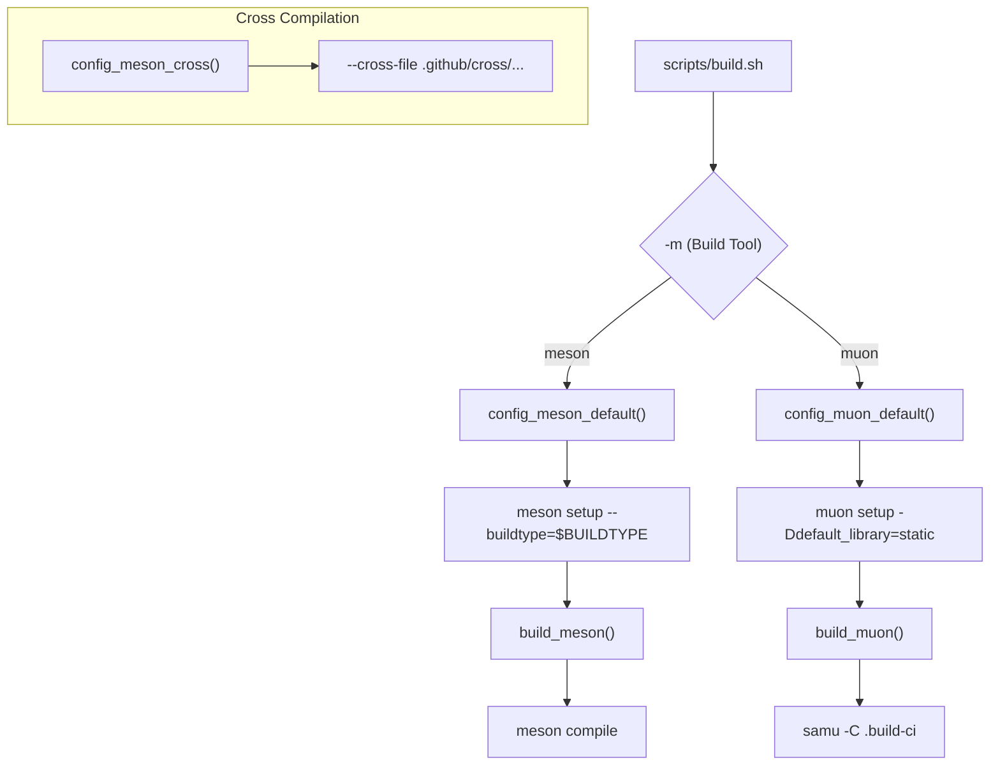
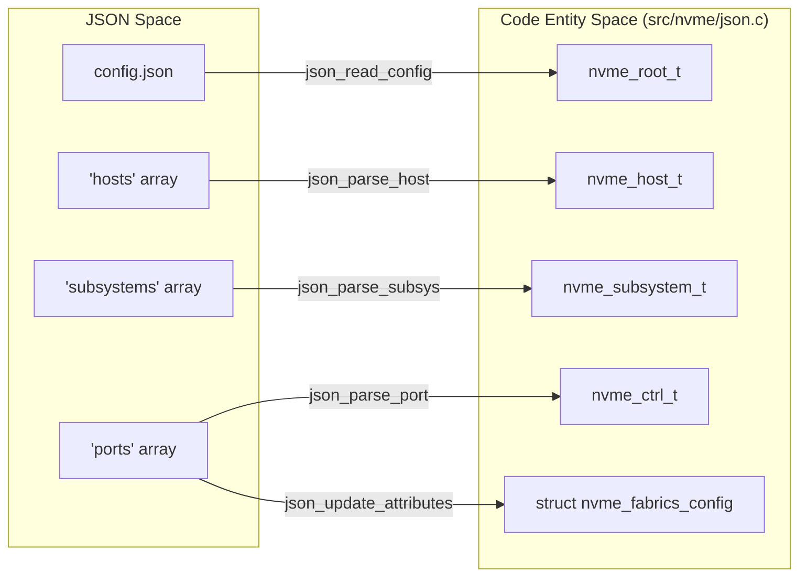

<!-- source: DeepWiki mcp.deepwiki.com · repo NVIDIA/libnvme · page 1.1 Getting Started: Build, Install, and Configuration · fetched 2026-10-26 -->

# Getting Started: Build, Install, and Configuration

Relevant source files

The following files were used as context for generating this wiki page:

- [.github/cross/ubuntu-cross-armhf.txt](.github/cross/ubuntu-cross-armhf.txt)
- [.github/cross/ubuntu-cross-ppc64le.txt](.github/cross/ubuntu-cross-ppc64le.txt)
- [.github/cross/ubuntu-cross-s390x.txt](.github/cross/ubuntu-cross-s390x.txt)
- [.github/workflows/build.yml](.github/workflows/build.yml)
- [.readthedocs.yaml](.readthedocs.yaml)
- [README.md](README.md)
- [ccan/meson.build](ccan/meson.build)
- [doc/config-schema.json](doc/config-schema.json)
- [doc/rst/fabrics.rst](doc/rst/fabrics.rst)
- [internal/meson.build](internal/meson.build)
- [meson.build](meson.build)
- [meson_options.txt](meson_options.txt)
- [scripts/build.sh](scripts/build.sh)
- [src/meson.build](src/meson.build)
- [src/nvme/json.c](src/nvme/json.c)
- [subprojects/dbus.wrap](subprojects/dbus.wrap)
- [subprojects/json-c.wrap](subprojects/json-c.wrap)
- [subprojects/openssl.wrap](subprojects/openssl.wrap)

This page provides a technical guide for building `libnvme` from source, managing its optional dependencies, and understanding the system configuration via JSON. `libnvme` uses the Meson build system to manage a complex dependency graph and provide cross-compilation support for various architectures.

## Build System Overview

`libnvme` utilizes **Meson** (version >= 0.50.0) as its primary build generator and **Ninja** as the backend executor [meson.build:8-11](). The build process is designed to be out-of-tree, ensuring that source directories remain clean of build artifacts [README.md:98-101]().

### Core Build Workflow

The standard compilation sequence involves three main stages: setup, compile, and install.

| Step | Command | Description |
|:---|:---|:---|
| **Setup** | `meson setup .build` | Generates the build directory and probes dependencies [README.md:89](). |
| **Compile** | `meson compile -C .build` | Executes the compiler (gcc/clang) and links the binaries [README.md:109](). |
| **Install** | `meson install -C .build` | Installs headers and `.so` files to the system [README.md:117](). |

### Build Artifacts
The build produces two primary shared libraries:
1.  `libnvme.so`: The core library for NVMe command submission and topology [src/meson.build:49-51]().
2.  `libnvme-mi.so`: The Management Interface library for out-of-band management [src/meson.build:78-80]().

**Sources:** [meson.build:8-21](), [src/meson.build:49-80](), [README.md:88-119]()

---

## Optional Dependencies and Features

`libnvme` is modular; many features are only enabled if the corresponding development libraries are found during the `meson setup` phase.

| Feature | Dependency | Build Option | Impact if Missing |
|:---|:---|:---|:---|
| **JSON Config** | `json-c` (>=0.13) | `-Djson-c` | Cannot parse `/etc/nvme/config.json` [meson.build:58-66](). |
| **Auth/TLS** | `openssl` (>=1.1.0) | `-Dopenssl` | No DH-HMAC-CHAP or TLS PSK support [meson.build:68-103](). |
| **Keyring** | `libkeyutils` | `-Dkeyutils` | Cannot store/retrieve keys from Linux keyring [meson.build:105-112](). |
| **MCTP Scan** | `dbus-1` | `-Dlibdbus` | No D-Bus based MCTP endpoint discovery [meson.build:114-132](). |
| **MI Transport** | `libmctp` | `-Dlibmctp` | Disables MCTP transport for MI commands [meson_options.txt:15](). |

### Dependency Resolution Logic
Meson uses `dependency()` calls with fallback mechanisms. If a library is not found on the system, Meson can use `.wrap` files in the `subprojects/` directory to download and build the dependency from source [meson.build:64,74]().

**Sources:** [meson.build:58-132](), [meson_options.txt:10-15](), [subprojects/json-c.wrap:1-13](), [subprojects/openssl.wrap:1-16]()

---

## Cross-Compilation and Embedded Builds

For environments where Python/Meson cannot run (e.g., small embedded targets), `libnvme` supports **muon** (a C99 implementation of Meson) and **samurai** (a C implementation of Ninja) [README.md:73-82]().

### Cross-Compilation Strategy
The project provides cross-files for `armhf`, `s390x`, and `ppc64le` [scripts/build.sh:14]().

**Entity Mapping: Build Script Logic**
The `scripts/build.sh` utility automates different build configurations used in CI.

**Sources:** [scripts/build.sh:1-183](), [.github/workflows/build.yml:37-77](), [README.md:73-82]()

---

## Configuration: config.json

`libnvme` supports a persistent configuration file, typically located at `/etc/nvme/config.json` [meson.build:53](). This file allows users to define hosts, subsystems, and specific controller connection parameters.

### Data Flow: JSON Parsing to Topology Objects
The parsing logic in `src/nvme/json.c` maps JSON keys to the internal C structures used by the fabrics layer.

### Key Configuration Parameters
The JSON schema defines how the `nvme_fabrics_config` structure is populated [doc/rst/fabrics.rst:18-37]().

| JSON Key | C Struct Member | Description |
|:---|:---|:---|
| `nr_io_queues` | `cfg->nr_io_queues` | Number of I/O queues to establish [src/nvme/json.c:33-34](). |
| `keep_alive_tmo`| `cfg->keep_alive_tmo` | Keep-alive timeout in seconds [src/nvme/json.c:41-42](). |
| `tls` | `cfg->tls` | Enable TLS encryption (TCP) [src/nvme/json.c:60-61](). |
| `dhchap_key` | `nvme_ctrl_set_dhchap_host_key` | Host DH-HMAC-CHAP key [src/nvme/json.c:121-122](). |
| `keyring` | `cfg->keyring` | Name of the keyring to use [src/nvme/json.c:72-80](). |

### Implementation Detail: The Lookup-or-Create Pattern
When `json_read_config` is called, it does not just create a flat list. It uses `nvme_lookup_host`, `nvme_lookup_subsystem`, and `nvme_lookup_ctrl` to find existing objects in the `nvme_root_t` tree or create them if they are missing [src/nvme/json.c:139, 172, 115](). This ensures that the configuration is merged into the current topology state.

**Sources:** [src/nvme/json.c:27-190](), [doc/config-schema.json:1-176](), [doc/rst/fabrics.rst:10-94]()

---

