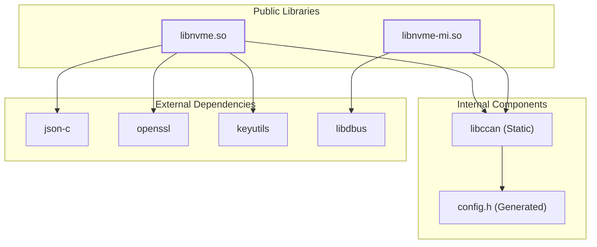
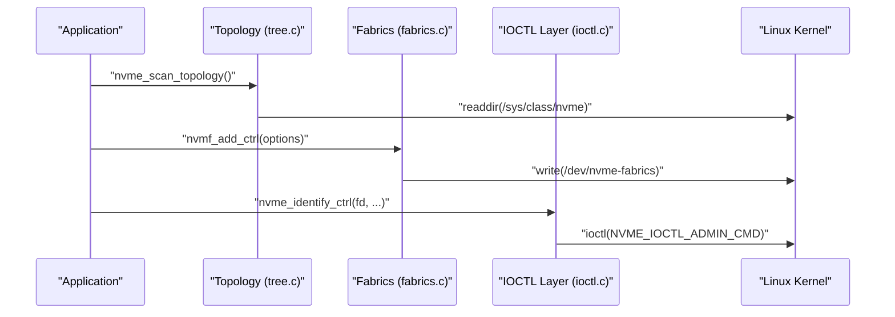

<!-- source: DeepWiki mcp.deepwiki.com · repo NVIDIA/libnvme · page 1.2 Library Architecture and Public API Surface · fetched 2026-10-26 -->

# Library Architecture and Public API Surface

<details>
<summary>Relevant source files</summary>

The following files were used as context for generating this wiki page:

- [ccan/meson.build](ccan/meson.build)
- [internal/meson.build](internal/meson.build)
- [meson.build](meson.build)
- [src/libnvme.h](src/libnvme.h)
- [src/libnvme.map](src/libnvme.map)
- [src/meson.build](src/meson.build)
- [src/nvme/private.h](src/nvme/private.h)

</details>


This page provides a technical overview of the `libnvme` architecture, detailing the division between its two primary shared libraries, the versioned symbol management, and the internal layered design that facilitates NVMe command submission and topology management.

## Dual-Library Architecture

The `libnvme` project produces two distinct shared libraries, each serving a specific management domain. Both libraries link against a common internal static utility library, `libccan` [src/meson.build:58-87](), to provide robust data structures like circular doubly-linked lists [ccan/meson.build:9-13]().

| Library | Binary Name | Primary Responsibility | Key Dependencies |
|:---|:---|:---|:---|
| **Core Library** | `libnvme.so` | Local device access (ioctl), topology scanning, Fabrics (TCP/RDMA/FC), and NBFT parsing. | `json-c`, `openssl`, `keyutils` [src/meson.build:33-37]() |
| **Management Interface** | `libnvme-mi.so` | Out-of-band management via NVMe-MI (Management Interface) over MCTP. | `libdbus` [src/meson.build:39-41]() |

### Symbol Versioning and API Stability
Both libraries use linker version scripts (`.map` files) to manage symbol visibility and ensure ABI stability [src/meson.build:53-82]().
- **libnvme.map**: Defines version nodes such as `LIBNVME_1_0` through `LIBNVME_1_6`, categorizing functions by the release they were introduced [src/libnvme.map:2-100]().
- **Internal Symbols**: Symbols not explicitly exported in the map files remain private to the library, preventing accidental ABI breakages.

### Library Dependency Graph
The following diagram illustrates the relationship between the public libraries and their internal/external dependencies.

**Library Dependency and Build Flow**

Sources: [src/meson.build:49-117](), [ccan/meson.build:20-26](), [internal/meson.build:12-21]()

---

## Internal Layered Design

The core library (`libnvme.so`) is organized into functional layers that abstract the complexity of NVMe communication from the user.

### 1. The Command Layer (ioctl)
At the lowest level, `nvme/ioctl.c` handles the construction and submission of `passthru` commands to the Linux kernel [src/meson.build:13](). It provides functions like `nvme_admin_passthru` and `nvme_io_passthru` [src/libnvme.map:65-242]().

### 2. The Topology Tree Layer
This layer maintains an in-memory representation of the NVMe hierarchy. It uses `ccan/list` to link objects together [src/nvme/private.h:12-112]().
- **`nvme_root_t`**: The base container [src/nvme/private.h:158]().
- **`nvme_host_t`**: Represents a local or remote host [src/nvme/private.h:112]().
- **`nvme_subsystem_t`**: Represents an NVMe subsystem [src/nvme/private.h:95]().
- **`nvme_ctrl_t`**: Represents an individual controller [src/nvme/private.h:62]().
- **`nvme_ns_t`**: Represents a namespace [src/nvme/private.h:37]().

### 3. The Fabrics Layer
The `nvme/fabrics.c` module extends the topology to remote targets, handling the `/dev/nvme-fabrics` interface for connecting and disconnecting controllers [src/meson.build:11]().

**Command Submission Data Flow**

Sources: [src/meson.build:8-18](), [src/nvme/private.h:24-110](), [src/libnvme.map:65-101]()

---

## Public API Surface and Header Organization

The public API is accessible through a flat include structure. While `libnvme.h` and `libnvme-mi.h` are the primary entry points, they include specific sub-headers for granular access.

### Header Map
| Header | Contents |
|:---|:---|
| `nvme/types.h` | NVMe specification structures (Identify, Log Pages) [src/meson.build:131](). |
| `nvme/ioctl.h` | Low-level command submission functions [src/meson.build:126](). |
| `nvme/tree.h` | Topology object accessors and iterators [src/meson.build:130](). |
| `nvme/fabrics.h` | Fabrics connection management and options [src/meson.build:124](). |
| `nvme/mi.h` | Management Interface endpoint and controller APIs [src/meson.build:133](). |
| `nvme/nbft.h` | NVMe Boot Firmware Table parser [src/meson.build:129](). |

### Object Association Diagram
This diagram bridges the conceptual "Tree" with the actual C structures defined in `src/nvme/private.h`.

**Code Entity Mapping: Topology Tree**
```mermaid
classDiagram
    class "nvme_root" {
        +char* config_file
        +struct list_head hosts
        +struct list_head endpoints
    }
    class "nvme_host" {
        +char* hostnqn
        +char* hostid
        +struct list_head subsystems
    }
    class "nvme_subsystem" {
        +char* subsysnqn
        +struct list_head ctrls
        +struct list_head namespaces
    }
    class "nvme_ctrl" {
        +int fd
        +char* transport
        +char* traddr
    }
    class "nvme_ns" {
        +uint32_t nsid
        +struct list_head paths
    }

    "nvme_root" *-- "nvme_host" : "hosts"
    "nvme_host" *-- "nvme_subsystem" : "subsystems"
    "nvme_subsystem" *-- "nvme_ctrl" : "ctrls"
    "nvme_subsystem" *-- "nvme_ns" : "namespaces"
```
Sources: [src/nvme/private.h:37-170]()

---

## Build System Integration

The library uses the Meson build system to manage optional features. If certain dependencies are missing, the library provides fallback behaviors. For example, if `json-c` is unavailable, `src/nvme/no-json.c` is compiled instead of `src/nvme/json.c`, providing stub implementations for configuration parsing [src/meson.build:27-31]().

**Key Build Options and Impacts:**
- `json-c`: Enables JSON configuration persistence [meson.build:58-66]().
- `openssl`: Enables DH-HMAC-CHAP and TLS key derivation [meson.build:68-103]().
- `libmctp`: Enables the MCTP transport for NVMe-MI [meson.build:55]().

Sources: [meson.build:1-220](), [src/meson.build:1-138]()

---

