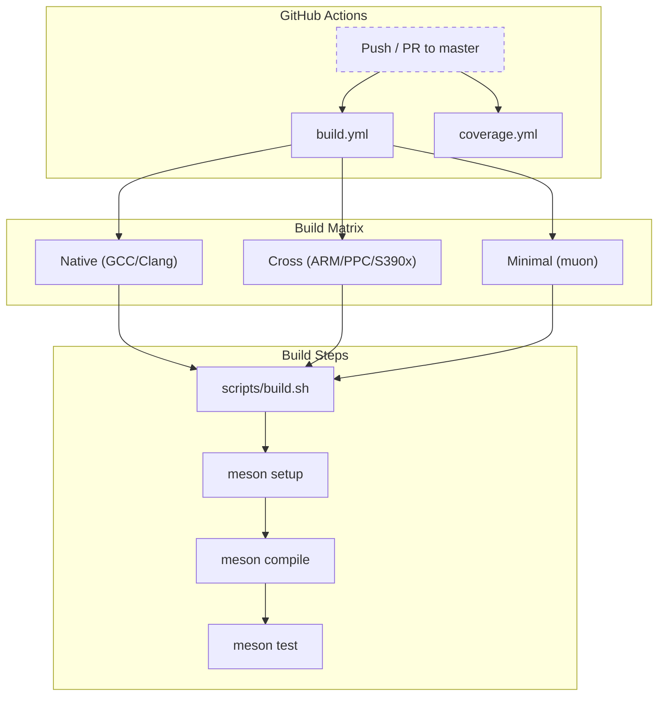
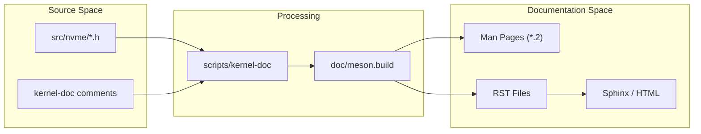

<!-- source: DeepWiki mcp.deepwiki.com · repo NVIDIA/libnvme · page 10 CI/CD, Documentation, and Release Process · fetched 2026-10-26 -->

# CI/CD, Documentation, and Release Process

Relevant source files

The following files were used as context for generating this wiki page:

- [.github/cross/ubuntu-cross-armhf.txt](.github/cross/ubuntu-cross-armhf.txt)
- [.github/cross/ubuntu-cross-ppc64le.txt](.github/cross/ubuntu-cross-ppc64le.txt)
- [.github/cross/ubuntu-cross-s390x.txt](.github/cross/ubuntu-cross-s390x.txt)
- [.github/workflows/build.yml](.github/workflows/build.yml)
- [.github/workflows/coverage.yml](.github/workflows/coverage.yml)
- [.github/workflows/release-python.yml](.github/workflows/release-python.yml)
- [.github/workflows/release.yml](.github/workflows/release.yml)
- [doc/api.rst.in](doc/api.rst.in)
- [doc/installation.rst.in](doc/installation.rst.in)
- [doc/meson.build](doc/meson.build)
- [doc/quickstart.rst.in](doc/quickstart.rst.in)
- [doc/rst/meson.build](doc/rst/meson.build)
- [scripts/build.sh](scripts/build.sh)
- [scripts/kernel-doc](scripts/kernel-doc)
- [scripts/kernel-doc-check](scripts/kernel-doc-check)
- [scripts/list-man-pages.sh](scripts/list-man-pages.sh)
- [scripts/list-pre-compiled.sh](scripts/list-pre-compiled.sh)
- [scripts/meson-vcs-tag.sh](scripts/meson-vcs-tag.sh)
- [scripts/release.sh](scripts/release.sh)
- [scripts/update-docs.sh](scripts/update-docs.sh)

This page provides a high-level overview of the automation infrastructure supporting `libnvme`. It covers the continuous integration pipelines used to validate code across multiple architectures, the documentation engine that extracts API references from source comments, and the standardized release workflow for both the C library and Python bindings.

## CI/CD Workflows and Build Scripts

The project utilizes GitHub Actions to maintain high code quality and cross-platform compatibility. The primary validation engine is the `build` workflow [ .github/workflows/build.yml:2-12](), which executes a matrix of builds covering different compilers (`gcc`, `clang`) and build types (`debug`, `release`) [ .github/workflows/build.yml:15-18]().

Key components of the CI infrastructure include:
*   **Multi-Architecture Support**: Cross-compilation jobs for `armhf`, `s390x`, and `ppc64le` using QEMU and dedicated Meson cross-files [ .github/workflows/build.yml:37-53]().
*   **Build Abstraction**: The `scripts/build.sh` helper script centralizes build logic, supporting both `meson` and the minimal `muon` build tool [ scripts/build.sh:3-25]().
*   **Dependency Testing**: Specific jobs validate builds with optional features like `libdbus` and "fallback" modes where dependencies are downloaded and built as shared libraries [ scripts/build.sh:68-86]().

For details, see [CI/CD Workflows and Build Scripts](#10.1).

### Build Pipeline Architecture

The following diagram illustrates how the CI environment orchestrates different build configurations:

**CI Build Pipeline Overview**

Sources: [ .github/workflows/build.yml:2-10](), [ scripts/build.sh:180-182]()

## Documentation Generation

`libnvme` documentation is strictly derived from the source code to ensure accuracy. The process uses the `kernel-doc` script [ doc/meson.build:52]() to parse comments in public header files and generate structured output.

*   **API Reference**: Documentation is generated for core modules including `fabrics.h`, `ioctl.h`, `tree.h`, and `mi.h` [ doc/meson.build:11-22]().
*   **Multi-Format Output**: The system produces both UNIX Man pages (section 2) and ReStructuredText (RST) files for Sphinx [ doc/meson.build:59-105]().
*   **Validation**: The `kernel-doc-check` script is integrated into the Meson test suite to catch undocumented parameters or syntax errors during the build [ doc/meson.build:53-55]().

For details, see [Documentation Generation](#10.2).

### Code to Documentation Mapping

This diagram shows how source code entities are transformed into user-facing documentation:

**Documentation Flow**

Sources: [ doc/meson.build:11-22](), [ doc/meson.build:72-77](), [ doc/rst/meson.build:21-31]()

## Release Process

The release process is semi-automated to ensure version consistency across the C library, Python bindings, and documentation.

*   **Release Script**: `scripts/release.sh` automates version bumping in `meson.build`, regenerates documentation, and handles git tagging [ scripts/release.sh:101-125]().
*   **GitHub Releases**: The `release.yml` workflow automatically creates a GitHub Release when a version tag (e.g., `v1.5`) is pushed [ .github/workflows/release.yml:4-13]().
*   **Python Distribution**: A dedicated `release-python.yml` workflow builds source distributions and publishes them to PyPI and TestPyPI [ .github/workflows/release-python.yml:15-72]().

### Release Workflow Summary

| Task | Component | Implementation |
| :--- | :--- | :--- |
| **Version Bump** | `meson.build` | `scripts/release.sh` [ scripts/release.sh:102]() |
| **Doc Update** | `doc/man`, `doc/rst` | `scripts/update-docs.sh` [ scripts/update-docs.sh:11-39]() |
| **Tagging** | Git Tags | `scripts/release.sh` [ scripts/release.sh:125]() |
| **C Artifacts** | GitHub Release | `.github/workflows/release.yml` [ .github/workflows/release.yml:18-21]() |
| **Python Pkg** | PyPI | `.github/workflows/release-python.yml` [ .github/workflows/release-python.yml:66-72]() |

Sources: [ scripts/release.sh:3-17](), [ .github/workflows/release-python.yml:1-13](), [ .github/workflows/release.yml:1-9]()

---

