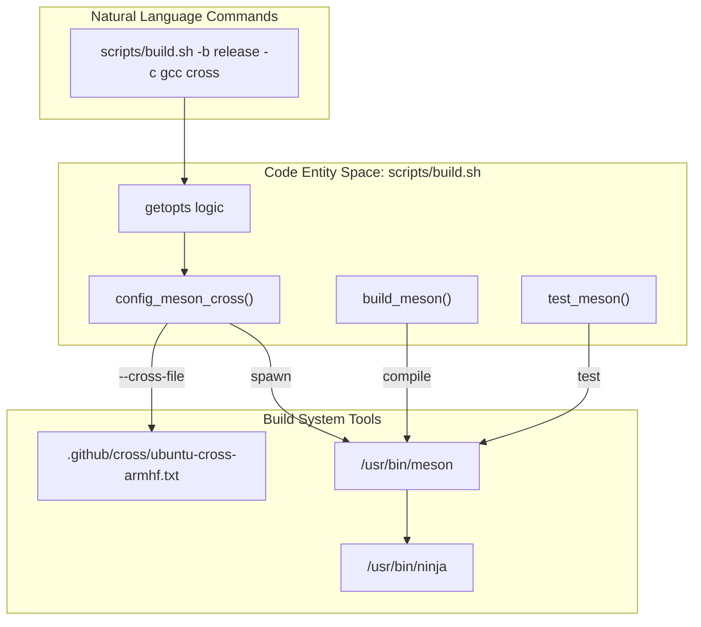
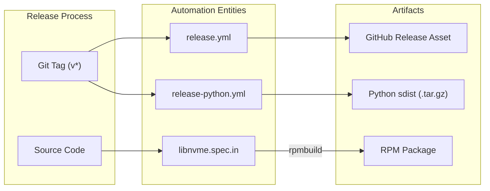

<!-- source: DeepWiki mcp.deepwiki.com · repo NVIDIA/libnvme · page 10.1 CI/CD Workflows and Build Scripts · fetched 2026-10-26 -->

# CI/CD Workflows and Build Scripts

Relevant source files

The following files were used as context for generating this wiki page:

- [.github/cross/ubuntu-cross-armhf.txt](.github/cross/ubuntu-cross-armhf.txt)
- [.github/cross/ubuntu-cross-ppc64le.txt](.github/cross/ubuntu-cross-ppc64le.txt)
- [.github/cross/ubuntu-cross-s390x.txt](.github/cross/ubuntu-cross-s390x.txt)
- [.github/workflows/build.yml](.github/workflows/build.yml)
- [.github/workflows/coverage.yml](.github/workflows/coverage.yml)
- [.github/workflows/release-python.yml](.github/workflows/release-python.yml)
- [.github/workflows/release.yml](.github/workflows/release.yml)
- [.gitignore](.gitignore)
- [Makefile](Makefile)
- [libnvme.spec.in](libnvme.spec.in)
- [scripts/build.sh](scripts/build.sh)

The `libnvme` project utilizes a robust automation infrastructure to ensure cross-platform compatibility, code quality, and seamless release management. The CI/CD pipeline is built primarily on GitHub Actions, leveraging a specialized helper script for complex build configurations and supporting multiple architectures and build tools.

## GitHub Actions Build Matrix

The primary build workflow executes a multi-dimensional matrix to validate the codebase against different compilers and build types. This ensures that `libnvme` remains compatible with both `gcc` and `clang` while maintaining stability in both `debug` and `release` configurations.

### Build Configurations
*   **Default Matrix**: Runs on `ubuntu-latest` using a custom Debian-based container (`ghcr.io/igaw/linux-nvme/debian:0.30`) [.github/workflows/build.yml:13-20](). It tests the combinations of `[gcc, clang]` and `[debug, release]` [.github/workflows/build.yml:16-18]().
*   **Libdbus Build**: A specific job dedicated to validating the library with `libdbus` support enabled [.github/workflows/build.yml:78-90]().
*   **Fallback Build**: Validates the "force fallback" mode where all dependencies are downloaded and built as shared libraries rather than using system-provided ones [.github/workflows/build.yml:99-112]().
*   **Muon Build**: A minimal static build using `muon` (a C-based implementation of Meson) to ensure compatibility with alternative build tools [.github/workflows/build.yml:120-129]().

### Cross-Compilation Matrix
The CI environment supports cross-compilation for several non-x86 architectures using `qemu-user-static` and architecture-specific toolchains [.github/workflows/build.yml:37-53]().

| Architecture | Port Name | Compiler |
| :--- | :--- | :--- |
| `armhf` | `armhf` | `gcc-arm-linux-gnueabihf` |
| `s390x` | `s390x` | `gcc-s390x-linux-gnu` |
| `ppc64le` | `ppc64el` | `gcc-powerpc64le-linux-gnu` |

**Sources:** [.github/workflows/build.yml:13-129](), [.github/cross/ubuntu-cross-armhf.txt:1-19]()

## Build Helper Script (scripts/build.sh)

The `scripts/build.sh` script acts as the central orchestration point for CI tasks. It abstracts the complexity of configuring Meson or Muon with various flags.

### Logic Flow and Configuration Mapping
The script maps high-level configuration names (e.g., `fallback`, `cross`) to specific Meson setup commands.

| Function | Meson Flags / Behavior |
| :--- | :--- |
| `config_meson_default` | Standard build with `--werror` and specified `--buildtype` [.scripts/build.sh:61-66](). |
| `config_meson_libdbus` | Enables `-Dlibdbus=enabled` [.scripts/build.sh:68-75](). |
| `config_meson_fallback` | Uses `--wrap-mode=forcefallback` and enables `libdbus` [.scripts/build.sh:77-86](). |
| `config_meson_cross` | Disables `python` and `openssl`; uses a specific `--cross-file` [.scripts/build.sh:88-96](). |
| `config_muon_default` | Performs a static build with all optional dependencies disabled [.scripts/build.sh:144-154](). |

### Build Tool Bootstrapping
For the `muon` build type, the script includes logic to clone and build `samurai` (a ninja replacement) and `muon` itself from source before proceeding with the `libnvme` build [.scripts/build.sh:108-142]().

### CI Build Orchestration Diagram
This diagram illustrates how the `build.sh` script interacts with the underlying build entities.

**Sources:** [scripts/build.sh:1-183](), [.github/workflows/build.yml:28,69,90,112]()

## Coverage and Release Workflows

### Code Coverage
The `coverage.yml` workflow runs on every push to the `master` branch. It uses `lcov` and the Meson `b_coverage` option to generate reports [.github/workflows/coverage.yml:25-30]().
*   **Execution**: It manually triggers `ninja -C build coverage` because of specific Meson/Ninja interaction requirements [.github/workflows/coverage.yml:35]().
*   **Reporting**: Results are uploaded to Codecov [.github/workflows/coverage.yml:36-39]().

### Release Management
The project automates both GitHub releases and Python package distribution.

1.  **GitHub Release**: Triggered by tags matching `v*`. It uses `ncipollo/release-action` to create a formal release on GitHub [.github/workflows/release.yml:1-21]().
2.  **Python Release**:
    *   **Build**: Generates a source distribution (`sdist`) using `pipx run build` [.github/workflows/release-python.yml:25]().
    *   **TestPyPI**: Automatically uploads tagged versions to TestPyPI for verification [.github/workflows/release-python.yml:32-47]().
    *   **PyPI**: Uploads to the production PyPI repository after verifying the tag format (e.g., `v1.0` or `v1.0-rc1`) [.github/workflows/release-python.yml:49-72]().

### Packaging Logic
The project maintains a `libnvme.spec.in` file for RPM-based distributions. The `Makefile` provides a `rpm` target that archives the source and builds the RPM package using `rpmbuild` [Makefile:45-51]().

**Sources:** [.github/workflows/coverage.yml:1-39](), [.github/workflows/release.yml:1-21](), [.github/workflows/release-python.yml:1-72](), [Makefile:45-51](), [libnvme.spec.in:1-46]()

---

